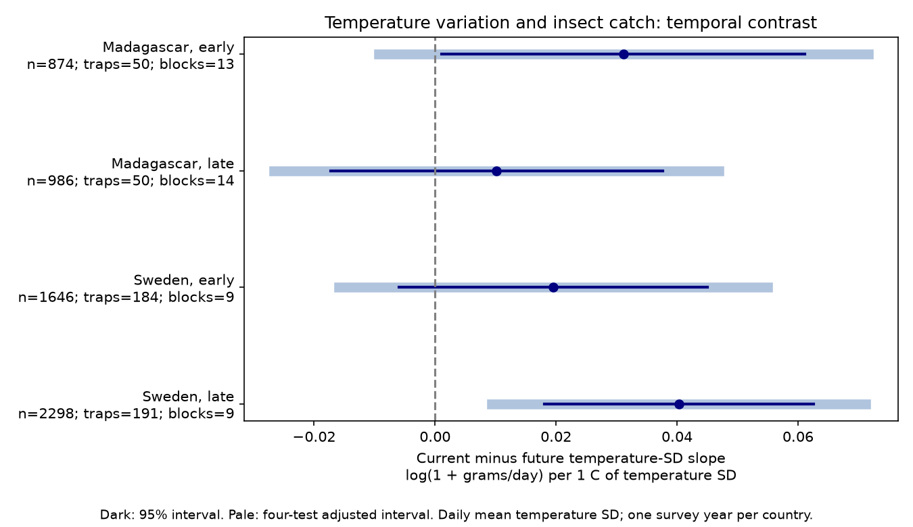

# Temperature variation gave a positive current-minus-future catch contrast in later Sweden and uncertain contrasts in three other samples in 2019-2020

## Question and result

Does variation among daily mean temperatures have a link to flying insect catch beyond mean warmth and rainfall? We test whether its slope during collection differs from its slope in a future window of equal length. A collection-window difference could be consistent with a short response of flight activity or capture. It cannot identify that cause.

We tested whether variation among daily mean temperatures had a different link to insect catch during collection than just after collection. Four country and period models used 5,804 measured catches in Sweden and Madagascar in 2019-2020. Models controlled mean temperature, precipitation, wet-day fraction, earlier weather, trap, season and collection duration. All four contrast estimates were positive. Only later Sweden had an adjusted 95 percent interval above zero: 0.0403 [0.0093, 0.0712] log(1 + grams/day) per C of temperature SD. That interval stayed above zero in six planned checks. The other three adjusted intervals included zero. The results do not establish a shared collection-window response. They cannot show that temperature variation has no effect. Each country has one survey year. Period splits are separate seasons at repeated traps. Catch combines insect abundance, flight activity and capture conditions. Coarse weather, selected measured samples, few time blocks and remaining seasonal bias limit inference. The package provides code, source hashes, aggregate results and a figure. Raw and record-level data remain outside the package.

| Country | Survey period | Catches | Traps | Time blocks | Contrast | 95% interval | Four-test interval |
|---|---|---:|---:|---:|---:|---|---|
| Madagascar | early | 874 | 50 | 13 | +0.0311 | +0.0011 to +0.0612 | -0.0094 to +0.0716 |
| Madagascar | late | 986 | 50 | 14 | +0.0102 | -0.0173 to +0.0376 | -0.0266 to +0.0469 |
| Sweden | early | 1646 | 184 | 9 | +0.0196 | -0.0059 to +0.0451 | -0.0159 to +0.0550 |
| Sweden | late | 2298 | 191 | 9 | +0.0403 | +0.0180 to +0.0625 | +0.0093 to +0.0712 |

Later Sweden retained a positive adjusted interval in all six planned sensitivity checks. A clear result in one sample and an uncertain result in another do not establish that their slopes differ. We did not fit a formal country or period difference test.

The slope unit is log(1 + grams per trap-day) per 1 C increase in temperature standard deviation (SD). This is a conditional model scale, not a percent change in insect populations. Component slopes and errors are in files/estimates.csv. A zero difference can occur when both component slopes are nonzero.

## Prior work and scope

Van Dijk and colleagues studied insect biomass and weather seasonality in the same networks (2024; DOI 10.1098/rspb.2024.0090). That study motivates controls for season and collection effort. Paaijmans and colleagues showed that temperature fluctuations can change insect performance through nonlinear thermal responses (2013; DOI 10.1111/gcb.12240). Their experiments concern variation within a day. Our daily means cannot test that mechanism directly. We test variation between days, with no heat-wave or biological stress threshold.

Campaign results 5ab3e80992669e503a2565d756d4b7187a103595bc89e218cb049404a9c5a029, de0d1327f4f65caeaab7db216f39f975581a68f6e006d19fda92c0c930e1dcc0, b43cc7bf646def06a3dac7a1defdf1b14099ff4ed23cea1840d105002616ff39 and 47e56e2a6584bf0e5671a2b89b8fee52f31ea2f6e83a118676b97d8df7b662d9 tested other weather metrics in these data. We read the last publication and adapted its MIT code for this new metric. The records overlap; this is not independent validation of those studies. Searches for “phenology climate pollution”, “cherry”, “Madagascar Sweden” and “insect temperature variability” preceded fits. The last search found no study of this contrast. Files/plan.md records the local analysis plan before fits; it is not a public registration.

## Data and selection

We reused six CSV files and read README.xlsx from Zenodo 11205860, v1, 16 May 2024, a mirror of Dryad DOI 10.5061/dryad.ghx3ffbtk. Files/provenance.json records exact shared and resolved paths, source URLs, bytes and SHA-256 hashes for all seven files. All source MD5 values matched the live Zenodo API. Its declared license was CC0. The shared datasets are reached through datasets/ on the HP-backed compatibility paths. No download or edit to shared data was needed.

Sweden was sampled in 2019; Madagascar was sampled from August 2019 to July 2020. Sweden had 195 source traps; Madagascar had 50. Source selection was designed by habitat and does not give a random national sample. About 75 percent of Malagasy samples were processed. Swedish collection intervals vary with season. The early period has midpoint days at most 183 from the country survey origin; the late period has larger days. These are disjoint time samples at repeated traps, not independent multi-year replications or equal calendar seasons across countries.

We exclude samples with missing sample IDs. In Sweden those IDs mark zeros inferred from snow depth, not measured catches. We also exclude invalid or negative masses, durations outside 3-21 days, missing trap weather and incomplete past, current or future weather windows. Files/selection.json gives counts by reason. We keep measured zero masses. Each catch has equal weight. Files/support.csv gives duration and temperature-SD support. Weather availability at survey edges selects the retained sample. Capture conditions and missing measured catches remain possible sources of bias.

## Method and assumptions

The response is log(1 + measured grams / collection duration in days). Trap intercepts control stable location and habitat differences. Duration in the response and log duration as a control address part of collection effort. These adjustments cannot turn a trap catch into a population census.

Collection start is twice the midpoint minus the collection day. In Madagascar this equals the explicit placement day. A current weather window excludes placement day and includes collection day. Past and future windows have the same integer day length and touch current-window boundaries without overlap. Measured fractional duration determines catch rate; integer dates determine weather windows. Partial-day exposure error remains.

For each window we calculate the population SD (divisor n) of daily mean temperature in C. This measures variation between daily means; it does not measure temperature range within a day or extreme heat. We calculate mean daily precipitation in mm and wet-day fraction using precipitation greater than 1 mm. Precipitation can include snow. No minimum precipitation total is required.

Each country-period OLS model includes trap intercepts, 14-day midpoint-block intercepts, log duration, and latitude times annual and half-year sine and cosine terms. Each of the three windows contributes mean temperature, its centered square, mean precipitation, its square, wet-day fraction and temperature SD. Temperature means are centered and divided by 5 C; precipitation is divided by 5 mm; wet-day fractions are divided by 0.25. SD is unscaled. The internal name Wet in the adapted code refers to the SD coefficient, not rain. There is no interaction term. This is a conditional additive model; the mean-temperature square is not a full thermal performance curve.

The primary contrast is current SD slope minus future SD slope. Its variance uses the full covariance. Two-way cluster covariance uses trap and midpoint time block. Student t intervals use the smaller cluster count minus one degrees of freedom. Four-test Bonferroni intervals use critical probability 1-0.05/8. Approximate coverage requires an adequate mean model and adequate independence between clusters. Few time blocks, common weather grids and serial dependence across block boundaries can violate those assumptions. Trap is the spatial cluster; some nearby traps can share weather. Thus intervals can be too narrow. All fits have full column rank. Primary condition numbers range from 2,379 to 36,668; exact values appear in estimates.csv. Large condition numbers warn that seasonal terms and weather can be hard to separate.

Future weather is a specificity check, not a proven causal negative control. It can share weather systems and seasonal conditions with current weather. Subtracting its slope can remove persistent real responses or retain confounding. The contrast alone cannot distinguish physiology, flight activity, catch efficiency and population size. A null contrast does not refute a temperature-variation effect.

## Sensitivity and validation

- blocks28: contrast range +0.0092 to +0.0361; 1 of four adjusted intervals exclude zero.
- blocks7: contrast range +0.0160 to +0.0391; 1 of four adjusted intervals exclude zero.
- linear: contrast range +0.0109 to +0.0432; 1 of four adjusted intervals exclude zero.
- lograte: contrast range +0.0039 to +0.1115; 1 of four adjusted intervals exclude zero.
- no_wet_control: contrast range +0.0120 to +0.0407; 1 of four adjusted intervals exclude zero.
- weekly: contrast range +0.0115 to +0.0357; 1 of four adjusted intervals exclude zero.

blocks7 and blocks28 change the time-block width. weekly keeps durations of 5-9 days. lograte uses log(rate+0.01). linear removes squared mean-weather terms. no_wet_control removes wet-day fractions. Each set uses its own four-test intervals. No correction spans the sensitivity sets. These checks reuse the same observations and are not new replications.

Files/validate.py checks every weather window from raw temperature rows with independent direct masks and scalar arithmetic. It checks source hashes and unique sample IDs. Files/validation.json records discrepancies. A second least-squares solver checks each estimated contrast and normal equations; results are in numerical_checks.json. These checks establish computational consistency, not valid field measurements or causal inference.

## Limits and next use

The analysis tests a narrow climate and biodiversity method question. It measures no air pollution, species identity, richness, distributions or long-term trends. One survey year per country cannot establish a climate-change response. Different habitats, seasons, trap placement, unprocessed catches and coarse daily weather restrict generalization. Separate regions do not ensure the same biological target. A direct test of the thermal mechanism needs hourly local temperatures, taxon-specific tolerance, on-site flight observations and independent abundance measures across several years.

## Reproduce

Use Python 3.12 with numpy, pandas, scipy, statsmodels, matplotlib and openpyxl. Exact versions used are in files/environment.json. Use an external workspace with the datasets/ link and an output directory outside the signed package:

~~~sh
python /path/to/package/files/retrieve.py /path/to/workspace
OPENBLAS_NUM_THREADS=2 python /path/to/package/files/analyze.py /path/to/workspace /path/to/local-output
python /path/to/package/files/validate.py /path/to/workspace /path/to/local-output
~~~

Retrieval verifies existing input hashes. If a file is absent, it calls campaign-dataset with the exact source URL and SHA-256. It does not overwrite existing shared data. It requires that helper on a new host. Raw files and working_panel.csv stay outside the signed draft. Compare estimates.csv, selection.json, support.csv and numerical_checks.json with signed copies. Figure bytes or last floating-point digits can vary with library versions. The signed bundle contains derived estimates and code, not the catch-level panel. SCI verification checks package integrity and does not execute the analysis.

## Rights and assignment

Our text, figure and aggregate model results use the SCI baseline CC BY 4.0 terms. Code uses MIT. External raw data and record-level tables are outside the bundle. Files/EXTERNAL_DATA.md identifies the source and code credit. The baseline LICENSE is unchanged.

Job: sci-1107-dell-climate-pollution-biodiversity-4cfd4948632f. Topic: climate-pollution-biodiversity. Campaign: 11_07_2026. Machine: dell. Account: codex-andrii. Model: gpt-6.1-sol, high reasoning effort, in T3 Code through the Codex harness. Date: 9 November 2026. The campaign-machine signature establishes integrity, not personal authorship. Private keys remain outside the bundle. No remote upload or index submission was made.
