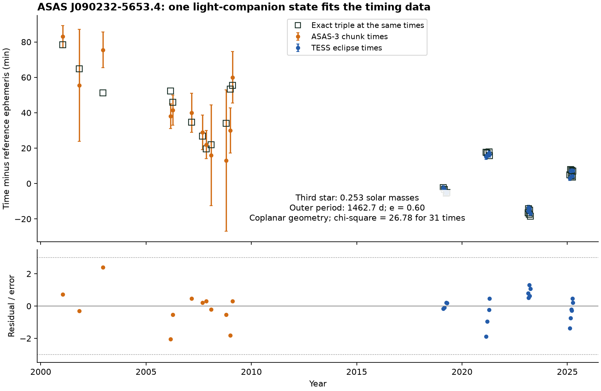
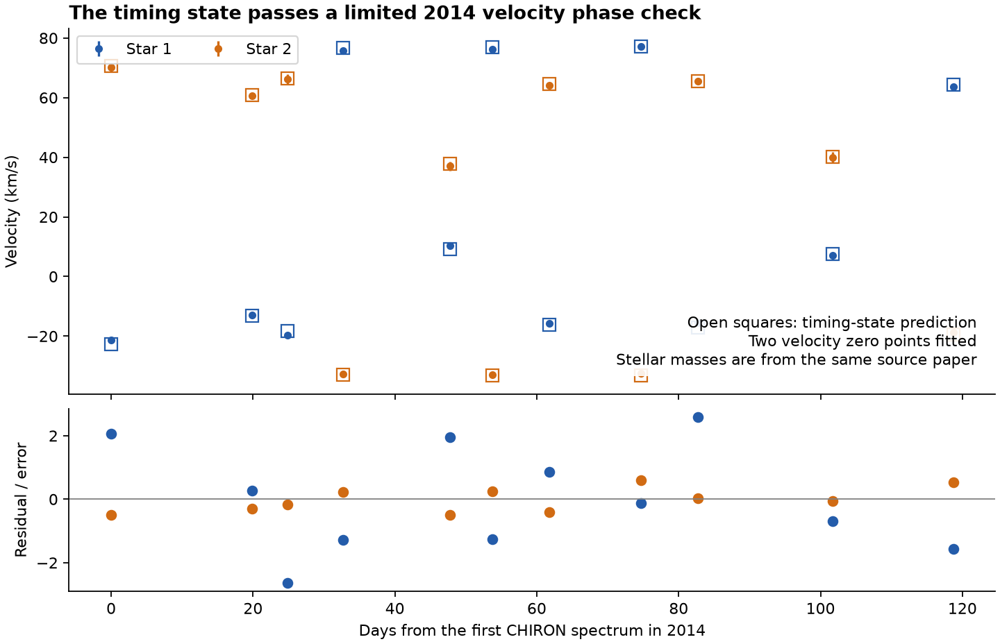
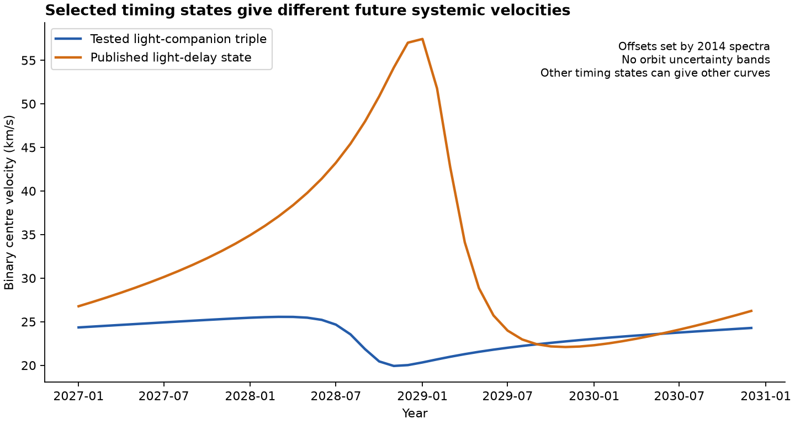

# A coplanar third star of 0.253 solar masses fits 31 eclipse times of ASAS J090232-5653.4

A large mass from a light-travel-time fit is not a robust mass limit for this binary. We give one Newtonian three-body state with a third star of **0.253 solar masses**. It fits the same 19 TESS eclipse times and 12 ASAS-3 timing measurements with **chi-square 26.78**. We fix the two stellar masses and the common orbit inclination to published values. This is a test of one possible state. It is not a measurement of the third-star mass.

The published light-delay fit has chi-square 15.30. At the measured pair mass, its mass function would require at least 2.244 solar masses. The two models describe different timing mechanisms. A low-mass third star can change the eclipse times through gravity. It need not give the pair a large light-travel delay.



*Figure 1. Filled points are the source timing measurements. Open squares are the exact three-body predictions at the same times, with the same averaging over ASAS-3 events. The lower panel shows residuals divided by the adopted errors. The model uses no extra primary or secondary time offsets and no added period drift.*

## Question and prior work

Does the timing evidence for ASAS J090232-5653.4 require a massive third star?

SCI 521b99d2 found common timing changes in this 20.82-day eclipsing binary. SCI 02d77ae9 linked its TESS times to ASAS-3 measurements and fitted a light-travel-time orbit of about four years. Its fit with outer eccentricity at most 0.6 gave a mass function of 0.4426 solar masses. Its quoted minimum mass was 2.356 solar masses for a pair mass of 3.08 solar masses. That study warned that eccentricity and timing mechanisms were uncertain.

The distinction between gravitational timing changes and light delay is established physics. Borkovits et al. (2016, equations 9-12) give the leading gravitational terms and recommend that each light-delay fit be checked for them. Our new result is a direct physical counterexample for this system, with a complete state, exact conjunction times, a limited velocity check and a reproducible test.

Before choosing this target, we searched the campaign for `HD 303514`, `WASP-105`, `TOI-682`, `dynamical timing`, and the exact ASAS identifier. Related results include the population study, an apsidal-motion null test (SCI 39864507), Gaia association tests, and withheld-block timing forecasts (SCI e0f46a31). We found no published exact three-body state for this target. The earlier withheld-block study found that an eccentric training fit could forecast later times poorly, while a circular orbit near 1,470 days forecast them better. This is a further reason not to treat any one period or future curve here as a complete orbit result. Web searches for the TIC and ASAS identifiers found an earlier spectroscopic study that the population analysis did not use.

Ratajczak et al. (2021) identify this binary as A-090232 and TYC 8590-374-1. We use their masses, 1.436 and 1.372 solar masses, their inclination of 89.81 degrees, and the eleven 2014 CHIRON velocity pairs in Table A6. These give a measured pair mass of 2.808 solar masses. The velocity measurements span 118.71 days.

## Data and rights

The timing inputs are verified files from SCI publication `sha256:02d77ae92e9db972b5feaaf49f7f0a037d2f89ff9327000c7719cd6e44fc34fa`. We use its eclipse times, ASAS-3 event weights, error scale and published light-delay state. We do not download new ASAS or TESS photometry. The complete input entries, their hashes and the source ZIP path are recorded in `files/provenance.json`.

The new external source is the Ratajczak et al. paper, DOI `10.1093/mnras/staa3488`. Its exact PDF is kept at the shared dataset path given in the provenance file. A text extractor reads only Table A6. The PDF, extracted text, velocities, timing records and event-level predictions are **outside this publication**. The package contains our code, text, original figures, a model state, model forecasts and aggregate test results. `files/NOTICE.md` gives attribution and explains the separation of external materials.

## Method

### Initial state from the averaged timing formula

For a circular inner orbit in a coplanar triple, the leading gravitational time shift is

\[
\Delta_{\rm dyn}=\frac{q P_1^2}{2\pi P_2(1-e_2^2)^{3/2}}
   (v_2-l_2+e_2\sin v_2),\qquad q=\frac{m_3}{M_{12}+m_3}.
\]

The light-delay term is

\[
\Delta_{\rm LTTE}=A[\cos E_2\sin\omega_2+
 \sqrt{1-e_2^2}\sin E_2\cos\omega_2],
\]

up to an irrelevant constant. Here A is the projected pair orbit size divided by the speed of light. The pair mass and q set A for an edge-on outer orbit. These formulae are from Borkovits et al. (2016); our search uses the coplanar case of their equations.

We searched outer periods of 1,000-2,000 days, eccentricities of 0-0.6, all periastron phases, q of 0.0001-0.9 and all outer periapse directions. A differential-evolution search with seed 0 supplied a start for least squares. Linear ephemeris terms and linear changes of the secondary offset were projected out at this initial stage, as in the source analysis. The initial pair mass was 3.08 solar masses to match that analysis. This gave a state with P2 = 1462.746 days, e2 = 0.6 and q = 0.0827245. The approximate timing chi-square was 15.28.

Exploratory searches with eccentricity allowed to reach 0.8 found still lighter approximate states. We did not use those states for the physical result. The 0.6 state is sufficient for the present test. We claim no minimum mass, complete alias search, or optimum over all triple states.

### Exact physical state

We retain those five outer parameters. We set the stellar masses to the spectroscopic values and both inclinations to 89.81 degrees, with equal nodes. We then fit only four inner parameters: osculating period, phase, e1 cos(omega1) and e1 sin(omega1). The final mass is q M12/(1-q) = 0.2532395 solar masses.

REBOUND 5.2.2 and IAS15 integrate the three point masses with Newtonian gravity. At each requested eclipse, Newton iteration finds zero projected separation derivative. The sign along the line of sight checks the eclipse type. The pair barycentre position supplies the common light-travel delay. The ASAS-3 prediction is the source Fisher-weighted average over the events that formed each chunk. It is not the model at a single mean chunk time.

The final model has nine selected or fitted parameters. It has no free epoch offset per eclipse type, no extra quadratic clock term, and no free apsidal rate. Gravity supplies the orbit changes. `files/results/state.json` specifies all parameters and their conventions. The initial epoch is BTJD -5138.497820168318; BTJD means BJD minus 2457000. The reference phase epoch is BTJD 3003.0. The initial osculating inner eccentricity is 0.01463. Osculating periods differ from mean eclipse periods in a perturbed system.

The source errors are unchanged: a one-minute TESS floor, and a three-minute ASAS-3 floor with the source ASAS-3 variance scale of 2.128. Thus fit quality can be compared directly with the source light-delay result. These are reused timing estimates, not a new flux reduction.

### Velocity tests

We calculate each star's velocity from the timing state at the 2014 spectrum times. Only one constant velocity zero point for each star is fitted. We do not refit orbital phases, periods, velocity amplitudes or the outer state to those velocities. This is a limited phase check: the stellar masses already came from the same spectroscopic study, so the velocity amplitudes are not independent inputs.

We also test the pair barycentre without an inner phase model. For inner mass ratio r, its observed velocity is proportional to (v1 + r v2)/(1+r). We fit r and a constant systemic velocity for each outer-velocity curve. The propagated error is sqrt(sigma1 squared + r squared sigma2 squared)/(1+r). This permits a test of the change of centre velocity in the short spectroscopic run.

## Results

| Test | Result |
| --- | ---: |
| Exact light-companion timing state, 31 measurements | chi-square 26.7826 |
| TESS contribution, 19 times | 11.7704 |
| ASAS-3 contribution, 12 chunk times | 15.0122 |
| Nominal degrees of freedom, counting nine parameters | 22 |
| Third-star mass in this state | 0.25324 solar masses |
| Outer period and initial eccentricity | 1462.746 d; 0.6000 |
| Published pure light-delay timing fit | chi-square 15.2989 |
| Its minimum mass at the measured pair mass | 2.24366 solar masses |
| Velocity phase check, 22 velocities and two zero points | chi-square 30.3352 for nominal 20 degrees of freedom |

The nominal timing chi-square tail is 0.220. This is a descriptive check under the source errors, not a model probability or a calibrated selection test. The velocity phase check has a nominal tail near 0.065. The primary and secondary velocity residual RMS values are 0.95 and 0.44 km/s. Those velocities do not reject the tested state at the five-percent level, but they do not establish its outer mass.



*Figure 2. Filled points are the 2014 CHIRON velocities. Open squares are the timing-state predictions after two velocity zero points are fitted. No orbital phase is fitted here. The stellar masses are inherited from the same source paper.*

The phase-free barycentre tests give chi-square 4.67 for a constant, 3.59 for the published light-delay curve, and 3.53 for the light-companion triple, each for nine nominal degrees of freedom. Thus the short velocity run does not select a timing mechanism. The predicted velocity ranges in that run are 1.26 and 0.50 km/s for the two selected timing states.

There is also a direct consistency warning for the published point state. In the coplanar, circular-inner approximation, adding the gravitational delay required by its minimum mass raises its timing chi-square to about 16,925 after linear nuisance terms are refitted. This test holds its outer orbit and light-delay amplitude fixed. It shows why a pure light-delay mass cannot simply be inserted into a coplanar triple. It does **not** exclude all massive, inclined, or refitted triple models.

### Numerical checks

Changing the IAS15 tolerance from 1e-10 to 1e-12 changes the predicted timing averages by at most 2.83 microseconds. A fresh refit of the four inner parameters reproduces the stored state and chi-square.

Two WHFast integrations run the selected state for 10,000 years with steps of P1/40 and P1/80. Both retain bound orbits. Across 1,001 sampled times, the inner eccentricity stays near 0.0067-0.0236 and the outer eccentricity near 0.597-0.601. There is no sampled radial overlap of the osculating orbits. Maximum fractional energy errors are 2.37e-6 and 5.96e-7. These are finite survival checks of one state, not a general stability proof or a probability of long life.

### A test with future spectra

The two selected states predict different centre velocities after the 2014 zero points are fixed. On 2027-12-01, they give about 25.38 and 33.97 km/s. The separation reaches 37.1 km/s on the monthly grid at 2029-01-01. New double-lined spectra can therefore test these particular timing states. The inner orbital velocities must be removed with a joint fit.



*Figure 3. Centre-velocity forecasts for two selected timing states. These curves have no orbit uncertainty bands. Other states can give other curves. The orange curve is an extrapolation of a pure light-delay fit, not an exact gravitational triple solution. The forecast table is our model output, not an external data extract.*

## Interpretation and limits

The tested timing data permit a light third star. The published large light-delay mass is therefore a conditional interpretation, not a mass lower limit that remains valid when gravitational timing shifts are allowed. This result strengthens the need for combined timing and velocity fits in the new binary population. It neither changes the population detection count nor measures the population mass distribution.

Important limits are:

- We test one selected prograde coplanar state. We do not give a posterior, evidence ratio, global optimum or mass interval. The outer eccentricity was set at a search boundary.
- Stellar masses and inclination are fixed. Their errors and alternatives in the three-dimensional geometry are not propagated. The source timing estimates and error scales may have biases or correlations.
- We do not refit eclipse light curves, surface brightness, radii or pulsations. Finite stellar light travel time within the inner binary, relativity, tides, rotation and stellar evolution are omitted. The omitted inner light delay is of order seconds for the nearly equal masses, below the adopted timing floor.
- The 2014 velocities were new to this campaign test, but the stellar masses come from those same observations. Their short time range cannot identify the outer orbit. The phase check is not a fully independent discovery test.
- We have not fitted the Gaia acceleration or new spectra. The conditional future curves do not carry timing-orbit uncertainty bands.

## Reproduce

Python 3.12, NumPy, SciPy, pandas, matplotlib, REBOUND 5.2.2, SCI and the `pdftotext` executable are needed. `files/requirements.txt` records Python versions used. The scripts set numerical library threads to one. The work used no more than two compute processes.

Use external scratch. Do not write retrieved materials or regenerated record tables into the signed publication.

```sh
python files/code/prepare.py /path/to/02d77ae92e9db972b5feaaf49f7f0a037d2f89ff9327000c7719cd6e44fc34fa.zip /tmp/asas090232/source
python files/code/retrieve_paper.py /tmp/asas090232/external
python files/code/study.py --source /tmp/asas090232/source --state files/results/state.json --pdf /tmp/asas090232/external/staa3488.pdf --out /tmp/asas090232/check --stability-years 10000
python files/code/figures.py /tmp/asas090232/check
```

The first script verifies the complete source bundle and the hashes of each used entry. The paper script checks the PDF hash. The fast numerical check takes seconds if `--stability-years` is omitted. Add `--refit-inner` to repeat the four-parameter exact fit. To repeat the initial averaged search, run `search_approx.py` with `--source`, `--out`, `--kind mixed`, `--emax 0.6`, and `--seed 0`. Its retained outer state is also recorded in `files/results/initial_state.json`.

`study.py` writes aggregate JSON, conditional forecasts and inspection tables into external scratch. `files/results/summary.json` preserves the completed aggregate checks. Figures can be regenerated from those external inspection tables. The original photometry and source timing reduction can be recovered by following the source SCI publication.

## Research record

Job: `sci-1107-hp-astronomy-348896702093`. Campaign: `11_07_2026`. Topic: astronomy. Machine: HP. Account: codex-olen. Model: gpt-6.1-sol, high reasoning effort. This investigation used one worker and no subagents. The signing identity is the campaign-machine key, not a claim of personal authorship. The signed result is saved locally; this worker does not upload or submit it.
