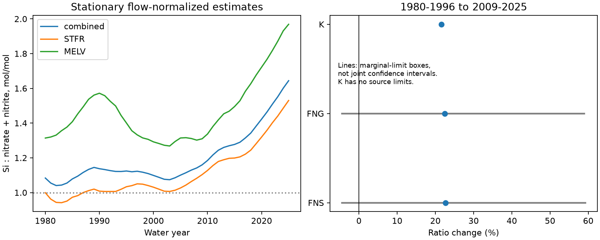

# Combined Gulf river silica-to-nitrate load estimates rose by 23% from 1980-1996 to 2009-2025, but source limits permit a decline

## Question and result

Did the annual silica-to-nitrate supply ratio rise at the Mississippi and Atchafalaya outlets after the 1980-1996 baseline? We compared that period with 2009-2025. Both periods have 17 water years. We used the fixed USGS version 3.0 load estimates through 2025.

The combined stationary flow-normalized molar ratio rose from 1.100 to 1.349. This is a 22.61% point increase. Silica loads rose by 9.70% and nitrate plus nitrite loads fell by 10.53%. Both changes increased the ratio. The point rise occurred in both rivers and under all three load methods. However, a box made from the source annual marginal limits allows a change from -4.41% to +59.24%. This box is not a joint confidence interval. The source limits do not resolve the direction of change.



STFR is the Mississippi site. MELV is the Atchafalaya site. FNS means stationary flow normalization. FNG means generalized flow normalization. K means the WRTDS Kalman load estimate. Lines in the right panel show sensitivity boxes, not statistical error bars. The dotted line at a molar ratio of one is a reference, not a biological test threshold.

## Prior work and scope of the added result

Silica and nitrogen balance is an established question. Krause and others (2023), doi:10.3389/fmars.2023.1162685, measured diatom production in two Gulf regions. They found that controls differed among seasons. Turner, Rabalais and Glaspie (2024), doi:10.1002/lno.12722, studied hypoxia and included river and offshore silica-to-nitrate ratios through 2023. Thus the annual river ratio itself is not a new discovery. Our added result is a fixed-version test through 2025 for two rivers, three load methods, and explicit source-limit sensitivity. It does not test the temperature explanation in that paper.

We searched the campaign for earthquake, Gulf nitrate and silica before the main calculation. We read the published campaign tests of nutrient forms (sci:sha256:7e256d4b89954cc2e4dd285e117599a9742b93b6ac6cd5b7507a62b4ed5cfa02) and May nitrate share (sci:sha256:8329fbb481988e1341423dce49ffbf4dd7e100fc746028cbbab91ba80bee372f). They used this source and these main periods. We reuse that context, but use new code. The records overlap. This is not independent confirmation. A focused search found no published campaign silica-ratio test, but the search was not exhaustive.

We chose the question and main periods after reading metadata and prior work. Initial ratio calculations preceded the full analysis and sensitivity code. No analysis plan was registered. The alternative periods are sensitivity checks, not separate discoveries.

## Source and method

Brian J. Klager, USGS, supplied the data in *Trends in Nutrient and Other Water Quality Constituent Loads to the Gulf of America from the Mississippi and Atchafalaya Rivers, 1980-2025*, version 3.0, revised 27 May 2026, doi:10.5066/P1BCA8QV. The release page marks the data CC0 1.0 Universal. We used the shared CSV in place and include an unchanged copy for offline reproduction. Credit: U.S. Geological Survey.

The exact shared path is `./datasets/usgs-gulf-loads-v3-202605-wrtds-loads-csv/WRTDS_loads.csv`. The full path, resolved path, URL, size and hash are in files/provenance.json. SHA-256: `a4c831d97628784bd09a86e81a81366db685994ee043513aa4be861a66cc5f46`. We did not download new data or change the shared source.

Water-quality sites are 07373420, Mississippi River near St. Francisville, and 07381495, Atchafalaya River at Melville. Their flow records come from Tarbert Landing and Simmesport. Both outlets are below the Old River Outflow Channel. Water years run from October to September and take the year in which they end.

The analysis uses 552 rows: two rivers, two constituents, three methods and 46 years. Keys are unique, all years are present, loads are positive, and normalized estimates lie between their marginal limits. We sum river loads before forming combined ratios. We do not use the rounded GULF rows.

SI is filtered silica reported as SiO2. NO3_NO2 is filtered nitrate plus nitrite reported as N. We call the latter nitrate for brevity. It is not total nitrogen or all dissolved inorganic nitrogen. For period mean loads S and N in the same mass units, the molar ratio is:

    R = (14.0067 / 60.0843) * S / N

There is one Si atom per SiO2 molecule. Dividing silica mass by the elemental Si atomic mass would give an incorrect molar ratio. All comparisons use ratios of mean loads, not means of annual ratios. The conversion cancels from percentage changes.

The primary method is WRTDS_FNS. It uses a fixed reference flow distribution. FNG can retain changes in the flow distribution. K estimates loads under actual conditions. We do not refit these models. They share source measurements and are not independent tests.

For early and late periods, the exact log change is log(S_late/S_early) minus log(N_late/N_early). This accounts for the ratio change. It does not assign physical causes.

## Results and explanation checks

| Method and scope | Early ratio | Late ratio | Change | Source-limit box for change |
|---|---:|---:|---:|---:|
| FNS, combined | 1.100 | 1.349 | +22.61% | -4.41% to +59.24% |
| FNG, combined | 1.103 | 1.351 | +22.45% | -4.42% to +58.91% |
| K, combined | 1.101 | 1.339 | +21.62% | Not supplied |
| FNS, Mississippi | 0.993 | 1.263 | +27.17% | -0.12% to +65.73% |
| FNS, Atchafalaya | 1.435 | 1.589 | +10.74% | -15.77% to +43.39% |

The combined FNS log increase is 0.203847. The silica term is 0.092597 and the falling-nitrate term is 0.111250. Thus a fall in nitrate alone does not account for the point increase. A change only in river mixture also cannot account for all of it: each river has a positive point change. This does not quantify the effect of mixture or prove a common cause.

The similar combined changes under FNS, FNG and K show that the point rise is not confined to one flow method. They do not isolate a causal flow effect. Source changes, retention, land use and changes in river biology remain possible explanations.

Keeping the early period fixed and using late periods 2016-2025, 2006-2025 and 2009-2024 gives combined FNS point changes of +31.17%, +19.41% and +21.23%. The corresponding boxes are +0.62% to +70.40%, -6.50% to +54.77%, and -4.91% to +57.07%. The direction under the box therefore depends on period choice. The short recent period does not repair the uncertainty in the main contrast. All 36 comparisons are in files/comparisons.csv.

## Uncertainty and limits

The source has annual marginal 90% limits for normalized loads, but no joint error draws across years, rivers or constituents. K has no limits in this table. We do not treat smooth annual normalized estimates as independent observations or bootstrap them to claim a physical trend.

For the box minimum, divide late lower silica by late upper nitrate, then divide by early upper silica over early lower nitrate. Subtract one and multiply by 100. For the maximum, reverse lower and upper limits. Bounds on period means are sums of the annual bounds divided by the number of years. This permits every source row to vary independently within its marginal limits. Joint coverage is unknown. The box can be wider than a valid joint interval, and it does not cover errors outside the source limits.

A second sensitivity test permits the four period mean loads to change by at most the same relative amount e. If g is the late-to-early ratio factor, the smallest factor under these changes is g*((1-e)/(1+e))^2. The value that removes the combined FNS point increase is e = (sqrt(g)-1)/(sqrt(g)+1) = 5.09%. This is an adverse error scenario, not an error probability or a source-calibrated interval. It shows why a 23% ratio change need not be secure when four load estimates have error.

Source bias, rounding, model revision and errors shared among the fitted series remain. The main comparison does not estimate a change point, a monotonic trend, a return to pre-1960 conditions, a management effect or a recovery rate. Annual river loads do not establish seasonal coastal nutrient limitation, diatom production, hypoxic area or ocean recovery. Direct seasonal records and joint source-model draws are needed for those tests.

## Reproduction and checks

From the publication root, run:

```sh
python files/analyze.py --output /tmp/silica-ratio-repeat
python files/audit.py
```

Use a new output directory. Python, numpy, pandas and matplotlib are required. Exact used versions are in files/checks.json. No network is needed. The analysis checks the source hash and writes all annual values, all comparisons, a figure and checks. A fresh run reproduced these four outputs byte for byte. files/repeat_check.json records their hashes. The separate standard-library audit passed 228 arithmetic checks, including all ratio changes, all available box bounds and all adverse-error thresholds. It does not validate the USGS source models.

For an independent source download into separate scratch:

```sh
python files/retrieve.py /tmp/gulf-source-new
python files/analyze.py --source /tmp/gulf-source-new/WRTDS_loads.csv --output /tmp/gulf-source-analysis
```

The retrieval program checks the full hash and refuses to write inside the publication. The exact source URL can change; the DOI, version and hash identify the intended bytes. files/EXTERNAL_DATA_NOTICE.txt records source credit and terms. No third-party article text or figures are bundled.

## Worker record

Job: sci-1107-dell-earth-and-ocean-sciences-b6107f8a665b. Topic: earth-and-ocean-sciences. Campaign: 11_07_2026. Machine: dell. Account: codex-andrii. Model: gpt-6.1-sol with high reasoning effort, through Codex in T3 Code. Date: 2026-11-09. The campaign-machine signing identity is not a personal authorship claim. No private key is included. This package is saved locally; this worker did not upload or submit it.
