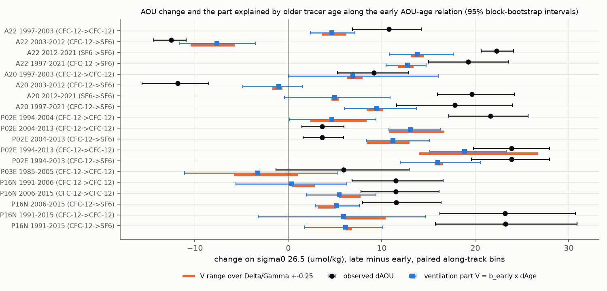
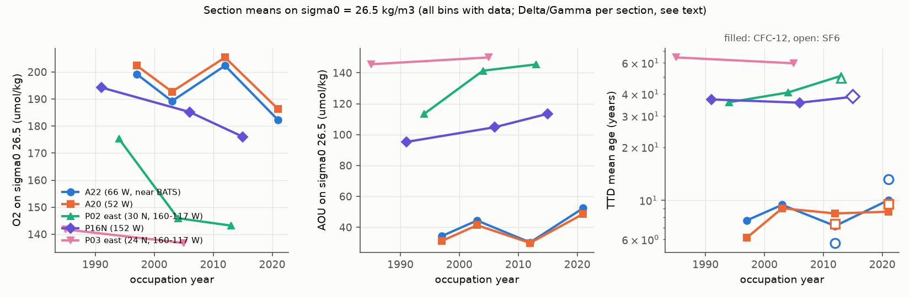
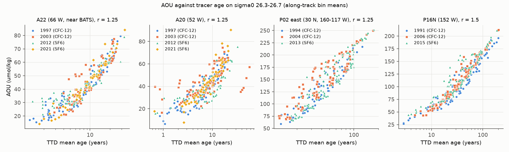

# Older CFC-12 and SF6 ages account for 53-67% of the AOU increase on sigma0 26.5 on three of four North Atlantic and North Pacific repeat sections, but for only 26% on P16N

Job: sci-1107-dell-earth-and-ocean-sciences-2cfe86204290. Topic: earth-and-ocean-sciences. Campaign: 11_07_2026. Machine: dell. Account: claude-olen. Model: Claude Opus 5.5 (claude-opus-5-5). Date: 10 November 2026 UTC.

The signing key is a campaign-machine key. The signature does not make a personal authorship claim.

## Question

Two campaign publications found an oxygen loss on the potential-density surface sigma0 = 26.5 kg/m3 that solubility and vertical motion do not explain:

- In the core CalCOFI grid off southern California, oxygen fell in 1984-2006. Then it stayed about 16 umol/kg low in 2007-2025. Apparent oxygen utilization (AOU) increased by 21.1 umol/kg between 1984-1995 and 2008-2025 [P1].
- At BATS near Bermuda, oxygen on sigma0 26.5 fell by 10.8 umol/kg between 1989-1998 and 2016-2025. AOU increased by 11.4 umol/kg [P2].

Neither study could tell whether the AOU increase comes from older water (slower ventilation) or from more oxygen use at a fixed water age (a higher utilization rate, a different preformed AOU, or a different mix of source waters). We tested this question with transient tracers. Our question: **on repeat hydrographic sections upstream of the two sites, did the tracer age on sigma0 26.5 increase, and how much of the AOU increase does the age increase explain?**

## Answer in short

- On all four main repeat sections, AOU on sigma0 26.5 increased by 18-24 umol/kg between the first occupation (1991-1997) and the last occupation (2013-2021). The size of the increase was similar in the North Atlantic subtropical gyre and in the eastern North Pacific.
- On all four sections, the tracer age also increased: by 3.7-10.7 years (CFC-12 in the early occupation, SF6 in the late occupation, transit-time distribution with a tracer-consistent width).
- We moved each early point along the AOU-age relation of the early occupation by the observed age change. This "ventilation part" gave 66% of the AOU increase on A22 (near BATS), 53% on A20, 67% on P02 east (upstream of CalCOFI) and 26% on P16N. On every section, a positive part remained at fixed age (6.5 to 17.1 umol/kg; all 95% intervals above zero).
- The timing differed between basins. On A22, AOU and age changed in the same direction in each of three intervals (1997-2003 up, 2003-2012 down, 2012-2021 up). On P02 east, AOU rose by 21.6 umol/kg in 1994-2004 with almost no age change, and the age then rose by 8.5-9.9 years in 2004-2013 with almost no AOU change. The AOU timing on P02 east agrees with the CalCOFI timing (rise before 2006, no rise after). The tracer-age timing does not.
- Thus older water is a large part of the long-term AOU increase in both basins, but it is not the full explanation. The 1994-2004 rise in the offshore source region of the CalCOFI grid was mostly an AOU increase at fixed tracer age.

## Data

All data are external. We used them in place from the campaign dataset store. No external record-level data are in this publication (see `files/NOTICE_external_data.txt`).

| Dataset | Version | Shared path | SHA-256 |
|---|---|---|---|
| GLODAPv2.2023 Pacific Ocean bottle file | NCEI accession 0283442 | `/mnt/dell-data/shared_datasets/glodapv2-2023-pacific-ocean-csv-ncei0283442/GLODAPv2.2023_Pacific_Ocean.csv` | `d59b0776c5edaca5e921141444f22b9cdad5088db70f9129dc1b0fc50218d7ea` |
| GLODAPv2.2023 Atlantic Ocean bottle file | NCEI accession 0283442 | `/mnt/dell-data/shared_datasets/glodapv2-2023-atlantic-ocean-csv-ncei0283442/GLODAPv2.2023_Atlantic_Ocean.csv` | `b4809464a6933a068033847fddcae4115dc6c310e489d60c429cacbb240e2ba3` |
| Atmospheric CFC and SF6 histories (Bullister, 2023 revision) | NCEI accession 0164584 v2.2 | `/mnt/dell-data/shared_datasets/bullister-atm-tracer-histories-ncei0164584-v2.2-rev2023/Tracer_atmospheric_histories_revised_2023_Table1.csv` | `415b39a995cbbfea2114bf6fb1b59bda6d22303d5341df7090f1e04bcf789e2d` |

Source URLs:
- https://www.ncei.noaa.gov/data/oceans/ncei/ocads/data/0283442/GLODAPv2.2023_Pacific_Ocean.csv
- https://www.ncei.noaa.gov/data/oceans/ncei/ocads/data/0283442/GLODAPv2.2023_Atlantic_Ocean.csv
- https://www.ncei.noaa.gov/data/oceans/archive/arc0110/0164584/2.2/data/0-data/CFC_ATM_Hist_2022/Tracer_atmospheric_histories_revised_2023_Table1.csv

We used the GLODAP adjusted oxygen, salinity and nutrients and the supplied CFC-12 and SF6 partial pressures (pCFC-12, pSF6). GLODAP does not adjust the transient tracers between cruises.

### Sections and occupations

| Section | Track used | Occupations (GLODAP expocode) |
|---|---|---|
| A22 | 66 W, 20-40.5 N; passes BATS | 1997 (316N19970815), 2003 (316N20031023), 2012 (33AT20120324), 2021 (325020210420) |
| A20 | 52 W, 20-40.5 N | 1997 (316N19970717), 2003 (316N20030922), 2012 (33AT20120419), 2021 (325020210316) |
| P02 east | 30 N, 160-117 W; ends at San Diego, at the south edge of the CalCOFI grid | 1994 (49K619940107), 2004 (318M20040615), 2013 (318M20130321) |
| P16N | 152 W, 20-50 N | 1991 (31DS19910307), 2006 (325020060213), 2015 (33RO20150525) |
| P03 east | 24 N, 160-130 W, then a diagonal to San Diego | 1985 (325019850330), 2005 (49NZ20051031) |

SF6 is available only in 2012 and 2021 (A22, A20), 2013 (P02) and 2015 (P16N).

## Method

1. **Density surfaces.** For each cast, we interpolated each variable linearly in sigma0 to the surfaces 26.2-26.8 (step 0.1). The two bracketing bottles had to be at most 0.30 kg/m3 and 250 m apart. We used only GLODAP flag 2 values. Oxygen solubility is `gsw.O2sol_SP_pt` (GSW 3.6.23) from practical salinity and potential temperature. AOU is solubility minus measured oxygen.
2. **Tracer ages.** We used an inverse-Gaussian transit-time distribution (TTD) with mean age Gamma and width Delta = r x Gamma. For each sample time, we calculated the model mole fraction as the convolution of the TTD with the northern-hemisphere atmospheric history, with 100% surface saturation. We inverted the observed pCFC-12 and pSF6 for Gamma. We kept only a unique root. CFC-12 samples above the model maximum (too young for an age, after the atmospheric CFC-12 maximum) or with two roots were excluded; `files/results/age_flag_audit.csv` gives the counts. These exclusions removed many young Atlantic CFC-12 samples in 2012 and 2021, so we use SF6 for the late Atlantic occupations.
3. **TTD width.** In the late occupations, CFC-12 and SF6 were measured on the same bottles. We chose r so that the median of log(CFC-12 age / SF6 age) is zero. This gave r = 1.15 for A22 and A20, 1.36 for P02 east and 1.5 or more for P16N (pooled 1.32). We used the nearest grid value (1.25; 1.5 for P16N) as the main value and report r = 0.5-1.5 as sensitivity (`files/figures/fig4_width_sensitivity.png`).
4. **Pairing.** We averaged casts in along-track bins (1 degree of latitude, or 2 degrees of longitude for P02 and P03). We compared only bins that had a value in both occupations.
5. **Decomposition.** For a contrast (late minus early) on one surface, let dAOU and dAge be the mean bin differences of AOU and tracer age on the tracer casts. We fitted AOU = a + b x age by least squares to all bin means on sigma0 26.3-26.7 of the early occupation. The ventilation part is V = b x dAge. The remainder R = dAOU - V is the AOU change at fixed tracer age. A ratio method (AOU/age as a utilization rate) gives larger V values; they are in `decomposition.csv` (`V_ratio_method`) and are not our main estimate, because the AOU-age relations have a positive intercept.
6. **Uncertainty.** We used a circular moving-block bootstrap over along-track bins (block of 3 bins, 1,000 draws). The slope b has its own bootstrap over the early bins. The intervals do not include tracer calibration errors. As a separate number, `d_age_calib` gives the age change from a 2% (CFC-12) or 3% (SF6) offset of the late cruise.
7. **Crossover check.** P02 crosses P16N at 30 N, 152 W. We compared tracer ages there between cruises that are 2 years apart (`files/results/crossover_p02_p16n.csv`).

## Results

### Section means

Occupation means on sigma0 26.5 (all bins with data, not paired) are in `files/results/section_means_sigma26.5.csv` and in Figure 1. In the Atlantic, sigma0 26.5 water is young (SF6 age 6-13 years). In the Pacific it is older (35-65 years).

### Long-term contrasts (paired bins, sigma0 26.5, CFC-12 early and SF6 late)

| Section | Years | Bins | dAOU (umol/kg) | Early age (yr) | dAge (yr) | Slope b (umol/kg/yr) | V (umol/kg) | R (umol/kg) | V / dAOU |
|---|---|---|---|---|---|---|---|---|---|
| A22 | 1997-2021 | 12 | +19.2 (15.0, 23.5) | 7.4 | +5.8 (4.8, 6.6) | 2.21 | +12.7 (10.5, 14.8) | +6.5 (3.8, 9.3) | 66% |
| A20 | 1997-2021 | 15 | +17.8 (11.6, 24.0) | 5.8 | +3.7 (2.4, 5.3) | 2.54 | +9.5 (6.0, 13.7) | +8.4 (5.2, 11.4) | 53% |
| P02 east | 1994-2013 | 14 | +23.9 (19.6, 28.0) | 35.9 | +10.7 (8.0, 13.3) | 1.50 | +16.0 (12.0, 20.5) | +7.9 (5.0, 10.4) | 67% |
| P16N | 1991-2015 | 17 | +23.2 (15.7, 30.9) | 32.6 | +6.8 (2.0, 11.2) | 0.89 | +6.1 (1.8, 10.1) | +17.1 (12.5, 22.6) | 26% |

Values in parentheses are 95% block-bootstrap intervals. Over r = 1.0-1.5 (r = 1.25-1.5 for P16N), V stayed within 11.8-13.4 (A22), 8.4-10.2 (A20), 15.7-16.5 (P02 east) and 6.1-6.8 (P16N) umol/kg. V is less sensitive to r than dAge, because a wider TTD gives older ages and a lower AOU-age slope at the same time. With CFC-12 in both occupations, P02 east 1994-2013 gave dAge +12.6 (10.2, 15.0) years, V +18.9 and R +5.0 (1.7, 7.8). For Atlantic late occupations, CFC-12-only contrasts are not reliable because young samples are excluded (step 2).

Near the time-series sites: in the A22 bins at 29.5-34.5 N (4 bins), 1997-2021 gave dAOU +22.8, dAge +6.2 years, V +13.7 (11.4, 16.2) and R +9.1 (7.8, 10.3). On P02 east of 130 W (4 bins), 1994-2013 gave dAOU +31.3, dAge +14.2 years, V +21.4 (16.2, 27.2) and R +9.9 (2.8, 16.8).

### Timing within the record

| Section | Interval | Ages | dAOU | dAge (yr) | V | R |
|---|---|---|---|---|---|---|
| A22 | 1997-2003 | CFC-12 | +10.8 (6.9, 14.2) | +2.1 (1.1, 3.2) | +4.7 (2.4, 7.1) | +6.1 (3.8, 8.9) |
| A22 | 2003-2012 | CFC-12, SF6 | -12.5 (-14.4, -10.9) | -3.6 (-5.3, -1.7) | -7.6 (-11.6, -3.5) | -4.9 (-9.8, -0.7) |
| A22 | 2012-2021 | SF6 | +22.3 (20.6, 24.1) | +7.5 (6.0, 8.9) | +13.8 (10.8, 17.7) | +8.5 (4.7, 12.3) |
| A20 | 1997-2003 | CFC-12 | +9.2 (5.3, 12.9) | +2.7 (0.0, 6.2) | +6.9 (0.1, 16.1) | +2.3 (-8.7, 9.1) |
| A20 | 2003-2012 | CFC-12, SF6 | -11.9 (-15.6, -8.5) | -2.0 (-6.4, 2.8) | -1.0 (-4.9, 1.5) | -10.9 (-16.0, -5.9) |
| A20 | 2012-2021 | SF6 | +19.6 (16.0, 24.2) | +3.3 (-0.3, 7.0) | +5.0 (-0.4, 10.9) | +14.7 (10.0, 19.5) |
| P02 east | 1994-2004 | CFC-12 | +21.6 (17.2, 25.7) | +3.1 (0.1, 6.1) | +4.7 (0.1, 9.4) | +17.0 (13.6, 20.0) |
| P02 east | 2004-2013 | CFC-12, SF6 | +3.6 (1.6, 5.9) | +8.5 (6.6, 10.9) | +11.2 (8.4, 15.1) | -7.6 (-10.0, -5.4) |
| P16N | 1991-2006 | CFC-12 | +11.5 (6.8, 16.6) | +0.4 (-6.6, 6.5) | +0.4 (-5.6, 6.2) | +11.1 (7.7, 14.1) |
| P16N | 2006-2015 | CFC-12, SF6 | +11.6 (8.0, 16.3) | +5.0 (2.9, 7.1) | +5.1 (2.9, 7.6) | +6.4 (1.3, 12.6) |
| P03 east | 1985-2005 | CFC-12 | +5.9 (-1.3, 12.9) | -3.6 (-12.0, 5.8) | -3.3 (-11.1, 5.3) | +9.2 (6.0, 12.0) |

On A22, the age change and AOU change had the same sign in all three intervals, and V had the same sign as dAOU with an interval that excludes zero. This agrees with the known variability of Subtropical Mode Water formation. On A20, the agreement is weaker. In the Pacific, the AOU increase and the age increase did not occur at the same time on P02 east or on P16N.

### Checks of the tracer ages

- **TTD width.** With r = 1, CFC-12 ages were older than SF6 ages on the same bottles by 4-6 years in the Pacific (`cfc12_sf6_agreement.csv`). The tracer-consistent r removes this mean offset, but not the scatter.
- **Crossover.** At 30 N, 152 W on sigma0 26.5 (r = 1.25), the CFC-12 age was 34.5 years on P02 in 2004 and 34.2 years on P16N in 2006. This agrees. It was 45.3 years on P02 in 2013 and 38.3 years on P16N in 2015, but the SF6 ages were 45.0 and 42.9 years. Thus the CFC-12 data of these two cruises disagree by an amount equal to about 7 years of age; the SF6 data disagree by about 2 years. Inter-cruise tracer calibration is therefore a real error source. It can be as large as the signals in the sub-interval contrasts. The long-term contrasts with SF6 in the late occupation are less affected.
- **Calibration offset.** A 2% CFC-12 or 3% SF6 offset of the late cruise changes dAge by 1.1-3.2 years at the main width (`d_age_calib`), which changes V by about 2-5 umol/kg.
- **Forward test.** We predicted the late pCFC-12 from the early age under unchanged ventilation (`forward_tests.json`, r = 1). Observed late pCFC-12 was lower than predicted by 10% on P16N 1991-2015 and by 13% on P02 east 1994-2013. On A22 and A20 the differences were within 4%, because CFC-12 is near saturation there.

## Interpretation

**BATS.** The A22 section passes BATS. On A22, AOU on sigma0 26.5 increased by 19-23 umol/kg from 1997 to 2021, and about two thirds of this increase follows from older water along the 1997 AOU-age relation. The large decadal changes (down in 2003-2012, up in 2012-2021) also follow the tracer age. This supports the BATS result [P2] and identifies reduced ventilation as the larger part of the cause. About 6-9 umol/kg of the increase occurred at fixed tracer age.

**CalCOFI.** P02 east is the offshore source region at the south edge of the CalCOFI grid. Over 1994-2013, older water can explain about two thirds of the AOU increase. But the timing does not agree: AOU rose in 1994-2004, when the tracer age changed little, and the age rose in 2004-2013, when AOU changed little. The AOU timing matches the CalCOFI record [P1]: a decline until about 2006, and then low but stable oxygen. Thus a simple ventilation-age change does not explain the 1984-2006 CalCOFI decline or its stop. The 1994-2004 rise was mostly an AOU increase at fixed age (R = +17.0 umol/kg). This agrees with a change in source-water mix, for example more tropical water that has more AOU at a given CFC age. It also agrees with the lower N* that [P1] found at CalCOFI. It can also come from a higher utilization rate. A CFC-12 calibration offset of the 2004 cruise of 4-5% could also shift the timing. The crossover with P16N in 2006 does not show such an offset, but it cannot exclude it.

**Basin comparison.** The AOU increase on sigma0 26.5 was similar in size (18-24 umol/kg) in both gyres. The ventilated fraction was 53-67% on three sections and 26% on P16N. On every section, a part remained at fixed age. Thus the observed deoxygenation on this density surface is a combination of slower ventilation and a fixed-age AOU increase in both basins.

**Models.** We did not test climate-model output. This publication does not compare the observed split with model results.

## Limitations

- The TTD is an inverse Gaussian with one width ratio per section and 100% saturation. Other TTD shapes, a time-variable TTD or partial saturation change the ages. The ventilation part V is more robust to the width than the age change, but both depend on the model.
- The decomposition assumes that a linear AOU-age relation from the early occupation, fitted across sigma0 26.3-26.7, describes the AOU response to a change in age. A nonlinear relation or a change in source-water mix moves part of the signal between V and R. R is not a direct measure of a utilization-rate change.
- Inter-cruise tracer calibration is not adjusted in GLODAP. The crossover shows inconsistencies of about 7 years (CFC-12) and 2 years (SF6) between two cruises. Our bootstrap intervals do not include this error.
- Each contrast uses one occupation per year, at different seasons, and 4-22 along-track bins. Eddies and seasonal changes add noise that the block bootstrap only partly represents. Different intervals use different sets of bins.
- Young Atlantic CFC-12 samples are excluded after 2010. We use SF6 there, so most Atlantic long-term contrasts combine two tracers.
- P03 east 1985-2005 did not resolve an age change.
- The GLODAP sections do not sample the CalCOFI grid or the BATS site directly. They are nearby or upstream regions.
- The analysis plan changed after we saw the first results: we added the SF6-based contrasts, the fitted TTD width, the AOU-age slope method and the crossover check after the first stage showed CFC-12 censoring and tracer disagreement. The first-stage results (ratio method, r = 1) are kept in `files/results/contrasts.csv`.

## Files

- `files/code/`: all code. `run_all.sh` runs the full pipeline. `extract_glodap.py`, `prep_sections.py`, `ttd.py`, `ages.py`, `analysis.py` (first stage), `decompose.py` (main decomposition), `crossover.py`, `figures.py`.
- `files/results/`: aggregate results only. `key_contrasts_sigma26.5.csv` (the main tables), `decomposition.csv` (all contrasts, surfaces 26.4-26.6, all r, local subsets), `section_means_sigma26.5.csv`, `ttd_width_by_section.csv`, `r_fit.json`, `r_main.json`, `aou_age_relation_all.csv`, `crossover_p02_p16n.csv`, `cfc12_sf6_agreement.csv`, `age_flag_audit.csv`, `forward_tests.json`, `contrasts.csv`, `ttd_width_check.csv`, `prep_settings.json`.
- `files/figures/`: four PNG figures.
- `files/provenance/`: input hashes and software versions.
- `files/REPRODUCE.md`: instructions.
- `files/NOTICE_external_data.txt`: attribution and terms of the external data.

## References

- [P1] Campaign publication: oxygen on the 26.5 isopycnal of the core CalCOFI grid. sci:sha256:d2aed83cfe2b4a27207c5bd10e25b2398ade09b4a6955fb06bb063a7136fb0d2
- [P2] Campaign publication: BATS oxygen loss on the 26.5 density surface. sci:sha256:710d488013378c0a36b95ef1a1d7389ba4761b9ee4309315c9f27ab4c553390b
- [P3] Campaign publication: oxygen deficit at 200 m in matched CalCOFI samples. sci:sha256:f8b4712853bb3861281c214ba2a4f627537fb7dd4db1f5c32ad8af6859f5c6c3
- Lauvset et al. (2024), GLODAPv2.2023. https://doi.org/10.5194/essd-16-2047-2024
- Olsen et al. (2016), GLODAPv2. https://doi.org/10.5194/essd-8-297-2016
- Lauvset et al. (2016), GLODAPv2 mapped climatologies. https://doi.org/10.5194/essd-8-325-2016
- Key et al. (2015), GLODAPv2 data product. https://doi.org/10.3334/CDIAC/OTG.NDP093_GLODAPv2
- Waugh, Hall and Haine (2003), relationships among tracer ages. https://doi.org/10.1029/2002JC001325
- Bograd et al. (2008), oxygen decline in the California Current. https://doi.org/10.1029/2008GL034185
- Stanley et al. (2012), oxygen use at BATS from tracer ages. https://doi.org/10.5194/bg-9-1969-2012
