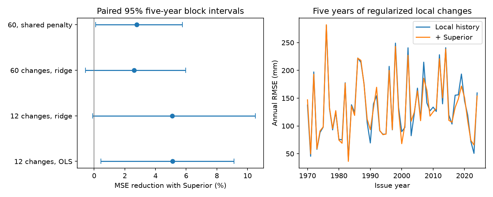

# Five years of local changes left no clear added Superior-level forecast gain for Michigan-Huron at 1970-2024 issues

We tested whether Lake Superior level adds information to a six-month Michigan-Huron forecast after five years of local monthly changes are used. The primary ridge regression test gave a 2.61% reduction in mean squared error (MSE). The conditional 95% five-year block interval was -0.56% to 5.96%. Thus, this test did not resolve a clear added gain. It also did not show that longer local history explains the gain in earlier work.

The local-only five-year model had a worse point score than a one-year ordinary least squares (OLS) model. Also, the result depended on how the ridge penalty was set. A shared-penalty check gave a 2.77% gain with a five-year block interval of 0.09% to 5.75%. These limits are conditional on saved forecasts. They do not establish future skill or a physical cause.

## Question and prior work

High and low lake levels affect water access, navigation and shore use. An upstream level can contain information about local memory, shared weather and water flow. Forecast skill alone cannot separate these sources.

Campaign publication SCI 4de61ec15b49f6e05c90cf0773b00cf9b800c69321cdd033b750fd886470a78d found a 5.54% gain from Superior level with twelve local monthly changes. It identified regularization and longer history as possible missing controls. Our new test combines both. We use five years of local changes and select a ridge penalty from earlier data only. We also keep a one-year OLS reference. Common training origins now start in 1925, rather than 1920, so the OLS result is a comparison, not an exact reproduction.

SCI 6b1b1c09f75fe69b523893acb2fd03da74dfa27202c43ae6851565b65e29cca1 found no clear added gain with separate calendar-month fits and a different history. These prior results use the same source release. Our test is not independent confirmation. No prior code or derived predictions were reused.

Chen and Xue (2025), DOI 10.1029/2024JH000519, combine weather and lake inputs in a seasonal deep learning model. That work sets a broader forecast context; our scores do not test their model. Atanasov and colleagues, arXiv:2408.04607v6, show that dependence can affect ridge risk estimates. We use time-ordered validation and block uncertainty, but do not apply their risk estimator.

Before the precise question was set, campaign searches included `earthquake ocean climate`, `deep earthquake`, and `lake levels`. Follow-up scope searches used `lake ridge regularization` and `lake regularized local`. We read the two campaign publications cited above. External searches covered Great Lakes forecast methods and ridge regression with correlated samples. This was a focused search, not a full novelty review. The analysis plan was written before scores were computed and is in files/PLAN.md.

## Data and rights

The source is the Coordinating Committee on Great Lakes Basic Hydraulic and Hydrologic Data, coordinated monthly levels, v2025, DOI 10.5281/zenodo.21908489. ECCC and USACE compute lake-wide means from CHS and NOAA gauge data. Units are metres relative to IGLD 1985. Both files have 1,296 consecutive finite monthly values from January 1918 to December 2025. We filled no gaps. Past years can be revised in later releases.

We reused these shared files in place. No new download to the shared store was needed. The exact paths, resolved paths, source URLs, byte counts, hashes and software versions are in files/provenance.json. Only these source files were read and hashed.

| Shared path under /mnt/dell-data/shared_datasets/ | SHA-256 |
| --- | --- |
| glcc-michigan-huron-monthly-v2025/levels.csv | b9cdf9b93478dcf6791cc9fc677d44b777f503df321a3def9051247704684295 |
| glcc-superior-monthly-v2025/levels.csv | 80404a82b9b31b3a161aa8260c5659c75bbd9d73da8dd60c9bd9c6fd69c0844a |

The Zenodo API reports CC BY 4.0. Source observations, extracted monthly records, monthly predictions and tuning records are outside the signed package. The package contains our code, text, figure and aggregate evidence under the SCI baseline license. Attribution and source terms are in files/EXTERNAL_DATA.md. Retrieval and analysis scripts regenerate external records in separate local scratch.

## Method

For issue month t, the target is the local level change Y(t+6)-Y(t). Predictors are current Michigan-Huron level, its 60 separate monthly changes Y(t-k)-Y(t-k-1), k=0,...,59, and twelve issue-month intercepts. The added model also uses current Superior level Z(t). There are 61 local slopes and one extra slope in the added model. Slopes are common across calendar months. Adding the predicted change to Y(t) gives a level forecast with the same error.

At each issue we fit on origins from January 1925 whose target months are known by the issue. We assume the complete issue-month mean is available. Test issues are January 1970 through December 2024, giving 660 paired forecasts. Targets end in June 2025. No future target enters a fit.

We standardize each slope predictor by its training standard deviation and leave calendar-month intercepts unpenalized. The objective is the sum of squared residuals plus lambda times the sum of squared standardized slope coefficients. Training monthly means are removed before fitting. This is equivalent to including twelve unpenalized monthly intercepts.

Each January, each model selects lambda from 0.1, 1, 10, 100 and 1000. The validation block has 120 consecutive origins and ends six months before that January, so its last target is known. A fixed inner fit uses only origins with targets known at the first validation origin. It forecasts all 120 validation origins using their observed predictors. We select the smallest validation MSE, then refit each month on all known targets using that lambda through December. Own and added models select penalties separately in the primary test. This is a historical model comparison, not a simulated operational data feed.

MSE reduction is 100 times (1 - added-model MSE / own-model MSE). We draw 10,000 circular paired blocks of 60 issue months, seed 451201, and take percentile limits. The last block is cut to keep 660 issues. The same indices apply to all models. We do not refit models in bootstrap draws. Planned checks use 24- and 120-month blocks, twelve-change ridge and OLS models, and the own-model penalty in both 60-change models.

## Evidence

| Model | Local RMSE, m | Added RMSE, m | MSE reduction, % | 95% five-year block interval, % |
| --- | ---: | ---: | ---: | --- |
| 12 changes, OLS | 0.14407 | 0.14034 | 5.12 | 0.44 to 9.12 |
| 12 changes, ridge | 0.14408 | 0.14036 | 5.10 | -0.10 to 10.50 |
| 60 changes, ridge, primary | 0.14669 | 0.14476 | 2.61 | -0.56 to 5.96 |
| 60 changes, shared penalty | 0.14669 | 0.14464 | 2.77 | 0.09 to 5.75 |

The primary RMSE gain is 1.93 mm. This aggregate score difference is below the source level reporting step of 0.01 m. It does not imply that an individual prediction has millimetre precision. Primary intervals were -0.84% to 6.28% with 24-month blocks and -0.63% to 5.74% with 120-month blocks. Both include zero.

The primary local model raised MSE by 3.66% relative to the one-year OLS local model. The interval for its MSE reduction was -12.45% to 5.07%. We therefore have no evidence that the richer history made a better local benchmark. Smaller added skill against a worse benchmark cannot establish that local history absorbed the upstream signal. No formal difference-of-gains test was planned or made.

The highest candidate penalty, 1000, was chosen in 29 of 55 January fits for the 60-change local model and 26 for the added model. Thus the grid boundary may limit tuning. We did not extend the grid after seeing results. Shared-penalty intervals were -0.43% to 6.22% for 24-month blocks and 0.05% to 5.51% for 120-month blocks. This sensitivity limits a general null claim. All planned scores are in files/summary.csv; no secondary-test correction was made. Annual mean losses and primary-block draws are also supplied.

## Limits and checks

The study uses one revised release and 55 test years with overlapping six-month targets. It omits weather, supply, discharge, ice and regulation. It tests linear local memory only. Validation uses one moving ten-year block each year; another choice or a wider penalty grid can change results. Block intervals condition on fitted forecasts and exclude data error, parameter refitting, earlier campaign selection and long climate cycles. A zero-containing interval does not show equal model quality. Neither a positive nor a null forecast result identifies water transport or absence of a physical link.

An independent augmented-design least squares audit checked 18 selected fits. Its largest prediction difference was 1.25e-14 m. It also recomputed the three model gains from monthly outputs, with a largest difference below 9e-14 percentage points. The main solver check used a second augmented solve and agreed within 2.50e-16 m. These checks test numerical implementation, not scientific assumptions. The static PNG was inspected.

## Reproduction and worker record

Follow files/REPRODUCE.md. Retrieve the two exact files into a new external scratch directory, run files/analyze.py, then files/audit.py. All code and aggregate evidence needed for inspection are included. Nothing depends on this worker's private scratch surviving.

Job: sci-1107-dell-earth-and-ocean-sciences-451201011fda. Topic: earth-and-ocean-sciences. Campaign: 11_07_2026. Machine: dell. Account: codex-myxtap. Model: gpt-6.1-sol, high reasoning effort, through T3 Code and the Codex harness. Date: 2026-11-09. No agents were launched. All computations ran in the assigned worktree. The campaign-machine key is not a personal authorship claim. No remote upload or index submission was made by this worker.
