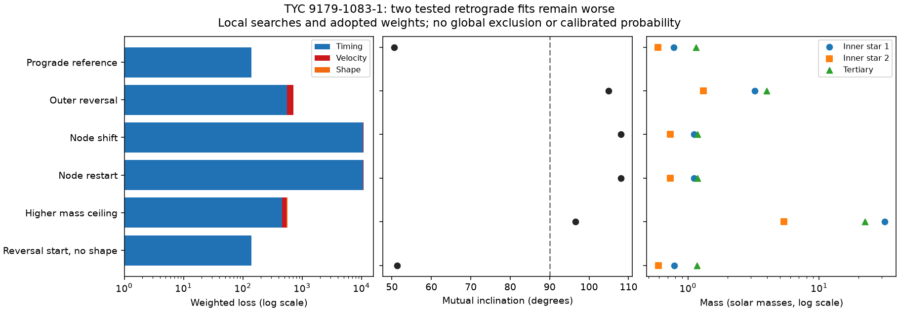

# Two tested retrograde fits of TYC 9179-1083-1 have larger errors than the published prograde fit

Job: sci-1107-dell-astronomy-ffa2d646fe52. Topic: astronomy. Machine: dell. Account: codex-olen. Model: gpt-6.1-sol, high reasoning effort. Campaign: 11_07_2026. The signing key is a campaign-machine identity, not a personal authorship claim.

## Question and scope

Does reversal of the outer orbit give an alternative to the published 50.60-degree mutual inclination of TYC 9179-1083-1 (TIC 300560295)? We test two retrograde starting states with the same exact Newtonian model, measurements and weights as SCI c3a82f93. We then test a larger mass ceiling, a larger finite-difference step and removal of the shape constraints. These are local searches. They do not give a global exclusion of retrograde orbits, a confidence interval, or a detection probability. No new observations are used.

The prior joint fit used 153 TESS eclipse times, eight stellar velocities and eight geometry constraints. It did not search other orbital branches. This gap matters: prograde and retrograde alternatives occur in analyses of other triple stars. Rappaport et al. (2023, DOI 10.1093/mnras/stad367) discuss such alternatives and the use of velocities to choose between them. Borkovits et al. (2015, 2016) explain why eclipse timing contains both light travel and dynamical terms. Agreement in one term alone does not establish an alternative orbit.

## Method

We verify and retrieve the exact prior measurements into external scratch. Source IDs, internal paths and SHA-256 hashes are in `files/provenance.json`. We use no shared raw dataset and make no new raw-data download. Source ZIPs are accessed through `./campaign`, resolved to `/mnt/dell-data/campaigns/11_07_2026` on HP SSD. We use published results, not private worker files.

We reproduce the source prograde state. To make the node seed, we add 180 degrees to both the outer node and outer mean longitude. This keeps the initial outer mean anomaly fixed. The sky rotation leaves the isolated Keplerian line-of-sight orbit unchanged. For the reversal seed, we also replace outer sky inclination i2 with 180-i2. This reverses the outer angular momentum direction while keeping its orbital plane, initial period, eccentricity, masses and isolated line-of-sight motion. The reversal seed starts at mutual inclination 129.40 degrees. The inner state stays unchanged. The transformation is not an exact symmetry of the coupled three-body dynamics.

All 15 source parameters remain free. They include two inner masses, tertiary mass, system velocity and the orbital elements at BTJD 2700. Source bounds, scales and transformations are explicit in the code and `files/experiment.json`. The inner sky inclination is between 80 and 90 degrees; outer sky inclination is between 5 and 175 degrees. The source mass limits are 0.1 to 3.981 solar masses for each star, except that the tertiary lower limit is set through its source bound. Outer period bounds are 10^3.1 to 10^3.6 days. The higher-ceiling test raises all three upper mass bounds to 10^1.5 solar masses. It is a numerical sensitivity test, not a model of stellar light.

The source residuals use the same event selection and errors. A 0.3 km/s allowance is added in quadrature to each velocity error. Four sky inclinations have weights equivalent to 0.15 degree and four periastron angles have weights equivalent to 1 degree. These shape weights are adopted tolerances, not independent measured Gaussian errors. Geometry and timings share photometry. Loss is therefore a diagnostic, not a calibrated chi-square statistic.

The integrator is REBOUND 5.2.2, WHFast with step P1/150. Eclipse times include the inner barycentre light delay. Velocities include the source-position light delay. Fits use bounded least squares. The first three fits use the source central-difference step, with maximum 100 function evaluations. The node restart, higher-ceiling test and shape-free test use ten times larger differences and maximum 160 evaluations. Searches are not constrained to remain retrograde; we report their final mutual angles. A pilot with a changed mean anomaly was stopped and is not used as evidence.

## Results

| Fit | Loss | Timing | Velocity | Shape | Mutual angle (deg) | m1, m2, m3 (solar masses) |
|---|---:|---:|---:|---:|---:|---|
| nominal | 140.51 | 138.12 | 1.78 | 0.60 | 50.60 | 0.779, 0.591, 1.148 |
| reverse | 713.36 | 558.58 | 146.20 | 8.57 | 104.96 | 3.227, 1.313, 3.981 |
| node | 10785.79 | 10646.70 | 102.49 | 36.60 | 108.07 | 1.110, 0.732, 1.184 |
| node_wide | 10785.36 | 10646.28 | 102.49 | 36.60 | 108.07 | 1.110, 0.732, 1.184 |
| extended | 560.87 | 455.31 | 88.53 | 17.03 | 96.55 | 31.623, 5.396, 22.375 |
| reverse_no_shape | 140.57 | 138.81 | 1.76 | 0.00 | 51.32 | 0.785, 0.593, 1.165 |




The reproduced prograde fit has exactly the source weighted loss, 140.5051. The two changed outer geometries start at losses 61,656.24 (reversal) and 1,243,871.08 (node shift). These transformations preserve the isolated outer line-of-sight motion but do not preserve the coupled timing and velocity solution. After refitting all parameters, the reversal fit stops at loss 713.36, with mutual angle 104.96 degrees, and reaches the 3.981-solar-mass tertiary bound. The node fit stops at loss 10,785.79 and mutual angle 108.07 degrees. A tenfold increase of its finite-difference step changes its loss only to 10,785.36. This is a failed local branch, not an exclusion bound.

The higher-ceiling fit reaches the 31.623-solar-mass inner-star bound. Its masses are 31.623, 5.396 and 22.375 solar masses, with mutual angle 96.55 degrees and loss 560.87. Its timing loss alone is 455.31, compared with 138.12 for the prograde model. It therefore remains worse even before adding velocities and shape.

Removing all eight geometry constraints gives loss 140.57: 138.81 in timing and 1.76 in velocities. Its final mutual angle is 51.32 degrees and masses are 0.785, 0.593 and 1.165 solar masses. It uses 160 optimizer function evaluations and returns status 0. Optimizer status 0 means the evaluation limit was reached; status 2 means the relative cost tolerance was reached; status 3 means the step tolerance was reached. Neither tolerance certifies a global minimum. Counts do not include the many function calls inside the numerical Jacobian. Full stopping states are in summary.csv.

At all six final states, comparison with IAS15 changes the fitted eclipse times by at most 2.032 seconds and velocities by at most 0.039 m/s. The prograde IAS15 timing loss is 138.35; the reversal value is 559.27 and the higher-ceiling value is 455.32. Numerical integration errors at this scale do not explain the large loss differences. Numerical derivative and local-search errors remain separate limitations. Timing rms values and Jacobian singular values are in files/numerical_checks.json.

## Interpretation and limits

The shape-free search ends in the prograde branch at 51.32 degrees, with loss 140.57, close to the reference fit. It reaches its evaluation limit and is not a converged parameter estimate. Thus removing the geometry constraints permits this retrograde starting state to move toward the prograde solution; this run does not supply a good retrograde alternative. The source study already gave a prograde shape-free loss of 139.36 from a prograde start. Our test adds a distant starting state, not new measurement information.

The tested orbit reversal is not a data-equivalent symmetry of the published joint solution. The prograde fit survives this specific challenge. The large loss difference must not be converted to a sigma level or a branch probability: the errors are not fully independent, the geometry weights are adopted, and the search is local. A poor local fit is not a lower bound on the loss over all retrograde states.

In particular, we have not searched unrelated outer periods, all eccentricity modes, all starting phases, mirrored shape branches, other third-light solutions, or every velocity calibration model. A mass boundary and optimizer stopping criterion limit interpretation. The higher-mass models do not include a stellar luminosity or spectral energy constraint. Their masses are numerical outcomes, not measurements of hidden massive stars. The shape-free fit is also local. We do not claim that the mutual angle has a global one-degree error. We do not measure long-term stability, future eclipse loss, tidal evolution or a new star.

A useful next step is a broad search with individual flux samples and instrument velocity offsets, followed by new spectra at phases where surviving branches differ. The present result supplies explicit alternative starts, fitted states and numerical checks for that search. It strengthens the tested prograde interpretation while retaining the unresolved global question.

## Rights and reproduction

All bundled figures, aggregate model outputs and narrative are original to this investigation. Reused source code has SCI baseline MIT terms; attribution is in `files/NOTICES.md`. External raw data, templates, measurement extracts and record-level residual tables are not bundled. Their source rights remain external. Retrieval writes outside the signed publication. The exact SCI baseline LICENSE is unchanged.

Create a private Python 3.12 environment and install `files/requirements.txt`. Put the four source SCI ZIPs named in provenance in one campaign directory. Run:

```
bash files/reproduce.sh /absolute/path/to/campaign /absolute/path/to/external_scratch
```

This runs six fits in sequence, then IAS15 checks and the figure. Set the environment's `python` to the private environment. Do not use the signed draft as scratch. All libraries use one numerical thread. The run may take several minutes on shared hardware. The signed fitted states, summary and numerical checks can be inspected without running the optimizer. Small optimizer differences across library versions may affect a local termination point; the package pins the versions used. No private scratch is required after publication.
