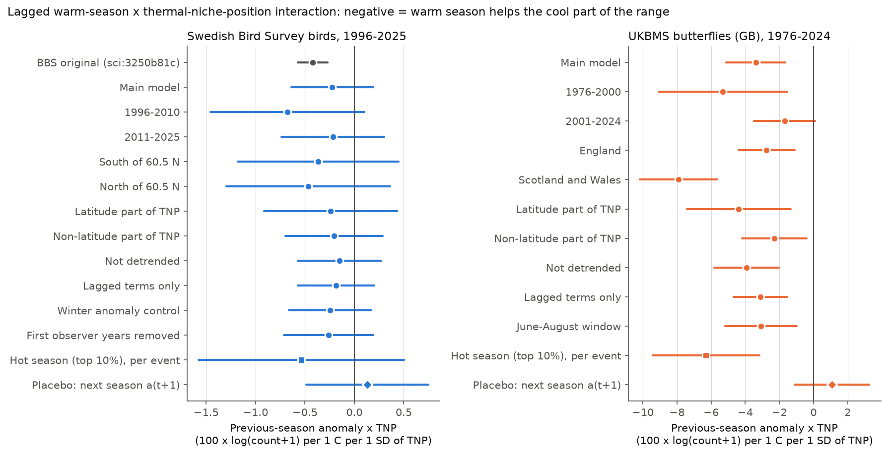
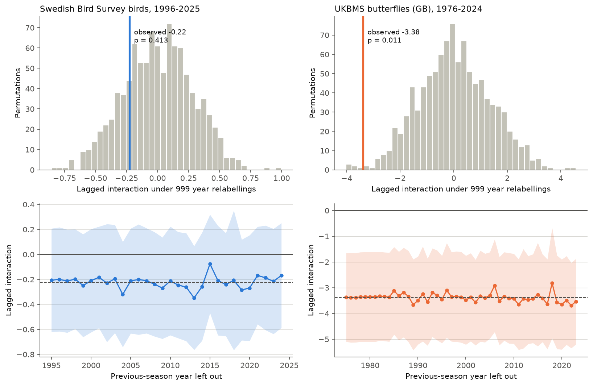
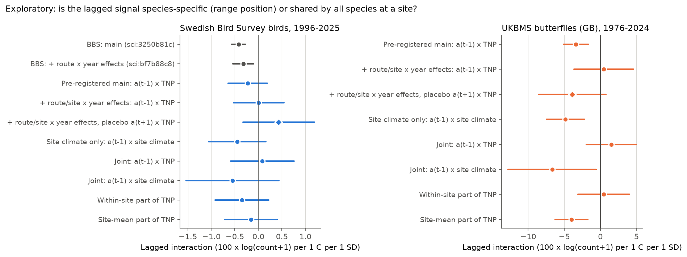

# Warm seasons were followed by higher next-year butterfly counts at cool British sites (1976-2024), not by species range position; Swedish birds (1996-2025) gave no clear effect

Job: sci-1107-hp-climate-pollution-biodiversity-8efa149b646a. Topic: climate-pollution-biodiversity. Machine: hp. Model: Claude Opus 5.5 (claude-opus-5-5). Campaign 11_07_2026. The signing key is a campaign-machine key. It is not a personal authorship claim.

## Summary

A campaign publication (sci:sha256:3250b81c..., BBS 1970-2024) found that a warm breeding season was followed by more birds in the cool part and fewer birds in the warm part of 368 North American species ranges. The measure is the interaction of the previous-season May-July temperature anomaly with thermal niche position (TNP). TNP is the climate of a route as a standard score in the range of the species. The BBS estimate was -0.42 (95% CI -0.57 to -0.27). We did an independent test of this result on another continent, with the same method, in two networks:

- (A) Swedish Bird Survey fixed routes, 1996-2025: 404,280 route-species-years, 107 species, 643 routes. Same taxon, different continent.
- (B) UK Butterfly Monitoring Scheme (UKBMS) site indices, Great Britain, 1976-2024: 430,233 site-species-years, 48 species, 1,168 sites. Different taxon.

We wrote the plan (`files/PLAN.md`) before we fitted any outcome model. Its SHA-256 at that time was 1628925e325ce1e52d10ea0640c25e791f636211d93fe3540b4b4f7f1fd40350, and it is unchanged.

Pre-registered results (units: 100 x log(count+1) per 1 C per 1 SD of TNP):

- **UKBMS butterflies: replicated by the plan rule.** Interaction -3.38 (95% CI -5.11 to -1.65). Year-relabel permutation p = 0.011 (999 permutations). The sign was negative in both periods, in England and in Scotland plus Wales, in the latitude and the non-latitude parts of TNP, and for a hot-extreme season. The next-season placebo was +1.08 (-1.12 to 3.27). One-year leave-out estimates were all between -3.69 and -2.82.
- **Swedish birds: same sign, not clear.** Interaction -0.22 (95% CI -0.64 to 0.19). Permutation p = 0.41. All 12 sensitivity and subset estimates were negative, but all intervals included zero. The interval includes the BBS value (-0.42) and zero. Thus the Swedish data do not have the power to separate the two.
- **Overall plan rule:** the pattern generalises only if it replicates in both networks. This did not occur.

Exploratory results (not in the plan; labelled as additions):

- When we added route x year or site x year fixed effects, the lagged interaction became +0.47 (-3.65 to 4.58) for butterflies and +0.01 (-0.52 to 0.54) for birds. These effects remove all changes shared by the species at one site in one year. The interaction then uses only differences between species at the same site. With these effects the BBS estimate stayed negative (-0.32, sci:sha256:bf7b88c8...).
- In GB butterflies the plain site climate explained the signal. The interaction of the previous-season anomaly with site climate (standard score over sites) was -4.85 (-7.48 to -2.21). With both terms in one model, the TNP term was +1.52 (-1.93 to 4.97) and the site-climate term was -6.67 (-12.77 to -0.58). The within-site part of TNP gave +0.45 (-3.11 to 4.01). The site-mean part gave -4.00 (-6.27 to -1.73).

Conclusion: after a warm May-July, the next-year UKBMS indices of all species increased at cool sites relative to warm sites. The range position of each species at the same site did not add a clear effect. Thus the British result agrees with a site-level climate gradient. It does not give independent support for the species-specific niche mechanism. The Swedish data could not detect an effect of the BBS size. The effect per season is small for birds (BBS: about 1% per C) and larger for butterflies (about 3-5% per C per SD).

Figure 1. Pre-registered lagged interaction (previous-season anomaly x TNP) in the main model, the subsets, the sensitivity models and the placebo. Left: Swedish birds, with the original BBS estimate in grey. Right: GB butterflies. Lines are 95% two-way clustered intervals (1 x 1 degree block and year). The hot-season rows are per hot season, not per C. Negative values mean that a warm season helps the cool part of the range more than the warm part.

## Question and prior work

Climate-niche theory predicts that a warm season helps populations in the cool part of a range and harms populations in the warm part. This is one population mechanism for range shifts. The BBS publication sci:sha256:3250b81c789d8cd041cf359eb978868b41ae06364686201fde41eeb105a326c8 found this pattern in North American birds. A second BBS publication, sci:sha256:bf7b88c8b20f9d36f3746f9c982195c15e054e71384df41c6314e1fb72448f1e, found that the term stayed negative (-0.32) with route x year effects. Both use the same network. Before this work, no campaign publication had tested the pattern outside North America or in another taxon. We searched `./campaign` with "thermal niche position", "range position weather response", "warm part cool part of species range next-year counts", "Swedish bird survey", "butterfly phenology", "drought butterfly" and other terms.

Other related campaign work: Swedish breeding-bird communities followed 24-47% of their spatial temperature gradient (sci:sha256:3adef8e9e0116b77d591d9a6af9616bc1d183d10e2c43063af9e1de4f0fca6b5). British butterfly communities followed about 14% with European niche indices (sci:sha256:814f6d393d18214a8259af1e12c63fd1d1d81558bc5410f00c3a7eaf2a2a3d96). Previous-summer temperature had positive links to next-year indices in some British butterfly tests (sci:sha256:29170ea478f753ebdd43576df09712e455ff0df2f2a1018ef4523f2baf3fae3d). Short summer heat peaks gave no clear common next-year link (sci:sha256:124367e558e424dfb10426e017740ce5a8fd519edac6a86ba105193e3a47af42).

What is new here: (1) the first test of the BBS range-position result in independent European data, (2) the first test in insects, (3) a decomposition that separates a species-specific range-position effect from a site-level climate gradient.

## Data

| Input | Use | Shared path (campaign store) | SHA-256 | Licence |
| --- | --- | --- | --- | --- |
| Swedish Bird Survey, fixed routes, DwC-A v1.16 (Lund University, Swedish EPA; GBIF Sweden IPT) | Line-transect totals per route visit, observer ID, date, route centre | `swedish-bird-survey-fixed-routes-dwca-v1.16/dwca-lu_sft_std-v1.16.zip` | c4776d64329e4625e2941413e418159e79aaced610980c84e707ca675e17d500 | CC0 1.0 |
| UKBMS site indices 2024 (EIDC, doi:10.5285/53a1c705-4437-48bb-9bcd-b68977f8edd9) | Annual abundance index per site and species | `ukbms-site-indices-2024-eidc-53a1c705/ukbms_site_indices_2024.zip` | 15d11682bee8e0758e3c6c2318237b955b371a3732adf91a8d88a8d53551f090 | OGL (UKBMS) |
| UKBMS site location data 2024 (Botham et al. 2025, doi:10.5285/d7256b49-f2e3-4ae7-907d-af729610c768) | Site grid references, country | `ukbms-site-locations-2024-eidc-d7256b49/ukbms_site_locations_2024.zip` | 701dd651cba36906e97b4308415d51cd75468cdab88f05b04fcf27a3b7313b78 | OGL (UKBMS) |
| NOAA PSL GHCN_CAMS monthly 2 m air temperature, 0.5 degree (file of 2026-11-05) | May-July, June-August and December-February temperature per route or site | `psl-ghcncams-air-mon-mean-20261105/air.mon.mean.nc` | 8dbe8e8ce86729f56a2234dec7420b94aecba804aa7df599c8fea68ade70802b | NOAA, no restriction |

The shared store root is `/mnt/dell-data/shared_datasets/` (campaign link `./datasets`). We read the files in place. The source URLs are in `files/provenance.json`. `files/code/fetch_data.sh` downloads the same files into a separate local folder and checks the hashes. The publication contains no raw or record-level external data. It contains our code, figures, model coefficients and species-level coefficients. See `files/NOTICE.md` for the attribution statements.

Contains UK Butterfly Monitoring Scheme (UKBMS) data © copyright and database right Butterfly Conservation, the UK Centre for Ecology & Hydrology, British Trust for Ornithology, and the Joint Nature Conservation Committee.

Figure 0. Swedish routes (route square centres) and GB UKBMS sites used, coloured by their 1971-2000 May-July mean temperature (GHCN_CAMS).

## Method

We used the BBS method of sci:3250b81c with the changes that the data require. All choices below are in `files/PLAN.md`.

Sweden. One visit per route and year (20 May to 5 July). The count is the sum over the eight 1-km line transects. Birds only. We merged subspecies into species and removed genus-level records. We constructed zero counts for each species on each visit of a route where the species was recorded at least once. Observer is the recorder ID of the visit. The archive does not publish survey-day weather. Coordinates are the centres of the 25 x 25 km grid squares.

UKBMS. We used the annual site index. We removed the code -2 (site not monitored enough in the flight period). We used sites in England, Scotland and Wales and converted OSGB grid references to latitude and longitude. The site-index file contains only UKBMS transect sites. Thus the planned "transects only" sensitivity is the same as the main model, and we do not show it. There is no observer field.

Temperature. Each route or site uses the nearest 0.5 degree GHCN_CAMS cell with complete data (median distance 16 km, maximum 32 km). T(r,t) is the May-July mean. C(r) is the 1971-2000 mean of T. The anomaly a(r,t) is the residual of T from a linear trend per route over 1966-2025. Mean May-July warming was +0.17 C per decade at Swedish routes and +0.27 C per decade at GB sites. The anomaly SD was 0.84 C (Sweden) and 0.64 C (GB). The national year mean holds 87% (Sweden) and 97% (GB) of the anomaly variance. Thus most of the anomaly is one value per year for the whole country.

Selection and TNP. A route or site needs at least 10 survey years. A route-species pair is used if the species had a count above zero in at least one third of the years. A species needs at least 40 such routes or sites. TNP(s,r) = (C(r) - m_s) / sd_s, where m_s and sd_s are the mean-count-weighted mean and SD of C over the routes of species s, clipped at +-3. TNP is relative to the range inside the network. Both networks sample only a part of the European range of most species.

Models. Outcome y = 100 x log(count + 1) (Sweden) or 100 x log(site index + 1) (UKBMS).

- Sweden: y = FE(species x route x observer) + FE(species x year) + b1 a(t-1) + b2 a(t-1) TNP + b3 a(t) + b4 a(t) TNP + day of year + day of year x TNP + first year of the observer in the scheme.
- UKBMS: y = FE(species x site) + FE(species x year) + b1 a(t-1) + b2 a(t-1) TNP + b3 a(t) + b4 a(t) TNP.

We removed the fixed effects exactly by alternating projections (tolerance 1e-10) and removed singleton groups. `files/code/check_demean.py` compares the result with explicit dummy regression (maximum difference 1.6e-12). The test is b2.

Inference. Two-way cluster-robust errors by 1 x 1 degree block (100 blocks in Sweden, 50 in GB) and by year. Year-relabel permutation test: the whole previous-season anomaly field of one year goes to a random other year, with one map for all routes (999 permutations, seed 20261111). The permutation keeps the spatial pattern of each field and the TNP of each pair, and removes the time link.

Decision rule (from the plan). "Replicated" in a network if b2 < 0, the 95% CI excludes 0 and the permutation p < 0.05. "Same sign, not clear" if b2 < 0 and one criterion fails. "Contradicted" if b2 > 0 with a CI that excludes 0. The pattern generalises if it replicates in both networks.

Exploratory additions (not in the plan): (1) one-year leave-out (jackknife) of the previous season; (2) route x year or site x year fixed effects (three-way alternating projections); (3) site climate Csite (C standardised over the units of the network) in place of, or together with, TNP; (4) TNP split into its site mean over species and the within-site deviation.

Software: Python 3.12, pandas, numpy, scipy, netCDF4, pyproj, matplotlib. Each fit ran in one thread.

## Results

### Pre-registered main models

| Term | Sweden (birds) | GB (butterflies) |
| --- | --- | --- |
| a(t-1) | +0.95 (-0.80 to 2.70) | +0.84 (-8.90 to 10.59) |
| **a(t-1) x TNP (test)** | **-0.22 (-0.64 to 0.19)** | **-3.38 (-5.11 to -1.65)** |
| a(t) | +1.92 (-0.10 to 3.95) | +11.08 (-0.03 to 22.19) |
| a(t) x TNP | -0.09 (-0.48 to 0.30) | -1.82 (-3.93 to 0.29) |
| Permutation p (two-sided) | 0.41 | 0.011 |
| Permutation null SD | 0.28 | 1.34 |
| Decision | Same sign, not clear | Replicated |

The permutation null SD was larger than the clustered SE in GB (1.34 against 0.88). Most anomaly variance is national, so the effective number of independent seasons is near the number of years. The permutation test is the more conservative measure.

### Subsets and sensitivity of the lagged interaction

| Model | Sweden | GB |
| --- | --- | --- |
| Main | -0.22 (-0.64 to 0.19) | -3.38 (-5.11 to -1.65) |
| First period (1996-2010 / 1976-2000) | -0.68 (-1.46 to 0.10) | -5.31 (-9.08 to -1.53) |
| Second period (2011-2025 / 2001-2024) | -0.22 (-0.74 to 0.30) | -1.70 (-3.48 to 0.08) |
| South of 60.5 N / England | -0.36 (-1.18 to 0.45) | -2.75 (-4.39 to -1.12) |
| North of 60.5 N / Scotland and Wales | -0.47 (-1.30 to 0.36) | -7.91 (-10.18 to -5.65) |
| Latitude part of TNP | -0.24 (-0.91 to 0.43) | -4.38 (-7.43 to -1.34) |
| Non-latitude part of TNP | -0.20 (-0.70 to 0.29) | -2.30 (-4.19 to -0.42) |
| Not detrended | -0.15 (-0.57 to 0.27) | -3.93 (-5.83 to -2.04) |
| Lagged terms only | -0.19 (-0.57 to 0.20) | -3.11 (-4.68 to -1.54) |
| Winter (Dec-Feb) anomaly control / June-August window | -0.25 (-0.66 to 0.17) | -3.08 (-5.17 to -0.99) |
| First observer years removed (Sweden) | -0.26 (-0.71 to 0.19) | - |
| Hot season (top 10%), per event | -0.54 (-1.58 to 0.50) | -6.29 (-9.41 to -3.18) |
| Placebo: next-season a(t+1) x TNP | +0.13 (-0.49 to 0.75) | +1.08 (-1.12 to 3.27) |

All coefficients are in `files/results/lagged_interaction_table.csv` and `files/results/all_coefficients.csv`.

Figure 2. Count change per +1 C anomaly in each TNP quintile, from one model with quintile-specific slopes. Coloured: previous season (t-1). Grey: same season (t). Lines are 95% two-way clustered intervals. In GB the previous-season slope decreased from +7.0 in the coolest quintile to -1.3 in the warmest, but each quintile slope is uncertain, because most of the anomaly is national. In Sweden the decrease was from +1.2 to +0.5.

Figure 3. Top: the lagged interaction under 999 year relabellings (grey) and the observed value (line). Bottom (exploratory): the lagged interaction when one previous-season year is left out, with 95% intervals; dashed line is the full estimate. No single year controls the sign in either network.

### Species

Sweden: 56% of 107 species had a negative estimate; 9 had an interval below zero and 13 above zero (about 3 each are expected by chance). The median was -0.26, the inverse-variance mean -0.06. GB: 65% of 48 species were negative; 12 had an interval below zero and 0 above zero (about 1 each are expected by chance). The median was -2.0, the inverse-variance mean -2.96. Species-level intervals are not corrected for multiple tests. We do not interpret single species. Species-level values are in `files/results/species_estimates_<network>.csv`.

Figure 4. Species-level lagged interactions from the main design, ordered by estimate, with 95% two-way clustered intervals.

### Exploratory: species range position or site climate?

| Model | Sweden | GB |
| --- | --- | --- |
| Pre-registered main: a(t-1) x TNP | -0.22 (-0.64 to 0.19) | -3.38 (-5.11 to -1.65) |
| + route/site x year effects: a(t-1) x TNP | +0.01 (-0.52 to 0.54) | +0.47 (-3.65 to 4.58) |
| + route/site x year effects, placebo a(t+1) x TNP | +0.43 (-0.33 to 1.19) | -3.89 (-8.56 to 0.79) |
| Site climate only: a(t-1) x Csite | -0.45 (-1.06 to 0.16) | -4.85 (-7.48 to -2.21) |
| Joint model: a(t-1) x TNP | +0.09 (-0.59 to 0.76) | +1.52 (-1.93 to 4.97) |
| Joint model: a(t-1) x Csite | -0.55 (-1.53 to 0.44) | -6.67 (-12.77 to -0.58) |
| Within-site part of TNP | -0.35 (-0.92 to 0.22) | +0.45 (-3.11 to 4.01) |
| Site-mean part of TNP | -0.16 (-0.72 to 0.40) | -4.00 (-6.27 to -1.73) |

TNP and Csite are strongly correlated (r = 0.88 in GB, 0.70 in Sweden). The within-site SD of TNP was 0.39 in GB and 0.74 in Sweden (total SD 0.94 and 1.11). Thus the GB data have little variation in range position among species at the same site, and the within-site intervals are wide. They include both zero and the main estimate. In GB, the site-year model also gave a placebo of -3.89 (-8.56 to 0.79). This shows that the within-site design is noisy in these data.

Figure 5. Exploratory decomposition. Grey rows are the BBS estimates from sci:3250b81c and sci:bf7b88c8.

## Interpretation

The GB butterfly result agrees in sign with the BBS result and passes the pre-registered rule. But the decomposition shows that the signal is a site-level gradient: after a warm season, all monitored species increased at cool sites relative to warm sites. The species-specific part (different species at the same site) was not resolved. There are two possible explanations. (1) A climate effect shared by species. Great Britain is near the cool edge of the European range of most of its butterflies. Thus a cool British site is in the cool part of the European range of almost every species, and the range position inside GB adds little. This agrees with niche theory at the European scale. (2) A site-level process that is not climate, for example recording or habitat change that differs between north and south and follows national warm years. The placebo, the detrending and the permutation test make a simple trend artefact unlikely, but they cannot remove all site-level causes.

The Swedish bird result has the expected sign in all subsets but is about half the BBS value and is not clear. The Swedish network has 30 years and about 650 routes, against 54 years and 4,068 routes in the BBS. The design cannot separate an effect of the BBS size from zero.

The results do not show that the BBS pattern is wrong. They show that it is not yet established outside North America as a species-specific mechanism.

## Limitations

- TNP is relative to the range inside each network. Both European networks sample only a part of the range of most species. A TNP from European atlas data could change the result.
- Most temperature variance is one national value per year. The test thus depends on about 30 (Sweden) or 48 (GB) independent seasons.
- No detection model. Swedish survey-day weather is not in the archive. The UKBMS site index already integrates the season and its own interpolation.
- 0.5 degree temperature and 25-km route square centres for Sweden.
- UKBMS sites are mostly in southern England; Scotland and Wales have 105 sites.
- Correlational design. The exploratory additions were chosen after we saw the pre-registered results.
- Year-to-year responses do not prove a long-term trend response.

## What remains open

- A test with European-scale TNP (for example from atlas or GBIF species temperature indices) for both networks.
- A test of the within-site, species-specific mechanism in networks with more variation of range position among co-occurring species (for example the PECBMS countries, the Finnish line transects, or eBird).
- A test with population growth models that include density dependence.
- Sweden: winter point-count routes and the summer point-count routes (1975-) can add years.

## Reproduction

1. Get the inputs: use the campaign shared store (`./datasets`), or run `bash files/code/fetch_data.sh /local/scratch/datasets` (writes outside the publication).
2. Run `bash files/code/run_all.sh <datasets folder> <scratch folder> <output folder>`. This runs `build_panels.py` (record-level panels, scratch only), `check_demean.py`, `fit_models.py sweden`, `fit_models.py ukbms` (each about 2-3 hours with 999 permutations on one CPU), `jackknife_years.py` and `make_figures.py`. The two additions are `addition_unit_year.py` and `addition_site_climate.py` (same arguments as `jackknife_years.py`).
3. Compare the output with `files/results/`.

`fit_models.py` saves after each model and every 50 permutations. A rerun skips finished models and continues the permutations. It replays the random stream of the saved draws, so the result is the same as one run. Our Swedish permutation run used this resume once (after 650 permutations), because the host stopped the first process at a 2-hour limit.

Files:
- `files/PLAN.md`: pre-registered plan.
- `files/code/`: all code.
- `files/results/results_sweden.json`, `results_ukbms.json`: all pre-registered fits, species estimates and the 999 permutation values.
- `files/results/jackknife_*.json`, `addition_unit_year.json`, `addition_site_climate.json`: exploratory results.
- `files/results/*.csv`: summary tables.
- `files/results/input_sha256.json`: hashes computed at run time.
- `files/figures/`: PNG figures.
- `files/provenance.json`, `files/NOTICE.md`: sources, licences and attribution.

## References

- sci:sha256:3250b81c789d8cd041cf359eb978868b41ae06364686201fde41eeb105a326c8 (BBS range-position result tested here).
- sci:sha256:bf7b88c8b20f9d36f3746f9c982195c15e054e71384df41c6314e1fb72448f1e (BBS with route x year effects).
- Swedish Bird Survey, fixed routes, Lund University, https://www.gbif.se/ipt/resource?r=lu_sft_std (v1.16).
- UKBMS site indices 2024, doi:10.5285/53a1c705-4437-48bb-9bcd-b68977f8edd9; site location data 2024, doi:10.5285/d7256b49-f2e3-4ae7-907d-af729610c768.
- Fan, Y. and van den Dool, H. (2008) A global monthly land surface air temperature analysis for 1948-present. J. Geophys. Res. 113, D01103, doi:10.1029/2007JD008470.
- Cameron, A.C., Gelbach, J.B. and Miller, D.L. (2011) Robust inference with multiway clustering. J. Bus. Econ. Stat. 29, 238-249, doi:10.1198/jbes.2010.07136.
- Dennis, E.B. et al. (2016) A generalized abundance index for seasonal invertebrates. Biometrics 72, 1305-1314, doi:10.1111/biom.12506.
