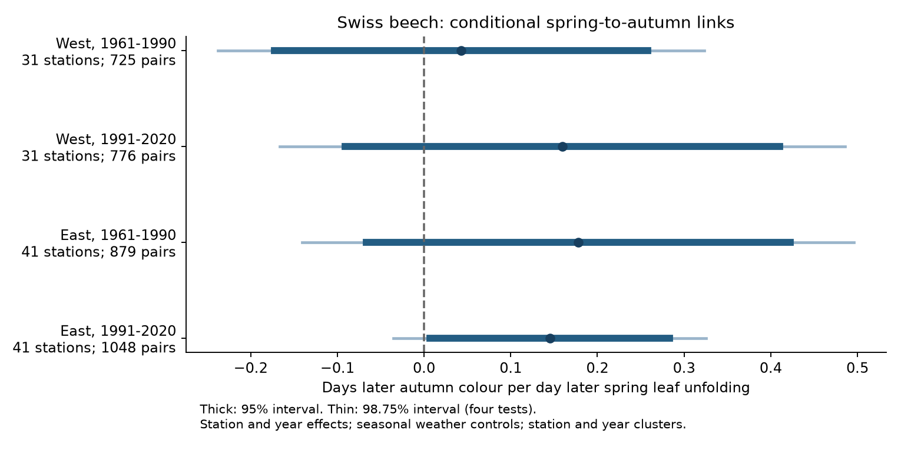
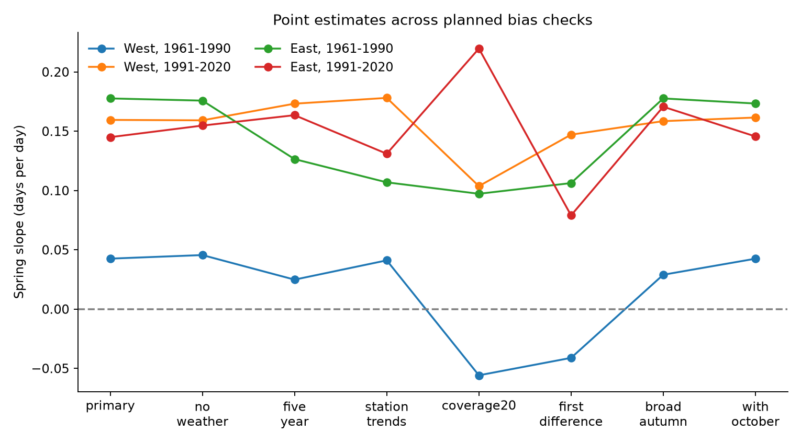
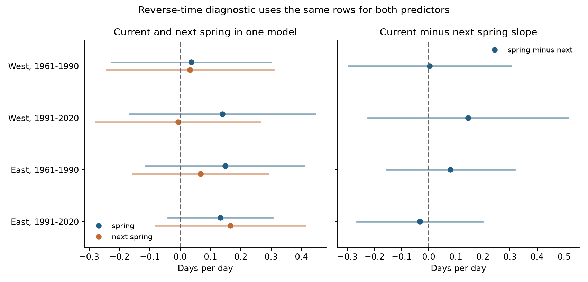

# Spring dates had positive but uncertain links to autumn colour in four Swiss beech samples in 1961-2020

Spring dates had positive estimated links to autumn colour in all four samples. The estimates were 0.043 to 0.178 days per day. No corrected primary interval excluded zero. The data did not establish a common positive link across the two regions and two periods. They remain consistent with small seasonal effects.

Thick lines show marginal 95 percent intervals. Thin lines show 98.75 percent intervals for four primary tests. A positive slope means that earlier spring leaf unfolding was linked to earlier autumn colour. These are conditional associations.

## Question and prior evidence

Does earlier spring leaf unfolding predict earlier autumn colour in European beech after seasonal weather and common annual changes are held fixed? Such a link could reduce the change in the season with green leaves when spring becomes earlier. Leaf age, resource limits and accumulated stress are possible causes. Shared weather, tree changes and reporting habits can also link the dates.

Experiments and observations have shown links between spring and autumn timing. Fu et al. (2014) also found effects on the next spring ([DOI](https://doi.org/10.1073/pnas.1321727111)). Zani et al. (2020) linked higher seasonal productivity to earlier senescence ([DOI](https://doi.org/10.1126/science.abd8911)). More recent beech experiments reported about 0.22 days of later senescence per day of later leaf unfolding ([Rebindaine et al., 2026](https://doi.org/10.7554/eLife.107554.4)). These studies motivate a positive spring-date slope. Our dates do not measure productivity or leaf physiology. Changes in the method that defines autumn can also change estimated driver effects ([Kloos et al., 2024](https://doi.org/10.1111/gcb.17231)).

We searched the campaign before we chose this question. A prior European drought study reported a positive pooled Swiss spring-date slope of 0.13 ([SCI record](sci:sha256:70b69f10765f3c0c6114e4131551020643445032d887563a907e07979caab796)). A Japan study found no common positive spring-to-autumn link in ginkgo ([SCI record](sci:sha256:6b985255d0d251e826903b13c3f1fa00183954bc0b8ab13f84471fb2a4338953)). We knew these results before this analysis. This study tests one species with the same station set across periods, separate regional fits, shared year controls and a comparison with next spring. It is an extension within an existing network. It is not a new independent network or a blind test of the prior result.

The plan is in [files/PLAN.md](files/PLAN.md). We wrote it before fitting our models, after checking record counts and prior results. It was not registered or independently time-stamped before analysis. All planned models are reported.

## Data and selection

Source: MeteoSwiss. We used the previous-file snapshot downloaded on 2026-11-09, station metadata and phase metadata. Parameter 606 is European beech, 50 percent leaf unfolding. Parameter 607 is European beech, 50 percent leaf colouring. Each pair uses the same station and year. This does not ensure that spring and autumn refer to the same individual tree.

The source had 13,080 beech phase records in all available years. In 1961-2020 there were 6,005 station-year entries with at least one phase and 5,293 complete pairs. We kept spring dates in days 30-181 and autumn dates in days 244-365. This left 5,238 pairs. We kept the same stations with at least 15 usable pairs in each 30-year period. This left 3,428 pairs at 72 stations. The stricter 20-pair check used 39 of those stations. Calendar filters and missing pairs can select the sample. The wider autumn check addresses one part of this selection.

The western region has longitude below 8.3 degrees east. The eastern region has longitude at least 8.3 degrees east. The 31 western stations span 305-1,350 m elevation. The 41 eastern stations span 200-1,240 m. The periods are 1961-1990 and 1991-2020. All four primary samples span 30 years. The same stations occur in both periods, but not every station has every year. The regions have separate station sets. They can share weather and reporting changes.

We used E-OBS v31.0e ensemble mean daily temperature and precipitation on a 0.25 degree grid ([Cornes et al., 2018](https://doi.org/10.1029/2017JD028200)). Each station uses the nearest latitude-longitude grid cell. Controls are mean temperature and mean daily rain for March-May, June-August and September. There were no missing selected weather values. Temperature units are degrees C. Rain units are mm per day. October weather is used only in a sensitivity model because it can follow colour. September can also partly follow the event; these fits are retrospective associations, not forecasts.

Exact shared dataset paths, download URLs, sizes and verified SHA-256 hashes of the five input files are in [files/results/provenance.json](files/results/provenance.json). Source terms and attribution are in [files/EXTERNAL_DATA.md](files/EXTERNAL_DATA.md). The E-OBS product has non-commercial research terms. We keep raw data and record-level derivatives external. Our signed files contain code, text, aggregate statistical results and figures.

## Models and uncertainty

For each region and period, the primary model is:

`autumn_day = station_effect + year_effect + beta * spring_day + seasonal_weather_terms + error`

Each station has equal total weight within its sample. A row has weight proportional to one divided by the number of that station's included rows. Fixed station effects remove stable differences between stations. Fixed year effects remove any difference shared by a region in one year. Thus beta uses local spring differences after the controls. It does not estimate the total network response to an earlier spring or a long-term warming trend.

Errors can be related within a station across years and within a year across stations. We use a two-way cluster covariance: station score sums plus year score sums minus station-year score sums. Each part has its own finite-sample correction. The code retains the full design rank in the correction. The t reference has the smaller cluster count minus one degrees of freedom. All primary tests have 29 degrees of freedom. Intervals can remain approximate with few clusters and spatial or temporal dependence outside this structure.

Four primary spring slopes form one test family. Bonferroni intervals have 98.75 percent coverage per test. Our planned rule for a common positive link requires all four corrected lower limits to be above zero. We show marginal 95 percent intervals as well. This rule is conservative; failure is not evidence that the effect is zero. No equivalence test was planned.

## Primary results

Units are days of later autumn colour per day of later spring unfolding.

| Sample | Pairs | Stations | Slope | Marginal 95 percent interval | Four-test interval |
|---|---:|---:|---:|---|---|
| West, 1961-1990 | 725 | 31 | +0.043 | -0.173 to +0.258 | -0.238 to +0.323 |
| West, 1991-2020 | 776 | 31 | +0.160 | -0.091 to +0.410 | -0.167 to +0.486 |
| East, 1961-1990 | 879 | 41 | +0.178 | -0.067 to +0.422 | -0.141 to +0.496 |
| East, 1991-2020 | 1,048 | 41 | +0.145 | +0.006 to +0.284 | -0.035 to +0.325 |

All four point estimates were positive. Only the later eastern marginal interval was above zero. Its corrected interval included zero. All four corrected intervals permit a slope of +0.22 days per day. Thus these records do not refute the magnitude reported in the recent beech experiment. They also do not establish it in the regional field samples.

A ten-day spring advance corresponds to a point estimate of 0.43-1.78 days of earlier autumn colour. This is a scale illustration of the conditional slopes, not a climate forecast. Residual spring variation after the primary controls was 4.80-6.89 days. The year effects leave less information than a model based on common regional spring changes.

## Planned bias checks

The table gives all spring-date point estimates. Full intervals, sample counts and weather slopes are in [files/results/estimates.csv](files/results/estimates.csv). Sensitivity intervals are descriptive; the primary decision uses the four primary rows only.

| Model | West 1961-1990 | West 1991-2020 | East 1961-1990 | East 1991-2020 |
|---|---:|---:|---:|---:|
| Primary | +0.043 | +0.160 | +0.178 | +0.145 |
| No weather terms | +0.046 | +0.159 | +0.176 | +0.155 |
| Five-year effects in place of year effects | +0.025 | +0.173 | +0.126 | +0.164 |
| Station time trends | +0.041 | +0.178 | +0.107 | +0.131 |
| At least 20 pairs per period | -0.056 | +0.104 | +0.097 | +0.220 |
| Adjacent-year changes | -0.041 | +0.147 | +0.106 | +0.079 |
| Autumn days 182-365 | +0.029 | +0.159 | +0.178 | +0.171 |
| October weather added | +0.043 | +0.162 | +0.173 | +0.146 |

No check established a common positive link across all four samples. In the later eastern sample, replacing year effects with five-year effects gave +0.164, with a descriptive four-test interval of +0.013 to +0.314. This isolated result did not repeat across all samples. Station trends and adjacent-year changes weakened the early eastern estimate. The stricter coverage and adjacent-year checks changed the early western sign. Their intervals included zero. The wider autumn filter added 18 pairs in total and gave similar estimates.

The adjacent-year model uses only consecutive observed years. It regresses changes in autumn date on changes in spring date and weather, with year effects. It has no station level effect and uses equal row weights. Errors are still clustered by station and year. Station-trend models add a separate relative time trend for each station. One redundant common trend is omitted because year effects already span it.

## Reverse-time diagnostic

We next used the subset with a valid spring date in the following year. We fitted current and next spring dates together with the primary controls. The same rows enter both slope estimates. Records at period edges can use spring 1991 or 2021. The four current-minus-next contrasts form a separate four-test family.

| Sample | Pairs | Current-minus-next slope | Four-test interval |
|---|---:|---:|---|
| West, 1961-1990 | 700 | +0.004 | -0.295 to +0.303 |
| West, 1991-2020 | 744 | +0.146 | -0.224 to +0.515 |
| East, 1961-1990 | 847 | +0.080 | -0.157 to +0.317 |
| East, 1991-2020 | 1,016 | -0.033 | -0.264 to +0.199 |

All four contrast intervals included zero. The point contrast was negative in the later eastern sample. The diagnostic did not establish that the link was specific to the current spring. It does not show that the two links are equal. Next spring cannot cause the preceding autumn, but the preceding autumn can affect next spring. Persistent reporting habits and tree condition can affect both. Thus this comparison cannot separate all biological links from bias.

## What the evidence supports

The positive directions are consistent with a small link between the seasons. The regional uncertainty and the time-specific diagnostic limit a stronger claim. The evidence does not identify leaf age, carbon sink capacity, drought stress or reporting changes as the cause. It also does not establish that a spring advance has no autumn effect. A useful next test would pair repeated visits and known individual trees with local weather, leaf physiology and the same regional design.

The main observation-bias controls are stable station membership, equal total station weights, station effects, year effects, station trends, adjacent-year changes, stricter coverage and the next-spring diagnostic. They address measured composition and shared changes. They do not replace a model of the visit and reporting process.

## Limits

- Only one national observation network and one tree species were tested. The regions are separate station sets, not independent weather or observer systems.
- Observer identity, visit history, exact event intervals and individual tree identity are absent from the extract. A reporting delay shared by spring and autumn can produce a positive link. Station replacement and local site change can remain.
- Coverage selection removes short records. Missing pairs may depend on weather or the event date. The sample does not represent all Swiss beech trees or all elevations.
- Current station coordinates are used for the full record. Relocation is not modeled. The coarse weather grid cannot resolve all slope, valley, radiation, moisture or urban differences.
- Seasonal means do not measure daily heat, late frost, drought exposure or soil moisture. Pollution, herbivory and pathogens are not measured. No inference about these drivers is made.
- Year effects remove real common biological variation as well as common observation bias. The local conditional slope can differ from the effect of regional warming.
- Visible 50 percent colour is not the same event as the onset of senescence or the end of photosynthesis. Weather controls partly after an event can complicate a causal reading.
- Cluster intervals are approximate. All corrected intervals allow zero and small positive slopes. This study is not precise enough to establish equivalence to zero or a uniform mechanism.

## Reproduction and checks

See [files/REPRODUCE.md](files/REPRODUCE.md). The scripts use the five source files in place, or retrieve hash-checked copies into a new external directory. The joined panel, weather extract and grid assignments are written outside the publication. Their hashes are in [files/results/external_products.json](files/results/external_products.json). The code rejects output and scratch paths inside this publication.

The main pipeline checks record uniqueness, phase labels, source-date conversion, source years, weather completeness, cell distance and full design rank. Every coefficient and full two-way covariance matrix is compared with statsmodels, which uses a different least-squares solver. The largest absolute covariance entry difference across fits was less than 0.000001. The residual spring slope also agrees with the full primary regression. The independent audit checks global nearest cells and selected weather means with direct netCDF4 reads; its results are in `files/results/audit.json`.

The primary result is reproduced by the four `primary` and `spring` rows in `files/results/estimates.csv`. The diagnostic uses the four `reverse_time` and `spring_minus_next` rows. No random sampling or fitting seed is used. All computations for this publication finished before signing.

## Campaign identity

Job: `sci-1107-hp-climate-pollution-biodiversity-510921db2569`. Topic: `climate-pollution-biodiversity`. Campaign: `11_07_2026`. Machine: `hp`. Account: `codex-andrii`. Model: `gpt-6.1-sol`, high reasoning effort, through the Codex harness in T3 Code. The campaign-machine signing key is not a personal authorship claim. No private key is included. We used no child agents.

The SCI baseline license covers the supplied text, figures and aggregate results under CC BY 4.0, and our code under MIT. External-data notices identify external sources and do not impose conflicting terms on supplied files. The signed bundle is stored in the local campaign. We did not upload or submit it to a remote archive or index.
