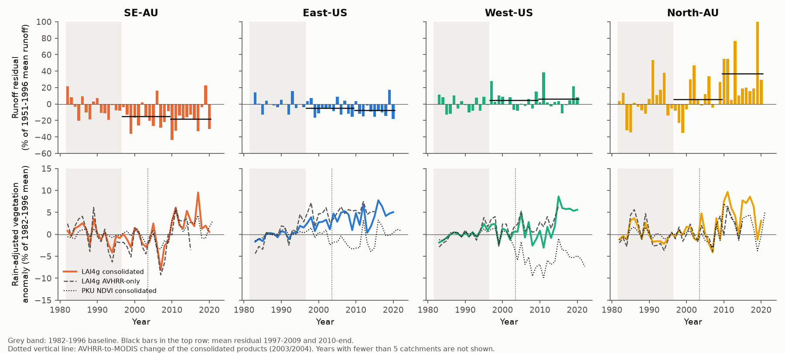
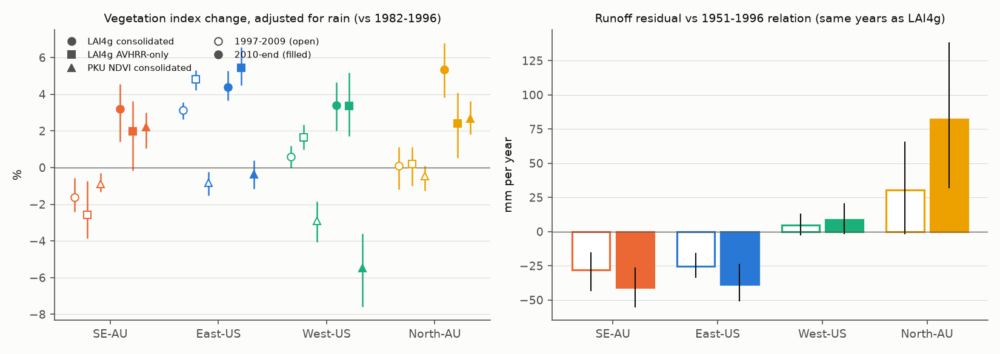
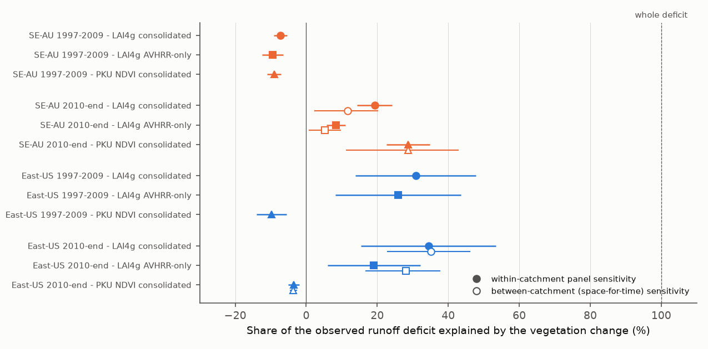

# Greening did not cause post-1997 runoff losses in 175 south-east Australian and 260 eastern US catchments: leaf area fell in 1997-2009 in Australia and explains at most one third after 2009 (satellite LAI and NDVI, 1982-2021)

Job `sci-1107-dell-earth-and-ocean-sciences-f81a4850b323`, campaign 11_07_2026, topic
earth-and-ocean-sciences, machine dell, account claude-sci. Model: Claude Opus 5.5
(`claude-opus-5-5`) in Claude Code (T3 Code). The signing key is a campaign-machine key. It is
not a personal authorship claim.

## Summary

**Question.** Earlier campaign bundles found two post-1997 runoff losses. In south-east Australia
(SE-AU, 175 CAMELS-AUS catchments) runoff lost 20-25% of its response to rain. In the eastern US
(East-US, 260 CAMELS catchments) runoff had a constant offset of about -7%. Both lost about 40 mm
per year after 2009 (bundles 20955da2, 871b2192). Rain-gauge networks, evaporative demand and
water storage do not explain the losses (bundles 20955da2, 58715cfe, ccf7e5d4). The missing water
probably left the catchments as evapotranspiration or water use. Vegetation was not tested. We
asked: did more leaf area (greening) cause either loss?

**Data and method.** We calculated catchment-mean leaf area index (LAI) and NDVI for 1982-2022
from three satellite products: GIMMS LAI4g v1.2 consolidated (AVHRR to 2003, MODIS-based from
2004), GIMMS LAI4g v1.2 AVHRR-only (1982-2015, no sensor change) and PKU GIMMS NDVI v1.2
(AVHRR to 2002, MODIS from 2003). Runoff residuals are relative to each catchment's 1951-1996
relation Q = a + bP + cP(t-1) + dT (same model as the earlier bundles). For each catchment we
removed the rain effect from the vegetation index with a 1982-1996 fit V = a + bP + cP(t-1). We
wrote a plan (`files/ANALYSIS_PLAN.md`) before we calculated any vegetation value. It has five
endpoints: regional greening (E1), catchment correlation of greening and runoff loss (E2),
size of the implied runoff loss from a space-for-time ET sensitivity (E3), a 1997 step model
against a vegetation model for the regional series (E4), and a within-catchment panel (E5).
West-US (279) and North-AU (64) catchments, which did not lose runoff, are controls. Intervals
are 95% cluster-bootstrap intervals over 2 x 2 degree cells.

**Main results.**

1. **SE-AU vegetation decreased when the Australian loss started.** In 1997-2009, when SE-AU
   runoff was 28 mm/yr (24%) below its relation, the rain-adjusted vegetation index was *lower*
   than in 1982-1996 in all three products: LAI4g -1.6% (95% CI -2.4 to -0.6), AVHRR-only LAI
   -2.6% (-3.9 to -0.7), NDVI -0.9% (-1.3 to -0.3). With the panel sensitivity, this browning
   predicts 1.7-2.2% *more* runoff, not less. Thus greening did not start the SE-AU loss.
2. **After 2009 SE-AU greened a little, which explains 5-29% of the loss.** In 2010-end the
   rain-adjusted index was +3.2% (LAI4g, CI +1.4 to +4.6), +2.0% (AVHRR-only, -0.2 to +3.6) and
   +2.2% (NDVI, +1.1 to +3.0). The implied runoff change was 3-12 mm/yr against an observed
   41-55 mm/yr (space-for-time) and 8-29% of the loss (panel). The LAI change that the observed
   loss needs is about 0.8 m2/m2; the observed change was about 0.09 m2/m2.
3. **East-US greening depends on the product and can explain at most about one third.** LAI4g
   increased by 3.1% in 1997-2009 and 4.4% in 2010-2020 (AVHRR-only: 4.8% and 5.4%). This
   implies 19-35% of the East-US offset (11-15 mm/yr of 38-41 mm/yr). NDVI did not increase
   (-0.8% and -0.4%), which implies no runoff loss. NDVI saturates in dense forest, so LAI is
   more relevant there, but the products do not agree.
4. **Regions without a runoff loss greened as much.** West-US LAI4g increased by 3.4% after 2009
   and North-AU by 5.3%, while their runoff was 9 and 82 mm/yr *above* the 1951-1996 relation.
5. **Catchments that greened more did not clearly lose more runoff (planned E2).** With LAI4g in
   2010-end, Spearman rho was -0.13 (-0.33 to +0.05) in SE-AU and -0.00 (-0.14 to +0.14) in
   East-US. AVHRR-only LAI gave -0.02 and -0.02. NDVI gave negative values: -0.25 (-0.52 to
   -0.04) in SE-AU and -0.41 (-0.54 to -0.25) in East-US; with aridity and a quadratic surface of
   position controlled (post hoc), -0.27 and -0.18. The signs do not agree between the LAI and
   NDVI products.
6. **A 1997 step describes the regional runoff series better than the vegetation series
   (planned E4).** In SE-AU and East-US, a step at 1997 had a lower AIC than the vegetation
   anomaly series in 5 of 6 product cases (by 2.3-7.8 units). Adding the vegetation series did
   not reduce the step (SE-AU -12.5 to -12.3 percentage points with LAI4g; East-US -6.2 to -6.7).
   The only exception is SE-AU NDVI (AIC 216.0 against 216.9; step -13.0 to -11.2).
7. **Post-fire regrowth did not explain the Victorian loss (Addendum B, exploratory).** In 104
   Victorian catchments, the area burned by bushfires in 1997-2009 (mean 11%, 2003, 2006-07 and
   2009 fires) did not go with a larger 2010-2021 loss (rho +0.05, p = 0.59). Catchments with 20%
   or more burned lost *less* runoff than catchments with less than 5% burned (-14% against -23%;
   difference +8.7 points, CI -3.8 to +16.7).
8. **Forest catchments lost more runoff at equal aridity (Addendum A, exploratory).** In SE-AU,
   the closed-forest fraction had a partial rank correlation with the 2010-end runoff residual of
   -0.30 (q = 0.0005) after aridity control. In East-US, the CAMELS maximum LAI had -0.16
   (q = 0.03). Farm-dam and land-use disturbance indices did not (impound_fac -0.02, landuse_fac
   -0.02). This static result does not show a change in time.

**Conclusion.** By the planned decision rule, the vegetation hypothesis was supported in no
region or product. It is rejected for the start of the SE-AU loss (vegetation decreased in all
three products) and, with NDVI, for the East-US offset. The other cases are inconclusive, with
greening that can explain at most about one third of a loss. Greening after 2009 was similar in
control regions without a loss, and a 1997 step remains after vegetation control. Thus satellite
greening is not the main physical cause of either post-1997 shift. A water loss that does not
appear as more leaf area remains possible: for example deeper or more efficient root water use,
groundwater use by vegetation, water use by people, or a change of evaporation per unit leaf.
The forest association in Addendum A agrees with a forest-water-use mechanism that satellite
leaf area does not show, but it is static and post hoc.

## Figures

**Figure 1.** Top: regional mean annual runoff residual relative to the 1951-1996 relation (% of
the 1951-1996 mean runoff; AGCD and nClimGrid rain). Black lines: means for 1997-2009 and
2010-end. Bottom: rain-adjusted vegetation anomaly relative to 1982-1996 for the three
products. In SE-AU the index decreased during 1997-2009, when the runoff loss started.

**Figure 2.** Left: rain-adjusted vegetation change by region, product and period (95%
cluster-bootstrap intervals). Right: runoff residual in mm per year in the same years (LAI4g
years). West-US and North-AU greened as much as SE-AU and East-US but did not lose runoff.

**Figure 3.** Catchment rain-adjusted vegetation change against the runoff residual,
2010-end. Top: LAI4g (no clear relation). Bottom: NDVI (negative relation). Residuals are clipped
for display only.

**Figure 4.** Share of the observed runoff loss that the vegetation change predicts. Filled:
within-catchment panel sensitivity (E5, post-1997 coefficient times the mean change; interval
from the coefficient only). Open: between-catchment space-for-time ET sensitivity (E3; interval
from the coefficient only). Negative values in 1997-2009 mean that vegetation change predicts more
runoff. No value is near 100%.

## Tables

**Table 1. Planned endpoints E1-E3 and E5 for the test regions.** dV = rain-adjusted vegetation
change (%). Q = runoff residual. Space-for-time = implied runoff change from E3. Panel = implied
runoff change from E5. P1 = 1997-2009; P2 = 2010 to end of the product (LAI4g 2020, AVHRR-only
2015, NDVI 2021 AU / 2022 US with runoff to 2021 AU and water year 2025 US).

| Region, period, product | dV % [95% CI] | Q mm/yr | Q % | rho(dV, Q%) [95% CI] | Space-for-time mm/yr | Panel % |
| --- | --- | ---: | ---: | --- | ---: | ---: |
| SE-AU P1 LAI4g | -1.6 [-2.4, -0.6] | -28.2 | -23.7 | -0.17 [-0.37, +0.06] | - | +1.7 |
| SE-AU P1 AVHRR-only | -2.6 [-3.9, -0.7] | -28.2 | -23.7 | -0.23 [-0.42, +0.03] | - | +2.2 |
| SE-AU P1 NDVI | -0.9 [-1.3, -0.3] | -28.2 | -23.7 | -0.25 [-0.50, +0.12] | - | +2.1 |
| SE-AU P2 LAI4g | +3.2 [+1.4, +4.6] | -41.0 | -17.7 | -0.13 [-0.33, +0.05] | -4.8 | -3.4 |
| SE-AU P2 AVHRR-only | +2.0 [-0.2, +3.6] | -54.8 | -20.7 | -0.02 [-0.26, +0.23] | -2.9 | -1.7 |
| SE-AU P2 NDVI | +2.2 [+1.1, +3.0] | -42.9 | -18.4 | -0.25 [-0.52, -0.04] | -12.3 | -5.3 |
| East-US P1 LAI4g | +3.1 [+2.6, +3.6] | -25.3 | -4.9 | -0.17 [-0.30, -0.01] | - | -1.5 |
| East-US P1 AVHRR-only | +4.8 [+4.2, +5.3] | -25.3 | -4.9 | -0.27 [-0.43, -0.09] | - | -1.3 |
| East-US P1 NDVI | -0.8 [-1.5, -0.2] | -25.8 | -5.1 | -0.27 [-0.44, -0.06] | - | +0.5 |
| East-US P2 LAI4g | +4.4 [+3.7, +5.3] | -38.4 | -6.1 | -0.00 [-0.14, +0.14] | -13.5 | -2.1 |
| East-US P2 AVHRR-only | +5.4 [+4.5, +6.6] | -40.7 | -7.5 | -0.02 [-0.20, +0.19] | -11.4 | -1.4 |
| East-US P2 NDVI | -0.4 [-1.2, +0.4] | -39.1 | -6.3 | -0.41 [-0.54, -0.25] | +1.4 | +0.2 |

The space-for-time sensitivity of mean ET to mean LAI across catchments (1982-1996, with mean P
and PET in the model) was 49 mm/yr per m2/m2 in Australia (CI 12-85) and 127 in the US (83-168).
The panel coefficient (two-way fixed effects, runoff residual fraction on vegetation anomaly
fraction, post-1997 years) was -1.07 (-1.35 to -0.80) in SE-AU and -0.48 (-0.75 to -0.22) in
East-US with LAI4g. It was also negative in West-US (-0.62), where runoff did not decrease. This
coefficient can include shared weather effects; we use it only for size. Full values for all
regions and products: `files/results/summary_by_product.csv`, `endpoints_*.csv` and
`models_*.json`.

**Table 2. Planned E4: regional annual runoff residual series (% of mean Q), 1982-end.**

| Region | Product | AIC step | AIC vegetation | Step alone (points) | Step with vegetation | r(series) |
| --- | --- | ---: | ---: | ---: | ---: | ---: |
| SE-AU | LAI4g | 211.8 | 218.1 | -12.5 | -12.3 | -0.11 |
| SE-AU | AVHRR-only | 178.6 | 186.4 | -13.5 | -13.2 | +0.14 |
| SE-AU | NDVI | 216.9 | 216.0 | -13.0 | -11.2 | -0.43 |
| East-US | LAI4g | 170.7 | 173.0 | -6.2 | -6.7 | -0.22 |
| East-US | AVHRR-only | 143.3 | 146.1 | -6.1 | -8.5 | -0.22 |
| East-US | NDVI | 176.9 | 181.9 | -6.6 | -6.6 | +0.05 |

## Checks

- **Sensor change.** Between 2000-2003 and 2004-2007, the consolidated LAI4g East-US anomaly rose
  1.6 points more than the AVHRR-only anomaly (`results/sensor_switch_check.csv`). The AVHRR-only
  product, which has no sensor change, still shows East-US greening (+4.8% in 1997-2009) and
  SE-AU browning in 1997-2009 (-2.6%). The main conclusions do not depend on the sensor change.
- **SILO rain.** With SILO rain for the SE-AU runoff relation, the 2010-2021 runoff residual is
  smaller (as in bundle 871b2192), the vegetation change is the same (+3.2%), rho is -0.10
  (-0.32 to +0.08) and the 1997 step stays preferred (AIC 204.2 against 207.0)
  (`results/*_lai4g_SILO*`).
- **Rain adjustment.** Raw (not rain-adjusted) changes give the same signs (`endpoints_*.csv`,
  metric `dV`).
- **Mean-of-ratios caveat.** The percentage runoff residual is the mean over catchments of
  sum(residual)/sum(predicted). In dry West-US and North-AU catchments it is dominated by
  near-zero predictions (for example +75% for West-US in 1997-2009). Use the mm values for these
  controls.

## Decision rule outcome (planned)

Support needed: greening (E1 above 0), E2 rho below 0 with an interval below 0, and E3 at least
half of the loss. Rejection: no greening, or E2 interval that excludes rho <= -0.2 together with
E3 below one quarter.

| Case | E1 | E2 | E3 share | Outcome |
| --- | --- | --- | ---: | --- |
| SE-AU 1997-2009 (all products) | browning | - | - | rejected |
| SE-AU 2010-end LAI4g | greening | -0.13, CI includes 0 and -0.2 | 12% | inconclusive, not supported |
| SE-AU 2010-end NDVI | greening | -0.25, CI below 0 | 29% | inconclusive, not supported |
| East-US 2010-end LAI4g | greening | -0.00, CI excludes -0.2 | 35% | inconclusive, not supported |
| East-US 2010-end NDVI | no greening | -0.41 | -4% | rejected |

## Limitations

- Satellite LAI and NDVI are indirect measures of transpiring leaf area. They do not see roots,
  stomatal change, understorey or groundwater use. The products disagree in the East-US, where
  NDVI saturates in forest.
- The vegetation baseline is 1982-1996 only (15 years), and the AVHRR period has known
  calibration problems. The consolidated products change sensor in 2003/2004.
- The space-for-time sensitivity (E3) and the panel coefficient (E5) are statistical; both can
  include effects of climate and soils. Their intervals do not include the uncertainty of the
  vegetation change.
- The E2 spatial-control version (E2s), the SILO run and the sensor check were added after the
  plan. Addenda A and B are exploratory. Addendum B covers Victoria only and uses fires of 1000 ha
  or more from a live web service.
- Runoff residuals come from one annual linear model and the derived tables of earlier bundles.
  Australian flow ends in 2021.
- We did not test farm dams, water use by people or changes in rain intensity directly.

## Files

- `files/ANALYSIS_PLAN.md`: plan written before any vegetation value, with Addenda A and B.
- `files/code/`: `runoff_resid.py`, `veg_weights.py`, `veg_extract.py`, `veg_analysis.py`,
  `summarize.py`, `attr_assoc.py`, `fire_assoc.py`, `figures.py`, `fetch_veg.sh`,
  `fetch_veg_avhrr.sh`, `fetch_vic_fire.sh`, `reproduce.sh`.
- `files/data/`: derived inputs (catchment half-month vegetation means, grid weights, annual
  runoff residuals, catchment metadata). SHA-256 in `files/provenance/derived_sha256.txt`.
- `files/results/`: all endpoint tables, model outputs, series, catchment tables, attribute and
  fire tests.
- `files/provenance/`: shared dataset records (URL, SHA-256, size), Zenodo MD5 matches for all 12
  satellite archives, prior bundle input hashes, fire extract hash, software versions.
- `files/DATA_NOTICE.md`: external data sources, licences and credit lines.

## Reproduce

From the worktree that holds `campaign/` and `datasets/`:

    bash files/code/reproduce.sh /tmp/vegtest ./campaign ./datasets

The script writes only into the given scratch folder. It needs `sci`, Python 3.12 with numpy,
pandas, scipy, rasterio, geopandas and matplotlib (versions in `files/provenance/environment.txt`)
and about 9 GB of satellite archives. If the shared archives are absent, `fetch_veg.sh` and
`fetch_veg_avhrr.sh` stage them from Zenodo records 8281930 and 8253971. The extraction takes
about 3 minutes per product with 12 processes; each analysis run takes about 7 minutes.
The `.csv.gz` files contain a gzip time stamp, so compare their decompressed content, not the
file hashes. We checked that a new run of steps 1-3 gives identical runoff tables.

## References

- Peterson, T. J., Saft, M., Peel, M. C., and John, A. (2021), Watersheds may not recover from
  drought, Science 372:745-749.
- Ukkola, A. M., et al. (2016), Reduced streamflow in water-stressed climates consistent with CO2
  effects on vegetation, Nature Climate Change 6:75-78, doi:10.1038/nclimate2831.
- Gardiya Weligamage, H., et al. (2023), MODSIM 2023 and EGU23-10029: vegetation indices stayed
  similar or higher in Victorian catchments during the Millennium Drought.
- Cao, S., et al. (2023), GIMMS LAI4g, ESSD 15:4877. Li, M., et al. (2023), PKU GIMMS NDVI,
  ESSD 15:4181.
- Campaign bundles cited in `sci.json`.
