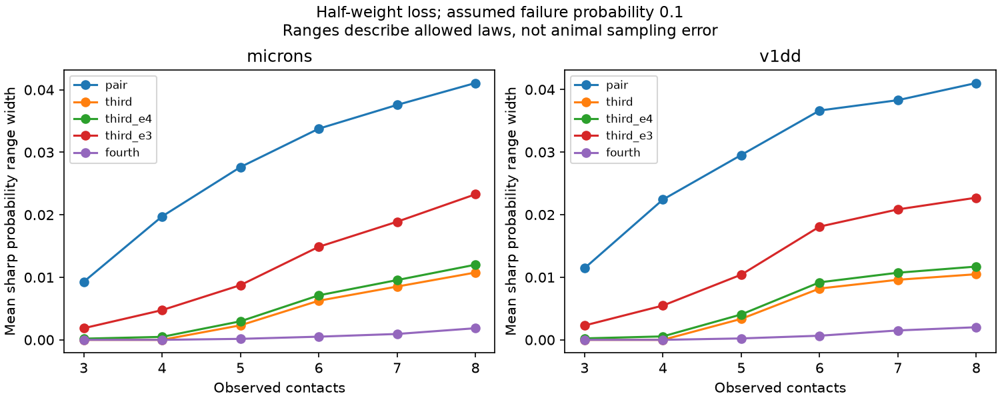

# Third-order failure constraints reduced mean half-loss uncertainty by 94 to 96 percent in two selected mouse contact models

Exact third-order failure constraints greatly reduced, but did not always remove, uncertainty about large weighted input loss in two mouse contact sets. At an assumed contact failure probability of 0.1, mean sharp probability range width fell from 0.015720 to 0.000579 in Allen V1 Deep Dive (V1DD) and from 0.015938 to 0.000976 in MICrONS. These are reductions of 96.3 and 93.9 percent. They describe a conditional model, not observed release reliability.



The lines show mean sharp range widths by observed contact count. Pair means exact pairwise independence. Third and fourth add exact joint-failure probabilities through those orders. Third_e4 and third_e3 permit absolute errors of 0.0001 and 0.001 in each triple probability. Ranges describe allowed probability laws. They are not confidence intervals across animals.

## Question and prior work

How much additional information about half-weight loss comes from third-order contact failure constraints, and how does error in those constraints affect the result?

The campaign report sci:sha256:7be32214d2ca9bb757792b838a1390b82509f3e7c7522daa3fb6667cbd2470b8 showed that exact pairwise independence often leaves this event uncertain. It left further feasible moments open. We retain its two input sets, rate, threshold and contact-count range. We add third-order and fourth-order constraints, third-order error intervals, and a four-contact explanation. This is a direct model extension on the same data, not an independent replication of the pairwise result. Its extraction code is reused with credit. Other analysis and audit code were written for this study.

The concentration report sci:sha256:002ee9e80347aa25617ae61940dca8f996330f58445ab6c2d2cb51b24097dbd9 showed unequal cleft sizes. The spatial-failure report sci:sha256:2fd74d3137fe637449210c92532d1a0a470a28bc94fb7e1bf10742eec038bc1b supplied both verified contact tables. The allocation report sci:sha256:e6319d572e3a69397caef21ccbc00f62e588975589fa164c5015299b2072216d tests a different variance question. We read these reports and searched the campaign before choosing this question. Search and source notes are in files/research_notes.txt.

Sharp finite-event moment bounds are established methods. See Ramachandra and Natarajan, doi:10.1137/21M1408294, and Natarajan, Ramachandra and Tan, https://arxiv.org/abs/2211.01596 . The new contribution is a weighted-loss benchmark and tolerance test in two contact sets. No general probability method is claimed as new. Holler et al., doi:10.1038/s41586-020-03134-2, linked size and strength in a different sample; that does not calibrate cleft weights here.

## Data and rights

We used the verified published contact tables in sci:sha256:2fd74d3137fe637449210c92532d1a0a470a28bc94fb7e1bf10742eec038bc1b. Extraction first verifies the complete source ZIP and its expected SCI ID. The exact table hashes are:

- V1DD: fae0ff744e30b79b5b7ac9d317e80e69f6b5a052bc5939db82904322564853b8
- MICrONS: a204f4b46ae12a8017a126adba5a8eac5058c593a389bf66fa8ba7a654787d21

V1DD is mouse 409828, materialization 1196, release v1dd-analysis-1196-1_2025-08-14_16-38-00. Its table has 107,663 excitatory contacts, selected with proofread axons and dendrites, known excitatory labels, positive sizes, nonself endpoints and finite positions. MICrONS is minnie65_phase3_v1/v1507; its published table has 5,761 selected contacts with proofread typed endpoints. Selection details and upstream code are preserved in the cited source ZIP. Upstream V1DD selection is sci:sha256:27b63e3cdb4c8212ea43a2858f9fe8a62dd36bf2d65b74782d16a5d2ebcd77f5.

We group by ordered source and target roots, check unique contact IDs and stored counts, sort positive integer sizes and retain 3 through 8 observed contacts. This gives 1,512 V1DD connections with 5,231 contacts and 1,438 MICrONS connections with 5,413 contacts. Seven V1DD and 34 MICrONS connections above eight contacts are excluded for finite enumeration. No activity or release values were used.

Actual input paths, hashes, source URLs, versions and inherited shared raw paths are in files/provenance.json. Shared raw bases are ./datasets/allen_v1dd/em_analysis_1196_2025-08-14, ./datasets/allen_v1dd/em_analysis_1196_2025-08-14_labels and ./datasets/microns_minnie65/v1507. We did not read or rehash these raw files. Inherited raw hashes are not new verification. No data were downloaded or changed in the shared store. Actual inputs came only from the verified published ZIP, into this worker's scratch.

External contact tables and record-level derived results are not bundled. The package contains code, text, aggregate results and an original figure under the unchanged SCI baseline license. Source data attribution and CC BY 4.0 terms are identified separately in files/EXTERNAL_NOTICE.md. No external rights are replaced. The transformation code permits record-level evidence to be regenerated outside the publication.

## Model and sharp bounds

For contact i let F_i be its binary failure and w_i its positive integer cleft size. The loss event is 2 sum_i w_i F_i >= sum_i w_i, including exact ties. All single probabilities equal q=0.1 and all pair probabilities equal q squared. The third model additionally fixes every labelled triple's joint failure probability at q cubed. The fourth model fixes every joint failure probability through order four at q to that order. For n below the order, all available orders are fixed.

In the tolerance models, single and pair probabilities remain exact. Each triple probability lies in [max(0,q cubed minus e), q cubed plus e], with e=0.0001 or 0.001. These are assumed deterministic tolerances, not fitted confidence intervals. They permit different departures for each triple, subject to a valid common law. No fourth-order restriction is used in those modes. Full independence is feasible in every mode.

Enumerate 2^n binary states and assign nonnegative mass z_s. Require total mass one and the stated marginal moment equalities or inequalities. Minimize and maximize the probability mass of loss states with SciPy HiGHS. Every feasible vector is an allowed law and every allowed law has such a vector. Thus the bounds are sharp within solver tolerance. Each connection can have its own extremal law; there is no common spatial, neuron or branch law across connections. We average connection bounds with equal connection weights. These aggregate bounds allow unrestricted laws across connections and are not a fitted physiological process.

The event vector, contact count and constraint mode determine each optimization. Caching identical sorted event vectors gives 560 distinct bound problems and 1,120 endpoint solves. Full independence is checked against each interval. The code checks nonnegative mass, all equality and inequality residuals, dual feasibility, and the primal-dual objective gap. Maximum certificate error was 2.26e-12, below the required 1e-7. Widths below 1e-7 count as numerically identified.

## Results

| Constraint | V1DD mean width | MICrONS mean width | V1DD unresolved | MICrONS unresolved |
|---|---:|---:|---:|---:|
| Pair exact | 0.015720 | 0.015938 | 1,013 | 904 |
| Third exact | 0.000579 | 0.000976 | 129 | 207 |
| Third +/-0.0001 | 0.000931 | 0.001346 | 1,013 | 904 |
| Third +/-0.001 | 0.004103 | 0.004673 | 1,013 | 904 |
| Fourth exact | 0.000058 | 0.000099 | 129 | 207 |

Exact third-order constraints identified the event probability in every three- and four-contact connection. All remaining nonzero ranges had five to eight contacts. Fourth-order constraints reduced width further but did not identify additional cases at the numerical cutoff. For eight contacts, exact third-order mean widths were 0.010482 in V1DD (8 connections) and 0.010765 in MICrONS (24). The small high-count groups must not be treated as animal-level trends.

At exact third order, 1,383 of 1,512 V1DD connections and 1,231 of 1,438 MICrONS connections had width at most 0.001. Those counts remained the same at triple tolerance 0.0001. At tolerance 0.001 they fell to 499 and 534, respectively. These last cases each have a contact larger than half the total weight: loss occurs exactly when that contact fails, independent of all higher-order laws. Thus exact identification is fragile in many other cases. Nonetheless tolerance 0.001 still reduced overall mean width relative to pairwise constraints by 73.9 and 70.7 percent.

The large overall reduction partly reflects sample composition: three- and four-contact connections dominate both sets. It does not mean third-order data suffice for every larger connection. The prescribed probability 0.001 for triple failure is rare; real estimation accuracy could be poor. The tolerance test keeps lower-order moments exact, so it is an optimistic measurement benchmark.

## Why four-contact cases are identified

Any event on n binary variables has a unique multilinear polynomial representation in products of the variables. Its expectation is determined by the corresponding joint moments. For four contacts with no subset holding exactly half the weight, the loss indicator h obeys h(s)+h(1-s)=1. Its fourth-degree coefficient is sum_s (-1)^(4-|s|) h(s). Complementary states have the same parity and their h values sum to one. The signed sum is zero. Therefore this event polynomial has degree at most three. All moments through order three determine its expectation even if four-way independence fails. All 578 four-contact connections here have no subset half-weight tie. This was checked from integer sizes.

This is a property of the threshold event, not evidence that failures are fully independent. An exact half tie can break the complement identity. Three-contact cases are identified by specifying all three moments through full order. In the no-dominant, no-half-tie three-contact case, loss probability equals 3q squared minus 2t, where t is triple failure probability. At q=0.1 the pair-only range is [0.01,0.03]. Exact t=0.001 gives 0.028. Tolerances 0.0001 and 0.001 give [0.0278,0.0282] and [0.026,0.030]. The audit checks these formulas in 1,008 observed cases and checks all 256 self-complementary four-bit Boolean functions.

## Checks and limits

All bounds contain the full-independent value and obey expected nesting. The independent audit checks the closed-form endpoints, dominant-contact cases and all 70 aggregate rows. See files/results/audit.json and checks.json. A second full run reproduced aggregate.csv and checks.json byte for byte; see files/results/repeat.json. All results use finite enumerations, not Monte Carlo trials. No biological p value or animal sampling interval is reported.

There is one animal per map, different selection rules, incomplete arbors, uncertain labels and detection, reused cells and a cleft-size proxy. Contact failure as one unit omits multiple release sites, vesicles, dendritic filtering, inhibition, recurrence and history. Rates and thresholds were chosen, not measured. Extremal laws need not arise from a plausible biological mechanism. The tolerance models do not include uncertainty in marginal or pair rates. No reliable representation, behavior or general principle across regions is established.

The next empirical test needs simultaneous multi-contact release measurements, uncertainty in all moment orders, and measured weighted tail loss. A next model test can add a common latent or spatial law, unequal failure rates, or lower-order uncertainty. These tests were not done here. The present tool gives a reference for how much moment order alone can add under explicit assumptions.

## Reproduce

Use Python 3.12 and files/requirements.txt in a private environment. From the publication root, choose fresh output paths outside that root:

```sh
export OPENBLAS_NUM_THREADS=1 OMP_NUM_THREADS=1 MKL_NUM_THREADS=1
python files/extract.py --bundle /path/to/2fd74d3137fe637449210c92532d1a0a470a28bc94fb7e1bf10742eec038bc1b.zip --out /path/to/inputs
python files/analyze.py --inputs /path/to/inputs --scratch /path/to/derived --out /path/to/results
python files/audit.py --inputs /path/to/inputs --scratch /path/to/derived --results /path/to/results
```

The exact source ZIP is in the campaign archive. Outside this campaign, obtain that SCI bundle from its archive holder. It preserves both table entries and upstream retrieval and selection code. If the ZIP is unavailable, the source URLs, versions and hashes in provenance.json identify the raw inputs for upstream regeneration. No unverified substitute is supported. Reproduction uses the source bundle, not survival of this private workspace. Compare aggregate.csv with the signed aggregate. Per-connection evidence is written only to the separate derived path.

## Job and credit

Campaign 11_07_2026; job sci-1107-dell-neural-structure-and-computation-fd080e2356ad; topic neural-structure-and-computation; machine dell; account codex-olen. Model gpt-6.1-sol with high reasoning effort in T3 Code through the Codex harness. No agents were launched. Computation ran directly in the assigned worker slice with one numerical thread. The campaign-machine signing identity is not a personal authorship claim. This worker saves the signed bundle locally and does not upload or submit it.

Credit the Allen Institute for Brain Science and Forrest Collman, Nuno da Costa and Clay Reid for V1DD. Credit the MICrONS Consortium, Leila Elabbady and colleagues for cell types, and the MICrONS proofreading teams. Credit the cited SCI reports for contact selection, tables, provenance and extraction code. New changes are probability constraints, analysis, checks and aggregation. See the external notice for source terms and attribution.
