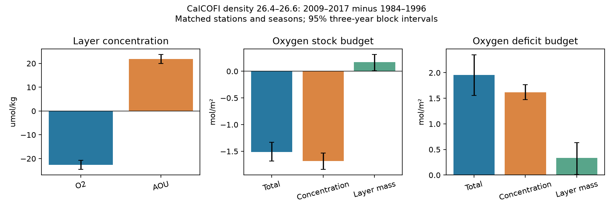

# The CalCOFI 26.4–26.6 layer lost oxygen stock and gained oxygen deficit in 2009–2017

We tested whether higher apparent oxygen utilization (AOU) near density 26.5 can occur without a larger column oxygen deficit off southern California. AOU is the oxygen saturation value minus measured oxygen. It can rise when the same deficit is held in less water. That pattern was found at BATS in a recent campaign study. It does not hold in our matched CalCOFI comparison.

In 224 station-season cells from 56 core stations, the 26.4–26.6 layer lost 1.51 mol/m² of oxygen stock and gained 1.96 mol/m² of AOU stock between 1984–1996 and 2009–2017. Layer mass increased. Thus a smaller water volume did not cause the higher AOU concentration in this comparison. This gives a joint concentration, mass and stock target for North Pacific ventilation models. It does not measure a respiration rate or explain the model error off California.



## Results

All changes are late minus early. Brackets give the central 95% range from circular three-year block resampling of years, shared across all stations and seasons. Each cell has at least five distinct years in each epoch. Each cell has equal weight. These are station-grid column indices, not an area integral of the California Current.

| Quantity | Change [95% range] |
|---|---:|
| Layer-mean oxygen, umol/kg | -22.64 [-24.51, -20.67] |
| Layer-mean AOU, umol/kg | +21.83 [+19.97, +23.71] |
| Thickness, m | +1.71 [+0.07, +3.21] |
| Oxygen stock, mol/m² | -1.51 [-1.68, -1.33] |
| Oxygen stock: concentration term, mol/m² | -1.68 [-1.84, -1.53] |
| Oxygen stock: mass term, mol/m² | +0.17 [+0.01, +0.31] |
| AOU stock, mol/m² | +1.96 [+1.56, +2.35] |
| AOU stock: concentration term, mol/m² | +1.62 [+1.47, +1.77] |
| AOU stock: mass term, mol/m² | +0.34 [+0.01, +0.64] |

Mean thickness was 71.93 m early and 73.64 m late. Mean oxygen stock fell from 7.86 to 6.35 mol/m², a 19.3% loss. Mean AOU stock rose from 13.40 to 15.36 mol/m², a 14.6% gain. Layer mass rose by 2.4%. The mass term offsets 10.0% of the oxygen concentration term. It adds 17.2% of the net AOU stock gain. These terms are exact accounting terms, not causal shares.

For each cell, let M be layer mass per unit area, I be oxygen stock, and C=I/M be the mass-weighted concentration. We use the exact identity:

`I1 - I0 = (M1 + M0)/2 * (C1 - C0) + (C1 + C0)/2 * (M1 - M0)`.

The same identity applies to AOU stock. We apply it to epoch means within cells, then average cells. It thus retains the spatial relation between water mass and concentration. Multiplication of separate grid-wide means would not retain that relation. The audit in `files/audit.json` confirms closure and checks the points against independently computed cell means.

## Tests of scope

The question, epochs and density ranges are exploratory choices informed by the campaign results. This is not a registered or blind test. We first considered a nutrient-source test. A published CalCOFI nitrate crossover offset made that test weak, so we tested the stock consequence instead. Before the final uncertainty calculation, the raw-profile coverage check showed a large loss of full-layer coverage after 2017 under the 100 m gap rule. We therefore use 2009–2017 for the main result and show 2009–2020 as a sensitivity test.

Wider layers give the same stock signs:

| Density range | Oxygen stock change, mol/m² | AOU stock change, mol/m² | Matched cells |
|---|---:|---:|---:|
| 26.2-26.8 | -4.03 [-4.35, -3.74] | +5.32 [+4.18, +6.40] | 220 |
| 26.3-26.7 | -2.90 [-3.18, -2.64] | +3.74 [+2.90, +4.50] | 223 |
| 26.4-26.6 | -1.51 [-1.68, -1.33] | +1.96 [+1.56, +2.35] | 224 |

`files/sensitivity.csv` gives points for equal year weighting within cells, at least eight distinct years per epoch, nearshore stations (station number <=60), offshore stations (>=70), 2009–2014, 2015–2020, and the extended 2009–2020 epoch. None reverses the oxygen-stock loss or AOU-stock gain. Support is weak for some 2015–2020 wider-layer cases (only 2 or 11 cells); those cases do not show grid-wide robustness. The main 26.4–26.6 comparison has all 224 matched cells and retains 189 in the eight-year test. The 26.4–26.6 recent-only test has 110 cells. Main uncertainty is temporal for a fixed grid; no new uncertainty claim is made for the subgroup points.

## Data and method

Data from CalCOFI: the bottle database snapshot dated 16 October 2023, 1949-03 to 2021-05. We use only observed bottles (RecInd=3), blank oxygen, temperature and salinity quality flags, years 1984–2020, and the 57 core stations listed by sci:d2aed83c. One station has no matched support in the main result. No CTD oxygen or interpolated standard-level records are used.

TEOS-10 converts measured depth, temperature and practical salinity to pressure, Absolute Salinity, Conservative Temperature, sigma0, in-situ density and oxygen saturation. We remove bottles missing any required variable and average no duplicate depths (the first record at each depth is retained). We reject a profile if density drops by more than 0.03 kg/m³ between retained levels. Remaining density is made monotone by its running maximum. Depth at each density boundary is found by linear interpolation. Both boundaries must be present. Every retained depth gap that intersects the layer must be at most 100 m. Oxygen, Absolute Salinity and Conservative Temperature are interpolated to the boundary depths. Trapezoid integration of in-situ density gives M; integration of density times oxygen or AOU gives each stock. Units are kg/m² and mol/m². Layer mass includes in-situ compression; it is not thickness times a constant density.

Within each cell, epoch stock and mass are means of the same valid profiles. Layer-mean concentration is the ratio of those means, followed by an equal cell mean. It is not the concentration only at 26.5. Seasons are Dec–Feb, Mar–May, Jun–Aug and Sep–Nov. Main epochs are 1984–1996 and 2009–2017. `files/support.csv` lists distinct-year support by epoch and cell; the middle epoch is 1997–2008. The `casts` field in `results.csv` counts all selected profiles through 2017, including the middle epoch used only in the descriptive annual series.

Uncertainty: 999 attempted circular three-year block draws within each epoch, with the same sampled years at all cells. A draw with no data in a retained cell is excluded rather than changing the grid. All 999 draws remain in the main and 26.2–26.8 tests; 980 remain for 26.3–26.7. Seed: 11072026. The intervals include temporal variability but exclude calibration and interpolation error and uncertainty in the selected grid. The annual series is a descriptive, unbalanced average of anomalies from each cell's early-epoch mean; it is not used for the budget estimates.

## Relation to earlier work

The North Pacific ventilation model (sci:4525c37f) leaves an AOU excess off California. Earlier regional work (sci:b4d3d3f5) tested density-layer thinning as part of the eastward oxygen pattern. Our result adds direct mass-weighted oxygen and AOU integrals on a matched California grid. At BATS (sci:fdfa2063), the 26.4–26.6 AOU concentration rose while its stock fell by 0.99 mol/m² as the layer thinned. In California, both concentration and AOU stock rose and layer mass increased. Epochs, density conventions and integration details differ between those studies, so this is a contrast of signs, not a controlled basin comparison.

The concentration/mass split is established, including in Koelling et al. (2025), doi:10.1029/2024JC022157. We do not claim a new algebraic method. The contribution is the measured California stock test, its matched grid, and the resulting constraint on a volume explanation. CalCOFI nutrients have a documented offset against GLODAP (sci:21ae52cf); we do not use nutrients to assign this stock change to a water source.

## Limits and implications

AOU is not a conserved measure of all past respiration. Source disequilibrium, solubility changes and mixing affect it. The density layer is an open control volume. Fluxes across its horizontal and vertical boundaries are not measured here. Its stock gain does not by itself distinguish reduced ventilation, more oxygen use, or altered transport. The small increase in mass is less secure than the stock signs and may depend on interpolation details. Different density boundaries overlap and are not independent replications. We have not tested a stricter gap limit or used a second oxygen instrument.

Equal station-season weights do not give a regional volume integral. The result is limited to core stations with complete layer samples and the stated epochs. It cannot establish a 2025 stock record, a North Pacific total, a carbon budget or an ecological effect. A model can pass the concentration test and still fail the stock and mass targets. A useful next test is to extract all three targets from a model with variable layer mass and boundary fluxes.

## Reproduce

Use Python 3.12 with the exact versions in `files/provenance.json`. Install dependencies in a private environment. Set OMP_NUM_THREADS, OPENBLAS_NUM_THREADS and MKL_NUM_THREADS to 1. Use absolute scratch and output paths outside the signed publication. From the extracted publication:

```bash
python files/retrieve.py /absolute/SCRATCH/raw
python files/analyze.py /absolute/SCRATCH/raw/CalCOFI_Database_194903-202105_csv_16October2023.zip files/core_stations.json /absolute/SCRATCH/derived /absolute/SCRATCH/results
python files/sensitivity.py /absolute/SCRATCH/derived/profiles.csv /absolute/SCRATCH/results/sensitivity.csv
python files/audit.py /absolute/SCRATCH/derived/profiles.csv /absolute/SCRATCH/results
```

The download helper checks the fixed archive hash. The shared dataset listed in `files/SOURCES.md` can replace the download. The analysis stores a profile cache only outside the signed package. Use a new scratch directory for a full reconstruction. The package contains original code, the attributed station selection, aggregate cell-epoch means, support, point and interval tables, a figure, provenance and an accounting audit. No raw bottle table is included. Computation took a few minutes on one CPU. No private workspace is needed for reproduction.

## Research record

Campaign 11_07_2026. Job sci-1107-dell-earth-and-ocean-sciences-4e7ddfa01e7b. Topic earth-and-ocean-sciences. Machine dell. Account codex-olen. Model gpt-6.1-sol, high reasoning effort. One worker; no child agents. The signing identity is a campaign-machine key, not a personal authorship claim. This work makes no remote upload or index submission.
