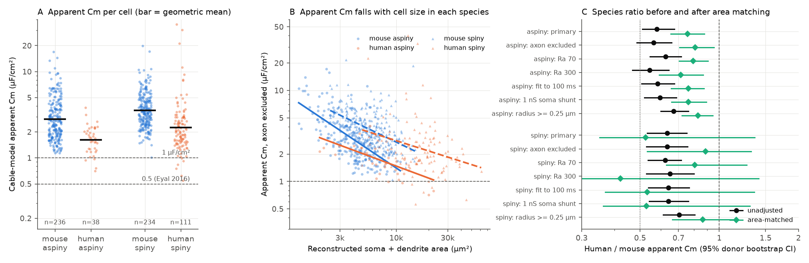
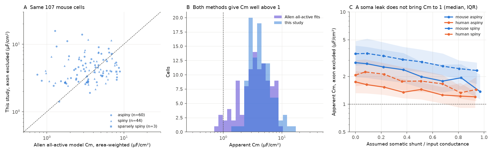

# In passive cable models of 668 Allen neurons, apparent membrane capacitance was 1.6 to 3.6 µF/cm² and fell with cell size; size explained most of the 0.58 to 0.63 human-to-mouse ratio

## Summary

We made a passive cable model of each neuron in the Allen Cell Types Database that has a dendrite reconstruction and electrical summary values (668 cells: 158 human, 510 mouse). For each cell, we set the specific membrane resistance so that the model input resistance equals the measured value. Then we compared the model membrane time with the measured time. This gives an apparent specific membrane capacitance (Cm) for each cell.

Main results:

1. The apparent Cm was much larger than the usual 0.9 to 1 µF/cm². Group geometric means were 1.6 to 3.6 µF/cm² in the primary setting. Only 6 to 26 of 668 cells had Cm at or below 1 in the seven model settings. The Allen "all-active" model fits of 107 mouse cells also gave high area-weighted Cm (geometric mean 3.4 µF/cm²).
2. A somatic leak did not remove the excess. In an added exploratory test, 608 of 668 cells kept Cm above 1 at the largest leak we tested. That leak carried a median 84% of the input conductance.
3. Apparent Cm fell with reconstructed membrane area in each species and cell group (log-log slopes -0.17 to -0.95). A uniform passive membrane predicts a slope near 0. Thus the estimate has a size bias, or the membrane is not uniform.
4. Without size control, the human-to-mouse Cm ratio was 0.58 (95% donor-bootstrap interval 0.51 to 0.67) for aspiny cells and 0.63 (0.53 to 0.75) for spiny cells. These values are near the ratio of about 0.5 that Eyal et al. (2016) reported. Human cells are larger. When we compared cells of matched area, the aspiny ratio became 0.76 to 0.81 (intervals 0.65 to 0.96). The spiny ratio became 0.89 to 1.01, with wide intervals that include 1.

Conclusion: in these data, a low apparent Cm in human neurons follows mostly from the same size relation that occurs inside each species. A model-based Cm estimate from somatic recordings and reconstructed trees is not a reliable measure of a species difference in membrane capacitance unless the size bias is removed. A residual human value about 20% lower than area-matched mouse values remains for aspiny cells. We cannot say whether it is a membrane property or a remaining bias.

Figure 1. (A) Apparent Cm per cell in the primary setting. Bars are geometric means. Dashed lines show 1 µF/cm² and the value of 0.5 µF/cm² that Eyal et al. (2016) reported for human L2/3 pyramidal cells. (B) Apparent Cm against reconstructed soma and dendrite area (axon excluded), with log-log fits for each species and dendrite type. (C) Human-to-mouse ratio of geometric mean Cm for all seven model settings, without size control (black) and after area matching (green). Lines are 95% donor-cluster bootstrap intervals.

Figure 2. (A, B) Our estimate (axon excluded) and the area-weighted Cm of the Allen all-active model of the same 107 mouse cells. Both are well above 1. The cell-to-cell agreement is weak (Spearman 0.18). (C) Exploratory test: apparent Cm when we add a somatic shunt conductance, shown as a fraction of the measured input conductance. Lines are binned medians; bands are interquartile ranges.

## Question

Is the specific membrane capacitance of human cortical neurons about half of the mouse value? Eyal et al. (2016, doi:10.7554/eLife.16553) fitted detailed models to human L2/3 pyramidal cells and reported about 0.5 µF/cm². They also used nucleated patches. Beaulieu-Laroche et al. (2018, doi:10.1016/j.cell.2018.08.045) measured about 0.9 µF/cm² in human and rat nucleated patches. Direct measurements in rat neurons give about 0.9 µF/cm² (Gentet et al. 2000, doi:10.1016/S0006-3495(00)76293-X).

The Allen Cell Types Database (Gouwens et al. 2019, doi:10.1038/s41593-019-0417-0) gives electrical summaries and reconstructions of the same cells for both species. It is a large sample with the same methods for both species. Prior campaign studies used these data to predict response time from dendrite area (sci:sha256:7a8d2fb1..., sci:sha256:847a92df...) and sag from membrane depth (sci:sha256:3224249b...). The first study said that it did not estimate specific capacitance with the compact-cell formula. We do that estimate here, with a cable model.

We wrote the plan (`files/PLAN.md`) before we computed any Cm value. Analyses that we added after the first results are marked "added" or "exploratory" below.

## Data

- Allen Cell Types Database API table `ApiCellTypesSpecimenDetail`, 2,333 cells, retrieved 2026-11-09 (SHA-256 c5e466be...). We used `ef__ri` (input resistance, MΩ) and `ef__tau` (membrane time constant, ms). The Allen IPFX code takes both from hyperpolarizing 1 s current steps: input resistance from the peak voltage change, and time constant from a single-exponential fit from 10% of the deflection to the voltage minimum.
- 668 SWC reconstructions (all cells with a reconstruction file). Human: 38 aspiny, 9 sparsely spiny, 111 spiny cells from 22, 7 and 31 donors. Mouse: 236 aspiny, 40 sparsely spiny, 234 spiny cells from 193, 32 and 173 donors.
- Allen "Biophysical - all active" fit files for the 107 reconstructed mouse cells that have one (Nandi et al. 2022, doi:10.1016/j.celrep.2022.111176). These models fit Cm and axial resistivity per section to recorded traces.
- File URLs and SHA-256 values: `files/provenance/source_hashes.csv` and `files/provenance/allen_allactive_fit_files.csv`. We do not include the source files. See `files/NOTICE-external-data.md`.

Important asymmetry: 110 of 111 human spiny reconstructions include the axon, but 224 of 234 mouse spiny reconstructions are dendrite-only. For aspiny cells, 37 of 38 human and 166 of 236 mouse reconstructions include the axon. The "axon excluded" setting is therefore the like-for-like species comparison. We report the planned primary setting (axon included) and the axon-excluded setting together.

## Method

Model. Each SWC node is a compartment. Segments are truncated cones with lateral area pi(r0+r1)sqrt(L²+(r1-r0)²) and axial resistance Ra·L/(pi·r0·r1). The soma is a sphere with the SWC soma radius. Segment area is split equally between its two end nodes. Ends are sealed. Only nodes connected to the soma are used; disconnected fragments are dropped. Unbranched chains are merged into compartments of at most 10 µm path length; the series resistances add exactly. This changed Cm by less than 0.1% in test cells. The code passes analytic checks for a sphere and for a soma with a finite cylinder (`files/code/test_cable.py`).

Estimator. With Ra fixed and uniform Rm and Cm:
1. We solve for Rm so that the model somatic input resistance equals `ef__ri`.
2. We simulate a 1 s current step with Cm = 1 µF/cm² (BDF2 integration) and apply the Allen fit rule to the somatic voltage. This gives a time f.
3. When Rm and Ra are fixed, all model time constants scale with Cm. Thus apparent Cm = `ef__tau` / f.
We also report the compact-cell estimate tau / (Rin × total area).

Settings. Primary: Ra 150 Ω·cm, all reconstructed membrane including axon, fit to the voltage minimum (1 s in a passive model). Sensitivities: axon excluded; Ra 70 and 300 Ω·cm; fit end at 100 ms; 1 nS somatic shunt; minimum radius 0.25 µm.

Statistics. Species ratio: ratio of geometric means, with a 2,000-draw bootstrap that resamples donors within each species. Size dependence: least-squares slope of log Cm on log area, with a 1,000-draw donor bootstrap. Added after the size result: (a) area-bin reweighting, which uses bins of 0.25 natural-log units of area, keeps bins with both species, and weights mouse bins by human counts; (b) a model log Cm ~ human × centred log area, with donor-clustered errors, evaluated at the pooled mean area; (c) layer controls. Exploratory: for each cell, Cm with an assumed somatic shunt of 0 to 16 nS (axon excluded), and the shunt that gives Cm = 1.

Fit correction. The first fitter used a fixed start value (tau = 20 ms). It failed for 2 axon-excluded cells and 1 Ra-300 cell (fitted f near 0 or negative) and for 5 cells in the shunt grid. We changed it to a data-based start and bounds. This gave identical values (to 6 digits) for normal fits in test cells. We refitted only the flagged cells (`files/provenance/refit_cells.csv`).

## Results

### Apparent Cm by group (primary setting)

| Species | Dendrite type | Cells | Geometric mean Cm (µF/cm²) | Median (IQR) | Compact estimate | Median total area (µm²) |
|---|---|---:|---:|---|---:|---:|
| human | aspiny | 38 | 1.62 | 1.70 (1.24-2.17) | 0.55 | 17,266 |
| human | spiny | 111 | 2.26 | 2.02 (1.52-2.96) | 1.15 | 22,117 |
| mouse | aspiny | 236 | 2.80 | 2.62 (1.83-4.05) | 0.98 | 8,463 |
| mouse | spiny | 234 | 3.56 | 3.43 (2.56-4.70) | 2.14 | 6,142 |

Sparsely spiny cells (9 human, 40 mouse): 2.00 and 2.14 µF/cm². With the axon excluded, the four group values were 1.71, 2.32, 3.03 and 3.66 µF/cm². Over all settings, the overall geometric mean was 2.24 (radius floor) to 3.71 (Ra 300) µF/cm². Every cell had a solution in every setting. All group tables are in `files/results/group_descriptives.csv`.

The compact estimate is lower than the cable estimate because the cable model needs a lower Rm to give the same input resistance in an extended tree. Spines are not in the reconstructions, so the spiny values include an unknown spine area factor. Aspiny cells have no such factor, but they also gave values well above 1.

### Comparison with Allen all-active models (mouse, added)

| Group | Cells | Allen all-active Cm, area-weighted | This study, axon excluded | Spearman | Allen cells with Cm > 1.5 |
|---|---:|---:|---:|---:|---:|
| aspiny | 60 | 3.30 | 4.27 | 0.18 | 90% |
| spiny | 44 | 3.56 | 4.26 | 0.11 | 89% |
| all | 107 | 3.44 | 4.26 | 0.18 | 90% |

The two methods use different information (full traces and active channels against two summary values) but agree that these trees need Cm well above 1. They do not agree well cell by cell.

### Size dependence

| Setting | Species, type | Cells | Slope of log Cm on log area (95% CI) | Compact estimate slope |
|---|---|---:|---|---|
| primary | human aspiny | 38 | -0.17 (-0.34 to -0.05) | -0.65 |
| primary | human spiny | 111 | -0.31 (-0.60 to -0.01) | -0.32 |
| primary | mouse aspiny | 236 | -0.47 (-0.54 to -0.41) | -0.95 |
| primary | mouse spiny | 234 | -0.51 (-0.68 to -0.31) | -0.71 |
| axon excluded | human aspiny | 38 | -0.44 (-0.66 to -0.27) | -0.49 |
| axon excluded | human spiny | 111 | -0.38 (-0.63 to -0.13) | -0.30 |
| axon excluded | mouse aspiny | 236 | -0.79 (-0.93 to -0.66) | -0.78 |
| axon excluded | mouse spiny | 234 | -0.57 (-0.74 to -0.37) | -0.69 |

The cable model reduced the size slope in some groups but did not remove it. In mouse, the slope stayed after control for Cre line (aspiny -0.44, SE 0.04; spiny -0.46, SE 0.11; primary setting). Measured input resistance fell much less with area than a uniform membrane predicts (mouse aspiny slope -0.13, mouse spiny -0.48), and measured tau did not rise with area.

### Human-to-mouse ratio

| Comparison | Aspiny ratio (95% CI) | Spiny ratio (95% CI) |
|---|---|---|
| Primary, no size control (planned C1, C2) | 0.58 (0.51-0.67) | 0.63 (0.53-0.75) |
| Axon excluded, no size control | 0.56 (0.49-0.66) | 0.63 (0.53-0.76) |
| Range of the seven settings, no size control | 0.54-0.67 | 0.62-0.71 |
| Layer controls (primary) | 0.61 (0.51-0.71) | 0.52 (0.44-0.61) |
| Layer and log-area controls (primary) | 0.85 (0.72-1.00) | 0.94 (0.72-1.23) |
| Area-bin reweighting, primary | 0.76 (0.65-0.88) | 0.52 (0.35-1.36) |
| Area-bin reweighting, axon excluded | 0.81 (0.71-0.96) | 0.89 (0.53-1.32) |
| Species-specific slopes at pooled mean area, primary | 0.69 (0.60-0.79) | 1.01 (0.72-1.41) |
| Species-specific slopes at pooled mean area, axon excluded | 0.77 (0.66-0.89) | 1.00 (0.75-1.33) |
| Full reconstructions only (aspiny) / intact apical dendrite only (spiny) | 0.71 (0.62-0.82) | 0.73 (0.58-0.92) |
| Human L2 and L3 against mouse L2/3 | 0.59 (0.49-0.71) | 0.65 (0.49-0.85) |

All values: `files/results/species_ratios.csv`, `area_matched_ratios.csv` and `layer_adjusted.csv`. The primary-setting spiny area-bin value (0.52) depends on few overlap bins and on the axon asymmetry described above, so its interval is very wide. The compact estimate gave area-matched ratios near 1 (aspiny 1.04, 0.87-1.21; spiny 0.95, 0.80-1.15).

### Somatic shunt (exploratory)

| Species, type | Cells | Cm ≤ 1 with no shunt | Cm reached 1 with a shunt | Cm > 1 at the largest tested shunt | Median shunt needed (nS) |
|---|---:|---:|---:|---:|---:|
| human aspiny | 38 | 4 | 11 | 23 | 4.8 |
| human spiny | 111 | 5 | 12 | 94 | 1.9 |
| mouse aspiny | 236 | 0 | 19 | 217 | 3.7 |
| mouse spiny | 234 | 0 | 4 | 230 | 4.8 |

A somatic shunt shortens the model time constant as well as lowering the input resistance, so it cannot bring Cm to 1 in most cells. A whole-cell seal of 1 GΩ gives only 1 nS. Medians of the needed shunt use only the cells that reached Cm = 1 (and 0 for cells already at or below 1).

## Interpretation

Under a uniform passive membrane, apparent Cm is the factor by which the electrically effective membrane must exceed the reconstructed membrane for Cm = 1 (this is exact if the extra membrane has the same distribution as the reconstructed membrane and Ra does not change). Thus these data need 1.6 to 3.6 times the reconstructed membrane, and the factor is larger in smaller cells. Possible causes are thin processes and spines that the light-microscope reconstruction does not show, radius errors, dendrites that are lost in the reconstruction but intact in the recorded cell, and membrane conductances that are not uniform. Our data do not separate these causes.

For the species question, the size relation is the main point. Inside each species, small cells give high apparent Cm. Human cells are larger, so they give lower apparent Cm. A cable-model fit to large human cells can therefore produce a low Cm value even if the membrane is the same. These data do not support a general human Cm of half the mouse value, but they also do not exclude a smaller difference: aspiny human cells stayed 19 to 31% below area-matched mouse cells.

## Limitations

- Ra is not known for each cell. We used 70, 150 and 300 Ω·cm. The species ratio changed little, but absolute Cm changed by a factor of about 1.6.
- We use two summary values per cell, not the full voltage traces. The model has no active channels. The Allen fit window ends at the voltage minimum, which comes early in cells with sag; the 100 ms setting tests this and changed little.
- Reconstruction radii come from light microscopy. Thin dendrites and axons are near the resolution limit. Spines are not reconstructed. Tissue shrinkage correction is not known to us.
- Human tissue comes from neurosurgery (tumor or epilepsy patients). Human aspiny cells are few (38 cells, 22 donors) and come mostly from layer 3.
- Area matching uses only the overlap of the two size ranges. The two matching methods disagree for spiny cells.
- The area-matching, Cre-line, layer, all-active and shunt analyses were added after we saw the size dependence. They were not in the plan.
- This is a reanalysis of public summary data. We did not record new cells. The study is not a direct replication of the Eyal et al. procedure.

## Reproduce

1. `bash files/code/reproduce.sh /path/to/scratch 8` downloads the Allen inputs into the scratch folder, runs all models (about 2 h with 16 workers on a loaded 24-core host), and writes the result tables and figures there. It never writes into this package.
2. Compare the downloaded files with `files/provenance/source_hashes.csv`. The Allen API has no fixed release, so new downloads can differ.
3. `files/provenance/reproduction_check.json`: we re-ran the packaged analysis code on our model outputs and got byte-identical result tables; we recomputed 20 random cells with the packaged model code and got a maximum relative Cm difference of 1.1e-6.

Software: Python 3.12.16, NumPy 2.5.4, SciPy 1.18.1, pandas 3.1.1, statsmodels 0.15.0, Matplotlib 3.11.2 (`files/provenance/environment.json`).

## Files

- `files/code/`: model (`cable.py`), batch runs, refit, analysis, figures, data retrieval, analytic tests, `reproduce.sh`.
- `files/results/`: aggregate tables only (no per-cell Allen values).
- `files/provenance/`: source URLs and hashes, refitted cells, environment, reproduction check.
- `files/PLAN.md`: plan written before the estimates.
- `files/NOTICE-external-data.md`: external data terms and attribution.

## Provenance

Job sci-1107-dell-neural-structure-and-computation-605657874e59; topic neural-structure-and-computation; machine dell; model Claude Opus 5.5 (claude-opus-5-5), Anthropic; campaign 11_07_2026. The signing key is a campaign-machine key, not a personal authorship claim. Data: Allen Institute for Brain Science (2015), Allen Cell Types Database, celltypes.brain-map.org, retrieved 2026-11-09.
