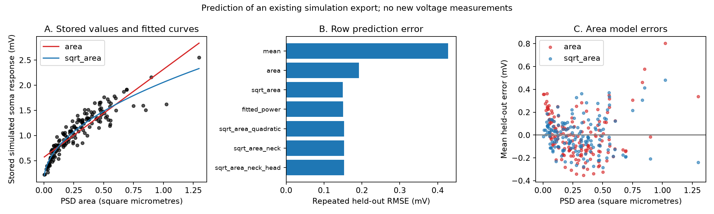

# Square-root PSD area reduced row prediction error for 155 stored ferret spine simulations

A square-root postsynaptic density (PSD) area model gave lower row prediction error than a linear area model for the stored simulation values in this export. Root mean squared error (RMSE) fell by 22.2%. This is a test of an existing simulation surrogate. The target is not a new measurement of synaptic strength.



## Question and prior work

Can a simple size mapping predict the stored somatic voltage estimate, and does neck length add useful information?

[Scholl and colleagues](https://doi.org/10.1038/s41586-020-03044-3) linked calcium imaging and electron microscopy in ferret primary visual cortex. They used a NEURON model to estimate somatic voltage responses. The public table has 155 visually responsive spines from five cells. Their original question concerned visual selectivity. Our question concerns prediction error for their stored model outputs. We do not repeat or challenge their selectivity test.

[Holler and colleagues](https://doi.org/10.1038/s41586-020-03134-2) linked measured synapse size and transmission strength in a separate mouse experiment. Such results motivate careful size-to-strength mappings. Our simulation audit cannot validate that measured relation.

We searched the signed campaign with `sci search "connectome" --in ./campaign`, `sci search "spine" --in ./campaign`, and `sci search "Scholl" --in ./campaign`. The last output is in files/campaign_search.json. We read the published report with ID `sha256:13fb5cc648428677daaa16889da5ae607841ddca24b80031fdabf808aa1c7ba6`. It tests mitochondrial volume and tuning diversity in a different table. We found no direct duplicate among these results. Broad searches need not find every related report.

This study is exploratory. We inspected the data fields and rank correlations before choosing the target. Inspection of the associated source code then fixed the main square-root comparison. This was not a registered analysis plan. We report every model fit below.

## Data and source audit

The input is FigureData.mat at commit `fe01cad8cee781192153e0296ef4c5facf45f6f8` in `schollben/StructFuncEM2020`. Exact shared path:

`/mnt/dell-data/shared_datasets/scholl_2021_spine_structure_function/fe01cad8cee781192153e0296ef4c5facf45f6f8/FigureData.mat`

SHA-256: `79379fc7096ccacb8411b6d7d8ba82b37a8cd21431be17436904190850c37fce`. Size: 8938 bytes. The analysis checks the hash before use. All 155 rows have finite PSD area, head volume, neck length, and simulated voltage. Areas and head volumes are positive. No row is removed from the main test. Units are square micrometres for area, cubic micrometres for volume, micrometres for neck length, and mV for voltage. Row numbers in our evidence file are zero-based export positions. They are not neuron IDs.

The [associated example code](https://raw.githubusercontent.com/schollben/StructFuncEM2020/fe01cad8cee781192153e0296ef4c5facf45f6f8/spineInputMAIN.py) calculates a diameter as `2*sqrt(area/pi)` and sets peak AMPA conductance proportional to that diameter. This gives a square-root area mapping before electrical filtering. It also fixes neck diameter at 0.200 micrometres. This motivates the model comparison. It does not prove the exact settings that made the stored outputs. The example uses placeholder inputs: its example rows have four entries, but it accesses a fifth entry. We did not run or repair that example. The export lacks soma distance and biological IDs, so a full reconstruction of the original simulation is not possible from this table alone. The inspected code URL and hash are in files/code_source.json.

## Methods

Let A be PSD area, L neck length, H head volume, and y stored simulated somatic voltage. The main models are `y = b0 + b1*A` and `y = b0 + b1*sqrt(A)`. Both have two fitted parameters. Fits use least squares with no sign constraint. They are predictive approximations with an intercept. They are not physical zero-area extrapolations.

We randomly assign the 155 rows to five folds with 31 rows each. We repeat this 100 times with seed 11072026. Each model uses identical folds. Coefficients use only the 124 training rows in each fold. Every row has 100 held-out predictions. RMSE is the square root of mean squared error over all 15,500 predictions. Mean absolute error (MAE) and R-squared use the same predictions; R-squared uses the variance of all observed y values as its denominator. Lines in panel A use full-table fits for display only.

We also fit: log(A); square-root area with L and L*sqrt(A); that model with log(H); square-root area with A; and a power model `b0 + b1*A**p`. The power fit constrains b1 to [0,20], p to [0.05,2], and b0 to [-10,10]. All its parameters use training rows only. A training-mean model gives a reference. Added geometry models are simple tests and do not exhaust nonlinear neck effects.

For a size sensitivity check, we repeat the two main models after removing areas above each of the 99th, 95th, and 90th percentiles. The retained rows are refit and tested. These checks use a later part of the same random number stream. Thus the all-row sensitivity repeat has slightly different scores from the main run.

The export has no cell or animal labels. Row splits can put spines from the same cell in training and test sets. They assess interpolation among these export rows. They do not assess prediction for a new cell or animal. Split percentiles in files/model_scores.csv show sensitivity to row assignment, not population confidence. A descriptive bootstrap in files/results.json resamples paired per-row squared error differences with fitted predictions fixed. Its interval must not be used as an animal-level confidence interval. No significance claim depends on that interval.

## Results

| model | rmse | mae | cv_r2 |
| --- | --- | --- | --- |
| area | 0.192341 | 0.152237 | 0.794752 |
| sqrt_area | 0.149584 | 0.118540 | 0.875862 |
| log_area | 0.185222 | 0.130792 | 0.809666 |
| sqrt_area_neck | 0.152979 | 0.120163 | 0.870164 |
| sqrt_area_neck_head | 0.153078 | 0.118384 | 0.869996 |
| sqrt_area_quadratic | 0.152910 | 0.117912 | 0.870280 |
| fitted_power | 0.150278 | 0.117741 | 0.874707 |
| mean | 0.427646 | 0.351126 | -0.014617 |

The square-root model reduced RMSE from 0.192341 to 0.149584 mV. This is a 22.23% reduction. Mean squared error fell by 0.014620 square mV. The square-root model had lower error in all 100 row assignments. Its row prediction R-squared was 0.875862, compared with 0.794752 for area. A high area-voltage rank correlation (0.939973) therefore did not ensure an accurate linear area calibration.

The fitted power model had RMSE 0.150278 mV. Training exponents had median 0.4070 and a split range from the 2.5th to 97.5th percentiles of 0.3192 to 0.4751. These are descriptive fit results. They are not confidence limits for a biological exponent. The power model did not improve RMSE over fixed square-root area.

Neck length and its interaction with square-root area increased RMSE to 0.152979 mV. Added head volume gave 0.153078 mV. These models gave no RMSE gain. This is not evidence that neck length has no electrical role. Fixed neck diameter, missing soma distance, model error, and the narrow export can all limit prediction. The small differences in MAE also show that the ranking depends in part on the chosen loss.

Size sensitivity results:

| area_quantile_retained | n | area_rmse | sqrt_area_rmse |
| --- | --- | --- | --- |
| 1.000000 | 155 | 0.191436 | 0.149277 |
| 0.990000 | 153 | 0.178296 | 0.143842 |
| 0.950000 | 147 | 0.160232 | 0.136628 |
| 0.900000 | 139 | 0.149235 | 0.128388 |

The square-root advantage remained after removal of the largest 10% of areas. Thus the advantage did not require the few largest spines in this export. This check still tests the same cells and simulation outputs.

## Meaning and limits

The new result is a quantified surrogate benchmark: linear area left an avoidable prediction error for these stored voltage values. The associated conductance rule gives a direct reason to test a square-root mapping. Agreement with an assumption used in a simulation is not independent evidence for that assumption. An area-weighted network analysis should state whether its weights represent measured strength, conductance, or predicted somatic response. These quantities can have different mappings.

The data concern selected proximal basal dendritic spines in one species and one cortical region. Missing biological labels prevent transfer tests. We do not infer a rule across animals, regions, or behavioral states. No trial variability, synaptic release failures, recurrent circuit dynamics, or reliable representation is measured by this target. The analysis does not run a new NEURON model. It does not recover omitted distances or validate the original simulation implementation. A useful next test needs the original simulation inputs and cell IDs, then independent paired physiology with whole cells held out. Our code supplies a small reproducible benchmark for that work.

## Reproduce and inspect

The raw MAT file and upstream code remain outside this bundle. Their rights are unchanged. Source credit is due to Benjamin Scholl, Connon I. Thomas, Melissa A. Ryan, Naomi Kamasawa, and David Fitzpatrick. New text, figure, code, and derived evidence use the SCI baseline license. No private key is included.

Use a writable copy of this publication. The prepared environment was Python 3.12.16. Package versions are in files/environment.json. To check internal numerical evidence without any network or shared data:

```sh
python files/validate.py
```

To reproduce from the existing shared file:

```sh
python files/analyze.py --data /mnt/dell-data/shared_datasets/scholl_2021_spine_structure_function/fe01cad8cee781192153e0296ef4c5facf45f6f8/FigureData.mat --out files
python files/validate.py
```

Without the shared mount, retrieve into a new local file and verify its exact hash:

```sh
python files/retrieve.py FigureData.mat
python files/analyze.py --data FigureData.mat --out files
python files/validate.py
```

The script needs NumPy, SciPy, pandas, and Matplotlib. It does not need NEURON. Numerical comparisons should allow a tolerance of 1e-10. A second full run reproduced results.json, model_scores.csv, and sensitivity.csv byte for byte. files/repeat_check.json records those hashes. files/validate.py separately checks every score against the per-row squared errors and observed target variance. Plot bytes can depend on graphics software. Predictions and scores remain available for inspection if remote retrieval fails.

## Campaign record

Campaign: 11_07_2026. Job: sci-1107-syam2-neural-structure-and-computation-c83510375c11. Topic: neural-structure-and-computation. Machine: syam2. Account: codex-myxtap. Model: gpt-6.1-sol with high reasoning effort, through the Codex harness in T3 Code. Work ran in the assigned isolated worktree without other agents. The machine key signs bundle integrity. It is not a personal authorship claim. Publication storage is local only.
