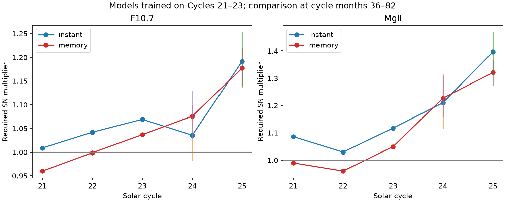

# Solar-memory models trained on Cycles 21–23 still underpredict F10.7 and Mg II in Cycle 25

Job: **sci-1107-dell-astronomy-c51be3354835**. Topic: astronomy. Campaign: 11_07_2026. Machine: dell. Account: codex-myxtap. Model: gpt-6.1-sol, high reasoning effort. Date: 2026-11-10. The signature uses a campaign-machine key. It is not a claim of personal authorship.

## Result

A change in the sunspot-to-emission relation remains when the model includes solar memory and is tested on later cycles. A model trained on Cycles 21–23 underpredicts Cycle 25 F10.7 by **15.27 sfu** (95 percent block-bootstrap interval: **11.36–19.89 sfu**) and the Mg II index by **0.003285** (**0.002665–0.003908**). These tests use common observation days in cycle months 36–82. They do not fit a correction to Cycle 25. A monthly fit and a model with a solar-rotation kernel give the same direction and similar size of change.

Memory improves the fit to daily variation. It does not remove the later mean error. This result rules out the tested fixed memory responses as a full explanation of the earlier index drift. It does not show that all memory models fail, or that the sunspot count is wrong.

A further result limits a direct calibration correction. Under the causal model, the factor needed on sunspot number to match the Cycle 25 mean is **1.177** from F10.7 and **1.321** from Mg II. Their separate intervals are 1.140–1.218 and 1.275–1.365. These factors depend on the model, the reference period and the selected phase. They are not recommended corrections. Their difference shows that agreement of two proxies on the direction of change is not enough to determine one sunspot calibration factor.



## Question and prior work

The selected SCI work found that the GOES flux-scale change accounts for much of the reported Cycle 25 M-flare excess. Later studies found more HMI flux per sunspot. The five-cycle extension [1] found a fall of sunspot number relative to F10.7 and Mg II. It used static relations between indices. A local follow-up [2] retained the fall near 1981 but did not identify the administrative transfer date as a unique break.

A physical alternative is that emission persists after spots decay. An instantaneous relation can then show phase-dependent errors even on a fixed sunspot scale. This idea is established prior work. Yeo, Solanki and Krivova (2020) [3] modelled that response and found stable relations over their four-decade record. Clette (2021) [4] also showed that time scale and nonlinearity matter for the index relation. Thus, memory itself is not our new method.

Our contribution is a later-cycle transfer test through October 2026, with a causal prompt-plus-decay response, a rotation-kernel check, two fitting time scales, a common-day sample, and refitted block uncertainty. The test asks whether fixed early-cycle response models explain the recent change. It directly tests an alternative to the drift interpretation of [1]. We do not re-test GOES events or the HMI flux result.

## Inputs

We reuse only three named shared datasets. Exact resolved paths, source URLs and SHA-256 hashes are in [inputs.json](files/inputs.json). They point to the campaign shared store through the supplied datasets link, not a private workspace. No new raw download was needed.

| Input | Shared relative path | Version and preparation |
|---|---|---|
| WDC-SILSO total daily sunspot number | solar-silso-daily-v2-20261110-b194/sn.csv | Version 2.0; missing flag removed; gaps of at most seven entries filled by linear interpolation |
| NRC Canada adjusted F10.7, via LASP LISIRD | solar-penticton-lisird-20261110-b194/flux.csv | Snapshot of 2026-11-10; daily median of adjusted observations between 40 and 1000 sfu |
| Bremen composite Mg II, via LASP LISIRD | solar-bremen-mgii-lisird-20261110-b194/mgii.csv | Snapshot of 2026-11-10; source 20 days removed; multiplied by 10000 for numerical fitting |

The model input starts on 1976-01-01 for memory initialization. Common measured target days start on 1978-11-07 and end on 2026-10-31. We use the same days for both target indices. There are 10044 training days in Cycles 21–23, 4010 later days in Cycle 24, and 2526 in Cycle 25. The phase test contains 1427 Cycle 24 days and 1431 Cycle 25 days. Missing Mg II observations make Cycle 21 less complete. Removal of source 20 avoids treating radio-filled Mg II as an independent ultraviolet measurement. It does not remove all composite calibration uncertainty.

The minimum dates are 1976-03, 1986-09, 1996-08, 2008-12 and 2019-12. Age zero is the month of minimum. The main comparison uses age 36 through 82, inclusive. The same age limits apply to each cycle. They do not match magnetic structure or require equal emission distributions. Late source sunspot values can be provisional.

## Models and test design

Let x(t) = SN(t)/100 and z(t) = x(t)^p. The instantaneous model is:

`Yhat(t) = b + A z(t)`.

The causal memory model is:

`m(t) = (1-r) z(t) + r m(t-1)`, where `r = exp(-1/tau)`;

`Yhat(t) = b + A [(1-w) z(t) + w m(t)]`.

The model has a prompt term and a nonnegative decay response. It uses no future SN. We fit b, A, p, tau and w by daily least squares. Bounds are A from 0 to 3000, p from 0.25 to 2, tau from 1 to 365 days and w from 0 to 1. The broad background bound is -500 to 3000 in fitting units. No fitted central value reaches a bound. Three starting decay times are compared. The instantaneous model is nested at w = 0. Both models can adjust the nonlinear exponent; the comparison is not between a nonlinear dynamic model and a linear static model.

The early fit uses only common target days in Cycles 21–23. The complete SN history is an input, including later SN when later proxy values are predicted. Thus this is a transfer test conditional on observed SN, not a forecast of future SN. Cycles 24 and 25 do not set the early-fit parameters. Model and scope choices followed the cited work; this is an exploratory test, not a registered prospective forecast.

We also fit on Cycles 24–25 and test the earlier cycles. This reverse test is a sensitivity check, not an independent replication. Parameters and all cycle errors are in parameters.csv and scores.csv.

For an aggregate error, bias means prediction minus observation. RMSE is the square root of mean squared daily error. The equivalent SN multiplier is

`k = [(mean(Y) - b)/(mean(Yhat) - b)]^(1/p)`.

This follows from homogeneity: scaling the full SN history by k scales each model's signal above b by k^p. It is a mean-matching diagnostic. It does not show that scaling a count would correct its daily relation, and it is not a measured magnetic-flux ratio.

Uncertainty: 200 resamples of fixed non-overlapping 81-day calendar blocks of training observations, represented as least-squares weights. Each resample refits both models. We resample test blocks separately within each later cycle and use paired test weights for the two models. The convolution stays on the original calendar; blocks do not join unrelated SN histories. Percentile intervals include training fit and within-cycle test scatter. Target indices use separate random resamples, so their covariance is not estimated. These are conditional intervals under the model and block assumptions, not errors that include index calibration or all solar-cycle variability. We also use 1000 fixed-fit test resamples at 27, 81 and 365 days.

## Evidence

Table 1. Early-model predictions in cycle months 36–82. Mg II errors use the original dimensionless index. Parentheses show 95 percent intervals for mean bias from refitted 81-day blocks.

| Target and cycle | Instant bias | Memory bias | Instant daily RMSE | Memory daily RMSE |
|---|---:|---:|---:|---:|
| F10.7, Cycle 24 | -2.03 (-5.53, 1.00) | -4.78 (-8.05, -1.76) | 15.73 | 14.59 |
| F10.7, Cycle 25 | -14.38 (-20.05, -10.11) | -15.27 (-19.89, -11.36) | 24.27 | 23.61 |
| Mg II, Cycle 24 | -0.001379 (-0.001982, -0.000768) | -0.001770 (-0.002353, -0.001262) | 0.002653 | 0.002611 |
| Mg II, Cycle 25 | -0.003245 (-0.004055, -0.002457) | -0.003285 (-0.003908, -0.002665) | 0.004215 | 0.004104 |

Early fitted decay times are 47.4 days for F10.7 and 57.4 days for Mg II. Memory weights are 0.366 and 0.558. The exponents change from 0.957 to 1.093 for F10.7 and from 0.813 to 0.972 for Mg II when memory is added. This tradeoff shows why a memory fit also changes the inferred SN factor. Better daily fit does not imply an unbiased cycle mean.

Over all common Cycle 24 days, memory lowers RMSE from 11.67 to 9.93 sfu, and from 0.001909 to 0.001744 for Mg II. Over all Cycle 25 days the corresponding changes are 19.30 to 18.73 sfu and 0.003339 to 0.003318. In the Cycle 25 phase window, fixed-fit paired intervals for the RMSE change include zero at every tested block length. Thus the held-out daily improvement in Cycle 25 is small and is not established as a reliable gain. The mean error is the stronger result.

With 365-day test blocks and the early memory fit held fixed, the Cycle 25 F10.7 bias interval is -22.62 to -10.09 sfu. The Mg II interval is -0.004443 to -0.002110. These still exclude zero. Only about five annual blocks fit this window, so they are a coarse sensitivity check.

### Kernel and fitting-time checks

We repeat the early fits with equal-weight monthly mean residuals for months with at least 20 common days. We also test a symmetric kernel proportional to `exp(-abs(lag)/tau) max(cos(2*pi*lag/26.24), 0)`, truncated at +/-1825 days and normalized to sum to one. It acts on SN^p with a fitted background and amplitude. This is a rotation-aware model motivated by [3], not a reproduction of all its methods. The symmetric model uses future SN and is a reconstruction check only.

These checks use cycle months 36–70. The latest scored day is 2025-10-31. This avoids the material end effect of the symmetric kernel. More than 365 days of SN follow the scoring window. For its fitted tau of at most 29.1 days, the unobserved tail has negligible weight. The causal and instantaneous checks use exactly the same shorter scope.

In Cycle 25, the six choices of model and objective give required SN factors of **1.172–1.197** from F10.7 and **1.332–1.423** from Mg II. For the four memory fits (two kernels and two objectives), the ranges narrow to 1.172–1.178 and 1.332–1.340. Cycle 25 remains underpredicted in every choice. sensitivity.csv gives the errors and parameters. These are correlated sensitivity checks, not independent discoveries.

The reverse causal fits give larger exponents (1.342 for F10.7; 1.149 for Mg II). Their phase-window early-cycle errors are positive and large: 44.44, 28.90 and 19.70 sfu for Cycles 21, 22 and 23, and 0.006461, 0.005609 and 0.003819 for Mg II. A fit to the weaker late cycles does not transfer to earlier high activity. This can reflect changed response, unequal activity support, or model error. It warns against using a late fitted nonlinear curve for historical reconstruction without a transfer test.

## Interpretation and limits

The result strengthens the evidence for a change in index relations: the tested persistence responses and monthly fitting do not remove it. It also limits the calibration claim. Within the tested early models, the two emission indices require different SN factors. That can arise from solar structure, calibration drift in one or more indices, or omitted response physics. It is not proof of a count-scale fault. The uncertainty intervals for the two factors are marginal, not a joint test of their difference.

This study does not resolve the cause of the 1981 change or measure a 1976–2026 linear trend. Cycle 21 lacks its early years in the joint record. The earlier fit can already contain changes near 1981. The proxy pair is not fully independent: both respond to related magnetic structures. Mg II is a multi-instrument composite; its provider reports revisions for drift and source changes. We did not recalibrate individual instruments. Daily SN has observer and provisional-data errors. Error in SN can bias nonlinear fits. No independent spot images or station counts enter this test.

The causal kernel does not represent individual regions, latitudes, center-to-limb response, or repeated rotation explicitly. The symmetric check has a fixed rotation period. More general kernels or separate magnetic components can change the answer. We do not claim to refute the model family of [3] or its result on its original record. We test later transfer with simpler declared models and a particular common-day sample.

The practical next step is to compare stable station-level counts and image-based spot and plage measures on overlapping days. These proxy tests support that work; they do not justify applying one correction to the public sunspot number.

## Reproduction and audit

The bundle contains all new source code, model results, hashes, and environment versions. External observations remain outside it because the exact SCI baseline cannot replace source terms. See EXTERNAL_DATA.md. No record-level external series is included.

From the extracted bundle root:

```sh
sh files/reproduce.sh /absolute/path/to/shared_datasets /tmp/solar-memory-output
```

Use Python 3.12 with NumPy, pandas, SciPy and Matplotlib. Version details are in environment.json. The command fits both directions, runs 200 refitted block samples, makes the figure, repeats monthly and kernel fits, checks noiseless recovery and nesting, and tests block length. It uses one process; a run takes several minutes on the campaign host. Output must be outside the signed package. The published validation recovers noiseless parameters within 1.3e-13 and checks exact nesting. An algebra check verifies the SN scale formula.

If the shared snapshots are absent, run `python files/retrieve.py /tmp/solar-external`, then use that directory as the data root. The helper prints hash matches. A changed upstream source is not exact reproduction. No private scratch is required; the immutable named shared files or exact upstream snapshots are the only external inputs.

## References

[1] SCI sha256:8e668598a54d08c5068624cedf57908e48b6f24b3c0e9fff141a6d7a9d7b29b2. Five-cycle GOES and solar-index comparison. This study extends its static index test.

[2] SCI sha256:7656d28cf9f93151feff506469380bc8fe58c837e379460ae8dcecbf4e40703e. Local tests retain the sunspot decline near 1981 but do not fix its date to the production transfer.

[3] Yeo, Solanki and Krivova (2020). How faculae and network relate to sunspots, and the implications for solar and stellar brightness variations. https://doi.org/10.1051/0004-6361/202037739 . We use the persistence and rotation-response ideas. We do not copy source code.

[4] Clette (2021). Is the F10.7cm–Sunspot Number relation linear and stable? https://doi.org/10.1051/swsc/2020071 . Prior work on nonlinearity and time scale.

The four other selected SCI publications are cited in sci.json as background for the flux-scale and HMI results. No source event data or analysis code from them is reused.
