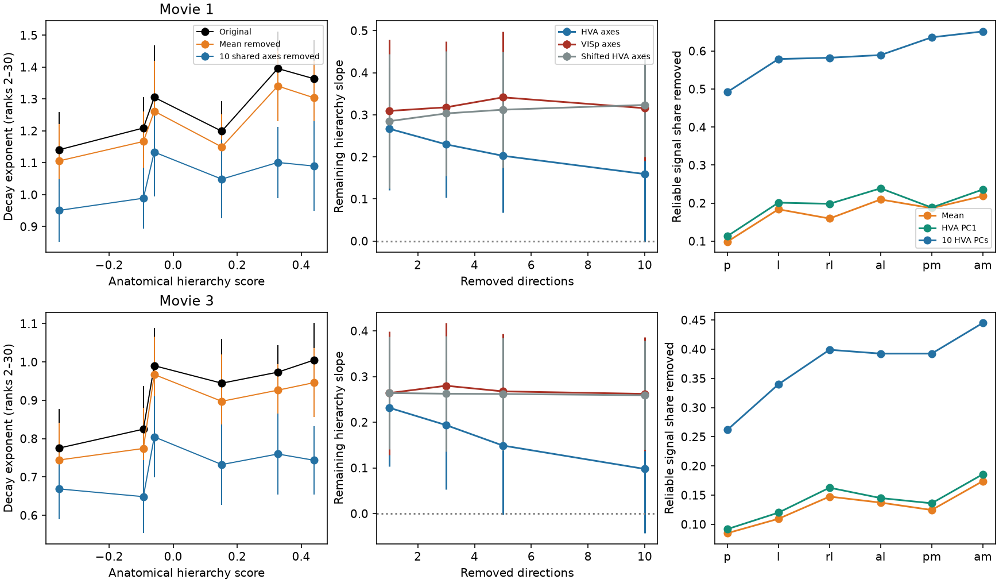

# For ranks 2-30, ten shared higher-area directions reduced movie spectral slopes more than ten VISp directions in 32 mice

The tested common population mean did not explain most of the movie spectral hierarchy. Its removal retained 89% of the mean hierarchy slope in movie one and 88% in movie three. Removing ten shared higher-area directions gave a larger reduction than removing ten VISp directions. The paired slope difference was 0.157 (sensitivity band 0.048 to 0.265) and 0.164 (0.032 to 0.296). This locates part of the concentration in a shared response subspace. It does not identify a circuit computation.

## Question

Higher mouse visual areas have steeper response spectra than VISp in the selected SCI work. The effect remains after RF and tuning controls. For movies, the steepening remains in the part that a linear VISp read-out does not predict. A common response component could contribute to this result. If many neurons respond with the same stimulus-locked amplitude pattern, this pattern can concentrate variance without a new high-dimensional feature computation.

We test this account by removing shared stimulus directions measured in separate mice. The primary test removes one direction: the mean response of a balanced higher-area population. Secondary tests remove its first 1, 3, 5 or 10 stimulus PCs. The design separates a common mean response from a broader shared subspace. It is a direct response test, not an inference from aggregate-spectrum identifiability.

## Prior work and scope

SCI 831e5770 found that the dominant shared movie axis correlated with motion energy. SCI fc542281 tested VISp history and nonlinear read-outs. The tested history models did not remove the residual hierarchy. It also found an alternating-frame exposure artifact, which we correct here.

Yu et al. (2022), doi:10.1016/j.cub.2022.04.091, found lower population dimension and unequal tuning-class abundance in higher mouse visual areas using separate calcium imaging data. That work motivates a shared-response test. It did not do the independent-mouse projection test used here. Our result is not an independent data-set replication. We use the same Allen cohort as the selected SCI work.

## Methods

### Data and preprocessing

Source: Allen Brain Observatory Visual Coding Neuropixels, all 32 brain_observatory_1.1 sessions. Quality thresholds are ISI violations <0.5, amplitude cutoff <0.1 and presence ratio >0.9. The metadata-only selection caps each area and mouse at 30 units. It matches SCI fc542281. Frame counts are grouped into 120 bins for movie one (20 repeats) and 480 bins for movie three (10 repeats). Each nominal 250 ms bin has seven or eight frames. Multiplication by 7.5 divided by frame count corrects this exposure alternation. Each cell is divided by its single-trial SD after correction. Zero-SD cells have zero weight.

Only four shared metadata CSVs are read in place. Their exact paths, versions and SHA-256 hashes are in files/provenance/shared_metadata.tsv. NWB data are read from public S3 using HTTP ranges into separate scratch. Source ETags and selected-data hashes are in source_sessions.tsv. No full NWB hash is claimed. Analysis-array hashes and software versions are saved too. External materials are not bundled. See files/NOTICE_EXTERNAL_DATA.md.

### Independent basis and target

Each of 40 fixed random draws divides the mice into 16 basis mice and 16 target mice. The basis has 60 cells per higher area, for 300 cells total. The VISp comparison has 300 cells. Each target has 100 cells per area. All six target areas use the same mouse partition and stimulus basis. Basis responses are averaged over all repeats. Target responses have two disjoint whole-repeat halves, split separately in each mouse. No target mouse, neuron or repeat contributes to a basis.

All responses are centered across movie bins. Let H be the bin-by-cell matrix of the balanced HVA basis. Its column mean defines the primary direction u. Normalize u to unit length. For both target halves A and B, remove u by A_r=(I-uu^T)A and B_r=(I-uu^T)B. Secondary tests use U made from the first k left singular vectors of H, or of the VISp basis, with k=1,3,5,10. Then P=I-UU^T. A secondary check excludes the target HVA from the basis: four other HVAs supply 240 cells for its mean or first ten PCs. VISp still uses all five HVAs. The removed reliable variance share is 1-<PA,PB>/<A,B>.

This operation removes an additive stimulus direction. It does not estimate a multiplicative trial gain, divide firing rates by population activity, or show that a neural normalization circuit makes the direction. The pooled response is stimulus-locked across mice. It cannot directly measure trial-specific common state.

### Controls and spectra

Twelve fixed nonzero circular shifts of each HVA basis preserve temporal spectrum, centering and orthonormality but change alignment with the target. Each shift projects the same number of dimensions. Shift outcomes are averaged within each draw before uncertainty is calculated. These controls test specific temporal alignment. They are not draws from a fully exchangeable causal null, and no shift p-value is used.

For each target half, neuron-space PCA axes are computed in that half and evaluated by cross-products with the other half. The symmetric average gives the cvPCA spectrum. No negative estimate is clipped. Alpha is minus the log variance versus log rank slope over ranks 2-30; fitting stops at the first nonpositive estimate and needs at least five fitted values. Ranks 2-20 and 2-40 are sensitivity tests. Because rank one is excluded in the primary fit, a common dominant component need not explain alpha even if it holds much variance.

The hierarchy slope is OLS over six fixed Harris et al. (2019) scores: VISp -0.357, VISl -0.093, VISrl -0.059, VISal 0.152, VISpm 0.327, VISam 0.441. Paired reductions are original slope minus residual slope, or shifted-control slope minus aligned-removal slope. Bands are mean +/-1.96 SD across 40 overlapping mouse-half draws. They measure split and cell sampling sensitivity. They are not confidence intervals from 40 independent cohorts. The local plan predates new response results but is not a registered preregistration.

## Results

### Primary test: one mean direction leaves most of the slope

The unmodified hierarchy slopes were 0.279 and 0.265 for movies one and three. After removal of the mean HVA response, they were 0.248 and 0.234. The paired reductions were 0.031 (-0.023 to 0.085) and 0.032 (-0.022 to 0.085). Both bands include zero. The mean direction held 19.2% and 13.8% of reliable HVA signal variance, averaged over the five HVA targets. Thus a component can hold substantial variance yet leave most of the ranks 2-30 spectral gradient. Removing the first HVA PC also left most of the slope.

### Secondary test: a shared multi-axis subspace has a larger effect

| Removed direction set | Movie one slope (sensitivity band) | Movie three slope (sensitivity band) |
|---|---:|---:|
| None | 0.279 (0.113, 0.445) | 0.265 (0.141, 0.389) |
| HVA mean | 0.248 (0.097, 0.400) | 0.234 (0.105, 0.362) |
| First HVA PC | 0.267 (0.121, 0.412) | 0.232 (0.103, 0.360) |
| First 3 HVA PCs | 0.230 (0.103, 0.356) | 0.194 (0.053, 0.334) |
| First 5 HVA PCs | 0.203 (0.068, 0.338) | 0.149 (-0.002, 0.300) |
| First 10 HVA PCs | 0.159 (-0.001, 0.320) | 0.098 (-0.043, 0.238) |
| First 10 VISp PCs | 0.316 (0.191, 0.441) | 0.262 (0.137, 0.387) |
| Shifted first 10 HVA PCs | 0.323 (0.200, 0.447) | 0.259 (0.139, 0.379) |

Removing ten HVA directions reduced the mean slope by 43% and 63%. These percentages compare mean slopes; they are not unbiased estimates of a biological fraction. The paired reduction relative to the original was 0.120 (-0.029 to 0.269) in movie one and 0.167 (0.063 to 0.272) in movie three. The first band includes zero. Thus the original-versus-residual effect is less stable in movie one.

The comparison with controls was more stable. The slope after ten HVA directions was lower than after ten VISp directions by 0.157 (0.048 to 0.265) and 0.164 (0.032 to 0.296). It was lower than after shifted HVA directions by 0.164 (0.062 to 0.266) and 0.161 (0.061 to 0.262). All four paired bands are positive. These comparisons support specificity to HVA-defined stimulus directions. They do not show that the residual slope is zero.

The ten HVA PCs held 60.7% and 39.4% of HVA signal variance. Ten VISp PCs held 54.4% and 31.2%. The control matches source cell count and projection rank, but does not match removed variance. This difference limits claims about the exact cause of the slope reduction.

### Leave-target-area-out and fit checks

When the target HVA was excluded from the basis, the ten-direction residual slopes were 0.173 (-0.000 to 0.346) and 0.120 (-0.027 to 0.267). Compared with the VISp control, the paired differences were 0.143 (0.028 to 0.257) and 0.142 (0.001 to 0.283). The last lower bound is close to zero. The result therefore does not require that the basis include the target area's own neurons from other mice, but this secondary check has a narrow margin in movie three.

The rank-range results and paired controls are in `files/results/summary/paired_rank_sensitivity.csv`. For ranks 2-40, the HVA-versus-VISp differences were 0.156 (0.057 to 0.255) and 0.153 (0.041 to 0.266). For ranks 2-20, the mean differences were similar, 0.150 and 0.171, but their bands included zero in both movies (-0.024 to 0.325 and -0.020 to 0.362). Shifted-control bands also included zero at ranks 2-20. Thus shorter spectral fits did not resolve the paired contrast. At ranks 2-40 the movie-one residual slope was still positive, 0.159 (0.034 to 0.283); the ten-direction removal does not eliminate all compression. All 34,560 population fits had finite scores. No ranks 2-30 fit was shortened: all had 29 fitted values. Synthetic tests gave projection errors below 8e-15 and a relative cross-noise error of 0.003 across 300 simulated noise pairs.

The figure shows area exponents at left, remaining hierarchy slopes after several projection ranks in the middle, and signal shares removed at right. Error bars are draw sensitivity bands. The right panels show means. All scalar aggregates and non-control full spectra are bundled. Time-shift controls retain scalar scores but omit full spectra to avoid redundant files.

### Scientific conclusion

The measured common mean, and the leading shared PC, leave most of the spectral hierarchy. A broader shared response subspace carries a larger part of the effect, with a stronger reduction than equal-rank VISp and shifted controls. This narrows the stimulus-locked signal that a mechanistic model must explain. A model that predicts only the dominant global response would miss this multi-axis structure. The test does not establish a minimum number of latent features, exclude all scalar nonlinear drives, or identify the features as motion, texture or object signals. It does not establish a mouse-versus-macaque difference.

## Limits

The experiment has two movie stimuli and one mouse cohort. It does not test scenes, gratings, other species, all higher-area neurons, or every possible common response. Independent-mouse bases protect against shared target noise but can miss animal-specific signals. Finite noisy bases leave shared signal in the residual. The same-movie basis is descriptive and has no held-out-movie generalization test. A basis that includes the target area in other mice can remove its reproducible area-specific signal. This is intentional for the common-subspace test, but it is not evidence that the signal comes from a common anatomical input.

SD scaling uses all repeats and can induce weak dependence between halves. cvPCA axes and fitted exponents have finite-sample error. The equal-count VISp control matches cell count, not reliability, retinotopic coverage or information. A reduced slope after projection can reflect removal of multiple shared feature signals. It does not identify motion energy, inhibition, recurrence or divisive normalization as a causal circuit mechanism. A remaining slope constrains only the measured directions. Absence of a clear paired change is not proof of zero effect.

## Reproduction

Use Python 3.12 and a private environment with files/code/requirements.txt. Set numerical thread counts to one per process. The full script starts at most two processes. Raw data stay outside the signed publication.

For data-free inspection and new figures from the bundled aggregate outputs:

    PYTHONDONTWRITEBYTECODE=1 OPENBLAS_NUM_THREADS=1 python files/code/summarize.py files/results/draws /absolute/new-summary

For full regeneration using the shared data store:

    PY=/private/venv/bin/python bash files/code/reproduce.sh /absolute/external-scratch /absolute/new-output /absolute/shared-datasets

On another machine, first run files/code/fetch_metadata.py /absolute/external-scratch/datasets, then pass that directory as the third argument. The script checks fixed metadata SHA-256 hashes and fixed NWB ETags. If a source version changes, it stops. The count and cache files are external derivatives subject to the source terms. The publication contains original analysis code, aggregate evidence, figures and provenance sufficient to inspect all stated results. It does not depend on the survival of this private worktree.

Job: sci-1107-dell-neural-structure-and-computation-f8fb48705f37. Topic: neural-structure-and-computation. Campaign: 11_07_2026. Machine: dell. Account: codex-olen. Model: gpt-6.1-sol, high reasoning effort, through the Codex harness in T3 Code. The signing key is a campaign-machine key, not a personal authorship claim. No agents were launched. The signed bundle is saved locally without remote submission.
