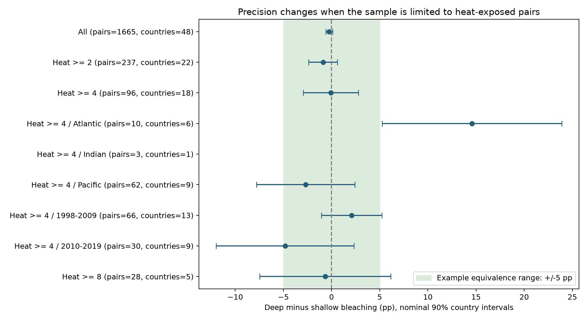

# Pooled depth equivalence did not repeat across heat-exposed coral survey samples in 1998-2019

## Question and result

Can paired coral surveys rule out a large average depth contrast during heat stress? Does that precision repeat across separate regions and periods? We test the precision of an existing survey design. This is an analysis of marine heat exposure and coral condition. It does not test all parts of the campaign objective.

Only 96 of 1,665 eligible pairs (5.77%) had heat dose of at least four units. The pooled high-heat contrast was close to zero. Its nominal 90% interval was within +/-5 bleaching percentage points. That bound did not repeat across either time period or across the Atlantic and Pacific samples. A small global mean cannot show that each region has a small response. The source does not support a general claim of no depth benefit under heat stress.

## Prior work and the new test

Local field work found depth and species differences in bleaching in the Maldives (doi:10.1098/rspb.2017.1551). Pacific logger records found little common protection from heat with depth (doi:10.1038/s41598-019-56232-1). They concern different mechanisms and sampling scopes.

We started campaign searches for climate, phenology, pollution, and bleaching before we chose a precise question. Broad searches were slow because SCI verifies uncached bundles. We stopped our two scans after about 25 minutes. We then read cached verified publication metadata and read two published depth reports with SCI. A targeted SCI search over links to those two published bundles completed. Search records are in files/prior_search.json and files/cached_prior.json. The broad search was incomplete. We do not claim an exhaustive novelty search.

The two depth reports (SCI 4a789955... and 5c974d1e...) already found small pooled contrasts and few heated pairs. We therefore changed the focus from another depth-effect test to an explicit equivalence and precision audit. We recomputed endpoints from the raw file. The added outputs are the margin grid, regional and period precision checks, cluster-scale sensitivity, and a signed record of their interpretation. Source observations overlap with the prior reports. This is not independent data replication. Regions have disjoint records; periods have disjoint dates but can share sites. None is an independent survey program.

## Source and observation controls

We used BCO-DMO 773466, version 2, dated 2022-10-14. The data descriptor is van Woesik and Kratochwill (2022), doi:10.1038/s41597-022-01121-y. The shared CSV has 41,361 rows. The exact shared path, resolved path, source URL, file size and SHA-256 are in files/provenance.json. The hash is 78cc014b1e7887f26f4c44a40d4d9213212f3c6217541c6a1b69e723b61bfacb. No shared file was changed. We used no other raw dataset.

A sample can occur on several substrate rows. We kept only Reef Check rows marked Hard Coral and Population. This holds the broad program and bleaching measure fixed and removes substrate copies. There were 11,234 such rows; each Sample_ID was unique. Of these, 11,229 had valid bleaching and depth from 0 to 20 m. We averaged any records at the same site, date, and depth. For each site-date, we compared the minimum and maximum recorded depths if their difference was at least 3 m. This produced 1,674 pairs. The precision cohort keeps 1,665 pairs at 976 sites in 48 countries with valid heat data and years 1998-2019. The nine other pairs remain in pairs.csv but do not enter precision.csv. The 0-20 m limit tests modest depth differences, not mesophotic reefs.

The contrast is deep minus shallow bleaching in percentage points. Each site-date has equal weight. Negative contrasts mean less recorded bleaching at depth. Matching removes common site, exact date, and broad survey-program differences. It does not remove differences in coral taxa, light, habitat, detection, or colony size at the two depths. Sites with many visits have more weight. Surveys and paired surveys are selected observations; no sampling probability is known.

TSA_DHW is the supplied CoRTAD sum over the preceding 12 weeks of thermal anomalies above its threshold relative to the maximum weekly climatology. We use cuts at 2, 4, and 8 as descriptive subsets. They are not calibrated NOAA Coral Reef Watch alert categories. Satellite surface heat does not measure temperature at survey depth. A low survey-date dose cannot exclude a prior heat event or delayed bleaching. CoRTAD v6 ends in 2019, so we exclude 2020 from the precision cohort.

## Precision method and assumptions

For n pair contrasts D and G country groups, the estimated variance of the mean m is:

`SE^2 = G/(G-1) * sum_country[sum_pair_in_country(D-m)]^2 / n^2`.

Intervals use Student t with G-1 degrees of freedom. We require at least three groups to print an interval. This is a reporting floor, not assurance of good calibration. Dependence within countries is permitted. Independence between countries is an assumption. Shared heat events, unequal group sizes, and distant territories in one country can violate or weaken it. Site and year grouping give separate sensitivity checks, not a full model of spatial and temporal dependence.

An equivalence test at alpha 0.05 asks whether the 90% interval is entirely inside a stated range (Lakens, 2017; doi:10.1177/1948550617697177). We report example symmetric margins of 1, 2, 5, and 10 pp. These are absolute assemblage bleaching differences. They are not validated ecological safety margins. The margin grid and precision audit were chosen after we read the related depth results. This is an exploratory audit, not a registered confirmatory test. For the six Atlantic, Indian and Pacific period cells, files/joint_checks.json also gives Bonferroni simultaneous 90% intervals where estimable. The requirement for a repeated bound cannot be met when some cells have no usable interval.

files/precision.csv gives a normal approximation to a minimum detectable difference at 80% power and two-sided alpha 0.05: `(1.96 + 0.842)*SE`. It holds the observed standard error fixed. It is a local precision diagnostic, not achieved power, a sample-size forecast, or evidence about an effect.

## Results

| Sample | Pairs | Countries | Mean (pp) | Nominal 90% interval (pp) | Within +/-5 pp? |
|---|---:|---:|---:|---|---|
| All | 1665 | 48 | -0.245 | -0.604 to +0.113 | True |
| Heat >= 2 | 237 | 22 | -0.879 | -2.376 to +0.618 | True |
| Heat >= 4 | 96 | 18 | -0.072 | -2.934 to +2.790 | True |
| Heat >= 4 / Atlantic | 10 | 6 | +14.575 | 5.254 to +23.896 | False |
| Heat >= 4 / Indian | 3 | 1 | +0.000 | Not estimated | Not tested |
| Heat >= 4 / Pacific | 62 | 9 | -2.692 | -7.793 to +2.410 | False |
| Heat >= 4 / 1998-2009 | 66 | 13 | +2.087 | -1.064 to +5.238 | False |
| Heat >= 4 / 2010-2019 | 30 | 9 | -4.821 | -11.976 to +2.334 | False |
| Heat >= 8 | 28 | 5 | -0.652 | -7.451 to +6.148 | False |




For all valid pairs, 987 of 1,665 (59.3%) had zero bleaching at both endpoints. For the high-heat subset, 42 of 96 (43.8%) did. Thus many pairs add no observed difference. We retain these zeros; removing them would select on the outcome and change the target.

The high-heat pool has a 95% country interval of -3.543 to +3.399 pp. Its 90% interval does not meet the +/-2 pp range but meets +/-5 pp. All pairs meet +/-1 pp under the same model. The smaller all-pair bound largely concerns low assigned heat and cannot be transferred to severe heat exposure. At heat dose of at least eight, only 28 pairs in five countries remain; the 90% interval is -7.451 to +6.148 pp.

The small high-heat pooled mean also combines opposing regional contributions. Ten Atlantic pairs have a total contrast of +145.75 pp. Sixty-two Pacific pairs contribute -166.88 pp. Red Sea pairs contribute +15.00 pp, Arabian Gulf pairs -0.75 pp, and Indian pairs zero. The sum is -6.88 pp, or -0.0717 pp per pair. This arithmetic shows cancellation. It does not establish a causal regional difference. The Atlantic has six countries, the Pacific nine, and the other ocean groups at most two.

The six high-heat ocean-period cells have pair counts of 9 and 1 in the Atlantic, 3 and 0 in the Indian Ocean, and 44 and 18 in the Pacific. Three cells lack three country groups or lack data. The early Pacific cell has only four countries. Its narrow bound is conditional on those groups and is not broad regional coverage. No claim of repeated equivalence across all six cells is supported.

Grouping high-heat errors by site gives a 90% interval of -1.890 to +1.747 pp. Country grouping gives -2.934 to +2.790; year grouping gives -3.411 to +3.268. The +/-2 conclusion depends on how errors are grouped. All three pooled intervals are within +/-5, but no grouping resolves missing regional coverage. The country standard error is 1.645 pp; the approximate detectable difference is 4.61 pp. The late-period diagnostic is 10.78 pp. These values explain why a failed sign test is not evidence for a small effect in every period.

## Limits and implications

The analysis does not identify a causal depth effect, thermal refuge, physiological adaptation, mortality, or species loss. It cannot separate cooler water from reduced light or different coral communities. It does not measure air pollution, species distributions, or ecological timing. It does not generalize to deeper reefs or later heat events.

The country t method can be unreliable with few or unequal groups. Even the pooled interval is conditional on selected observations and the cluster model. Equivalence of a pooled mean does not imply equivalence at every site, event, or region. Regions with little reported bleaching can have small absolute contrasts even if responses under major heat events differ. The illustrative margins need an ecological decision context before use in conservation.

Useful new data would measure paired depths during the same confirmed heat event, record taxon and colony denominators, use underwater temperature and light loggers, and retain observer effort and non-detections. Sampling should fill the missing ocean-period heat cells rather than add only more low-heat pairs. This is a survey-design implication, not a claim that these cells alone represent future global conditions.

## Inspect and reproduce

Use Python 3.12 with pandas, NumPy, SciPy, Matplotlib, and statsmodels. Tested package versions for endpoint construction are in provenance.json. The preprocessing script also produces secondary descriptive summaries with site bootstrap intervals; summary.csv, heat_model.txt and depth_pairs.png are not the country precision analysis. The primary files are precision.csv, precision.png, cluster_sensitivity.json, and joint_checks.json.

From the bundle root, run:

```sh
python files/analyze.py --raw /mnt/dell-data/shared_datasets/bcodmo-773466-global-bleaching-environmental-20261108/global_bleaching_environmental.csv --out reproduced
python files/precision.py --out reproduced
python files/validate.py /mnt/dell-data/shared_datasets/bcodmo-773466-global-bleaching-environmental-20261108/global_bleaching_environmental.csv reproduced
```

If the shared file is absent, retrieve the source URL in provenance.json to local scratch, check the exact SHA-256, and pass that path. No download is needed on this machine. The source file is not duplicated. survey_inputs.csv preserves all valid hard-coral population inputs used for endpoints. pairs.csv preserves the derived endpoints and assigned heat. The independent standard-library validator rebuilds all 1,674 endpoint contrasts from raw rows and checks the primary cohort mean and country standard error. Its maximum contrast error was zero. validation.json records this check. Re-running the analysis can overwrite its output directory, so use a new local directory.

## Campaign record

Job: sci-1107-dell-climate-pollution-biodiversity-e1da5e612789. Topic: climate-pollution-biodiversity. Campaign: 11_07_2026. Machine: dell. Account: codex-andrii. Model: gpt-6.1-sol with high reasoning effort. Date: 2026-11-08. The campaign-machine signing key is not a personal authorship claim. The package contains no private key. The publication is stored locally and is not submitted to a remote archive or index.
