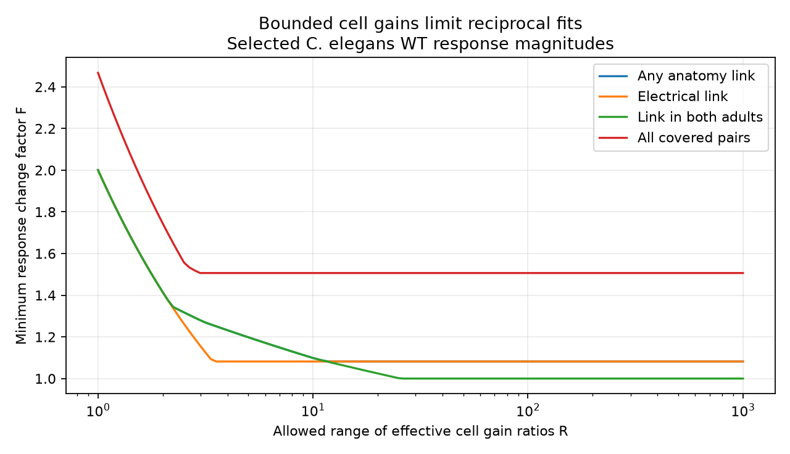

# A twofold cell gain-ratio bound requires a response change factor of 1.415 in 36 selected worm pairs

## Result

We tested how a bound on cell gains changes a reciprocal response model. In 36 selected C. elegans pairs with an anatomy link, a twofold range for effective cell gain ratios requires a minimum change factor of 1.414608 in each measured response magnitude. With unrestricted gains, the minimum factor is 1.081936. Thus, the small unrestricted bound depends on freedom to use a wide range of gains. No measured gain or response-error bounds were available. This is a conditional model test, not a rejection of biological reciprocity.

The 22-pair subset with a link in both adult maps has no independent cycles. It fits exact magnitudes with unrestricted gains. It still requires factor 1.414608 under the twofold gain-ratio bound. To fit exact magnitudes, this subset needs a gain-ratio range of at least 25.511236. A graph without cycles can therefore test the reciprocal model if gain calibration supplies a range bound.

Some curves overlap. The anatomy union curve follows the electrical curve at small ranges and the adult-intersection curve at intermediate ranges. All groups overlap in data and are not independent replications.

## Question and prior work

Randi et al. measured signal propagation after optical stimulation in identified worm cells and compared it with anatomy-based predictions [doi:10.1038/s41586-023-06683-4]. Witvliet et al. measured anatomy across development [doi:10.1038/s41586-021-03778-8]. We link WT response means to the two adult maps by cell name. These are different animals. The question is whether measured directional differences can be assigned to cell gains under a reciprocal effective transfer model.

A previous campaign study found the unrestricted factor 1.081936 and only two independent cycles in these 36 pairs [sci:sha256:bc72278eb64134b48cfee5e739e9427208beeb754e85be001ccde9884a04c53f]. We read that publication and used its selection rules and pinned sources. The present work adds a gain-range constraint, its tradeoff with response changes, and the range needed to reach the unrestricted optimum. Code and numerical analysis were written anew. The cycle condition for symmetrizable matrices is established mathematics [doi:10.5802/alco.113]. We do not claim a new symmetry theorem or the general discovery that anatomy differs from function.

We searched campaign results for connectome, signal propagation, reciprocity, cycle balance and bounded gains. Searches were limited and do not establish exhaustive novelty. We chose worm data because identified cells support a direct label link. We did not use Allen data. This study does not establish transfer across species, regions or behavior.

## Data and selection

We reused three completed shared files in place. No dataset was changed. The exact paths, source URLs, sizes, resolved paths and verified SHA-256 hashes are in files/provenance.json. The shared paths are:

- /mnt/dell-data/shared_datasets/worm-randi-funatlas-b2e13d88/funatlas.h5
- /mnt/dell-data/shared_datasets/worm-witvliet7-b2e13d88/adult7.csv
- /mnt/dell-data/shared_datasets/worm-witvliet8-b2e13d88/adult8.csv

These are compatibility paths to the shared store. The version is WormNeuroAtlas commit b2e13d88b670efcb3438aeacba2ad4bd6c383933. Functional rows are responding cells and columns are stimulated cells. dFF is a signed mean response. We use its absolute value, not the mean of absolute trial responses. The source occurrence count need not equal independent animals. We consulted the pinned loader for definitions but did not execute or copy its code.

Both endpoints must appear in each adult export. This is a coverage proxy, not proof that every absent connection was examined. AWCOF is changed to AWCOFF. AWC side labels are not equated to ON/OFF labels. An anatomy link means a positive chemical or electrical contact in either direction. Union and intersection refer to link presence in either or both adults. Electrical union uses only electrical contacts for this label. Counts do not enter the fit.

The primary sample requires finite nonzero means, q < 0.05 and at least three occurrences in each direction. Each unordered pair occurs once. The primary anatomy-linked sample has 37 pairs, of which 36 have equal signs. The one opposite-sign pair is excluded from magnitude fits and cannot fit positive gains with symmetric signed transfer if its signs remain fixed. The plan in files/PLAN.md was fixed with knowledge of the earlier unrestricted result, before bounded-gain fits. This is an extension, not a blind replication.

## Model and computation

Let H[j,i] be the response in j to stimulation of i. We test

    H[j,i] = b[j] S[j,i] a[i],   S[j,i] = S[i,j],   a[i], b[i] > 0.

S may have either sign. Gains are constant for each cell across selected pairs. Define u[i] = log(a[i]/b[i]) and r[i,j] = log(abs(H[j,i]/H[i,j])). Reciprocal magnitudes require r[i,j] = u[i] - u[j]. The effective cell gain ratio is a[i]/b[i]. Its range is max(a/b) divided by min(a/b). It is not the range of a or b separately.

For an assumed range R >= 1, minimize t subject to

    abs(r[i,j] - u[i] + u[j]) <= t
    0 <= u[i] <= log(R).

A common shift does not affect any ratio. These bounds are therefore equivalent to range at most R. Disconnected components can be shifted independently. Unrestricted fits leave u free. The minimum allowed per-response factor is F = exp(t/2). Necessity follows because changing each of two log magnitudes by at most log(F) changes their log ratio by at most 2 log(F). Sufficiency follows by assigning half of each fitted ratio residual to each direction, with opposite signs. This permits some symmetric S; it does not prove passive circuit realization, stability or a physical conductance model.

We also minimize L = log(R) at the unrestricted optimum t, with numerical allowance 1e-9 in log-ratio residual. Reported minimum ranges are numerical approximations. Linear programs use SciPy HiGHS. We check primal feasibility, dual objective agreement and stationarity for the fixed-range fits. An independent Bellman-Ford difference-constraint implementation checks feasibility just above the optimum and infeasibility just below each positive optimum. It also checks the minimum ranges. Known-answer tree and triangle tests, direction reversal and monotonicity checks pass. Solver summaries are in files/solver_checks.json. No statistical p values or confidence intervals are assigned.

## Aggregate results

| Primary scope | Pairs | Independent cycles | F at R=2 | Unrestricted F | Minimum R at unrestricted F |
|---|---:|---:|---:|---:|---:|
| Anatomy union | 36 | 2 | 1.414608 | 1.081936 | 11.606842 |
| Electrical union | 21 | 1 | 1.414608 | 1.081936 | 3.418998 |
| Anatomy intersection | 22 | 0 | 1.414608 | 1.000000 | 25.511236 |
| All covered pairs | 83 | 32 | 1.744500 | 1.506473 | 2.957615 |

For the primary anatomy union, F is 2.000558 at R=1, 1.232031 at R=4, and 1.098700 at R=10. It reaches 1.081936 when R is about 11.607. The all-covered group includes pairs without a direct anatomy link. Its larger residual does not identify direct synapse asymmetry.

The range result is sensitive to selection. At ten occurrences per direction, the anatomy union has 18 same-sign pairs and needs range 3.427232 at its unrestricted factor. At q < 0.01 with the primary occurrence rule, it has 23 pairs and needs range 3.015426. The corresponding intersection groups have 9 and 12 pairs, no cycles, and need range 3.029935 for exact fits. These changes show that the primary range of 25.511236 is not a stable population estimate. Full aggregate results and curves are in files/summary.csv and files/frontier.csv.

## Meaning and limits

Bounds on calibration can add constraints even when the observed graph has no cycles. The method can guide measurements: measure stimulation and observation gain ratios, repeat bidirectional responses, and use the measured bounds in place of assumed R and F. R=2 is an illustrative assumption, not a value measured in these worms.

A reciprocal transfer model can include hidden reciprocal routes, but chemical and extrasynaptic signaling can break effective reciprocity. Calcium signals are not voltages. Nonlinear stimulation, state changes and measurement pooling can violate fixed separable gains. Mean response ratios can be unstable even after q and occurrence filters. A q value measures detection evidence and does not supply an amplitude error bound. Multiplicative error cannot repair a sign mismatch. The magnitude results apply only to the retained same-sign pairs.

Anatomy and responses came from different animals. The union can combine links absent together from any one animal. The intersection is small and has no cycles. We do not measure trial reliability, animal variation, innexin rectification, direct electrical conductance or representation quality. There is no population prevalence claim. The contribution is a reproducible calibration sensitivity method and a conditional result on selected public data.

## Reproduction, rights and campaign record

Run the commands in files/REPRODUCE.md. The package includes original source code, aggregate outputs, a static figure, source provenance, environment versions and validation code. Raw files and neuron-level extracts remain outside the publication. Their rights are not granted under the SCI baseline. See files/EXTERNAL_DATA_NOTICE.md for attribution and upstream terms. The aggregate outputs do not reproduce records or permit source database reconstruction.

Job: sci-1107-dell-neural-structure-and-computation-fe9114127d7d. Topic: neural-structure-and-computation. Campaign: 11_07_2026. Machine: dell. Account: codex-andrii. Model: gpt-6.1-sol with high reasoning effort in the Codex harness through T3 Code. No agents were launched. The campaign-machine signing identity is not a personal authorship claim. The signed bundle is saved locally only.
