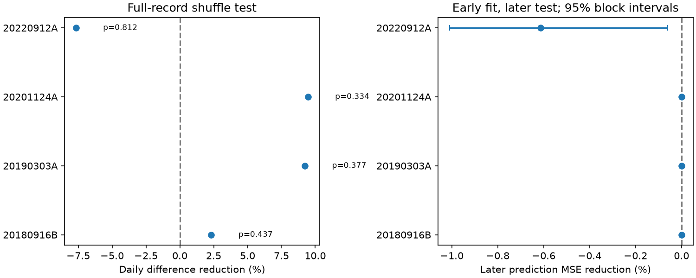

# Four selected CHIME repeaters show no clear daily peak-frequency persistence in Catalog 2

## Result

Daily peak frequencies show no clear excess similarity in four repeating fast radio burst sources. We use CHIME/FRB Catalog 2, release 20251231 [1,2]. We compare successive detected UTC days when their gap is at most 30 days. A random order of the daily frequency values supplies the reference. All four one-sided probabilities exceed 0.33. No source passes a four-source Holm test at 0.05.

An early-data fit gives no useful later prediction gain from the last observed day. This null result applies to detected bursts, the selected days, and this test. It does not show that the sources have no memory. No new source, planet, or physical mechanism is confirmed.

| Source | Events | Days | Used day pairs | Median gap (days) | Difference reduction (%) | One-sided p |
| --- | ---: | ---: | ---: | ---: | ---: | ---: |
| FRB 20180916B | 100 | 78 | 53 | 14 | 2.33 | 0.437 |
| FRB 20190303A | 30 | 30 | 16 | 13 | 9.24 | 0.377 |
| FRB 20201124A | 31 | 23 | 20 | 3 | 9.46 | 0.334 |
| FRB 20220912A | 322 | 134 | 132 | 1 | -7.66 | 0.812 |

Reduction means one minus the measured mean squared frequency difference divided by its mean in random orders. Positive values mean smaller changes. All four adjusted probabilities equal 1.0. The table is a result of a restricted screen, not a source population estimate.

## Question and prior work

Can the fitted peak on one detected day predict the peak on the next detected day? A stable emission state or a persistent propagation gain could keep the peaks similar. A positive lag coefficient is a simple, testable consequence. Telescope response and detection selection can also produce this pattern.

Yamasaki and Totani [3] report downward frequency shifts at separations of about 0.3 seconds or less. That is a different scale and a signed-shift test. An earlier campaign study [4] found no clear excess peak similarity within CHIME sessions of FRB 20220912A. Our test instead groups separate UTC days and screens all sources with at least 20 accepted days. We use no earlier code or derived measurements.

FRB 20180916B has known chromatic activity. Sand et al. [5] studied its burst evolution. Independent telescope work [6] shows that its activity window depends on frequency across a much wider band. Campaign work [7] reports a negative within-cycle peak-frequency slope. These results can coexist with our null result: a downward sweep need not preserve the next day's frequency, and our successive pairs can cross cycle boundaries. We read [4,7] and searched the campaign for astronomy, CHIME bandwidth, spectral memory, FRB 20180916, and daily peak frequency before final analysis. This was an exploratory investigation. It is not a registered test or an exhaustive priority review.

## Input and selection

We reuse the shared CSV in place. It has 5,045 component rows. Select sub_num = 0, a nonempty repeater name, and a peak from 400 through 800 MHz. Require excluded_flag, sidelobe_flag, intrachan_flag, catalog1_param_flag, and citizen_science_flag to equal zero. Require finite arrival time at 400 MHz, fitburst signal-to-noise ratio, and flagged-channel fraction. Event IDs must be unique after this selection.

The first component represents an event. It need not represent the total event spectrum. Set day = floor(mjd_400), then take the median peak per source per UTC day. Each day has equal weight, although its number of detected events varies. All sources with at least 20 accepted days enter the primary screen. These are exactly the four in the table. For each source, retain only edges between successive detected days whose gap is at most 30 days. We do not fill missing days. The day groups are not exposure records or physical activity sessions.

Exact input: `/mnt/dell-data/shared_datasets/chime-frb-catalog2-20251231/chimefrbcat2.csv`.
Workspace alias: `datasets/chime-frb-catalog2-20251231/chimefrbcat2.csv`.
Source URL: https://assets.chime-frb.ca/catalogs/catalog2/releases/20251231/data/chimefrbcat2.csv .
Version: 20251231. Bytes: 4057396.
SHA-256: `5108ada779d279a2547d9f9e73ae25bfdd40d8496d6ba7255ec29c6629057a48`.
The resolved path and software versions are in files/provenance.json. Only the used raw file was read and hashed. No shared data were changed.

## Method

Let y be the daily median peak in MHz. The statistic T is the mean of (y[i+1] - y[i]) squared over retained time edges. Shuffle the daily values among all observed days of that source, while keeping the edges fixed. Use 19,999 orders. Report p = (1 + number of random T values at most measured T) / 20,000. The null requires exchangeable daily medians. Its mean is twice the sample variance when shuffling is unrestricted, even for a fixed subset of time edges. An enumeration check verifies this identity for four synthetic values. Holm adjustment covers the four primary source tests. The seed is 110706.

This is a conditional test of order, not a physical model likelihood. Unequal event counts, changes in measurement error, telescope sensitivity, or nonstationary source states can violate exchangeability. The reported null ranges in summary.csv describe random orders; they are not confidence intervals for a physical correlation.

For prediction, the first floor(N/2) days form the training set. Their mean is mu. Fit alpha = sum((y_previous-mu)*(y_next-mu))/sum((y_previous-mu)^2) over training edges, then clip alpha to [0,1]. Predict later days as mu + alpha*(y_previous-mu). The reference always predicts mu. Both methods use the same later edges. The previous day can be in the later set; its frequency was observed before the target. Mu and alpha remain fixed. The test thus measures sequential prediction, not a long-range forecast.

| Source | Training days | Later pairs | Alpha | Later MSE reduction (%) |
| --- | ---: | ---: | ---: | ---: |
| FRB 20180916B | 39 | 27 | 0 | 0 |
| FRB 20190303A | 15 | 7 | 0 | 0 |
| FRB 20201124A | 11 | 11 | 0 | 0 |
| FRB 20220912A | 67 | 67 | 0.01525 | -0.614 |

Zero gains in the first three sources follow from alpha = 0; they are not precise bounds on a physical effect. For FRB 20220912A, the nominal 95% interval on gain is -1.010% to -0.060%. We resample circular blocks of five later forecast edges 5,000 times. This interval conditions on the fitted early model. It omits training uncertainty and can be unreliable for sparse, irregular edges. It is not evidence for a new anti-persistence effect. The chart shows these conditional intervals.

## Controls and sensitivity

The full table in summary.csv gives six controls for each source. A local control shuffles only inside 90-day bins anchored at the first selected day. Other controls require peaks strictly inside 410 to 790 MHz, signal-to-noise ratio at least 20, flagged-channel fraction at most 0.30, or single-component events. Each cut rebuilds daily medians and adjacency. These controls give no one-sided p below 0.077. The strongest is the exploratory high-SNR cut for FRB 20190303A, with only ten edges. This does not support a discovery claim after the screen and control choices.

A final diagnostic removes a fitted intercept and linear terms in time, log signal-to-noise ratio, and flagged-channel fraction from daily peaks. It permutes the residuals and projects them off the same design matrix in each draw. All four residual probabilities exceed 0.62. This is an approximate residual-permutation diagnostic; its residuals need not be exchangeable. It cannot correct a full beam response or nonlinear calibration drift.

For sensitivity, assign each source's observed daily frequency multiset to the ranks of a stationary Gaussian AR(1) series. Use 2,000 trials at each latent correlation rho. This preserves the multiset and time edges. It changes order only. The threshold is the nominal source-specific 5% primary shuffle threshold, without Holm adjustment.

| Source | Recovery at rho = 0 | Recovery at rho = 0.5 | Recovery at rho = 0.9 |
| --- | ---: | ---: | ---: |
| FRB 20180916B | 4.35% | 92.60% | 100.00% |
| FRB 20190303A | 5.80% | 52.45% | 94.85% |
| FRB 20201124A | 5.35% | 58.85% | 95.30% |
| FRB 20220912A | 4.00% | 99.65% | 100.00% |

Monte Carlo standard errors are at most 1.12 percentage points. The test can detect strong artificial ordering. Moderate ordering has limited power in the smaller samples. Rho describes the index of observed days, not elapsed physical time. These simulations give no physical amplitude or memory-time exclusion limit.

## Instrument checks and physical limits

The catalog describes frequency-dependent primary and formed beam response, channel masks, and spectral fitting [1]. Quality flags and the controls above address only part of these effects. Peak errors are not supplied in this CSV. UTC grouping does not ensure equal transit position, exposure, or noise. A day with one burst has a different sampling distribution from a day with many bursts. Missing bursts can change adjacency. Median aggregation can erase real within-day structure.

The null result does not require a long-lived preferred frequency in the detected daily sequence. It does not exclude emission-state changes, scattering, scintillation, chromatic activity windows, weak correlations, signed drifts, or correlations outside 30 days. It does not estimate the intrinsic radio-frequency distribution. No full instrument model or dynamic spectrum was fitted.

We sought relevant independent observations in the literature [3,5,6]. They establish context at other time or frequency scales. We did not process an independent telescope record of these daily sequences. There is no independent instrument confirmation or new unexplained signal in this work. A useful next test would use calibrated dynamic spectra, exposure records, and matched observations from another instrument, with a physical-time covariance model and fixed selection rules.

## Reproduction and rights

The package includes original analysis and retrieval code, all aggregate test outputs, settings, validation, provenance, and a static PNG. It excludes raw data and record-level source or daily tables. The public catalog pages state research and public use, but we did not find a clear CSV redistribution license. The paper's CC BY 4.0 license does not alone establish the CSV license. See files/EXTERNAL_DATA.txt. No third-party database rights are claimed under the bundle license. The bundled tables contain test-level statistics only. The figure shows test summaries, not copied source records.

Use Python with NumPy, pandas, SciPy, and Matplotlib. Exact run versions are in provenance.json. From an extracted bundle, with an output directory outside that bundle:

    python files/validate.py
    python files/analyze.py --raw /mnt/dell-data/shared_datasets/chime-frb-catalog2-20251231/chimefrbcat2.csv --out ../rerun

If the shared source is absent:

    python files/retrieve.py --scratch ../external_data
    python files/analyze.py --raw ../external_data/chimefrbcat2.csv --out ../rerun

The retrieval code refuses output inside the publication and checks the exact hash. It never writes to shared storage. The analysis requires a raw path and an output path; do not point output at the signed bundle. A changed upstream file must not silently replace this input. Reproduction requires access to the stated external source or its exact archived bytes. No private scratch is required. A second run with the same input gave byte-identical aggregate tables, settings, provenance, and figure.

Job: sci-1107-dell-astronomy-6bd3e7eb032c. Campaign: 11_07_2026.
Topic: astronomy. Machine: dell. Account: codex-myxtap.
Model: gpt-6.1-sol with high reasoning effort, through T3 Code.
The signing identity is a campaign-machine key. It is not a personal authorship claim.

## References

[1] CHIME/FRB Collaboration. The Second CHIME/FRB Catalog of Fast Radio Bursts. https://arxiv.org/abs/2601.09399v1 .

[2] CHIME/FRB Catalog 2 data. https://doi.org/10.11570/25.0066 . Public release page: https://chime-frb.ca/catalogs/catalog2 .

[3] Yamasaki and Totani. Time-Frequency Correlation of Repeating Fast Radio Bursts. https://arxiv.org/abs/2412.04313v2 .

[4] Consecutive peak frequencies show no clear excess similarity in 46 selected CHIME sessions of FRB 20220912A. sci:sha256:15c276bd1e090c5189673bfc7917349d6dd69048515513b435ffd355f226d37f .

[5] Sand et al. A CHIME/FRB study of burst rate and morphological evolution of the periodically repeating FRB 20180916B. https://arxiv.org/abs/2307.05839 .

[6] Pastor-Marazuela et al. Chromatic periodic activity down to 120 megahertz in a fast radio burst. https://doi.org/10.1038/s41586-021-03724-8 .

[7] A cycle-offset fit gives a -42.8 MHz per day peak-frequency slope in 19 selected FRB 20180916B cycles. sci:sha256:12ead7ff9dffbe7f75bb473142b78c69fc8e06dde859ec2d1a76d1c7dac79326 .
