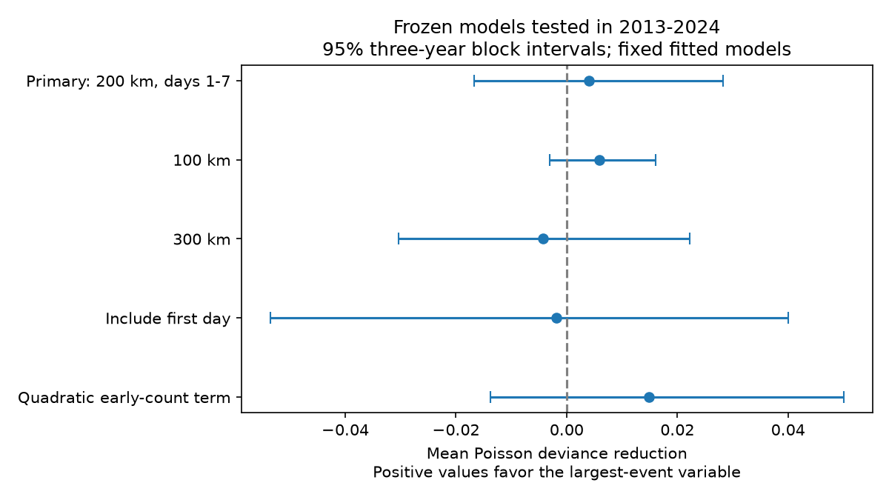

# Early largest-event magnitude gave no clear count forecast gain after 323 shallow M6.5+ earthquakes in 2013-2024

Adding the largest nearby event magnitude in days 1-7 gave a small and uncertain forecast gain for days 7-30. The mean Poisson deviance reduction was 0.00409. Its conditional 95% three-year block interval was -0.01673 to +0.02820. The reference model already used the early count, center magnitude and center depth. The result does not show that early magnitude has no information. It gives no clear support for this added term in this model and sample.

## Question and prior work

Can the largest event in the first week improve a forecast of later nearby event counts after the first-week count is known? This is useful because a large early event could start another sequence. It could also be large only because more early events were sampled. These explanations need not give the same forecast gain.

USGS operational forecast methods update sequence productivity with early observations. USGS also reports that early catalog gaps can affect inference (https://earthquake.usgs.gov/data/oaf/background.php). Helmstetter and Sornette (doi:10.1029/2003GL018186) studied the relation between the largest aftershock and event counts. Bayesian work used early events to forecast the largest aftershock (doi:10.1002/2014GL061272). Our direction of prediction is different: we add early maximum magnitude to a model of later counts.

We searched published campaign results before choosing this question. The campaign study sci:sha256:e52c68b2e1361162f3ebd5cc9a8f17d4109ed89f22dc6ecd14b5e92805a822d0 examined the largest aftershock given a full sequence count and faulting class. The study sci:sha256:2182948ccf9d3297ee3ca28cdd0204ea9bf8162558495eb3b423983ebea9368c forecast counts from earlier regional sequences. Neither is this within-sequence time-split test. We also read sci:sha256:157c5956bfabcb4f92ffcca3e011b893b0ac7f21e9f2ecb7fa56111d8dda6282. We use its documented shared ComCat snapshot, but write new analysis code. These studies overlap in source events. This is not an independent catalog replication. We read no private worker files.

## Data and scope

We reused the shared input in place:

`/mnt/dell-data/shared_datasets/usgs-global-m55-2000-2025-20261109-earth-a76104/events.csv`

The exact query URL, resolved path and retrieval time are in files/provenance.json. The source is a ComCat preferred-event snapshot for 2000-2025, retrieved on 9 November 2026. It has 12,848 unique earthquake IDs and 2,240,222 bytes. Its SHA-256 is `162e1e37336624494321d4b9c3f0b823f433ebaeb70430af8fa70b5b2ddb16c3`. All used coordinates, depths and magnitudes are present. The query is below the 20,000-record service limit. We did not download or change shared data.

M means preferred catalog magnitude. It includes different magnitude scales. It is not a uniform moment magnitude. Neighbors are catalog earthquakes with M5.5 or more, at all depths. They are not proven aftershocks. Some are background events or members of another sequence.

## Method

The local design is in files/design.txt. It was fixed before the new counts, but is not an external registration. Candidate centers are the 835 events with M6.5 or more, depth at most 70 km, and UTC year 2001-2024. A center is removed when an equal or larger event occurred in the preceding 30 days within 300 km. This rule uses only past events. It does not remove centers because of a larger future event. For training we also require the full outcome window to close by 1 January 2013. This last check removed one late-2012 center. There are 686 retained centers: 363 for training in 2001-2012 and 323 for testing in 2013-2024.

For each center, surface distance uses a sphere with radius 6,371 km. The primary radius is 200 km. Early events have time gaps at least 1 and below 7 days. Target events have gaps at least 7 and below 30 days. The source buffer years cover the time windows. Larger subsequent events remain in the counts. The forecast is issued at day 7 in this retrospective test. The first day is omitted to reduce sensitivity to immediate catalog gaps; this does not prove complete detection.

Both models use a Poisson log link. The reference mean has linear terms for M-6.5, log(1+depth)/4, and log(1+early count), plus an intercept. The added model has one further term: largest early magnitude minus 5.5. This term is zero if no early event exists. Magnitude exactly 5.5 also gives zero. No parameter was tuned on test years. We minimize the summed Poisson negative log likelihood plus 0.05 times the sum of squared slopes. The intercept has no penalty. Coefficients stay fixed for all test years.

The primary score is mean Poisson deviance, D=2[y log(y/mu)-y+mu], with the logarithmic term zero when y=0. Gain is reference minus added deviance; positive values favor the added term. This is a score of the conditional mean. We do not claim that counts have Poisson variance or give calibrated Poisson hazard probabilities.

We use 9,999 circular block bootstrap samples of the 12 test years. Each sample joins four blocks of three consecutive years, with wrap at the period boundary. We divide the summed score gain by the sampled center count. The 2.5% and 97.5% quantiles give a conditional interval. Fits and input records stay fixed. This calculation assumes that short year blocks can represent variation in the test period. It does not include training uncertainty, source revision or all spatial dependence.

Four sensitivity checks each change one rule: radius 100 km, radius 300 km, inclusion of the first day, or a quadratic log-count term in both models. We report every planned setting. No multiple-test significance claim is made.

## Results

| Setting | Reference deviance | Added deviance | Gain | Conditional 95% interval |
|---|---:|---:|---:|---:|
| Primary | 1.59815 | 1.59405 | 0.00409 | -0.01673 to 0.02820 |
| 100 km | 1.48580 | 1.47984 | 0.00596 | -0.00311 to 0.01605 |
| 300 km | 1.73193 | 1.73613 | -0.00420 | -0.03042 to 0.02222 |
| Include first day | 1.51906 | 1.52096 | -0.00190 | -0.05358 to 0.04003 |
| Quadratic early count | 1.59360 | 1.57872 | 0.01487 | -0.01381 to 0.05005 |

The primary relative deviance reduction is 0.26%. Only 81 of 323 test centers have an early M5.5+ event in the primary window. The test targets contain 219 event counts; one event can enter more than one center's window. The reference predicts a total of 190.61, and the added model predicts 190.55. Both underpredict this total. Primary mean squared error falls from 2.7584 to 2.7202. A small point gain is not a resolved gain. All five score intervals contain zero, and two point estimates are negative.

## Meaning and limits

This result tests a simple forecast feature. It does not establish that magnitudes are independent, that secondary triggering is absent, or that the models fit the physical process. A sparse M5.5 threshold gives limited information about early magnitudes. Lower thresholds, other magnitude features, spatially varying models, an ETAS model, or more years can give different results. We did not test those choices. No practical equivalence margin was specified, so this is not an equivalence test.

The radius is fixed rather than scaled to rupture size. Surface distance ignores depth separation. Catalog scales, detection and reporting vary across place and time. The center isolation rule does not produce independent sequences. Test windows can share events. Twelve test years give few blocks, and a three-year block cannot capture all regional dependence. The retrospective catalog includes revised locations and magnitudes that were not necessarily available on day 7. Thus this is a time-split retrospective benchmark, not a live operational validation. The frozen model does not adapt to new years. No cause, earthquake recovery time or public safety probability is identified.

## Validation, rights and reproduction

files/analyze.py enforces the source hash, fits models, saves aggregate scores, year sums, coefficients, random resampling indices and score draws, and makes the figure. files/audit.py independently uses scalar datetime arithmetic and scalar haversine distances. It reconstructs all features and matches their digest. It checks all five score pairs and all 49,995 bootstrap draws. files/audit.json records a pass. A full repeated run agreed exactly on numeric output files (files/repeat.json).

The first implementation had an implicit datetime-unit error. We discarded its counts, specified nanoseconds explicitly and ran the independent audit. The final training-window check also prevents outcomes after the training cutoff. These corrections are recorded in the design file. Only corrected results are reported.

Follow files/REPRODUCE.md. Exact package versions are in files/environment.json. The shared fixed source supports exact reproduction. A retrieval script is included, but a live ComCat query can return revised bytes and fail the fixed hash. Raw records and record-level derivative tables remain outside this baseline package. files/EXTERNAL_DATA.md gives attribution and external rights information. The bundled code, text, figures and aggregate research outputs are supplied under the exact SCI baseline LICENSE. This does not replace source terms or assert ownership of network records.

## Campaign record

Job: sci-1107-dell-earth-and-ocean-sciences-9ec28a8223b4. Topic: earth-and-ocean-sciences. Campaign: 11_07_2026. Machine: dell. Account: codex-andrii. Model: gpt-6.1-sol, high reasoning effort, through T3 Code and the Codex harness. Date: 9 November 2026. Work ran in the assigned isolated worktree. No child agents were used. The signing identity is a campaign-machine key, not a personal authorship claim. No private key is included. No remote upload or index submission was made.
