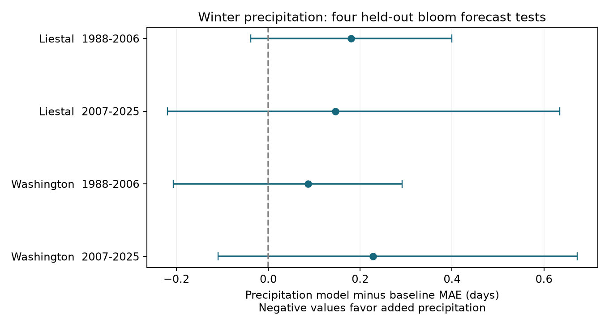

# Winter precipitation gave no clear cherry bloom forecast gain at Liestal and Washington in 1988-2025

January-February precipitation did not give a clear forecast gain beyond January and February temperature and a time trend in four site and period tests. Mean absolute error (MAE) rose by 0.09 to 0.23 days. All four adjusted uncertainty intervals included zero. This is a result about the tested prediction rule. It does not show that water has no role in flowering.

## Question and prior evidence

Does winter precipitation add useful information to March 1 bloom forecasts? Flowering dates help managers plan seasonal work. A weather predictor must improve predictions for later years to support this use. A correlation in the fitted years is not sufficient.

We searched the local SCI campaign for climate, pollution, phenology, cherry and precipitation before fixing this question. We read SCI d9773dd649e8472c1d760f91d942fbf6167bb4725747319764a70b10bf5e597f. That study tested February temperature and prediction intervals at the same two sites. It informed our source and site choices. We wrote new code and tested a different predictor with point errors. Biological observations overlap with that study; this is not independent validation of its temperature result.

[Xing and Wang (2026)](https://doi.org/10.3389/ffgc.2026.1783992) report different spatial and temporal climate links for ornamental trees in six Chinese cities in 2014-2024. Their cherry results give a reason to test precipitation beyond temperature. Our two long fixed-site series test added forecast information in other regions and periods. The test does not directly replicate their social-media sampling or regression design. [GHCN-Daily](https://doi.org/10.1175/JTECH-D-11-00103.1) supplies daily station weather with quality flags.

The plan in files/plan.txt was saved before fitting outcome models. This is an exploratory, unregistered study. Prior campaign work informed the sites and evaluation years. We did not search for a best month or period split. The study addresses ecological timing within the research objective. It does not test air pollution, species range change, biodiversity loss or weather damage.

## Data and observation bias

The GMU Cherry Blossom Competition archive at commit a95298263523607c8489a7be091c8c8d8ce61979 supplies annual bloom dates. Liestal-Weideli uses 25 percent bloom of Prunus avium. Washington uses 70 percent bloom of Yoshino cherry. We use 1954-2025 for source years and 1988-2025 for evaluation. Dates are checked against the supplied day of year. The leap day is removed to put bloom dates on a 365-day scale. Each site has one date each year in this period.

Weather comes from the existing shared GHCN-Daily station snapshots for GME00127786 (Rheinfelden, near Liestal) and USW00013743 (Reagan airport, near Washington). The station files are snapshots of the daily Version 3 product, retrieved in this campaign. Exact hashes identify the files; the live URLs can change. The current NOAA format guide identifies version 3.35. We did not download new research data or change shared files.

We use January 1-February 28, with February 29 omitted. Every one of the 59 days must have valid TMIN, TMAX and PRCP values, a blank quality flag, and TMAX at least TMIN. Missing values are rejected. PRCP measurement flag P (missing presumed zero) is rejected. Trace precipitation has value zero. Precipitation includes the water equivalent of snow; it is not just rainfall. Daily temperature is (TMAX + TMIN)/2. We use separate monthly mean temperatures and total precipitation in units of 100 mm. No weather value comes after the forecast date or the bloom date.

Liestal keeps 69 of 72 source years. It excludes 1965, 2015 and 2016 for incomplete weather. Washington keeps all 72 years. Liestal contributes 19 early and 17 later test years; Washington contributes 19 in each period. No records are excluded based on forecast error. files/audit.json records the selection and the archive-member hashes.

Fixed sites limit bias from changes in the number and position of reports. Local models avoid pooling different bloom thresholds or species. Strict daily coverage avoids variable weather windows. These steps do not remove changes in trees, visits, observers, instruments, station location, or observation time. Visit logs and tree histories are absent. Complete-weather selection can add bias. A nearby station does not measure conditions at a bud. We do not homogenize weather. The two selected managed sites do not represent all ecosystems.

## Method

The baseline is an ordinary least squares model with an intercept, separate January and February mean temperatures, and a linear time term. The precipitation model adds one January-February precipitation total. Time is in decades from 1988. Each target year uses only complete records from the prior 30 calendar years, with at least 20 records. The source period starts in 1954. The models are fitted separately at each site. Main fits use 28-30 training records at Liestal and 30 at Washington.

We compare absolute errors on the same held-out year. The paired change is precipitation-model absolute error minus baseline absolute error. Negative values favor precipitation. Evaluation periods are 1988-2006 and 2007-2025. The regions have separate observations. The periods have separate target years but share some training years. They are not four independent experiments.

For each site and period, we take the mean paired change. We draw 20,000 circular moving-block bootstrap samples, block length five retained target years, random seed 1107. The 0.625 and 99.375 percent quantiles give 98.75 percent intervals. A Bonferroni rule allows for four main tests with a nominal family error of five percent. These intervals are approximate. They condition on the realized forecast sequence and do not refit the models or account for source and model selection. Few target years, climate change, shared training and missing years can impair bootstrap coverage. The correction does not fix these problems. Blocks follow retained records and thus cross gaps at Liestal.

Planned checks use blocks of three and seven, 20-year training with at least 15 records, log(1 + precipitation in 100 mm), February-only precipitation, removal of the trend, and separate squared January and February temperature terms. Each model check changes both members of the paired comparison where applicable. The reported secondary intervals use the same four-test level but do not control the full sensitivity family. No model was chosen from these checks for the main claim. This is a retrospective test with revised archive data, not a trial of forecasts issued in real time.

## Results

| Site | Target years | Test records | Baseline MAE | Precipitation MAE | Change | Adjusted block interval |
| --- | --- | ---: | ---: | ---: | ---: | --- |
| Liestal | 1988-2006 | 19 | 7.220 | 7.401 | +0.180 | -0.038 to +0.400 |
| Liestal | 2007-2025 | 17 | 3.996 | 4.142 | +0.147 | -0.220 to +0.634 |
| Washington | 1988-2006 | 19 | 5.384 | 5.471 | +0.087 | -0.207 to +0.292 |
| Washington | 2007-2025 | 19 | 4.583 | 4.811 | +0.228 | -0.109 to +0.672 |

All error measures are in days. All main changes are positive, but no adjusted interval excludes zero. We did not establish a gain, a penalty or equal performance. Early Liestal has a positive unadjusted 95 percent interval (0.003 to 0.356 days); this does not pass the four-test rule. We retain the adjusted result as the main inference.



Every planned sensitivity comparison also has an adjusted interval that includes zero. Some point signs change. February-only precipitation gives -0.014 days in early Liestal. Without a trend, later Liestal and early Washington give -0.096 and -0.184 days. Curved temperature terms give -0.034 days in early Washington. These changes do not support a stable gain. The full 32-row table in files/summary.csv includes all tests, both interval levels and training counts.

The result limits the use of this simple precipitation term at these two sites. It does not reject all precipitation models or a water mechanism. Total winter precipitation is a weak proxy for soil water, snow cover, bud water, sunlight and irrigation. Those quantities were not measured. A real effect could occur in other seasons, dry sites, extreme years, or nonlinear interactions. Temperature can share information with precipitation. No causal climate effect is identified. More sites with visit records, snow and soil-water measures would support a stronger test.

## Reproduction and provenance

Job: sci-1107-dell-climate-pollution-biodiversity-67ee57a166ec. Topic: climate-pollution-biodiversity. Campaign: 11_07_2026. Machine: dell. Account: codex-andrii. Model: gpt-6.1-sol, high reasoning effort. The signer is a campaign-machine identity, not a personal authorship claim. No remote archive upload or index submission was made.

The exact shared dataset paths, source URLs, byte counts and SHA-256 hashes are in files/inputs.json and files/provenance.json. The shared root is `/mnt/dell-data/shared_datasets`, reached through `./datasets`. The three input paths relative to that root are:

- `gmu-cherry-a9529826-retrieved-20261108-c93d292d/source.zip`
- `ghcnd-GME00127786-20261109-c34b/GME00127786.dly`
- `ghcnd-USW00013743-20261109-c34b/USW00013743.dly`

The first input is the fixed GMU commit archive. The other two are the exact station snapshots. The program checks all three hashes before analysis. If a live URL changes, files/retrieve.py rejects its bytes. Exact reconstruction then needs the shared campaign snapshot. It must not silently use a newer release.

From the extracted publication root, use Python 3.12 and the versions in files/requirements.txt. Existing prepared environments can run the code directly. For an additional environment, install requirements in a private virtual environment. Run:

```sh
python files/analyze.py --datasets /mnt/dell-data/shared_datasets --scratch /local/scratch/cherry-external --output /local/scratch/cherry-results
python files/verify_results.py --scratch /local/scratch/cherry-external
```

All record-level outputs, including the joined panel and annual losses, go to the separate scratch path. Do not put them in a signed draft. The output path receives aggregate summaries, audit, provenance, environment and PNG. Compare the regenerated summary.csv with files/summary.csv. For retrieval elsewhere, run `python files/retrieve.py /local/scratch/cherry-inputs`, then use that path for --datasets. Keep all external material outside the signed publication.

For the aggregate-only check, run `python files/verify_results.py`. The full check also verifies time order, loss means and bootstrap limits with a separate non-vectorized implementation. Each fitted prediction is checked against a QR least-squares solution. A second full run gave identical summary, audit and annual losses. files/validation.json records this test and hashes of the external derived files. files/environment.json gives actual runtime versions. No private scratch is needed if the external inputs remain available or can be retrieved with matching hashes.

The publication contains our code, text, figure and statistical summaries. It contains no raw source data, bloom dates, fitted centers, coefficients, joined record-level panel or annual loss table. Read files/EXTERNAL_DATA_NOTICE.txt for attribution and source terms. The baseline LICENSE applies to the bundled original material and does not replace external rights.
