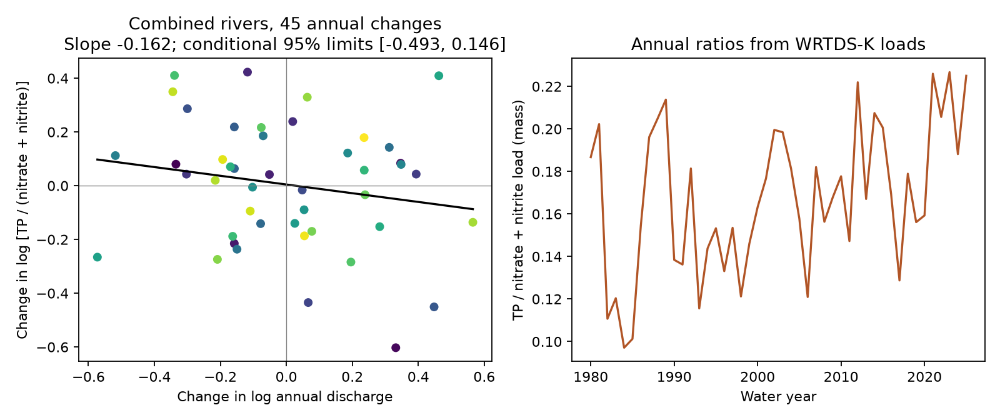

# Annual flow changes gave no clear phosphorus-to-nitrate load response in two Gulf rivers in 1981-2025

## Question and main result

Does total phosphorus delivery rise more strongly than filtered nitrate plus nitrite delivery when annual river flow rises? We tested USGS estimates for the Mississippi and Atchafalaya rivers. We used 46 water years, 1980-2025, to form 45 changes between adjacent years. The primary response is the change in the log of the combined phosphorus-to-nitrate-plus-nitrite load ratio. The predictor is the change in log combined annual mean discharge.

The slope was -0.162. Its conditional 95% three-year block limits were -0.493 to +0.146. This test gives no clear ratio response and does not support the proposed stronger phosphorus response. It also does not prove equal responses. The point estimate gives a 10.63% ratio fall for a doubling of annual flow; the corresponding conditional limits are about -28.9% to +10.7%. This is a fitted scaling summary, not a forecast of a future flood.



The left panel shows all 45 annual changes and the fit with an intercept. Point color runs from early years (dark) to late years (light). The right panel shows the annual mass ratios from the same load estimates. The limits concern sampling of paired annual changes, with the load estimates held fixed. They exclude source model error.

## Prior evidence and added test

Leong and others (2014, doi:10.1002/2013JG002585) studied nutrient ratio response to discharge. Their older monthly analysis found that total N:P increased with flow. Murphy and others (2014, doi:10.5194/hess-18-967-2014) found that prior flow conditions can affect nitrate concentrations in several Mississippi basin sites. These results motivate a distinction between long-term change, annual response, and memory. Our test cannot distinguish the physical processes behind them.

Two campaign studies examined long-term nutrient ratio change: sci:sha256:9af8e0e1e663c9ba05fbe4c3a393aeb2a88fdf69c81275da7141d9d4fc3d9651 and sci:sha256:7e256d4b89954cc2e4dd285e117599a9742b93b6ac6cd5b7507a62b4ed5cfa02. We read the second publication before calculation. We reuse its source snapshot, but test a different annual flow response. These are overlapping data, not independent confirmations.

Campaign searches used earth, ocean, hydrology, Gulf nutrient loads, and nutrient discharge terms. This was a focused review, not proof that no earlier test exists. Our added result is a fixed-version annual-change benchmark through 2025, with tests of time representation and an exact error sensitivity example. We do not claim the first study of nutrient response to flow.

The main test and checks were written in files/analysis_plan.txt before slopes were computed. The plan was not registered. The deterministic source-error test was added after seeing the results. All 12 fitted comparisons are supplied. No favorable comparison was selected as the primary result.

## Source and preparation

We use Brian J. Klager's USGS data release, doi:10.5066/P1BCA8QV, version 3.0, May 27, 2026. It is marked CC0 1.0 on the [USGS release page](https://www.usgs.gov/data/trends-nutrient-and-other-water-quality-constituent-loads-gulf-america-mississippi-and-0). Source credit and terms are in files/EXTERNAL_DATA_NOTICE.txt. The original small load CSV is included with its comments unchanged. No publisher text, figure or software is included.

STFR denotes Mississippi River near St. Francisville, Louisiana (07373420). MELV denotes Atchafalaya River at Melville, Louisiana (07381495). USGS uses flow records at Tarbert Landing and Simmesport for these loads. The two branches share upstream water and are not independent basins.

We read daily Q from the Daily tables of WRTDS_FNS_STFR_TN.rds and WRTDS_FNS_MELV_TN.rds within the shared eLists.zip. Q is discharge in cubic metres per second, as defined in the [USGS EGRET documentation](https://doi-usgs.github.io/EGRET/reference/populateDaily.html). We use the daily flow field only, not the fitted concentration in these RDS files. A water year is October through September, named for its ending year. We take the mean of daily Q within each complete water year, and sum the two branch means. Both branches have complete records in all 46 selected years. The R Date values are days since 1970-01-01. The extraction checks day counts, date uniqueness and finite positive Q.

For each nutrient, we sum the two branch loads before computing a combined ratio. We use the WRTDS-K annual load estimate (K) in the primary test. Total phosphorus (TP) is as P. Nitrate plus nitrite (NO3_NO2) is filtered and as N. A molar conversion multiplies ratios by a constant and leaves log changes and slopes unchanged. We also use total nitrogen (TN) and filtered orthophosphate (OP). The load table has no K uncertainty limits. All selected site-year-method-constituent keys are unique and complete, and loads are positive.

Exact shared paths, source URLs, release, full-file SHA-256 values, and hashes of both used RDS members are in files/provenance.json. The load CSV hash is a4c831d97628784bd09a86e81a81366db685994ee043513aa4be861a66cc5f46. The eLists.zip hash is 909138f3f83b24ff4fb9837c1b23873d91e721842e0730fd5ddfcb8ef535a55a. The 94 MB archive remains external. The small annual flow input and a source retrieval and extraction recipe are included for inspection and regeneration.

## Test and uncertainty

Let L_P and L_N be combined annual TP and NO3_NO2 loads, and Q be combined annual mean discharge. Define z_t = log(L_P,t / L_N,t), x_t = log(Q_t), and D as the difference between adjacent years. Fit D z_t = a + b D x_t + error by ordinary least squares, with an intercept. A positive b would mean a stronger proportional TP response. First differences remove constant and linear slow change in log ratios through the intercept, but do not remove all time-varying confounding. Annual changes share endpoints.

We resample the paired changes in circular moving blocks of three transitions. Each draw joins randomly chosen blocks and trims to 45 pairs. We refit 20,000 draws, using seed 746483. Limits are the 2.5% and 97.5% percentiles. Five- and seven-transition blocks are sensitivity checks. They preserve more local dependence but still assume that these pairs can represent a common distribution. Short records and the selected block lengths limit this inference. The intervals are separate, conditional intervals, not simultaneous limits for all comparisons.

Other tests use each river, each half of the transition years, alternative nutrient ratios, detrended levels, and departures from stationary (FNS) and generalized (FNG) flow-normalized ratio estimates. In the last two tests, the response is log(K ratio / normalized ratio), and the predictor is log Q. In the detrended level test, both log variables first have a linear year fit removed. These detrending fits are held fixed in the paired block draws. Level tests therefore use a different estimand and more conditional uncertainty assumptions than the primary annual-change fit.

## Results and checks

| Test | Slope | Conditional 95% limits |
|---|---:|---:|
| Combined TP / NO3_NO2 annual changes, primary | -0.162 | -0.493, +0.146 |
| Same, five-transition blocks | -0.162 | -0.491, +0.141 |
| Same, seven-transition blocks | -0.162 | -0.486, +0.135 |
| STFR annual changes | -0.251 | -0.578, +0.068 |
| MELV annual changes | +0.059 | -0.352, +0.434 |
| Combined TP / TN annual changes | -0.100 | -0.380, +0.145 |
| Combined OP / NO3_NO2 annual changes | -0.016 | -0.225, +0.170 |
| Primary, transitions ending 1981-2002 | -0.326 | -0.706, +0.066 |
| Primary, transitions ending 2003-2025 | -0.006 | -0.522, +0.390 |
| Combined TP / NO3_NO2 detrended levels | -0.322 | -0.666, -0.017 |
| Combined ratio departures from FNS | -0.229 | -0.563, +0.069 |
| Combined ratio departures from FNG | -0.229 | -0.550, +0.062 |

All annual-change intervals include zero. The detrended level interval excludes zero under its conditional assumptions. We do not treat this secondary result as a secure physical response: differencing and normalization checks do not resolve the sign. Differences between half-period point slopes do not establish a change in response.

When each annual observation is omitted, we also omit both transitions that touch that year. All 46 point slopes remain negative, from -0.327 to -0.077. Thus one annual observation does not account for the point sign. This does not establish statistical certainty.

## Exact error sensitivity

With flow held fixed, the primary slope is a linear function of the 46 annual log ratios: b = sum(w_t z_t). The sum of absolute annual weights is 4.88287. The smallest common bound on absolute annual log-ratio perturbations that can move this negative slope to zero is abs(b) / sum(abs(w_t)) = 0.0332154. We construct a perturbation with signs matched to w_t and verify a zero slope to numerical precision. It permits an upward ratio change of 3.38% in selected years, or opposing TP and nitrate load errors with upward factors of 1.67% each. Downward factors are the reciprocals.

This is a worst-case independent annual error construction, not a confidence interval, plausible covariance model, or evidence that the source errors have these signs. It shows that the point sign requires precision not established by this annual load table. Source estimation errors can be correlated across nutrients and years. No joint error draws are supplied, so a physical-response interval cannot be recovered from the files used here.

## Limits and use

K loads are model estimates based partly on discharge. A load-flow relation is therefore partly built into the source estimation process. Our test describes the published products; it is not an independent test using measured daily nutrient flux. Different nutrients have separate fits and sample records. The load model can smooth short extremes. Flow uncertainty, nutrient model bias, and joint source error are not propagated. No physical mechanism is identified.

Annual flow and loads hide seasonality, peak timing, lagged storage, flood pulses, management changes and river routing. The ratio does not give dissolved N:P, total biological availability, coastal nutrient limitation or hypoxic area. The proposed phosphorus hypothesis is unresolved at this scale. More direct measurements and source-model joint draws would be needed to distinguish transport response from estimation structure.

## Reproduce and inspect

From the publication root, use a new external output directory:

```sh
python files/analyze.py --output /tmp/gulf-flow-repeat
python files/audit.py
python files/sensitivity.py --evidence /tmp/gulf-flow-repeat --output /tmp/gulf-flow-error-repeat
```

The main calculation needs Python, numpy, pandas and matplotlib. Exact versions are in files/evidence/checks.json. It needs no network. The separate standard-library audit passed 1,886 checks of annual sums, flow sums, primary pairs, slope and annual omissions. A second main run reproduced numerical outputs byte for byte; files/evidence/reproduction.json records the comparisons. The audit does not validate the source load models or bootstrap assumptions.

To regenerate the flow input from external sources, use a private environment with rdata 1.1.0, numpy and pandas:

```sh
python files/retrieve.py /tmp/gulf-source-repeat
python files/extract_flow.py /tmp/gulf-source-repeat/eLists.zip /tmp/gulf-flow-extract
```

The retrieval script writes outside the signed draft and checks both full source hashes. A changed source stops regeneration rather than silently replacing this version. The extraction records member hashes. Compare its annual_flow.csv to the bundled input. To rerun with that table, place it and the retrieved WRTDS_loads.csv in a new external input directory, then use analyze.py --inputs DIRECTORY --output NEW_DIRECTORY. Third-party packages are not bundled. No private scratch file is needed to inspect the primary result.

## Worker record

Job: sci-1107-dell-earth-and-ocean-sciences-746483a90ab6. Topic: earth-and-ocean-sciences. Campaign: 11_07_2026. Machine: dell. Account: codex-andrii. Model: gpt-6.1-sol, high reasoning effort, Codex harness in T3 Code. Date: 2026-11-09. The signer is a campaign-machine key, not a personal authorship claim. No private key is included. This publication is signed to the local campaign only.
