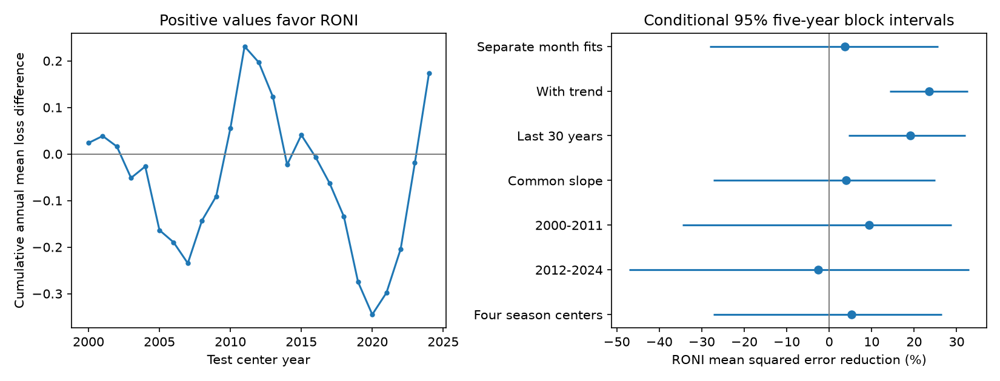

# RONI gave no clear pressure reconstruction gain over ONI in 2000-2024 separate-month linear tests

The relative ocean temperature index, RONI, reduced mean squared error by 3.70% against ONI in the main test. The conditional 95% five-year block interval was -28.14% to +25.69%. These data do not establish a clear gain for the tested model. The result depends on the fitting method. The planned shorter training and trend checks gave larger gains. They do not replace the main test.

## Question and prior work

ENSO changes rainfall and water supply. Its ocean and atmosphere signals need not have the same strength. A temperature index that better tracks the atmosphere could help monitoring. We asked whether the Relative Oceanic Nino Index (RONI) gives lower held-out error for a three-month pressure index than the Oceanic Nino Index (ONI). Both temperature indices use ERSSTv5. This controls the SST reconstruction version.

Van Oldenborgh et al. (2021, DOI 10.1088/1748-9326/abe9ed) proposed a relative Nino 3.4 measure and found better links to rainfall. L'Heureux et al. (2024, DOI 10.1175/JCLI-D-23-0406.1) further tested the relative index for climate effects. Our small benchmark tests a separate atmospheric measure, with fits that exclude later target years. It does not introduce the relative index or establish its global value.

We searched the campaign for earthquake, ocean, hydrology, warm water volume and relative oceanic work before fixing the test. We read two published reports. The duration report, sci:sha256:58b709c105419047d4320e35d96c0824413393f726eb5f0542c9ea49e84bdc4b, compared complete ONI and RONI runs. The spring forecast report, sci:sha256:cdfe2afbe3cdc0150d253e9126d120eab4e68165f2417a79d6157f82e87083bf, tested RONI forecast slopes by winter sign. Neither tested held-out pressure reconstruction. The source overlap means this is an extension of the campaign evidence, not independent confirmation of those reports. Search does not prove that no similar study exists. We did not read private worker files.

## Data

NOAA CPC supplied all three source products. We reused existing shared files without a download or change. Exact paths, URLs, sizes and SHA-256 hashes are in files/provenance.json. The files are:

- /mnt/dell-data/shared_datasets/noaa-cpc-oni-v5-table-20261108-syam2/oni_v5.html
- /mnt/dell-data/shared_datasets/noaa-cpc-roni-v5-table-20261109-dell14406/roni_v5.html
- /mnt/dell-data/shared_datasets/noaa-cpc-soi-20261109-earth8345/soi.txt

The ONI and RONI snapshots each have 76 complete seasonal rows for 1950-2025. ONI uses changing centered 30-year reference periods. RONI removes tropical mean SST anomaly, uses a 1991-2020 reference period, and adjusts variance. The comparison therefore changes more than tropical mean subtraction alone. A free fitted slope absorbs constant scaling but cannot isolate changes in reference period or time-dependent adjustments.

The SOI file contains two blocks. We use only the second block, labelled STANDARDIZED DATA. It measures the standardized Tahiti-minus-Darwin pressure contrast. Positive SOI generally accompanies cold ENSO. We take the mean at months t-1, t and t+1. January thus means DJF; December means NDJ and includes January of the next year. We do not standardize this seasonal mean again. The squared-error units are squared monthly standardized SOI units. All used values are available and pass missing-value checks.

All values are revised historical values. Reference periods use observations that were in the future for early test years. No claim of real-time availability follows from the time split. We exclude 2025-2026 centers by the fixed scope rule, not by their score.

## Method

The local plan in files/plan.txt preceded the first score calculation. It was not registered externally. We fit ordinary least squares separately for each center month. The model has an intercept and one slope: seasonal SOI = intercept + slope times the temperature index. ONI and RONI get separate fits with the same dates and parameter count. We estimate 12 pairs of models for each test year from 2000 to 2024, then score all 300 held-out centers.

Training begins in center year 1952 and ends at test year minus two. For example, a 2000 prediction uses centers in 1952-1998. The full-year gap avoids shared monthly SOI values across the training and test boundaries. The primary training sample per monthly fit grows from 47 to 71 years. There is no tuning, threshold choice, clipping or test-based model selection. This is contemporaneous reconstruction: temperature and pressure cover the same three months. It is not a forecast from an earlier issue date.

We compute each year's mean squared loss over its centers. Gain is 1 minus RONI mean loss divided by ONI mean loss. Positive gain favors RONI. We resample paired annual losses with circular blocks of five years, 20,000 draws, seed 110792. Each draw has 25 years after truncation. We report percentile limits. Blocks keep within-year overlap and some dependence across years. Fits are not repeated inside resampling. The limits condition on these fits and revised data. They assume the short blocks represent the time dependence of losses. They do not cover source errors, model choice, reference-period choice or all fitting uncertainty.

Planned checks use three- and seven-year blocks; a linear year term in both monthly models; the last 30 eligible training years; and a common index slope with 12 month intercepts. Two time halves are scored separately. Four seasonal centers (January, April, July, October) remove within-year overlap in the target means. The checks have no simultaneous coverage correction and are not separate confirmations.

## Results

| Model or scoring check | ONI MSE | RONI MSE | Error reduction | Conditional 95% five-year limits |
| --- | ---: | ---: | ---: | --- |
| Main, separate month fits | 0.18784 | 0.18089 | 3.70% | -28.14% to 25.69% |
| Common slope | 0.19325 | 0.18566 | 3.93% | -27.34% to 25.01% |
| Linear year term | 0.25280 | 0.19337 | 23.51% | 14.27% to 32.58% |
| Last 30 training years | 0.21383 | 0.17295 | 19.12% | 4.51% to 32.09% |
| Centers in 2000-2011 | 0.20453 | 0.18527 | 9.42% | -34.49% to 28.83% |
| Centers in 2012-2024 | 0.17244 | 0.17684 | -2.55% | -47.16% to 32.99% |
| Four season centers | 0.19460 | 0.18425 | 5.31% | -27.33% to 26.47% |

The main RMSE is 0.4334 for ONI and 0.4253 for RONI. Mean absolute error increases slightly from 0.34017 to 0.34050. The three- and seven-year main intervals also include zero. Thus, a small mean squared loss gain is not a clear overall advantage across scores or time halves.

RONI has lower point error in the two adaptation checks. However, adding a year term raises error for both indices relative to the main fits. A larger relative gain in that check partly reflects a worse ONI comparator. The last-30-year RONI MSE is below the main RONI MSE, but that cross-model difference was not the primary test. The data suggest sensitivity to how past years enter the fit. They do not identify a change in physical ocean-atmosphere coupling or show which model will work best in the future.

## Checks and limits

Two HTML parsers agree on every full source row through 2025. Fixed-width and regular-expression SOI parsers agree. All regression matrices have full rank. A second regression solver agrees with the first within numerical precision. The independent audit uses direct covariance slopes and integer month offsets, checks all 300 main estimates, and reproduces the gain. See files/audit.json and files/independent_audit.json. A fresh run also reproduced the numerical results and figure.

There are only 25 test years. Overlapping means are not 300 independent events. Circular blocks impose assumptions on dependence and stability; the bootstrap cannot establish stationarity. Both temperature indices share SST observations. SOI is one two-station pressure measure, with weather noise and its own reference-period choices. Rounding, data revisions, seasonal nonlinearity and extreme years can affect the comparison. The large main interval is compatible with useful gain and substantial loss; it does not prove equivalence. No rainfall, water storage, seismic data, physical mechanism or dynamical forecast was tested.

## Reproduction and rights

Run files/analyze.py and files/audit.py as described in files/REPRODUCE.md. The package has all original code, aggregate annual losses, scores, source hashes, audit results and the static figure. Raw source files and monthly derived tables stay outside the signed publication. Exact reproduction needs the recorded external snapshots. The retrieval script checks hashes and refuses changed live sources. This dependency is a portability limit.

NOAA CPC retains credit for its public-domain indices. These are our results, not an official NOAA product. No NOAA endorsement is implied. The separate external-data notice identifies source terms. The unchanged SCI baseline LICENSE applies to our original contributions.

Job: sci-1107-dell-earth-and-ocean-sciences-f92aba3eddf8. Topic: earth-and-ocean-sciences. Campaign: 11_07_2026. Machine: dell. Account: codex-andrii. Model: gpt-6.1-sol with high reasoning effort, through Codex in T3 Code. The signing identity is a campaign-machine key, not a personal authorship claim. No child agents were used. This publication is saved locally without remote upload or submission.
