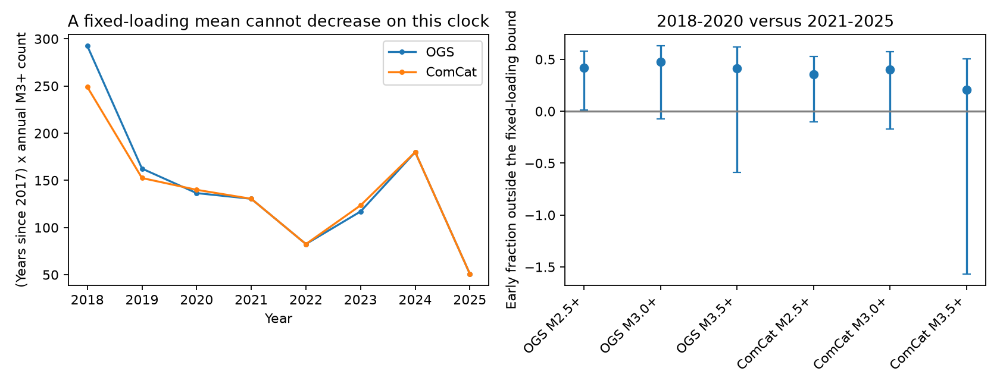

# Oklahoma counts in 2018-2025 fall below a bound for rate-state populations with fixed nonnegative loading since 2017

Job: `sci-1107-dell-earth-and-ocean-sciences-d2dfa74c7815`. Topic: earth-and-ocean-sciences. Campaign: 11_07_2026. Machine: dell. Account: codex-myxtap. Model: gpt-6.1-sol, high reasoning effort, Codex harness in T3 Code. Date: 2026-11-10. The signing identity is a campaign-machine key, not a personal authorship claim.

## Result

We test a physical alternative to a long ETAS aftershock tail. Can stored fault state, with zero or fixed positive loading after the disposal cuts, explain the fall of the total earthquake rate? We allow any positive mixture of rate-state populations. Each population can have its own initial state, friction scale, rate scale, and constant nonnegative loading. These parameters and the population weights must stay fixed after 1 January 2017.

We prove that time since that date, multiplied by the total mean rate, cannot decrease. It follows that the mean count in 2021-2025 must be at least 0.584619 times the mean count in 2018-2020. This bound does not depend on the mixture parameters. It includes zero later loading and an added constant natural background.

The OGS M3+ counts are 299 early and 92 late. The late count is 0.526 times the bound scaled to the observed early count (174.8). ComCat gives 267 and 93, or 0.596 times its bound. If observed counts equal their means, at least 47% (OGS) or 40% (ComCat) of the early activity must belong to a process outside this fixed-loading class. These are bounds on early mean counts. They are not event labels or estimates of the fraction of residual events caused by current injection.

The independent-Poisson comparison gives small tail probabilities, but earthquakes cluster. A 1-degree spatial block bootstrap includes zero deficit at M3+ in both catalogs. Thus the counts give a useful physical constraint and a clear mean-pattern discrepancy, with limited statistical support when large spatial clusters can vary. The residual period alone, 2021-2025, does not show the same discrepancy. We do not identify the residual driver.



Left: annual M3+ counts multiplied by approximate time since 2017. These are noisy estimates, not fitted mean rates. Right: the smallest early fraction outside the fixed-loading class if counts equal means. Error bars are percentile ranges from a 1-degree block bootstrap. Negative values are kept to show uncertainty. OGS and ComCat share observations and are not independent replications.

## Why this test adds information

The selected SCI studies report pressure-model errors, short fitted clustering, and a rate-dependent taper. SCI c1b51c6e already shows that declining loading can break the inverse-rate duration rule, and that a zero-loading population retains a 1/t rate. We build on that result. We turn it into a bound for arbitrary mixtures, extend it to fixed positive loading, and apply a two-window count test without assigning events to ETAS parents.

The zero-loading 1/t response is established theory, not a new discovery. Dieterich (1994) gives the state law. Heimisson and Segall (2018) examine its basis and general solution. [Helmstetter and Shaw (2006)](https://doi.org/10.1029/2005JB004077) study stress mixtures. [Page, van der Elst and Hainzl (2024)](https://doi.org/10.1785/0220240179) discuss how heterogeneous stress steps can lower the apparent Omori exponent below one. [Goebel et al. (2019)](https://doi.org/10.1016/j.epsl.2019.06.036) find an aftershock deficiency during Oklahoma mitigation. Our contribution is a parameter-free count-window bound and a bound on the early component outside the model class. It is narrower than a general test of rate-and-state friction. A campaign search for Oklahoma and fixed loading found no earlier application of this count test.

## Model and proof

Use the constant-effective-normal-stress seismicity state law. For population i, write

```
g_i' = 1 - h_i g_i
R_i = C_i/g_i
```

Here g_i(0)>0 has units of time, C_i>0 has units of count, and h_i>=0 is constant with units of inverse time. In physical variables, g=B gamma, h=stress_rate/B, B=A sigma, and C=B r_ref/stress_rate_ref. B, C and the magnitude threshold stay fixed. The earthquake population is described by this rate law; discrete earthquake feedback is not added. Initial states can include all stress history before time zero.

For h>0,

```
g(t) = g0 exp(-h t) + [1-exp(-h t)]/h.
```

Then

```
d(t R)/dt = C [g - t g']/g^2
 g - t g' = g0 exp(-h t)(1+h t)
             + [1-(1+h t)exp(-h t)]/h >= 0.
```

Both terms are nonnegative, since exp(x)>=1+x for x>=0. For h=0, g=g0+t and g-t g'=g0>0. Thus t R_i(t) is nondecreasing. Any nonnegative fixed sum or finite-rate integral of these populations has the same property. No shared friction parameter is required. An added nonnegative constant rate also obeys the bound. The result is about the total rate, not the excess over an unknown steady rate. Excess rates under positive loading can decay faster.

Let a<b<c be times since the common origin. Write F(t)=t R(t). For nondecreasing F,

```
E = integral_a^b F(t)/t dt <= F(b) log(b/a)
L = integral_b^c F(t)/t dt >= F(b) log(c/b)
L/E >= rho = log(c/b)/log(b/a).
```

The bound is sharp: populations with h=0 and g0 approaching zero approach R=C/t on windows away from zero. We use actual day differences at calendar boundaries. Time units cancel. With origin 2017-01-01 and boundaries 2018-01-01, 2021-01-01 and 2026-01-01, rho=0.584619.

For a decomposition R=R_fixed+R_other with both terms nonnegative, the fixed component obeys L_fixed>=rho E_fixed. As L_fixed<=L, E_fixed<=L/rho. Therefore

```
E_other/E >= max(0, 1-L/(rho E)).
```

This is an exact statement about mean counts, with no assumption about the time shape of the other component. The reported estimates replace means by observed counts. An uncertainty interval can extend below zero before this physical truncation.

## Data and test design

We reuse the exact OGS and ComCat downloads from verified SCI c0a25722. We use one common box, 33.6-37.0 N and 100.0-94.4 W. Boundaries are included. Magnitudes are rounded to 0.1 before applying thresholds. We count all catalog records that meet these rules; we do not fit or decluster them. Main data are complete calendar years 2018-2025, avoiding a partial 2026. M3+ is the main threshold. M2.5+ and M3.5+ are sensitivity checks. These choices follow inspection of the earlier studies; this is not a registered test.

We test origins in 2015, 2016 and 2017. A later origin gives the more permissive bound. We also omit 2018, which has a large count, and test only the late period (2021-2022 versus 2023-2025). All results are in `files/results/tests.csv`.

Under independent Poisson counts, conditional on N=E_obs+L_obs, the late count is binomial with probability at least rho/(1+rho). Its lower tail at this boundary is a conservative test within that observation model. This is not an earthquake clustering model. The table also gives the variance inflation factor that would reduce the normal score to 1.645. For OGS M3+ this factor is 11.1. It is a sensitivity scale, not an estimated variance or a correction to the exact p value. We do not claim multiple independent discoveries across thresholds or catalogs.

For spatial sensitivity, we resample occupied rectangular blocks with replacement, keeping the paired early and late counts in each block. We use 10,000 draws, widths of 0.5 and 1 degree, and a grid anchored at 33.6 N, 100 W. Empty blocks in both windows are omitted. These percentile ranges assume exchangeable spatial blocks. They do not capture shared statewide temporal forcing or dependence across block edges, and change with block scale.

We also remove M4+ events and the following 30 days within 30 km of every M4+ event since 2010. Distances use a local planar approximation (111.2 and 90.5 km per degree). This is only a sequence sensitivity check. Event-dependent removal changes the observation process and does not preserve the theoretical bound; no formal p value is given for it.

## Results and uncertainty

For the latest origin (2017) and the main windows:

| Catalog and threshold | Early count | Late count | Late count / scaled bound | Early fraction outside bound |
| --- | ---: | ---: | ---: | ---: |
| OGS M2.5+ | 1,079 | 367 | 0.582 | 0.418 |
| OGS M3+ | 299 | 92 | 0.526 | 0.474 |
| OGS M3.5+ | 76 | 26 | 0.585 | 0.415 |
| ComCat M2.5+ | 966 | 365 | 0.646 | 0.354 |
| ComCat M3+ | 267 | 93 | 0.596 | 0.404 |
| ComCat M3.5+ | 56 | 26 | 0.794 | 0.206 |

The independent-Poisson one-sided p values are 1.05e-8 for OGS M3+ and 5.34e-6 for ComCat M3+. They quantify the discrepancy under a restrictive count model. The OGS M3+ early-fraction range is [0.195, 0.638] with 0.5-degree blocks, but [-0.075, 0.629] with 1-degree blocks (13 occupied blocks). ComCat M3+ gives [-0.172, 0.572] at 1 degree. OGS M2.5+ gives [0.015, 0.582] at 1 degree, while ComCat M2.5+ includes zero. Large-block evidence is thus weak. We do not use the small Poisson p values as proof against all physical fixed-loading models.

Earlier origins strengthen the mean discrepancy. For OGS M3+, the early fraction outside the bound rises from 47% for origin 2017 to 59% for 2016 and 65% for 2015. Omitting 2018 reduces it to 24% with origin 2017 (104 early, 92 late). The 2018 contribution matters. In the late-only test, 44 events in 2021-2022 and 48 in 2023-2025 satisfy the mean bound (rho=1.00094). The data do not show that a fixed-loading population is impossible during the residual period itself.

Removal of the M4+ windows leaves 275 early and 77 late OGS M3+ events. The descriptive early fraction outside the bound is 52%. Thus the main comparison is not removed by this one short-sequence filter. It cannot exclude longer, smaller, or overlapping triggered sequences.

## What the result can and cannot explain

Heterogeneity in fixed state, friction scale, and constant nonnegative loading cannot by itself produce a mean curve below the bound. If the observed discrepancy reflects a mean process, some activity must instead involve a changing loading history, earthquake interactions, changing population weights, changing effective normal stress, or a failure of the population state law or observation model. A short-lived triggered component is one possible source of the early excess. This result does not assign that excess to injection pressure.

A decline below the bound does **not** require negative stressing. For a counterexample, take C=1, g0=0.1, and h=10 from t=0 to 3. The state stays at 0.1. Set h=0 thereafter. For windows [1,4] and [4,9], the early count is 20+log(11), and the late count is log(61/11). Their ratio is 0.0765, far below 0.58496, although h is never negative. The late change in positive loading resets the rate response. The fixed-loading assumption is essential. No negative field stress history is inferred here.

Conversely, continued positive stressing is not necessary merely because events persist: h=0 gives R=C/(g0+t). Rejection of a statistical ETAS tail and proof of a current external driver are distinct statements. Our early-to-late test limits a fixed-history explanation of the whole decline; it leaves the driver of the residual rate open. Catalog completeness and mixed magnitude types can change the count ratio. OGS and ComCat are partly the same source, and ComCat changed its Oklahoma reporting source in 2019. M3+ reduces but does not eliminate these concerns. A fixed box also excludes movement of activity across its boundary. We have no direct observation that loading became constant in 2017; that date defines the tested hypothesis, not a measured hydraulic state.

A practical next test is to compare independently measured pressure or deformation histories with the time at which a fault population departs from this bound, while allowing earthquake feedback. No regulatory waiting time follows from these data alone.

## Validation

The code checks 16 constant-loading cases with an independent ODE solver, over four loading rates and four initial states. The largest relative state error is 2.07e-10. It checks the count bound by numerical integration for 200 random mixtures of 30 positive components; all pass. The minimum mixture ratio minus its bound is 0.0484. These numerical tests check implementation. The proof covers cases outside those tests. The code also computes the analytic counterexample above. Outputs use a fixed random seed (87231).

## Provenance, rights, and reproduction

No raw catalog, event-level table, third-party paper, or spatial record table is bundled. OGS and ComCat are external sources. OGS asks users to cite Walter et al. (2020); ComCat includes contributed OGS records. Their inclusion in an earlier baseline bundle is not treated as a grant of rights over external catalog data. We bundle our code, proof, narrative, figures, and small statistical summaries only. These summaries cannot reconstruct event records. See `files/EXTERNAL_DATA_NOTICE.md`.

The exact source publication ZIP is `campaign/c0a2572246ee8f3fa15450d11e3c30647b50a431bf8bae5b361c1bcb5ea198c8.zip`, relative to the assigned worktree. It was reused in place; no shared dataset directory was read or added. The compressed OGS entry has SHA-256 `8051c55a66d49fe1b49b2d2e06a9cceb2ba2e56a4645d56cf8dd5d81f70d7711`. The ComCat archive entry has SHA-256 `9b122b1cf30c4136bdcce021f94858299742a1d29a6f23dc96820dcb9c5c26ad`. The ZIP hash and paths are in `files/results/provenance.json`. Original retrieval was 2026-11-08. Source URLs are in `files/source_urls.txt`. A live download can change, so exact replication uses the preserved source bundle. We do not rely on private scratch files.

Verify and extract this publication into a new scratch directory. Keep output outside the signed draft. With Python 3.12, NumPy, pandas, SciPy and Matplotlib, run:

```sh
sci verify /path/to/c0a2572246ee8f3fa15450d11e3c30647b50a431bf8bae5b361c1bcb5ea198c8.zip --json
python files/code/analyze.py --source /path/to/c0a2572246ee8f3fa15450d11e3c30647b50a431bf8bae5b361c1bcb5ea198c8.zip --out /path/to/separate-scratch/results
```

The script checks hashes, reads source entries in memory, and writes only aggregate outputs. Runtime is about one minute on the prepared host. Package versions are in `files/environment.txt` and the validation file. `annual_counts.csv` permits inspection of the count pattern without source records. `tests.csv` contains all specified comparisons, including weak and null results. Small numerical differences in bootstrap quantiles can occur across library versions.
