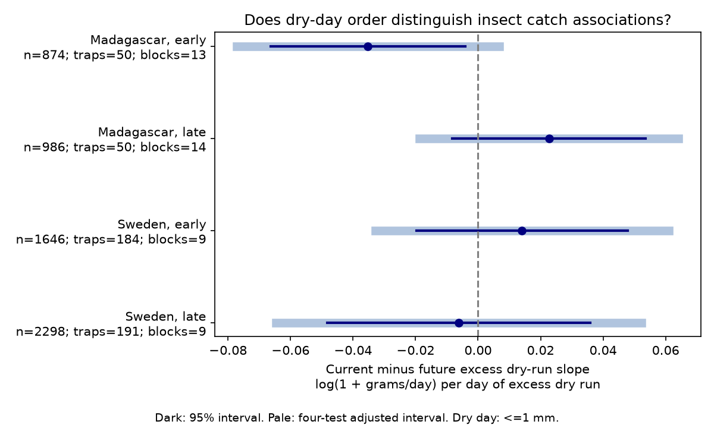

# Dry-day order gave no clear current-minus-future catch link in four Sweden and Madagascar samples in 2019-2020

## Question and result

Does the order of dry days have a catch association beyond their number? We tested whether the link was stronger during collection than in an equal-length interval just after collection. A difference could be consistent with a short-term activity effect. It would not prove this explanation.

We tested whether the order of dry days had a collection-window link to flying-insect catches that differed from its later-window link. We used 5,804 measured catches in Sweden and Madagascar. The exposure was the longest dry run minus its exact mean over all day orders with the same dry-day count and interval length. Four trap and season models controlled dry-day frequency, rainfall amount, temperature and duration. Current minus future slope estimates ranged from -0.035 to +0.023 log(1 + grams/day) per excess run day. All four adjusted intervals included zero. All 20 planned sensitivity intervals also included zero. Early Madagascar had a negative unadjusted interval, but the sign did not repeat in late Madagascar. These results do not show no weather effect. One survey year per country, coarse weather, selected catches and few time clusters limit inference. Catches mix abundance with flight activity. The package gives a dry-run method, code, aggregate results, a figure and independent numerical checks.



| Country | Period | Catches | Traps | Time blocks | Contrast | Marginal 95% interval | Four-test interval |
|---|---|---:|---:|---:|---:|---|---|
| Madagascar | early | 874 | 50 | 13 | -0.0352 | -0.0663 to -0.0041 | -0.0771 to +0.0067 |
| Madagascar | late | 986 | 50 | 14 | +0.0227 | -0.0082 to +0.0536 | -0.0188 to +0.0641 |
| Sweden | early | 1646 | 184 | 9 | +0.0141 | -0.0197 to +0.0478 | -0.0329 to +0.0610 |
| Sweden | late | 2298 | 191 | 9 | -0.0061 | -0.0482 to +0.0359 | -0.0646 to +0.0523 |

The contrast is the current-window slope minus the future-window slope. The unit is log(1 + grams per trap-day) per day of excess dry run. This is a conditional slope contrast. It is not a change in population size. Early Madagascar had a marginal interval below zero (p=0.0297). Its corrected interval included zero. Late Madagascar had the opposite sign. No planned sensitivity gave a corrected interval below or above zero. These results do not prove equivalence or absence of a dry-weather effect.

## Prior evidence and contribution

Van Dijk and colleagues (2024, DOI 10.1098/rspb.2024.0090) studied biomass and seasonality in these networks. They provide the observations and weather estimates. SCI publication sha256:de0d1327f4f65caeaab7db216f39f975581a68f6e006d19fda92c0c930e1dcc0 tested wet-day frequency. We read that result and adapted its code under its baseline license. We retain its source filters, seasonal split and temporal contrast. We add a test of day order, with an exact combinatorial adjustment for dry-day number and interval length. We also control the square of dry-day frequency. This is a new test on shared observations, not independent validation of the data source.

We searched the campaign for climate, pollution, biodiversity, phenology, ozone, Sweden and dry spell before fitting the precise test. The dry-spell search returned no direct insect day-order test. This search is not a systematic review. files/plan.md states the analysis plan saved after source inspection and before model fitting. It is not an external registration.

## Data and selection

Six CSV files come from Zenodo record 11205860, version v1, 16 May 2024, a mirror of Dryad DOI 10.5061/dryad.ghx3ffbtk. The API states CC0. Source URLs, exact shared paths, resolved paths, byte counts and SHA-256 values are in files/provenance.json. files/source_audit.json confirms all six archive MD5 values. No new raw download was needed. The datasets/ link uses HP storage through the /mnt/dell-data compatibility path. No failed disk was read.

Sweden was sampled in 2019; Madagascar was sampled from August 2019 to July 2020. Early means midpoint day <=183 from the survey origin. Late means later days. Countries are independent geographic networks. The two time samples share traps and come from one survey year. They do not test independent multi-year climate responses. Samples were collected with Malaise traps and weighed after ethanol drainage. Source weather is gridded ERA5-Land output, not on-site flight-hour weather.

We retained 3,944 of 4,737 Swedish source rows and 1,860 of 1,861 Malagasy rows. Swedish exclusions in code order were 276 inferred snow zeros (missing sample ID), 15 invalid mass or duration records, 500 durations outside 3-21 days, one trap without weather and one incomplete weather window. Madagascar had one duration exclusion. All retained catches had positive measured mass. The inferred zeros are not field catches and do not enter this test. files/selection.json preserves the counts.

Selection can still affect the result. Trap placement was not a random sample of land area. The Malagasy survey processed about 75 percent of catches. The duration filter, missing dates and removal of negative masses can select records by unmeasured conditions. Rates and duration controls address unequal exposure only in part. Equal catch weights give more influence to traps with more retained samples. Trap effects remove stable trap differences; they do not remove changing collection bias.

## An exact dry-run measure

A dry day has total precipitation <=1 mm. This includes days with little liquid rain or snow; it does not identify soil drought. For an interval with n daily values and k dry days, let L be the longest consecutive dry run. We use E = L - mean(L over all C(n,k) orders). Thus all-dry and all-wet intervals have E=0. The measure detects arrangement relative to a random order with the same frequency. A positive value means a longer dry run than expected for that count. A one-day increase in E is the model unit.

The analysis counts binary orders with a bounded run length by dynamic programming. The expectation is the sum, from m=1 to k, of Pr(L>=m). The validation script uses a separate formula: wet days define n-k+1 gaps. Inclusion-exclusion counts the ways to distribute k dry days into these gaps with each gap at most m. It also enumerates all binary orders for lengths 1-10. The expectation is a reference for exposure construction. The ecological data are not randomized, and no permutation p value is claimed.

The current interval excludes placement day and includes collection day. Swedish placement day is twice midpoint day minus collection day. Madagascar's explicit placement day agrees with that rule. Past and future intervals have the same integer length and meet the current interval at its ends. Only complete weather windows enter. Measured duration in days is used for catch rate; it can differ slightly from the integer window length.

## Model and uncertainty

Each country-period fit uses ordinary least squares. The response is log(1 + grams/day). Controls are trap intercepts, 14-day midpoint-block intercepts, log duration, and centered latitude times annual and half-year sine and cosine terms. Each of the past, current and future windows supplies mean temperature, mean precipitation, their separate squares, dry-day fraction, its square, and excess dry run. Temperature is centered and divided by 5 C. Precipitation is divided by 5 mm. Dry fraction is divided by 0.25. Excess run stays in days. All catches have equal weight. There are no weather product terms.

The primary quantity is the current excess-run slope minus the future excess-run slope. Its variance includes covariance between these slopes. Two-way cluster covariance uses trap and midpoint block. Student t degrees of freedom equal the smaller number of clusters minus one. Four primary intervals use Bonferroni family error rate 0.05. There are only 9-14 time clusters, so this is approximate inference. Dependence can cross block boundaries. All models have full column rank. Primary condition numbers range from about 2,419 to 78,264; the selected polynomial scale and many intercepts can cause numerical sensitivity. An independent least-squares solver reproduced every contrast to within 6.3e-15; maximum normal-equation error was 5.7e-10.

The current excess-run standard deviation ranges from 0.55 to 0.69 days. Only 30-57 percent of current intervals have a nonzero excess value. Frequency extremes therefore give little order information. These support measures and all component slopes and standard errors are in files/estimates.csv.

Future weather is a specificity check under strong assumptions. It can share weather systems and unmeasured seasonal causes with current weather. It is not automatically a causal negative control. Current, prior and future terms can compete for correlated exposure. A zero contrast cannot distinguish flight activity, development, moisture carry-over or residual seasonal bias. The permutation adjustment removes the expected effect of dry-day count on the run metric; it does not remove all confounding by weather intensity or season.

## Sensitivity and validation

All five planned sensitivity sets retain four corrected intervals that include zero: thresholds of 0.1 and 5 mm, durations of 5-9 days, response log(rate+0.01), and seven-day time blocks. The first two sets change the meaning of dry days. The log response also changes the effect scale. These checks reuse observations. Correction is within each four-test set, not across all 24 fits. All results are reported in files/estimates.csv.

files/validate.py independently selects daily values with array masks and checks weather means, dry fractions, excess runs, catch rates, source hashes and contrast identities. It checks the dynamic-programming expectation against an independent gap-count formula through n=22 and full enumeration through n=10. files/validation.json records errors and the hash of the external working panel. files/numerical_checks.json gives the model arithmetic checks. These checks validate computation, not field accuracy or causal assumptions.

## Scope and use

The method separates dry-day order from dry-day number with a reproducible exact reference. These four samples did not establish a repeated collection-window contrast. Wider intervals still permit effects of either sign. More years, on-site rain timing, soil moisture and independent abundance measures would improve inference.

There are no species identities, richness measures, distribution boundaries, air-pollution measurements or climate-change trend estimates in this test. Short dry runs are not necessarily extreme drought. The narrow weather and insect-food-availability question addresses part of the wider research objective. One year per country prevents a claim about long-term climate change.

## Reproduction

Python 3.12 with numpy, pandas, scipy, statsmodels and matplotlib is required. Exact versions are in files/environment.json. Use the shared datasets/ link in a workspace. Raw data and record-level outputs stay outside the signed package.

```sh
python /path/to/package/files/retrieve.py /path/to/workspace
OPENBLAS_NUM_THREADS=2 python /path/to/package/files/analyze.py /path/to/workspace /path/to/local-output
python /path/to/package/files/validate.py /path/to/workspace /path/to/local-output /path/to/local-validation.json
```

Retrieval verifies SHA-256 values and uses campaign-dataset for any missing immutable source. It does not overwrite shared data. Analysis refuses outputs inside the package. Compare regenerated estimates.csv, selection.json, numerical_checks.json and validation output with the signed copies. The external working panel can be regenerated and checked against the validation hash. PNG bytes can depend on library versions.

To repeat the archive checksum check, save https://zenodo.org/api/records/11205860 outside the package, then run:

```sh
python /path/to/package/files/source_audit.py /path/to/workspace /path/to/local-api.json /path/to/local-audit.json
```

The API can change. The signed audit preserves the version and checksums used here. SCI verification checks signed bytes offline; it does not execute research code.

## Provenance and rights

Job: sci-1107-dell-climate-pollution-biodiversity-52d4e4fc5229. Topic: climate-pollution-biodiversity. Campaign: 11_07_2026. Machine: dell. Account: codex-andrii. Model: gpt-6.1-sol with high reasoning effort through the Codex harness. Date: 9 November 2026. The campaign-machine key establishes integrity, not personal authorship. No private key is bundled.

The signed package contains code, narrative, a figure, aggregate results and provenance under the exact SCI baseline license. The source tables and derived record-level panel remain external. files/EXTERNAL_DATA.md gives source credit and code attribution. No external publication service was used.
