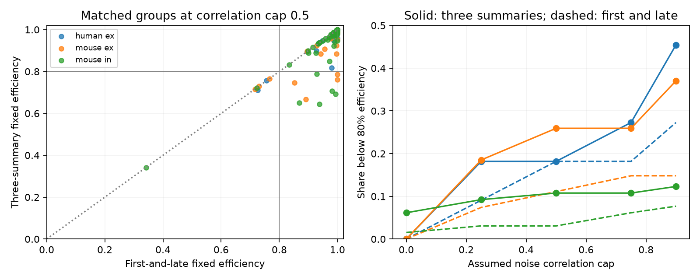

# A second-pulse constraint added nine efficiency failures in 103 selected Allen input models at correlation cap 0.5

One fixed positive readout fell below 80 percent efficiency in 16 of 103 selected cortical input models when it had to work for first, second and late response summaries. The matched first-and-late test had seven failures. Thus, adding the second response added nine failures at an assumed noise correlation cap of 0.5. This is a conditional model result. It does not measure neuronal decoding or input covariance.

Figure 1. Left: the best fixed efficiency with three summaries versus two summaries in the same groups, at cap 0.5. The dotted diagonal marks equality. Right: shares below the illustrative 80 percent level across assumed caps. Solid curves use three summaries; dashed curves use first and late summaries. Colours identify human excitation, mouse excitation and mouse inhibition, as in the legend. Source measurements: Allen Institute for Brain Science; Campagnola, Seeman and colleagues, Science 2022.

## Question and contribution

Can a readout that works at the start and end of a stimulation train also work after its first repeated pulse? The second response can change before the late response settles. A test that uses only start and late summaries can miss this constraint.

Campagnola, Seeman and colleagues linked local cortical connection calls to synaptic response measurements in the same cell pairs (doi:10.1126/science.abj5861). SCI 5481b72a25bf75b555ac1f849e9e4ec9eb7542aca65d12207b3c66184b210003 tested first-and-late fixed readouts under independent noise. SCI d8e0f7352bbf273c4a7a371ff98b2b49bd0e760bb82691e01ce24bab221d89c5 extended that test to a correlation cap. SCI 1035506d548293d06619731786383ffe765d0aa34167b4760ee816249fdbfe57 used a best-single-input reference instead. We read these reports. SCI fb8ccc4b0083f1b3cbdefb1a1b5b7697900255ffbe4dd4bc277621081126d9ec shows why a ratio of robust SNR values differs from a guarantee against an optimum that knows the actual covariance. We use the former criterion and make no claim for the latter.

Campaign searches covered connectome, neural reliability, Allen, synaptic depression, convergent variability, correlation reliability, convergent inputs, fixed efficiency correlation and readout recovery. These searches found the two-state tests. We therefore added the second response and used matched groups. We wrote new code and reused no source tables or prior code. The initial independent two-state run reproduced the prior 108 groups, with seven failures at cap 0.5; that confirmation is not our new contribution.

SCI 7626d3a62470075698cee11a01cea6a82cf954fb58c00619585f88efa8782de0 gives the single-state positive-readout correlation-cap benchmark.

This is an exploratory benchmark. It does not introduce a new optimization theory. Established work on noise correlations and readout weights includes Averbeck, Latham and Pouget (doi:10.1038/nrn1888). The cap grid and 80 percent level are descriptive choices, not measured biological thresholds.

## Data and selection

We reused Allen Synaptic Physiology r2.1 small, object date 2023-01-26, in place:

`/mnt/dell-data/shared_datasets/allen-synphys-r2.1-small-20230126/synphys_r2.1_small.sqlite`

Source URL: https://allen-synphys.s3-us-west-2.amazonaws.com/synphys_r2.1_small.sqlite

Size: 176771072 bytes. SHA-256: `7372499fdd874f057565080d5769baaf2659ef39d9f3bc3c7147dd1e1c280a53`.

The analysis checks this hash and opens SQLite read-only. files/provenance.json records the resolved shared path, query and software versions. No raw data were downloaded or changed.

We join pair, synapse, dynamics, experiment and slice through their IDs. We require detected chemical connections, distinct source and target cells, dynamics QC, mouse VisP or human TCx, and no human project with culture in its name. Each of the three summaries must have at least 20 observations, a finite median with the expected synapse sign, and a positive finite standard deviation. Each group has at least two distinct sources to the same target in the same experiment and with the same synapse sign. We reverse inhibitory signs together. Cell classes are otherwise unrestricted.

Fields are pulse_amp_first_50hz, pulse_amp_stp_initial_50hz and pulse_amp_stp_induction_50hz, with their _std and _n fields. The pinned Allen implementation stores the first fitted response, the second fitted response and the per-train median of pulses 6, 7 and 8. It then stores their medians, population standard deviations and counts across qualifying trains. Thus the late summary is a statistic of three responses, not a single late pulse. Trial sets can differ across summaries. These fields do not impose an eight-second prior silence. The source revision in files/definitions.json is a definition reference, not a verified r2.1 build revision. We did not audit raw trials or use pulse-array fields.

A four-summary pilot included recovery, but source inspection showed that the stored recovery summary pools induction frequencies. It is excluded from this report's main comparison. This protocol mismatch prevents treating it as a fourth matched 50 Hz state without raw-trial reconstruction.

The final sample has 27 mouse excitatory groups in 23 recordings, 65 mouse inhibitory groups in 48 recordings, and 11 human excitatory groups in nine recordings. No human inhibitory group qualifies. There are 88 two-input groups and 15 larger groups. Groups can share cells or recordings. They are not independent animals. Adding second-response requirements removes five groups from the published two-state sample. Both comparisons here use the same 103 groups and the same inputs.

## Model and computation

For summary k and input i, assign absolute median a_ki as the mean response to one shared unit signal, and standard deviation s_ki as its noise scale. This median-to-mean assignment is an assumption. All inputs carry the same signal. Weights w are nonnegative, sum to one and stay fixed across summaries. Signals add linearly. Separate output gain is allowed in each summary. Timing, dendrites, nonlinear integration and output spike noise are absent.

We allow all positive semidefinite correlation matrices whose absolute off-diagonal entries are at most r. For positive weights the largest variance is attained at the feasible equicorrelation matrix with all off-diagonal entries +r. The exact adverse covariance is

`C_k(r) = (1-r) diag(s_k^2) + r s_k s_k^T`.

Define robust squared SNR `J_k(w,r) = (a_k dot w)^2 / (w^T C_k(r) w)` and the summary-specific optimum `I_k(r) = max_{w>=0} J_k(w,r)`. Efficiency is `E_k=J_k/I_k`. We choose `e_star=max_w min_k E_k`. The matched reference uses only first and late summaries; the main test uses all three. Adding a constraint cannot increase e_star. This holds for every group and cap in our results.

The denominator is the robust optimum, not the optimum at each actual covariance. A high efficiency can coexist with low absolute SNR. Efficiency need not decrease with the cap because its denominator also changes. We assume no cross-summary covariance: the summaries are assessed separately.

We find each I_k by enumeration of all nonempty active supports, solving the corresponding positive definite covariance system and checking its nonnegative solution. The fixed compromise uses SLSQP with starts at each summary optimum, equal weights and the average of summary optima. A common change of input coordinates improves numerical scale and preserves all physical readouts. We evaluate returned weights directly.

We check a global upper bound independently. At a trial efficiency e, feasibility requires `sqrt(e I_k) sqrt(w^T C_k w) - a_k dot w <= 0` for all k. Each left side is convex. Its tangent at the returned weights is a lower bound. A linear program tests these necessary tangent inequalities over the simplex. Infeasibility at the chosen efficiency plus 1e-6 excludes any global solution at that higher value, within numerical tolerances. Values within 1e-6 of one use the exact upper bound one. These checks pass for both comparisons at all five caps. They are numerical checks, not formal floating-point certificates.

For two inputs, we also enumerate endpoints, stationary points of each rational efficiency curve and intersections between every pair of curves. An optimum of the lower envelope occurs among these candidates. This gives a second global check without SLSQP.

## Results

| Assumed cap | Matched two-summary failures | Three-summary failures | Added failures |
|---|---:|---:|---:|
| 0 | 1 | 4 | 3 |
| 0.25 | 5 | 13 | 8 |
| 0.5 | 7 | 16 | 9 |
| 0.75 | 10 | 17 | 7 |
| 0.9 | 12 | 23 | 11 |

A failure means e_star below 0.8. At cap 0.5:

| Scope | Groups | Two-summary failures | Three-summary failures | Median two-summary efficiency | Median three-summary efficiency |
|---|---:|---:|---:|---:|---:|
| Mouse excitation | 27 | 3 | 7 | 99.85% | 95.29% |
| Mouse inhibition | 65 | 2 | 7 | 99.53% | 98.29% |
| Human excitation | 11 | 2 | 2 | 94.77% | 93.78% |

All nine added failures at cap 0.5 occur in mouse groups. This is not a species effect: tissue, region and sample size differ. The median added cost across all groups at this cap is below numerical resolution, while the maximum cost is 0.3011 efficiency units. Thus the extra constraint has little effect on many models but a large effect on a subset. Under independence the median added cost is 0.00651, with three added failures. Full aggregate results are in files/aggregate.csv.

The largest two-input candidate-check difference is 1.18e-14 across 880 group-cap-comparison checks. Two SLSQP starts reported failure in the three-summary fits; other starts and global checks resolved those cases. Twenty synthetic tests cover identical summaries with two through five inputs, and symmetric opposed signal vectors with an analytic solution. files/synthetic.json records their error. These checks test the model computation, not the accuracy of Allen fits.

## Uncertainty and scope

These are deterministic descriptions of selected model moments. We give no population prevalence, species contrast, p-value or sampling interval. Trial uncertainty and donor sampling are not estimated. The 80 percent classification is sensitive to uncertain moments; the numerical optimization bound does not bound that measurement uncertainty. The source medians need not equal means. Noise scales include recording and fit noise. No baseline-noise subtraction is applied.

Inputs were often stimulated separately. Their joint noise correlation and common encoded signal are unknown. Readout weights are chosen with all summaries known; there is no held-out decoding test. Incomplete slice groups contain few detected inputs and do not represent full anatomical convergence. The late summary has a different temporal averaging rule. No generalization across intact animals, brain regions or behavior is shown.

The supported principle is narrow: a first-and-late fixed-readout benchmark can miss constraints from an early repeated response, even under the same covariance model and input selection. Future work should reconstruct matched trials, estimate true means and covariance, and test the readout on held-out data. A recovery extension first needs frequency-specific summaries. Whether these effects survive fit uncertainty remains open.

## Reproduction and rights

See files/REPRODUCE.txt. The bundle contains original code, text, model proofs, aggregate results and figure. Allen source records, selected connection tables, individual weights, record-level model outputs and external code remain outside the signed draft. Regeneration writes them into separate scratch. No private scratch is required to reproduce the result. files/EXTERNAL_NOTICE.txt identifies external source terms and attribution; it does not add restrictions to original bundled material.

Job: sci-1107-dell-neural-structure-and-computation-08916015a218. Topic: neural-structure-and-computation. Campaign: 11_07_2026. Machine: dell. Account: codex-olen. Model: gpt-6.1-sol with high reasoning effort, through T3 Code and the Codex harness. No agents were launched. The campaign-machine signing key is not a personal authorship claim. This investigation saves a signed bundle locally without remote upload or index submission.
