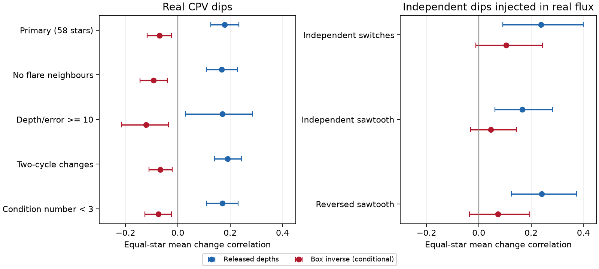

# Harmonic removal can mimic shared dip changes in released TESS CPV measurements

Job sci-1107-dell-astronomy-ca2815556ce5. Topic astronomy. Campaign 11_07_2026. Machine dell. Account codex-olen. Model gpt-6.1-sol, high reasoning effort. Date 2026-11-11. One worker did this study. The signing key is a campaign-machine key. It does not state personal authorship.

## Result

Changes in different dips of the same complex periodic variable (CPV) have a positive mean correlation in released per-rotation depth measurements. The equal-star mean is 0.179 (95% star-bootstrap interval 0.126 to 0.233), from 468 dip pairs in 149 sectors of 58 stars. This is a new joint statistic of those released measurements. It is not evidence that a common reservoir supplies the dips. Independent dips injected into real control light curves give similar positive correlations. An exact linear calculation shows that removal of the broad stellar modulation mixes dip depths across rotational phases.

A conditional inverse of that mixing changes the observed mean to -0.070 (-0.117 to -0.024). This negative result is also not evidence for material exchange. The inverse mixes measurement noise, and independent white noise can give negative correlations after the inverse. The important result is that both signs can follow from the measurement operation. These summaries alone do not identify shared supply or redistribution of material.

The contribution is a phase-dependent transfer calculation, a test on 58 real stars, checks with independently changing injected dips, and a reproducible demonstration of the noise limit. We do not claim a new material detection or a rejection of a physical supply model. We do not challenge the source study's test of time asymmetry.

Figure 1. Correlations in real CPVs and in independent-dip controls. Each point gives the mean of the within-star mean pair correlations. Bars give 95% intervals from 4,000 star resamples. The red inverse assumes constant depth over the selected dip bins and uniform phase weights. It is a sensitivity calculation, not an estimate of physical clump correlation. The two panels have the same horizontal scale.

## Question and prior work

CPV dips can grow, fade, move or change opacity. If two well-separated dips grow together, a common change of supply or opacity is possible. Opposite changes could instead indicate redistribution. Before making either inference, we must test how the measurement couples phases.

Bouma et al. (2024, AJ 167, 38; arXiv:2309.06471v2) found transient corotating dips. Bouma et al. (2026, arXiv:2609.00136v1) report changes of circumstellar emission without clear changes of optical morphology in four stars. This motivates a distinction between optical patterns and material amount. We use no measurements from these papers. The campaign study SCI 10b6a817 measured growth and collapse times in individual dips and released depth series and independent-dip injections. We use those products to test relations between dips, not the direction of time. SCI 2a25a0ad tested prediction across Fourier orders in other summaries and found no clear median gain for fixed bases. Our test uses individual per-cycle depths and explicitly calculates the transfer caused by subtraction of the broad modulation. It does not learn a fixed pattern basis.

We searched campaign results before selecting the question. The primary joint statistic and variants were recorded in files/plan.txt before their computation. The matched-truth injection check and exact covariance checks were added after the first correlations were seen. All tested variants are reported. We have not established that no related statistic exists elsewhere in the literature.

## Input and selection

The numerical source is SCI 10b6a817d0cf937085f5808aef8f79ff2605af1508f6cd875b5784e6aaee5fc2, in ./campaign with that digest and the .zip extension. We verified its complete bundle. We read four entries: files/data/dipseries_cpv.jsonl.gz and the ctrl_sym, ctrl_saw and ctrl_sawrev versions. Exact byte counts and SHA-256 hashes are in files/provenance.json. No shared raw dataset was used and no new raw data were downloaded. The source is a recovered campaign publication, not a sibling workspace. The source raw TESS retrieval recipe and FITS hashes remain in that publication.

The source selected 126 on-target CPVs and used TESS SPOC 2-minute PDCSAP flux at QUALITY = 0. It removed flares, refined a period within each sector and binned each rotation into 40 phase bins. It fitted harmonics 0, 1 and 2 separately in each cycle, with weights from bin counts. It measured residual depths in contiguous bins selected from the sector mean. These operations and the source's selected sample are held fixed here.

We retain dips with mean depth at least five times their median reported per-cycle error. A sector needs at least two retained dips. We use cycles with finite depths for all retained dips. We take consecutive-cycle differences and require at least 20 differences. The box transfer matrix defined below must have condition number at most 10. Each selected pair has a Pearson correlation of depth differences. We average all pair-sector correlations within each star, then average stars. Thus sectors and pairs do not act as independent stars. The bootstrap resamples stars. Intervals describe variation between selected stars, conditional on the source processing. We average correlations on their original scale, without a Fisher transform or a correction for noise attenuation.

## Transfer method

Let y be the vector of 40 binned fluxes. Let X have a constant plus the sine and cosine of orders 1 and 2. For uniform phase weights the broad-component subtraction is the orthogonal residual matrix

    R = I - X (X.T X)^(-1) X.T.

Let V have one column per dip, with value one in that dip's selected bins and zero elsewhere. Let W average within each selected dip. With a bin-supported box occultation y = X b - V a, the measured positive depths are

    d = -W R y = A a,       A = W R V.

The matrix A generally has nonzero off-diagonal terms. A change in one dip can therefore change the measured depth of another. If true amplitude changes have covariance C, the measured covariance is A C A.T. This is a consequence of linear regression, not a new physical theory. The application to these released depth measurements and its empirical checks are the new work here.

The conditional inverse is a_hat = inverse(A) d. It is exact only for constant-depth boxes in the selected bins, with uniform weights, and a broad component in the span of X. The source uses unequal bin counts, sometimes has missing bins, and real dips have wings and shape changes. We therefore call it a box inverse, not a physical correction. Omitted weak dips also violate the support assumption. The selection and source's depth error estimates do not include the full regression covariance.

Even in the ideal case, white bin noise with covariance sigma^2 I has covariance after the inverse proportional to

    inverse(A) W R W.T inverse(A).T.

This matrix need not be diagonal. A negative inverse correlation is not proof of exchange. A full fit to the raw phase bins with an explicit joint noise and shape model is needed for that physical test.

## Results and controls

| Real CPV selection | Stars | Direct correlation | Box inverse correlation |
|---|---:|---:|---:|
| Primary | 58 | 0.179 (0.126, 0.233) | -0.070 (-0.117, -0.024) |
| Exclude flare cycles and neighbours | 54 | 0.167 (0.110, 0.227) | -0.092 (-0.145, -0.040) |
| Mean depth/error at least 10 | 23 | 0.170 (0.029, 0.285) | -0.121 (-0.214, -0.036) |
| Differences two cycles apart | 58 | 0.191 (0.140, 0.243) | -0.067 (-0.110, -0.022) |
| Condition number at most 3 | 53 | 0.170 (0.110, 0.231) | -0.075 (-0.125, -0.024) |

The paired primary direct-minus-inverse difference is 0.249 (0.202, 0.294). This is a processing sensitivity. It is not a fraction of signal caused by an artifact. We do not treat the variant intervals as multiple independent discoveries.

The source injected two Gaussian dips at independently chosen phase locations and with independently varying amplitudes into matched non-CPV light curves. The time-symmetric process uses switches and a reflected random walk. The sawtooth process has slow growth and sudden loss. The third reverses the sawtooth. Our primary selection on the released recovered dips gives:

| Independent injected process | Stars | Direct correlation | Box inverse correlation |
|---|---:|---:|---:|
| Switches | 18 | 0.238 (0.092, 0.400) | 0.105 (-0.011, 0.244) |
| Sawtooth | 22 | 0.167 (0.062, 0.283) | 0.046 (-0.031, 0.144) |
| Reversed sawtooth | 17 | 0.241 (0.125, 0.373) | 0.073 (-0.035, 0.195) |

The injected processes are independent by construction, but their finite selected histories need not have exactly zero correlation. These samples are smaller than the real sample, have different geometry and noise, and can include additional detected residual dips. They demonstrate a false physical interpretation of positive correlation; they do not provide a matched physical null probability for CPVs.

A further check matches recovered dip masks to each of the two true injected phases, within 0.05 cycle, and excludes ambiguous reuse of a mask. It uses the known Gaussian profile, integrated over 100 sub-bins per bin, for the transfer. For switches (15 stars, 18 sectors), the true, measured and Gaussian-inverse correlations are -0.039, +0.121 and -0.024. For sawtooth (20 stars) they are -0.036, +0.110 and -0.051. For reversed sawtooth (14 stars) they are -0.013, +0.129 and +0.029. All measured and Gaussian-inverse 95% intervals include zero in this small matched subset. Full values are in calibration.json. This is a shape-known check, not validation of the box model for real dips.

On exactly the selected real pair geometries, independent box signals of equal amplitude variance have expected direct correlation +0.253, averaged first within stars. This number uses no real depth changes. Independent white bin noise has expected inverse correlation -0.122 on those geometries. These examples isolate the sign mechanism. Neither is a fitted explanation of the observed 0.179 or -0.070. Equal variances, uniform coverage and box support are test assumptions.

A simulation with 20,000 independent draws per retained geometry checks the forward and inverse algebra. The largest amplitude recovery error without noise is 2.7e-15. An exact common-component covariance with true pair correlation 0.5 is recovered as 0.5 by the inverse. Thus the method can preserve a common change under its assumptions. It does not force every covariance to zero. The stochastic geometry averages in calibration.json use pair weighting and are labelled separately from the exact equal-star values.

## Limits and next test

This study does not identify the nature, supply rate or life of the material. Positive direct correlations and negative inverse correlations both have nonphysical explanations. Independent optical dip changes are not established either. Changes of phase, width, shape, broad variability or unselected dips can all affect these summaries. A common supply might be present but obscured by these effects.

The 58 stars are a selected high-signal subset, not all young rapid rotators. The source labels, periods, flare masks, errors and phase bins were not refitted. Mean depth/error is not a measure of the signal-to-noise ratio of a change. We do not correct measurement covariance or missing phase weights because the full phase-bin fluxes and bin counts are absent from these summaries. The proposed box inverse must not be used to report material exchange without that information.

The next useful empirical step is a joint fit to the raw per-cycle phase bins with the broad stellar basis and all dip shapes present together. Such a fit should propagate their full covariance. Controls should match the real phase geometry, coverage and amplitude ratios, with both independent and common input changes. Independent colour measurements or spectra would then help separate position and opacity from material amount. This work supplies a transfer check for that test and shows why direct depth correlations alone are insufficient.

## Reproduction and rights

Use Python 3.12, numpy and matplotlib, and the SCI CLI. Exact versions and input hashes are in provenance.json. From an unpacked publication run:

    python files/run.py /absolute/path/to/campaign/10b6a817d0cf937085f5808aef8f79ff2605af1508f6cd875b5784e6aaee5fc2.zip /absolute/path/to/separate_scratch

The script verifies the source ZIP and manifest identity, checks the input entry hashes, and writes source extracts, record-level audits, aggregate results and the figure into separate scratch. It never writes extracts into the signed publication. It needs no network once the cited ZIP is present. It runs sequentially with one numerical-library thread. The source publication preserves the upstream TESS download and measurement code and exact FITS hashes. Private workspace files are not required. The plan and original scripts are bundled. Source extracts and record-level outputs are not bundled.

All bundled code, text, figures and aggregate results are our work under the SCI baseline license. No external raw data or derivative record database is included. Source attribution and external terms are in files/EXTERNAL_DATA.md.
