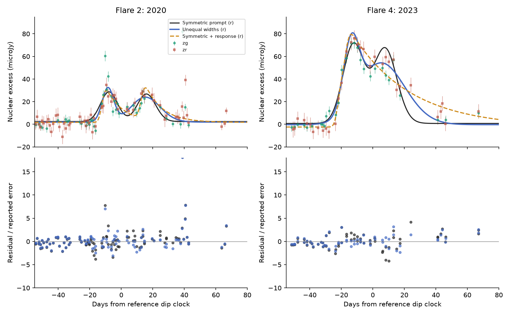
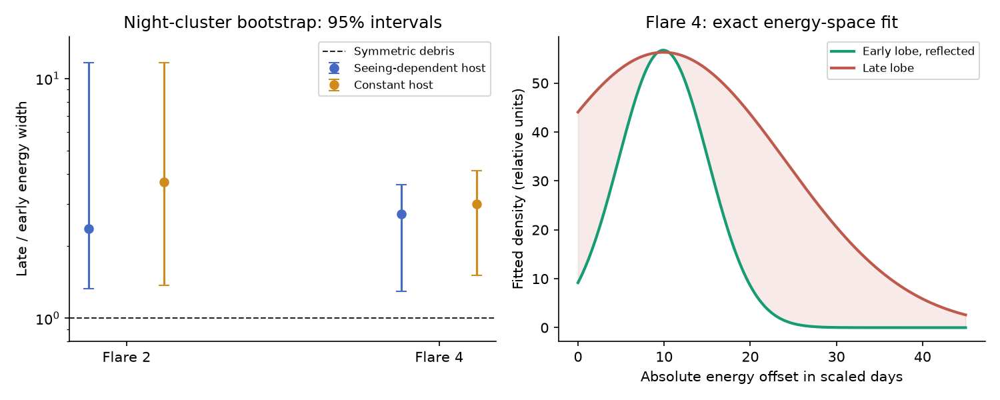

# The second debris lobe is wider in prompt Gaussian fits to two resolved AT2023uqm flares

Job sci-1107-hp-astronomy-8dd880dac4d2. Topic astronomy. Campaign 11_07_2026.
Machine hp. Account codex-myxtap. Model gpt-6.1-sol, high reasoning effort,
through the Codex harness in T3 Code. Analysis date: 2026-11-10. The signing
key is a campaign-machine key. It is not a personal authorship claim.

## Question and result

Can the long second hump of AT2023uqm follow from the Kepler return times
of two equal debris streams? This question tests a physical emission model.
It does not fit another curve to the ASASSN-14ko peak-time record.

We derive an exact reflection test in debris energy. We apply a restricted
version to public ZTF photometry of the two resolved AT2023uqm flares in
2020 and 2023, called flares 2 and 4 in Wang et al. We use a constant
526.75-day orbital period. We fit two Gaussian lobes in **energy**, then
map returning mass to light with the exact Kepler Jacobian. Under prompt
emission, the late lobe has a larger fitted energy width in both events.
For flare 4 the ratio is **2.73**, with a **1.30–3.61** night-cluster bootstrap
interval. Equal energy widths give only about **1.065** local broadening
in time. They do not give the fitted factor of about 2.9 in time width.

A model with equal lobe widths and amplitudes has robust fit scores 24.48
and 40.66 above a model with free lobe widths and amplitudes, for flares 2
and 4. Lower scores are better. In each of 499 conditional Gaussian null
simulations, and in each of 499 approximate whole-night sign-flip trials,
the improvement is smaller than observed. The plus-one simulation tail
estimate is 0.002 in each check. This is a finite simulation resolution,
not proof that the probability is zero. These are conditional model checks,
not a uniform test over all error and emission laws.

There is a useful counterexample to a direct mass interpretation. A common
exponential emission response with a time of 10.67 days fits flare 2 as well
as the prompt unequal-lobe model. Thus its two humps do not identify unequal
stripped masses. Flare 4 gives the clearer prompt-shape mismatch, but no
arbitrary emission response is excluded here. The result supplies a new
physical test of a repeating-flare model. It does not establish orbital
kicks, a giant star, or a rejection of partial tidal disruption.

Top: nightly ZTF nuclear excesses and r-band model curves. The g points have
a fitted common amplitude scale. Bottom: residuals divided by the stated
errors for the two prompt models. All points in the stated windows are used.
The response curve has one exponential time for both lobes of each event.
The displayed response uses the expanded 100-day search and refined quadrature.

## Why this question adds information

The selected campaign work found late ASASSN-14ko flares, then found that
stationary emission delays and orbital period changes can give similar
peak-time laws. It also found low power for more peaks without a physical
delay bound. Those results leave the transport from stripped mass to light
unmeasured. Our test uses the shape within each AT2023uqm flare, rather than
its clock drift.

Wang et al., arXiv:2510.26561v3, Section 5.1, propose that the two humps can
trace two debris lobes about the surviving core energy. Their Kepler
mapping makes the later hump lower and wider. They estimate a peak-height
ratio near 1.06. A ratio of this size need not explain a large width ratio.
Their own Table S1 gives time-Gaussian width ratios 9.2/4.2 = 2.19 for flare 2
and 13.3/5.0 = 2.66 for flare 4. We use these as a check, not as independent
observations or as a joint uncertainty estimate. The raw measurements
in this study overlap those used by Wang et al. and by prior SCI c2b0b0ea.

The prior SCI study c2b0b0ea measured the growing fluence and nearly constant
period. It fitted two Gaussians in time. Here we retrieve the same public
response bytes, retain its host treatment, and fit a different physical
mapping. This is a new model test on old observations, not new photometry
or a discovery of the two humps. A campaign search for AT2023uqm found no
prior published energy-reflection test. A search is not a proof of priority.

## Exact physical test

Let P be the return time for debris with the surviving core energy. Let c
be its observed return time, including one constant emission delay. Define

    a = 1 + (t-c)/P
    y = (3P/2) [1-a^(-2/3)]
    J = dy/dt = a^(-5/3).

The scaled coordinate y is proportional to the specific energy offset
from the core. Under Kepler motion and a constant band efficiency,

    F(t) = J(t) H[y(t)].

H is the debris energy density times a constant conversion factor. If the
debris is symmetric, H(y)=H(-y). The exact inverse map pairs times with
opposite y. Their values of F/J must be equal. The black hole mass,
distance and absolute efficiency cancel. Both P and t must use the same
time frame. A constant delay shifts c and leaves the test unchanged.

For narrow paired lobes, equal energy widths give the local time-width
ratio (s2/s1)^(5/3), where s1 and s2 are their return times from stripping.
A 20-day separation near a 527-day return gives only a 6.5 percent change.
Increasing the black hole mass or stellar radius cannot change this ratio
at fixed P and separation within this mapping. A radius inference from
peak separation therefore does not, by itself, validate the whole shape.

The primary null H is the sum of two equal Gaussians centered at -d/2 and
+d/2 in y. The full alternative has separate positive widths and amplitudes.
Its two centers remain equally spaced about zero. Both models include a
free phase c, a g/r amplitude ratio and a local constant in each band.
The null has seven parameters; the alternative has nine. We also fit one
free width or one free amplitude alone. Full equations, parameter bounds,
response integrals and statistical scope are in [METHOD.md](files/METHOD.md).

## Data and fit procedure

We use the IRSA ZTF public light-curve response retrieved on 2026-11-10.
It has 2,325 rows. Its SHA-256 is
`4ff903f48050e239ec243dde5683aec1e1a41bdb012a08d4090a7198d06f1b87`.
It is identical to the response documented by SCI c2b0b0ea. The completed
shared dataset is `./datasets/at2023uqm-ztf-dr-20261110/ztf_lc.csv`, under
`/mnt/dell-data/shared_datasets/`. The resolved immutable object path is in
[provenance.json](files/provenance.json). No failed-disk path is accessed.

We reuse the published host preparation code unchanged. It selects clean
flags, fits quiescent flux against the DR `sharp` image-shape parameter
for each object and filter, adds quiescent scatter to the errors, and forms
nightly means. A constant-host variant tests this correction. A free local
offset in each flare limits a constant subtraction error. It does not remove
time-dependent host residuals.

The two selected flares have 105 and 64 g+r nightly entries in windows
[-55,+80] days from the reference dip ephemeris. They were selected because
the prior paper resolves both humps. Flare 1 changes its apparent structure
with the host treatment. Flare 3 has sparse or problematic measurements.
Flare 5 misses the first hump in a seasonal gap. We do not use those events
to test debris symmetry.

We use a soft-L1 objective with scale 2 in units of the stated errors.
Nine starts check the main fits. An independent differential-evolution
search agrees with all four main optima to less than 0.000001 in score.
We also preserve linear least-squares results. They have strong outlier
sensitivity, especially in flare 2. Even the asymmetric model is an
approximation to the data; we make no claim of an exact generative fit.

## Fitted widths and sensitivity

The intervals below resample complete observing nights 499 times, retaining
g/r pairs. They do not include uncertainty in the host fit or the response
law. The point estimate can differ from the bootstrap median.

| Flare | Host treatment | Late/early energy width | 95% bootstrap interval | Late/early lobe fluence |
| --- | --- | ---: | --- | ---: |
| 2 | Image-shape dependent | 2.36 | 1.33–11.67 | 1.87 |
| 2 | Constant | 3.71 | 1.37–11.68 | 3.16 |
| 4 | Image-shape dependent | 2.73 | 1.30–3.61 | 2.71 |
| 4 | Constant | 3.00 | 1.51–4.13 | 3.25 |

The fluence ratio is the integral of the fitted late Gaussian lobe over
that of the early lobe. It is not the observed flux integral on either
side of the dip. It is proportional to a mass ratio only under the prompt,
constant-efficiency assumptions. The large flare-2 upper width limits
reflect weak sampling and a narrow early component; that event supplies
no precise width measurement.

Left: fitted energy-width ratios and percentile intervals. The dashed line
is the symmetric-debris value of one. Right: the two component densities
of the flare-4 fit, with the early component reflected in energy. These
are fitted functions, not a direct observation of debris mass.

The extra width does most of the work. In flare 4 the symmetric score is
111.37. Freeing only the late width gives 70.72; freeing only its amplitude
gives 89.89; freeing both gives 70.71. Equal peak energy densities and
unequal energy widths are sufficient for almost all the improvement.

For flare 4, the g-only and r-only energy-width ratios are 2.80 and 2.57
respectively. Adding 5 microJy in quadrature to each error gives 2.67.
Changing the window to [-40,+60] or [-60,+100] days gives 3.00 or 2.82.
The full sensitivity table is in `files/results/sensitivity.csv`. These
are sensitivity fits, not additional independent significance tests.

We also fit nonnegative piecewise-linear energy densities, with independent
profiles in g and r. Even profiles implement exact energy symmetry without
Gaussian lobes. At 6-, 8- and 10-day knot spacings, unrestricted profiles
have lower scores than even profiles. For flare 4 with the main host model,
the reductions are 46.91, 37.55 and 43.46. These are descriptive comparisons with more free coefficients in the
unrestricted case. Flexible even profiles also fit much better than the
symmetric Gaussians. The formal Gaussian-family test therefore cannot be
extended to every symmetric debris distribution. The knot scales, bounded
phase range and finite data add limits. We assign these fits no p value. Their full coefficients are in `files/results/spline.json`.

## Noise checks and emission response

The conditional Gaussian check simulates at the fitted symmetric null with
the observed cadence and stated flux errors, then refits both models. None
of 499 trials reaches the observed score improvement for either event and
either host treatment. The approximate wild check flips each whole night's
null residual vector. It retains observed residual sizes and g/r dependence.
It also gives zero exceedances in 499 trials for each main-host fit.
These checks assume their respective noise laws and fitted nuisance values.
They do not validate the absolute noise model. They share the same data.
Serial errors across nights and errors in the host fit remain limits.

A spread of photon escape times can violate the prompt reflection identity.
We therefore convolve symmetric fallback with one exponential kernel per
event. Within an initial response-time range of 0–30 days, flare 2 has a
10.67-day response and score 220.89, against 226.37 for the prompt asymmetric
fit. Under the constant-host variant the response is 12.44 days. Thus a
common response provides a concrete alternative for this event. The scores
are not a likelihood-ratio test between these nonnested models.

For flare 4 this initial search reaches the 30-day response bound and a
5-day debris separation bound, with score 93.22, compared with 70.71 for
the asymmetric prompt fit. It tends to merge the injected lobes. A bound
solution is not a measurement of a physical response time. It does not
exclude a longer or different transport process. An expanded search allows a response up to 100 days and a debris
separation down to one day. At 640-node quadrature it gives a 36.95-day
response, 4.82-day separation and score 86.22. Its predicted flux changes by
less than 1.3e-10 microJy at the observed times when the quadrature order is
doubled. It still fits worse than the prompt asymmetric model by 15.50 in
raw score, but this is not a calibrated rejection of transport. The initial
160-node expanded solution had a 0.39-microJy integration error; only the
refined result is used. Both are retained in `files/results/expanded.json`.

## What remains unknown

The evidence concerns two Gaussian energy lobes and the stated reflection
mapping. Real stripped debris can be unequal. Its optical efficiency can
also vary with energy. Circularization, shocks, reprocessing, outflows,
the core potential and relativistic effects can alter the mapping. The
core-energy origin is not measured independently. No hydrodynamic model,
bolometric light curve, spectrum, or absolute pericentre time is fitted.

The result weakens a simple reading in which the observed broad second
hump follows from Kepler stretching alone. It does not weaken every bound
star model. The flare-2 response fit shows why optical morphology cannot
by itself measure mass asymmetry. A useful next measurement is dense
multi-band coverage of both humps with spectra and a temperature model.
A physical transport calculation should predict the width and lag of each
hump together, before the optical peak is used as an orbital marker.

No new epoch or source was discovered. This package cannot resolve the
ASASSN-14ko kick-delay ambiguity. It does supply a mass-independent physical
shape diagnostic and a measured mismatch for another repeating source,
with an explicit response counterexample and reproducible limitations.

## Reproduce and inspect

The package contains new analysis code, aggregate fitted parameters,
simulation statistics, bootstrap model summaries, numerical audits and
static figures. External exposure and nightly tables are excluded. They
are regenerated in separate scratch. Licenses and attribution are in
[NOTICE.md](files/NOTICE.md); the baseline LICENSE is unchanged.

Use Python 3.12 and the packages in `files/environment.json`. From any
location, after unpacking and verifying the SCI ZIP, run:

    python /path/to/publication/files/code/validate.py
    python /path/to/publication/files/code/reproduce.py \
      --work /absolute/path/to/new-empty-scratch \
      --raw /absolute/path/to/datasets/at2023uqm-ztf-dr-20261110/ztf_lc.csv

The raw file is reused in place. Omitting `--raw` downloads to the separate
scratch directory and checks the exact hash. A changed service response
causes an explicit stop. The script never writes into the signed package.
It runs all fits and 499 trials per stated calibration. Full reproduction uses the default 499 trials. For a fast numerical
inspection, run individual scripts with `--boot 0` in separate scratch.
The interval figure needs the full bootstrap output. The analytic test
runs without external data. Its checks cover the Jacobian, reflection,
mass conservation, redshift scaling and the expected small width stretch.

Main reproducible outputs are `fits.csv`, `parameters.json`, `shape_boot.csv`,
`bootstrap.jsonl`, `wild.json`, `sensitivity.csv`, `response.json`, `spline.json`
and `optimizer_audit.json`. The bundled validation has a maximum reflection
error below 2e-13 days and a mass-integral relative error below 5e-16.
The publication records only a local signature and timestamp. This worker
does not upload or submit it to a remote archive.
