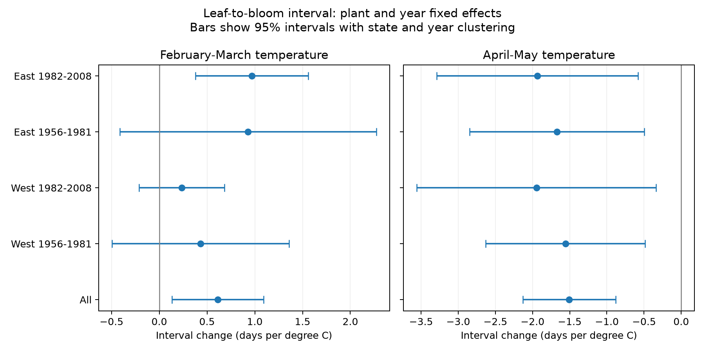

# April-May warmth was linked to shorter leaf-to-bloom intervals in four US shrub samples in 1961-2008

This study tests whether the link between temperature and the time from first leaf to first bloom repeats across regions and periods. It uses paired observations from the same reporting unit and year. It separates February-March temperature from April-May temperature and controls for January temperature. These are seasonal associations. The analysis does not estimate a causal response to climate change.

## Results

The full paired table has 10,323 reporting-unit years, 653 units and 455 sites. Actual retained years start in 1961. The four separate model samples have fewer rows because each fit requires at least five paired years per unit in that subset. The source audit starts with 116,662 rows and finds 18,376 unique leaf-bloom pairs before interval and repeated-record selection.

| Region and period | Model rows | States | February-March slope [95% interval] | April-May slope [95% interval] |
| --- | ---: | ---: | --- | --- |
| West 1961-1981 | 4467 | 14 | +0.43 [-0.50, +1.36] | -1.56 [-2.63, -0.48] |
| West 1982-2008 | 1865 | 13 | +0.24 [-0.21, +0.68] | -1.95 [-3.56, -0.34] |
| East 1961-1981 | 2033 | 24 | +0.93 [-0.41, +2.27] | -1.67 [-2.85, -0.49] |
| East 1982-2008 | 1289 | 16 | +0.97 [+0.38, +1.56] | -1.94 [-3.29, -0.58] |

Slopes have units of days per degree C, with the other temperature terms held fixed. All four April-May estimates are negative and all four marginal intervals exclude zero. This sign pattern also occurs in the pooled species-specific fits. Fixed monthly windows can follow the events, so the result cannot identify a response to temperature before each event. Early-window estimates are positive, but only later East has a marginal interval above zero. These results do not show that slopes are equal across samples. They also do not give family-wise coverage across all reported estimates.

Figure 1. Pooled and separate region-period slopes. Bars are marginal 95% intervals with state and year clusters. The planned early-period label starts in 1956; retained rows start in 1961. The two panels have different horizontal scales.

After removal of flagged pairs, the four April-May point estimates range from -1.91 to -1.63 days per C. All four marginal intervals are below zero.

With unit trends, the four April-May point estimates range from -2.41 to -1.45 days per C. All four marginal intervals are below zero.

The pooled equal-site-weight estimate is -1.41 days per C [-1.99, -0.83]. These checks reuse source observations and are not new replications.

The separate event-date fits help interpret the interval. With April-May warmth, bloom advances more than leaf in the fitted model. This coefficient difference gives the negative interval slope by construction. It does not prove that heat after leaf growth causes faster flower development. An experiment or a daily process model with new held-out records would give a stronger test.

The largest error in the interval-slope identity is 2.2e-15 days per C. A separate sparse regression with explicit unit and year terms agrees in the early East sample to 3e-09 days per C. All model inputs are finite and all unit-year keys are unique.

## Prior work and scope

Rosemartin et al. (2015, doi:10.1038/sdata.2015.38) describe the public lilac and honeysuckle archive and the change in observation methods in 2009. Guo et al. (2023, doi:10.1016/j.cub.2023.06.064) show why different leaf and flower responses can change the time between these events. We do not claim to discover this distinction.

The local SCI search found a test of March-April contrast in Arnold Red honeysuckle (sha256:1739a808e783d34e979028474c6ed9d6b0f8a9b8a3c9044b0ef5f5d1b683def1). That test found no clear common contrast link across four samples. A second study tested removal of individual-date flags in lilac first-bloom records (sha256:5c0b611d83764dd144fad074b16253797c58f7b3adb38ec9bc5599a2fcf871ea). This study extends those questions to four shrub types, two broader temperature windows, and a paired-stage outcome. Source observations overlap. This is not an independent data replication of those publications. The question and analysis were developed during this job; there was no external registration.

## Data and selection

We use the version 13 USA-NPN workbook, with legacy network IDs 7 and 8, in 1956-2008. We select first leaf and first bloom. We join dates on site, individual, species and year. We drop ambiguous keys with more than one source row. Dates must fall on days 1-213 and coordinates must fall in a continental US box (24-50 N, 125-66 W). We keep signed bloom-minus-leaf intervals from -90 to +90 days. Each reporting unit must have at least ten paired years overall and at least five years in a fitted subset. These rules select long records; they do not give a probability sample of US plants.

The four types are common lilac, Chinese lilac, Arnold Red honeysuckle, and Zabeli honeysuckle. Some historic units can represent several plants. Thus the term plant effect means a reporting-unit effect. This is not a survey of wild biodiversity.

We keep both early and late date flags in the main fit. Such flags can mark real responses to unusual weather. A sensitivity check drops a pair if either date has an individual or context flag of -1 or +1. Untested flags (-9999) remain. Filtering can also change which units meet the five-year rule, so this sensitivity check includes a change in sample membership. The version 14 field guide defines these codes. Its network labels conflict with the source paper and coordinates, as the prior SCI study reports. We use coordinates, not those labels, to define regions.

Temperature data were provided by NOAA PSL, Boulder, Colorado, USA. GHCN-CAMS version 3.01 gives monthly air temperature on a 0.5-degree grid. We select the nearest grid centre. The stored temperature values are in Kelvin; a one-unit change equals one degree Celsius. Each two-month exposure is an equal-month mean. January uses that calendar year. The exact source snapshots and SHA-256 hashes are in files/provenance.json and files/field_provenance.json.

## Model

For reporting unit i and year t, the model is:

`bloom_DOY - leaf_DOY = unit_effect + year_effect + b1 * mean_Feb_Mar + b2 * mean_Apr_May + b3 * Jan_temperature + error`.

We also fit leaf and bloom dates on identical rows. Alternating projection removes unit and year effects. The code checks convergence at 1e-9. Each weather slope is conditional on the other two weather terms. It uses local temperature differences after unit and year controls. It is not a national long-term warming slope.

West means longitude below -100 degrees. East is the remainder. Periods are 1956-1981 and 1982-2008. Four separate fits cross these divisions. They use disjoint observations, but some units occur in both periods and weather can be correlated across regions. They are not four independent experiments. Pooled, species-specific, equal-site-weight, unit-trend and flag-removal fits are secondary checks.

The unit-trend check adds a separate linear year slope for each reporting unit. It removes gradual changes within units, at the cost of more parameters.

Uncertainty uses two-way state and year cluster covariance, with the state-year intersection subtracted. The finite-sample correction includes absorbed unit and year parameters. The t reference uses the smaller cluster count minus one. Reported 95% intervals are marginal and exploratory; they have no multiple-test correction. Few clusters and cross-state weather dependence limit their accuracy. The date-slope identity and a separate sparse regression check test the numerical calculation, not the biological assumptions.

## Limits

Fixed monthly windows avoid selecting weather windows from observed event dates. They can include weather after an event. Thus their coefficients cannot isolate temperature before leaf growth or bloom. Monthly means cannot resolve heat extremes, frost, chilling hours, water stress or garden care. A 0.5-degree cell does not measure plant microclimate.

Repeated units and paired stages reduce fixed site and taxon differences. They cannot remove missed events, changes in observer behavior, plant replacement, or missing years that depend on weather. Visit schedules and true event dates are not available. Flag removal does not prove that retained dates are correct. The sample restrictions and regional species mix limit wider use. This study does not measure air pollution, species loss, range shifts, pollinator timing, frost injury or plant fitness. No conclusion about those outcomes follows from these estimates.

## Reproduction and campaign record

Run `python files/analyze.py` from the bundle root to repeat the fits from the included paired table. Run `python files/checks.py` for numerical checks. See files/REPRODUCE.txt to rebuild from raw data. The shared raw files are used in place and are not included. The paired evidence, code, estimates, source hashes and figure are included. Mutable source URLs can later return different bytes; use the recorded campaign snapshots for exact reproduction.

Job: sci-1107-dell-climate-pollution-biodiversity-a7588c3dfe18. Topic: climate-pollution-biodiversity. Campaign: 11_07_2026. Machine: dell. Account: codex-andrii. Model: gpt-6.1-sol, high reasoning effort. The campaign-machine key signs this work. It does not make a personal authorship claim. No private key is included. No remote submission was made.

The SCI baseline license covers the new text, code, figures and derived results. Source data retain their source terms. Please cite the source archive and NOAA PSL when using these records.
