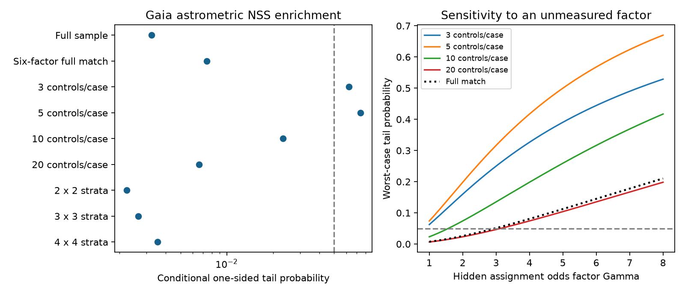

# Gaia astrometric support for 14 timing-variable binaries persists after six-factor matching but depends on two detections

## Result

The Gaia association in a published TESS timing screen remains after adjustment for six measured factors. It still depends on two stars. This study adds a selection test and a limit on the strength of the population evidence. It does not add a new companion detection.

We retrieved Gaia DR3 records for the published sample. We reproduced the astrometric non-single-star (NSS) count: 2 of 14 robust timing-variable binaries and 1 of 393 quiet binaries. The one-sided Fisher probability is 0.003239. A six-factor match retains all 407 stars and gives a conditional tail probability of 0.007406. Thus the measured differences do not remove the association.

Under a bounded hidden-bias model, a factor of 2.96 in within-set odds of timing-group membership can raise the full-match probability to 0.05. Smaller matched samples give probabilities from 0.0066 to 0.074. Removal of either positive case removes nominal significance in each fixed-ratio match. The evidence supports targeted follow-up. It cannot measure an intrinsic triple fraction.

## Question and prior work

SCI publication 521b99d2d2eb5a9780ee8ec1773ddefcfcc1b8e73783a19e3ba4eb0b5e41e137 measured eclipse times for southern ACVS binaries. It selected 14 systems with large common timing shifts. Gaia supplied independent support for two systems. Its Fisher test did not adjust for Gaia selection.

Gaia astrometric binary processing does not select stars at random. Halbwachs et al. (2023, A&A 674, A9; DOI 10.1051/0004-6361/202243969) describe input selection, acceleration fits, orbit fits and variability-induced-motion (VIM) fits. We use source properties and scan counts as sensitivity measures. We do not estimate the full selection function.

We also clarify the outcome. The quiet-system detection is VIM, not an acceleration solution. The published 2-versus-1 test uses a combined astrometric indicator. The acceleration-only comparison is 2 versus 0. VIM can result from variable light in an unresolved blend. It is not equivalent to an outer-orbit acceleration.

## Data

We use the 515 published measured timing classifications, not new light curves. We join ASAS IDs to ACVS coordinates and select the brightest Gaia source within 6 arcsec, as in the source study. Of these systems, 464 have a match. We compare the 14 robust systems with the 393 quiet systems. Other timing classes are excluded.

The shared input is /mnt/dell-data/shared_datasets/acvs-pge5-vle12p5-20261111-dell6/acvs.tsv, an extract of ACVS version 2005-09-05, obtained with the campaign dataset helper. Gaia DR3 TAP records were retrieved into local scratch on 2026-11-12 UTC (2026-11-11 in Los Angeles). The provenance file records exact input hashes, query hashes and software versions. No catalogue records or matched membership lists are bundled.

The two robust acceleration sources are the previously reported ASAS J090232-5653.4 and HD 104856. The quiet VIM source is TIC 192216558. These are inherited identifications. We do not check pixels or fit astrometric orbits.

## Method

All tests are exploratory. We chose this question after reading the source result. The design was not registered. We report every tested ratio and bin grid.

The primary outcome follows the source definition: a Gaia solution whose type contains Acceleration, Orbital, AstroSpectro or VIM. We query the three relevant NSS tables. Spectroscopic and eclipsing solutions are excluded. The second outcome uses the acceleration table alone.

The six variables are Gaia G, asinh(parallax in mas), BP-RP, log(number of good along-scan observations), visibility-period count and log(inner period in days). The asinh transform admits negative parallaxes. Missing values are replaced by the quiet-group median. One robust star and six quiet stars have missing variables. Scale factors are quiet-group sample standard deviations. We do not match on RUWE, which could remove the signal under test.

For 3, 5, 10 and 20 controls per robust star, linear assignment minimizes total squared distance in the six-dimensional space. Controls are used once. Full matching first assigns one distinct control per robust star, then assigns all other controls to their closest robust star. This retains all 393 controls in 14 sets, with 9-61 controls each.

Under the conditional null, each set member is equally likely to be its robust member. Conditional on the number of detections in each set, the robust detection count is hypergeometric. We convolve these distributions and compute the probability of at least two robust detections. Full matching has three event-containing sets of sizes 13, 28 and 23, with one detection each. Direct enumeration of all 8,372 event placements independently checks the probability.

We also split the full sample into pooled G and transformed-parallax quantile grids of 2 by 2, 3 by 3 and 4 by 4 cells. Both robust count and detection count are fixed in each cell. Their convolved hypergeometric tail tests adjustment for two major sensitivity factors without discarding controls.

For hidden bias, Gamma bounds the odds ratio of robust-group assignment for any two stars within a matched set. To maximize the tail, each event receives Gamma times the assignment weight of a non-event. For N members and m events, the worst-case robust-event probability is Gamma*m/(Gamma*m+N-m). Sets are treated as independent. This is an observational assignment bound, not a measured Gaia completeness correction or causal estimate.

## Results

| Design | Quiet controls | Combined astrometric p | Acceleration-only p |
| --- | ---: | ---: | ---: |
| Original comparison | 393 | 0.003239 | 0.001101 |
| Six-factor full match | 393 | 0.007406 | 0.002747 |
| 3 controls per robust star | 42 | 0.062500 | 0.062500 |
| 5 controls per robust star | 70 | 0.074074 | 0.027778 |
| 10 controls per robust star | 140 | 0.023291 | 0.008264 |
| 20 controls per robust star | 280 | 0.006587 | 0.002268 |
| G/parallax 2 by 2 grid | 393 | 0.002227 | 0.000337 |
| G/parallax 3 by 3 grid | 393 | 0.002658 | 0.000262 |
| G/parallax 4 by 4 grid | 393 | 0.003533 | 0.000714 |

These tests share the same stars. They are sensitivity tests, not independent replications or adjusted global discovery probabilities. Smaller control sets have less power as well as better local matches. Higher probabilities do not prove that confounding caused the original result.

Before matching, absolute standardized mean differences across the six variables are 0.079-0.243. Five-control matching reduces all below 0.064. That match includes one quiet VIM detection among 70 controls. For ten controls, Gamma = 1.57 is enough to reach p = 0.05. For twenty controls, Gamma = 3.13. The full-match limit is 2.96.

After removal of either detected robust star and its matched set, combined-indicator probabilities are 0.25, 0.306, 0.174 and 0.093 for ratios 3, 5, 10 and 20. These tests leave one robust detection. They show dependence on two cases, not evidence against either star. A complete-case Fisher test gives p = 0.00288 (2/13 versus 1/387).

files/results.json contains all aggregate outputs. files/validation.json records the independent enumeration check.

## Limits and next test

Matching does not correct unknown astrometric selection. We use scan counts, not the full scanning law, sky crowding, window assignment or actual NSS input and acceptance rules. The inherited 6-arcsec brightest-source match can select a blend. Positions are not propagated to a common epoch. The source study chose timing rules after visual inspection. It also selected the Gaia indicator. Neither uncertainty enters these probabilities.

We do not re-time the positive systems. Timing and acceleration can come from different components in a blend. Quiet systems can contain undetected triples. Absence of Gaia acceleration does not exclude a third star. Two detections cannot give a reliable intrinsic triple frequency.

The next useful test is a prospective velocity or imaging study of ASAS J090232-5653.4 and HD 104856, with fixed matched quiet controls. New measurements must locate the eclipsing source and test whether the same outer orbit explains timing and astrometry. This study supplies a selection audit, not that orbit test.

## Reproduction

Use Python 3.12, SCI, and the versions in files/requirements.txt. Obtain the cited source ZIP and verify it with sci verify SOURCE.zip --json. Reuse the shared ACVS file on this host.

From an extracted publication, set OMP_NUM_THREADS, OPENBLAS_NUM_THREADS and MKL_NUM_THREADS to 1. Run these commands with your own paths:

    python files/retrieve.py /absolute/external_scratch SOURCE.zip /absolute/acvs.tsv
    python files/analyze.py /absolute/external_scratch /absolute/new_aggregate_output
    python files/validate.py

The first command verifies the source publication ID and writes Gaia queries, responses and derived tables outside the publication. The second writes match memberships in external scratch and only aggregate results and a figure in the output directory. The last checks the preserved results. To validate a new run, copy validate.py beside its results.json and run that copy.

The campaign dataset helper can retrieve ACVS from:

https://vizier.cfa.harvard.edu/viz-bin/asu-tsv?-source=II/264/asas3&-out.max=unlimited&-out=ASAS,Per,T0,Vmax,Vamp,Class,GCVS,_RA,_DE&-out.add=_RA,_DE&Per=%3E%3D5&Vmax=%3C%3D12.5

VizieR headers contain a retrieval time, so later responses can have different byte hashes. The hashes identify the files actually used. Source version, query and code define scientific regeneration. Network services can change. Local analysis takes seconds on one thread.

## Provenance and rights

Job sci-1107-dell-astronomy-6e1d01813623; topic astronomy; campaign 11_07_2026; machine dell; account codex-olen. Model gpt-6.1-sol, high reasoning effort, through T3 Code and the Codex harness. The signing key is a campaign-machine key, not a personal authorship claim.

The baseline license covers the new code, narrative, figures and aggregate results. External terms, credit and derivative-table instructions are in files/EXTERNAL_DATA_NOTICE.md. No external record-level database is bundled. This investigation made no remote submission.
