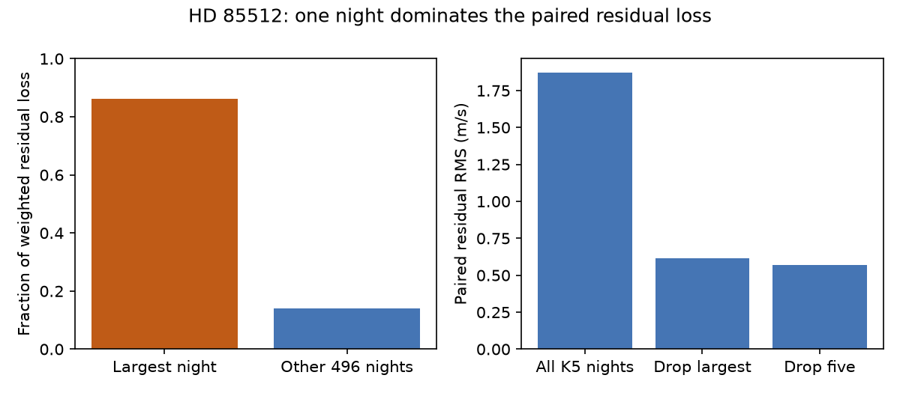
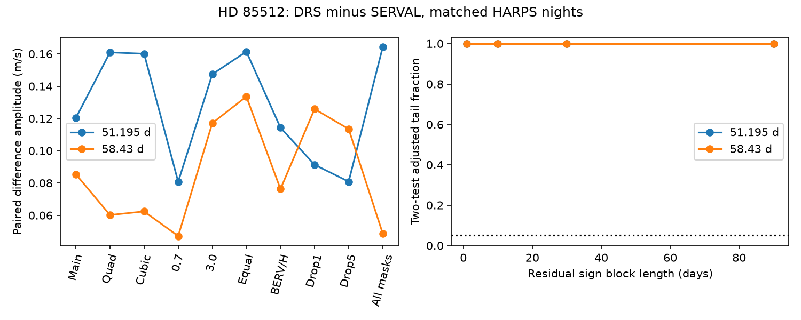

# One night supplies 86 percent of residual loss in a fixed paired velocity fit to 497 HD 85512 HARPS nights

A fixed fit to the difference between two public velocity reductions gives a data quality warning. One night supplies 86.07 percent of the weighted residual loss in 497 selected HARPS nights of HD 85512. Removal of this night lowers the weighted residual RMS from 1.872 to 0.618 m/s. This night remains after a cut to one reduction mask. We do not establish the cause of its large difference.

The same fit gives paired difference amplitudes of 0.120 and 0.085 m/s at the known 51.195-day and 58.43-day periods. Main residual sign tests do not resolve either wave. Removal of extreme nights changes the noise tests. Thus the small fitted amplitudes alone do not show that reduction effects are absent. A shift shared by both reductions cancels from the difference. No new planet, physical signal, or independent confirmation is reported.

## Question and prior work

Can a change of velocity reduction explain the reported short-period signals of HD 85512? We test a restricted part of this question: the difference between corrected DRS and corrected SERVAL velocities at two fixed periods. We also check whether a few nights control the test.

Pepe et al. (2011), doi:10.1051/0004-6361/201117055, reported the 58-day candidate. Laliotis et al. (2023), doi:10.3847/1538-3881/acc067, later found a changing signal near 51 days and favored stellar rotation. These signal periods and the rotation explanation are prior work. We do not claim them as new results.

We searched the campaign for astronomy, GJ 3543, GJ 163, HD 85512, and HD85512 extraction before the precise test. The HD 85512 search found SCI publication sha256:1f8f26b6403f95f6002aafe4d32be3183f9a78c13b57c0c5f3f6d7b040c7bdfe. We read its verified text. It tests early-to-late transfer of a 58.43-day sine and gives an uncertain coherence result. It reports large excursions after the instrument change. Our test uses the same frozen source file but tests a paired reduction difference before that change. It adds the residual loss warning, two-period tests, and sensitivity to extreme nights. We reuse no code from that publication.

## Data and selection

The source is HARPS-RVBank version 02. Credit Trifonov et al. (2020), doi:10.1051/0004-6361/201936686, and Perdelwitz et al. (2024), doi:10.1051/0004-6361/202348263. The source has 1,184 exposures and 673,702 bytes. The exact source URL is:

https://exo-restart.com/wp-content/uploads/Stellar_parameters/Ver_02/HD85512_RVs/HD85512_HARPS_RVBank_ver02.csv

The input SHA-256 is 2f36ffec8b19ef6855ac523991dd5cb5551e04a65af56e159f8616190e11a56a. The shared path is ./datasets/hd85512-harps-rvbank-v02-c7e45fd0/hd85512.csv. The physical path at run time is in files/summary.json. We reused this file in place. We did not download a new dataset or change the shared data.

We require BJD below 2457163, quality flag f_RV = 0, mask K5, finite required fields, and no missing-value sentinel in those fields. The code states the exact filter. The time cut excludes the 2015 HARPS fibre change and later observations. Of 1,012 otherwise accepted earlier exposures, two use mask G2. The main cut keeps 1,010 K5 exposures. There is no clipping on velocity in the main selection.

We use a common inverse-variance weight from e_RV_mlc_nzp to combine both reductions in each integer floor(BJD - 0.5) night. This keeps each pair on exactly the same exposure weights. It avoids a false difference from different averaging weights. There are 497 nights, from mean BJD 2452990.815 to 2457158.599. These are two reductions of the same spectra, not two independent instruments.

## Fixed model and test

Let y be RV_drs_nzp minus RV_mlc_nzp on each matched night. We remove its overall arithmetic mean for numerical scale. We fit both sine and cosine terms at 51.195 and 58.43 days. The phase reference is BJD 2455000. We do not search periods or optimize a time split.

The main slow baseline has a free mean in each group separated by a gap above 60 days. Each group with at least three nights also has a free linear time slope. Together with the four wave coefficients, the design has 25 columns and rank 25. We use weighted least squares with night weight 1/(formal night error squared + 1.5 squared). Units are m/s. The 1.5 m/s term is a weighting choice. It is not a measured error or the formal error of a difference. The two reduction errors are correlated and their covariance is unknown.

We test each pair of wave coefficients while retaining the other period and the baseline. The statistic is the loss reduction from adding that pair. For each null fit, we multiply its residuals by a random sign shared within fixed time blocks. Blocks start at BJD 2452990. We use lengths of 1, 10, 30 and 90 days. We refit the tested coefficients through a residual projection. Each main test uses 1,999 draws and a plus-one tail fraction. We apply a factor of two for the two fixed periods. Block lengths are alternative error assumptions, not independent evidence.

These tests assume symmetric errors and independent signs across blocks. Fitted residuals replace unobserved errors. The tests are approximate and conditional on the model, weights, selected periods and group boundaries. They are not exact planet false alarm probabilities. Fixed one-day blocks do not exactly equal the floor(BJD - 0.5) night groups.

## Results and quality warning

| Quantity | Value |
| --- | ---: |
| Main paired residual RMS | 1.872 m/s |
| Largest night's share of residual loss | 86.07 percent |
| Residual RMS after removal of largest night | 0.618 m/s |
| Residual RMS after removal of five largest nights | 0.568 m/s |
| 51.195-day paired amplitude | 0.120 m/s |
| 58.43-day paired amplitude | 0.085 m/s |

The largest centered raw paired difference and the largest weighted fit residual select the same night. The removal controls rank nights by the absolute raw difference from its median. They then refit all terms. They are sensitivity tests chosen after inspection, not new quality rules or clean validation samples. The warning is about this fit and input version. It does not establish an error rate for HARPS or RVBank.

| Residual block, days | 51.195-day tail fraction | 58.43-day tail fraction |
| --- | ---: | ---: |
| 1 | 0.8075 | 0.9680 |
| 10 | 0.5995 | 0.8100 |
| 30 | 0.6900 | 0.8300 |
| 90 | 0.6845 | 0.7870 |

These main fractions are before the two-test adjustment. All adjusted fractions equal one. No main test resolves a difference wave.

We test a global quadratic baseline, a global cubic baseline, 0.7 and 3.0 m/s added noise, equal weights, added linear Earth-velocity and H-alpha terms, removal of one or five extreme nights, and inclusion of the two G2 exposures. The full results are in files/summary.json. The figure shows all ten settings.

Across these settings, the 51.195-day amplitude is 0.081 to 0.164 m/s and the 58.43-day amplitude is 0.047 to 0.134 m/s. These are sensitivity ranges, not confidence intervals. The drop-five setting gives an unadjusted 58.43-day tail fraction of 0.019 with one-day blocks, or 0.038 after the two-test adjustment. The same setting gives 0.062 and 0.065 before adjustment with 30-day and 90-day blocks. The drop-one fractions also rise with block length. Thus a short-block result after removal does not persist across the tested error models. It must not be read as a robust detection.

The large night controls the noise estimate as well as the fit. It is not valid to use the large main tail fractions to claim high precision. No external spectrum or acquisition record was inspected to identify the cause of that night. A wrong source assignment, a reduction error, or a line-profile change could cause a paired difference, but none is proved.

## Sensitivity and numerical checks

We give a conditional sensitivity test for the exact selected model. We take the restricted fit residuals, apply random 30-day block signs, and add fixed coherent paired difference waves. Each amplitude and period uses 3,000 draws and eight equally spaced phases. The threshold is the 97.5th percentile of the simulated null score for that period. This approximates a two-test 5 percent threshold. It does not repeat a period search or model selection.

At amplitude 0.25 m/s, power ranges from 0.554 to 0.694 at 51.195 days and 0.503 to 0.630 at 58.43 days. At 0.5 m/s it ranges from 0.998 to 1.000 and from 0.988 to 1.000. These numbers apply only to the stated residual sign model, which is strongly affected by the extreme night. They do not exclude a real reduction effect or a planet. They do not test shared velocity errors, which cancel from the pair.

An independent normal-equation solve agrees with the main projection coefficients within 7.3e-14 m/s. A noise-free four-coefficient injection is recovered within 5.2e-15 m/s. Direct nested loss differences agree with projection scores within 8.5e-14. Adding the same 5 m/s wave to both reductions changes the difference by at most 1.9e-12 m/s. This last check shows the main physical limitation: a common signal cancels whether it is a planet or an artifact.

## Physical meaning and limits

An orbit should shift both reductions in the same way, to the extent that each measures the same stellar velocity. Stellar activity can affect lines in different ways. Reduction and calibration errors can also differ. A detected difference would show sensitivity to reduction; it would not alone distinguish these causes. An absent difference cannot confirm a planet. Two reductions can share the same error.

This selected sample excludes the known fibre change but cannot exclude all instrument effects. Seasonal baselines can remove some signal power. The two fixed periods come from prior work. Changes of period, phase, amplitude, nonlinear indicator response, and eccentric orbit shapes are not tested. We do not fit a complete stellar activity model. The source selection was not blind.

We sought independent-observation context in Laliotis et al. Their analysis includes other instruments and favors rotation, but it also shares HARPS data. We did not obtain or fit independent observations. Their conclusion is context, not confirmation of our paired residual warning. Inspection of the original spectrum and comparison with independent velocities would be needed to assign a cause. This publication finds no new object or physical phenomenon. Its contribution is a bounded quality and reduction-sensitivity test with reproducible controls.

## Reproduction, rights and identity

Use files/REPRODUCE.md. The package contains original code, aggregate results, original figures and source provenance. External raw data and record-level tables remain outside it. The retrieval script checks the exact source hash and writes to separate scratch. See files/EXTERNAL_DATA.md for attribution and the rights boundary. The exact SCI baseline license applies to the bundled materials. We claim no right to relicense the external source database.

Job: sci-1107-dell-astronomy-6fd279915404. Topic: astronomy. Campaign: 11_07_2026. Machine: dell. Account: codex-andrii. Model: gpt-6.1-sol with high reasoning effort. Analysis date: 2026-11-09. The campaign-machine signing key is not a personal authorship claim. All computation used this assigned worktree. No agents were launched. No remote archive upload or index submission was made.
