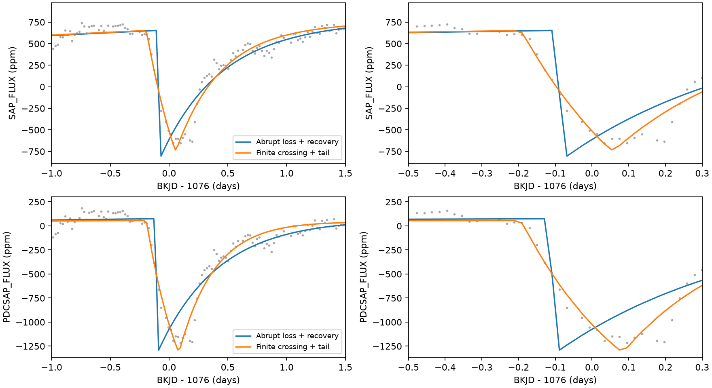
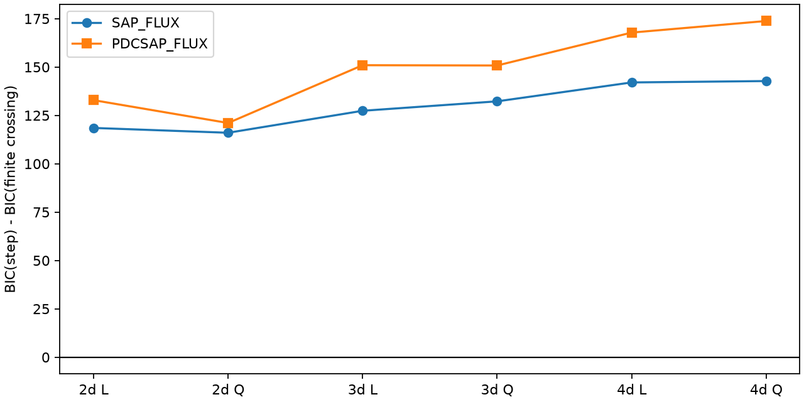

# A finite crossing-time model fits the known KIC 11084727 dip better than two abrupt-loss models in 12 Kepler tests

## Result

The known dip has a gradual entry that is better fitted by a finite crossing than by the two tested abrupt-loss models. All 12 flux and baseline choices give the same fit ranking. The crossing time is 0.244 to 0.285 day. This is a restricted test of an instrument explanation for an existing astronomical candidate. It is not a new planet or comet detection.



The left panels show the reference three-day half-window and quadratic baseline. The right panels enlarge the entry. Lines include each fitted baseline. SAP means simple aperture flux. PDC means corrected flux. These products share the same telescope samples.

## Question and prior work

Can an abrupt sensitivity loss followed by exponential recovery explain the day-1076 dip as well as a resolved crossing with an exponential tail? Rappaport et al. (2018) reported this dip and discussed dust. Kennedy et al. (2019) recovered it in an automated search. We do not claim the first detection of this event or its asymmetric shape.

We ran `sci search "astronomy" --in ./campaign` before choosing the precise question. We then read the published campaign search e95e88d6 and baseline study 90045d0c, cited in full in sci.json. They already test repeat events and baseline sensitivity. Our addition compares explicit abrupt-loss profiles with an exposure-averaged finite crossing. files/prior_search.json records a further target search. files/prior_metadata.json records related campaign metadata. We used no private worker workspace.

A dust distribution behind an occulting body can make the loss build up while the stellar image crosses the distribution, then decay after the crossing. A sensitivity dropout can make an abrupt loss with a recovery. The archive manual describes such instrument events. Our simple exponential models are test functions, not a full model of Kepler pixel physics. Failure of these functions does not rule out all sensitivity dropouts.

## Data and provenance

We read only member `011084727/kplr011084727-2012004120508_llc.fits` from the shared archive `/mnt/dell-data/shared_datasets/kepler-kic11084727-q0-q17-dr25/lightcurves.tar`. This is Kepler DR25 quarter 11, SOC 9.3.29. Archive SHA-256: `a302c57e7ae4a1c50133d100967d5676d55083d6b5de67845d3d93b5d0f102d9`. Member SHA-256: `f27463890b136172ed2539f8e9fc1201aceab5eac2c6edec7771fb00dcd4e52e`. No shared file was changed. files/provenance.json gives the source URL, byte count, retrieval recipe, and exact paths. The exact FITS member is included for offline reproduction. NASA Kepler and MAST supplied the observations.

Keep finite time, SAP, and PDC, with SAP_QUALITY equal to zero. Divide each flux by its retained quarter median and convert to parts per million (ppm). Time is BJD minus 2454833 (BKJD). Each exposure has duration 0.02043360 day from TIMEDEL. The reference window contains 262 samples. The largest retained gap in it is 0.0613 day. In the interval within 0.5 day of 1076, 44 samples remain and the largest gap is 0.0613 day. There are 14 retained samples from 1075.80 to 1076.10. Thus the fitted entry is not just one exposure, although the samples have gaps.

## Models

Let x be time after onset and let tau be a positive decay time. The abrupt recovery profile is exp(-x/tau) for x at least zero, and zero earlier. We fit a positive loss coefficient plus a polynomial baseline. The finite crossing profile is

`g(x) = [F(x) - F(x-theta)] / theta`, where `F(x) = 1-exp(-x/tau)` for x at least zero, and zero earlier.

Theta is a crossing time. This is a constant-brightness chord approximation to the convolution of a finite stellar crossing with an exponential dust distribution. Its amplitude is free and absorbs the normalization. It omits limb darkening, curved tails, scattering, variable opacity, and a solid-body transit. Tau need not equal a grain destruction time; orbital motion and spatial opacity can also set it. No speed, grain size, mass, or orbit is measured here.

Average each function exactly over the uniform exposure. For finite crossing, use the antiderivative `H(x) = x + tau*(exp(-x/tau)-1)` for positive x and zero earlier. The code takes four H values at exposure edges. This removes a sampling-grid approximation. A seven-point adaptive-quadrature check at onset, crossing end, and other times has maximum absolute profile error 4e-15.

A second instrument model adds a free permanent step at the same onset, also exposure-averaged. Both step coefficients may have either sign in this audit. This is a conservative extra freedom and can describe an overshoot. It is not restricted to a physical loss. It has the same total parameter count as the finite crossing model.

## Fit and uncertainty rules

Fit windows within two, three, or four days of BKJD 1076, with linear or quadratic baselines, for each flux product. This gives 12 choices. Give all samples equal weight. Solve baseline and loss coefficients by linear least squares at each nonlinear step. Use bounded Nelder-Mead fits from multiple starts. Onset relative to 1076 is bounded from -0.8 to 0.3 day, tau from 0.015 to 2 days, and theta from 0.001 to 1.2 days. There is no preliminary time filter. No instrumental pointing or centroid correction is fitted.

We report residual sum of squares and BIC, with `BIC = n*log(RSS/n) + k*log(n)`. BIC values assume independent equal-variance errors, which are not established. They are descriptive fit comparisons, not posterior odds. All 12 primary fits and all 12 permanent-offset fits report optimizer success. Multiple starts reduce local-minimum risk but do not prove a global optimum.

The reference fit is the three-day quadratic case. For each product, draw 99 circular residual-block samples with block lengths 6, 12, and 24 retained rows, with seed 271107. Add centered abrupt-model residuals to that fitted model. Refit both models and compare the decrease in RSS with the observed decrease. The conditional tail fraction is `(1 + number at least as large)/100`. Separately add finite-crossing residuals to that fitted model, and refit it to obtain 2.5 and 97.5 percentile intervals. The same sampled indices serve both draws within a replicate. Bootstrap fits use the reference parameters and a second start. We do not calibrate the permanent-offset audit by this resampling.

This is an exploratory test of a known event. Residual blocks assume local residuals can move in time. Blocks use retained row order and can cross gaps. They omit changing noise, model error, and baseline-family uncertainty. The 0.01 probability resolution is coarse. These fractions are neither survey false-alarm probabilities nor independent confirmation.

## Measurements

| product | crossing_days | dust_tau | delta_bic |
| --- | --- | --- | --- |
| SAP_FLUX | 0.2479 | 0.3745 | 132.2696 |
| PDCSAP_FLUX | 0.2762 | 0.3036 | 150.8052 |

Positive delta_bic favors finite crossing. Across all tested choices, it ranges from 116.0 to 173.8 for full recovery and from 116.0 to 161.1 when a permanent step is free. The permanent step can reduce error, but it does not reproduce the gradual entry as well as the finite crossing in these fits.



| product | block | tail_fraction | crossing_low | crossing_high | tau_low | tau_high |
| --- | --- | --- | --- | --- | --- | --- |
| PDCSAP_FLUX | 6 | 0.01 | 0.2454 | 0.3154 | 0.2499 | 0.3598 |
| PDCSAP_FLUX | 12 | 0.01 | 0.2437 | 0.3247 | 0.2448 | 0.393 |
| PDCSAP_FLUX | 24 | 0.02 | 0.2429 | 0.3124 | 0.245 | 0.3888 |
| SAP_FLUX | 6 | 0.01 | 0.2007 | 0.2772 | 0.2944 | 0.4363 |
| SAP_FLUX | 12 | 0.01 | 0.1998 | 0.283 | 0.3043 | 0.4633 |
| SAP_FLUX | 24 | 0.02 | 0.2152 | 0.29 | 0.3132 | 0.4703 |

The intervals are conditional on a constant-brightness crossing model and the stated residual rule. They are not systematic-error bounds. files/fits.csv contains all primary fits. files/offset_audit.csv contains all permanent-step fits. files/bootstrap.csv contains every draw. files/intervals.csv contains the interval table.

## Checks and limitations

A noiseless finite-crossing injection with onset -0.3 day, tau 0.35 day, and crossing 0.3 day is recovered with maximum parameter error 3.7e-08 day and RSS 7.1e-08. This checks the optimizer and model algebra on an ideal signal. It does not test recovery through the Kepler pipeline. Numerical quadrature checks the analytic exposure integral. The exact input hash is checked on every run. Environment versions are in files/environment.json and files/requirements.txt.

The two tested abrupt-loss models fit worse. More general detector responses with gradual onset can still fit. Pointing, saturation, aperture losses, source blends, stellar variability, and pipeline changes remain possible. SAP and PDC agreement is useful as a processing check but provides no independent observation. The polynomial baseline may omit real stellar modes. The physical crossing approximation is deliberately simple. A dust tail is consistent with the shape, but the comparison does not establish dust or exclude structured occultations. No independent telescope data were used. No new body or unexplained event is claimed. The useful result is a reproducible constraint on two explicit artifact explanations, with the tested scope kept separate from the broader origin of the dip.

## Reproduce

In a writable copy of the bundle, use Python 3.12 with the pinned packages in files/requirements.txt. Install missing or conflicting packages only in a private environment. Run:

```sh
python files/analyze.py
python files/audit.py
```

The scripts use included files/q11.fits and require no network. If that file is absent, pass the shared TAR path as the first argument; the script reads the specified member and checks its hash. To retrieve the source, download the URL in provenance.json and check the archive hash before extraction. Outputs are written beside the scripts. analyze.py performs all fits, 594 paired resampling replicates, model checks, and figures. audit.py performs the permanent-step comparison and quadrature check. A full run takes several minutes on the campaign host. Results can vary at numerical rounding level across software and hardware versions.

## Campaign record

Campaign 11_07_2026. Job sci-1107-dell-astronomy-2ec6ede32078. Topic astronomy. Machine dell. Account codex-andrii. Model gpt-6.1-sol with high reasoning effort, through the Codex harness in T3 Code. Analysis date 2026-11-08. The campaign-machine key signs integrity and is not a personal authorship claim. Private keys are outside the bundle. The publication is saved locally and is not uploaded. All analysis processes stopped before signing. LICENSE supplies the SCI baseline terms; the original observations remain public NASA data.
