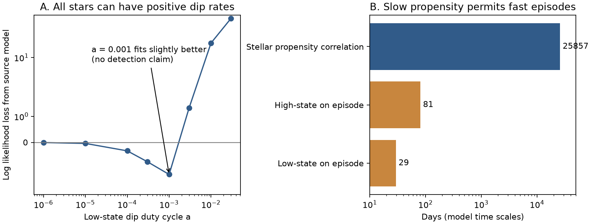
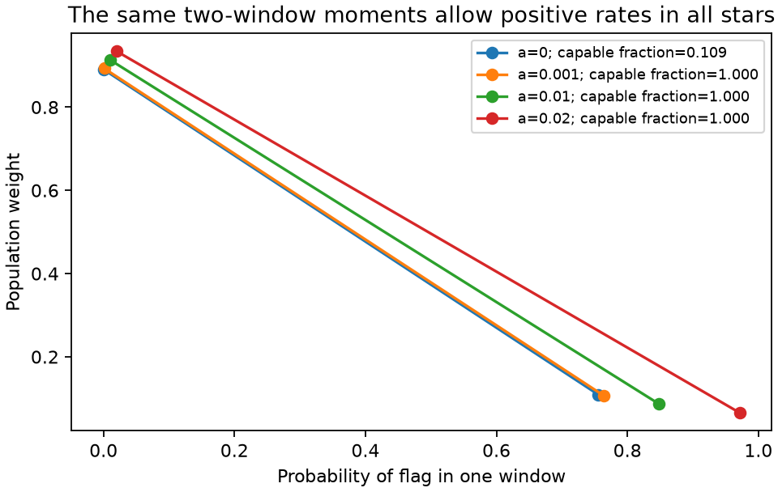

# TESS CPV flags permit month-long dip episodes in a persistent low-rate stellar state

Job: **sci-1107-dell-astronomy-3c3422d99ac1**. Topic: astronomy. Campaign: 11_07_2026. Machine: dell. Account: codex-olen. Model: gpt-6.1-sol, high reasoning effort. Date: 2026-11-11. The signer is a campaign-machine key. It does not identify a personal author.

## Result

The long memory of complex periodic variable (CPV) flags is strong evidence for persistent differences between stars. It does not give the same lower limit on the lifetime of a dip episode or its material. We test this distinction with the released flags from 1,746 stars and 8,772 TESS sectors. There are 245 flags.

We extend the published three-state likelihood to four states. A star can have either a high or a low rate of dip episodes. Both rates can be positive. The source model is recovered exactly when the low rate is zero. With a low-state duty cycle of 0.001, the log likelihood is -630.815. The source model gives -632.042. Thus a model in which every star can make dip episodes in either state fits at least as well as the source model. This is a counterexample to an interpretation that needs a state with no capacity to make dips. It is not a detection of rare episodes.

In this example, the low-state on episodes have a mean duration of 29.4 days, conditional on the star remaining in that rate state. Their mean off interval is 80.5 years. The high-state duty cycle is 0.636 and the rate-state correlation time is 70.8 years. The example retains persistent stellar differences. It does not make all stars frequent CPVs. It does not remove the age decline in the fraction of stars with a high dip rate.

A finite-sample bound explains why this distinction is difficult. For the same rate-state process and the same other parameters, replacement of the zero-duty state by duty a changes the distribution of the complete observed experiment by at most 8,772a in total variation distance. At a = 10^-6 this is at most 0.008772. A state with strictly zero capacity to make dips cannot be distinguished uniformly from a sufficiently rare positive rate with these flags alone.

## Question and prior work

The selected campaign work reports that the CPV rate falls with age, that contraction explains much of this fall, and that contamination can explain the apparent shortfall in old rapid rotators. Its latest time-domain study, SCI 92bc3f8b, finds a host correlation time T of at least about 18 years. It also finds much faster flag changes inside hosts. The study explicitly warns that a flag is a threshold result and does not measure the presence of material. However, it also states that supply episodes shorter than about 10-20 years are excluded. We test the scope of that physical conclusion.

The distinction between random zeros and structural zeros is established in statistics. Hall (2000), DOI 10.1111/j.0006-341X.2000.01030.x, develops zero-inflated binomial models with random effects. The clustered binary model of DOI 10.1177/0962280216683740 also separates a zero component from correlated positive responses. We do not claim a new general theory of mixtures. The contribution here is a nested CPV likelihood, a data-based counterexample, and a finite-experiment bound for the actual released sector count.

Short material turnover is physically relevant. Daley-Yates, Jardine and Bouma (2026), DOI 10.48550/arXiv.2604.27116, model dust loss through repeated prominence breakouts. Their one simulated star has a dust half-life of about six rotations. That model and our statistical example are different calculations. Our flags neither validate that simulation nor exclude its short turnover time. No values from that simulation enter our fit.

## Data and rights

All numerical observations come from the signed baseline SCI publication `sci:sha256:92bc3f8b6169f1f904c2c292ac9bca6f42965a38263a018ae7d1065d4969e8af`. Its data files contain sector flags, observation times, noise, cleaning flags and age classes. We use its primary clean sample and its published detection-efficiency curve. We do not fetch new FITS files or use a shared raw dataset. The exact shared input is `./campaign/92bc3f8b6169f1f904c2c292ac9bca6f42965a38263a018ae7d1065d4969e8af.zip`; on this host the campaign link resolves to `/mnt/dell-data/campaigns/11_07_2026` on HP SSD. File hashes and the ZIP hash are in `files/provenance.json`.

The source study uses a matched rotation and colour window and neighbour cleaning. We accept these choices. We retain its six classes, its noise-dependent efficiency eta, and its false-flag probability eps. We exclude sectors with missing noise as it does. This recovers its 1,746 stars, 8,772 sectors and 245 flags. The likelihood recovers the source log likelihood to 1.1e-8 before the extra low-state rate is added.

We bundle our code, narrative, figures, aggregate fit results and hashes only. No source record table, raw astronomical data, or external article is bundled. The reproduction script verifies the source ZIP before it extracts the five needed files into external scratch. See `files/EXTERNAL_DATA.md` for attribution and source terms.

## Model

Let Z be the stellar rate state, L or H. Its stationary high-state fraction is h, with one h for each source age class. At a gap D,

    P(Z_next=H | Z=H) = h + (1-h) exp(-D/T)
    P(Z_next=H | Z=L) = h [1-exp(-D/T)].

Each rate state has an on and an off substate. The on duty is a in L and d in H. Within the same rate state, the source flicker rule is

    P(on_next | on)  = u + (1-u) exp(-D/tau)
    P(on_next | off) = u [1-exp(-D/tau)],

where u is a or d. A change in rate state draws a new on/off state from its stationary duty. The emission probability of a flag is eta in either on substate and eps in either off substate. The initial state is stationary. We use the same tau for both rate states. This equality is a restriction for this example, not an empirical finding.

The four states are L_on, L_off, H_on and H_off. The forward algorithm sums over all hidden paths. At a = 0, L_on has zero probability. Aggregation of the two L states then gives exactly the published three-state likelihood. Thus the comparison does not change the sampling, label selection or detection efficiency.

For a fixed rate state, the flicker rule is a two-state continuous-time Markov process. Its off-to-on rate is u/tau and its on-to-off rate is (1-u)/tau. The mean off interval is tau/u; the mean on duration is tau/(1-u). These durations are conditional on no change of the slow rate state. Slow state changes can truncate them. We report them as model examples, not measured cloud lifetimes.

We use L-BFGS-B to maximize the likelihood for each fixed a on a nine-point grid. All other parameters are free, with the source parameter ranges except that logit(eps) can reach -16. All nine fits report convergence. These are feasible fitted examples, not a proof of global optimization. The existence of an example is sufficient for the counterexample. We do not use a likelihood-ratio cutoff to claim a confidence interval, since the null is a boundary, the nuisance parameters can be weakly measured, and no null calibration was run.

## Fits

| Low-state duty a | Log likelihood | Change from source | Mean low-state on time, days | Mean low-state off time, years |
|---|---:|---:|---:|---:|
| 0 | -632.042 | 0 | Not occupied | Infinite |
| 0.00001 | -632.005 | +0.037 | 28.9 | 7,924 |
| 0.0001 | -631.719 | +0.322 | 29.1 | 797 |
| 0.0003 | -631.305 | +0.736 | 29.3 | 267 |
| 0.001 | -630.815 | +1.227 | 29.4 | 80.5 |
| 0.003 | -633.367 | -1.325 | 37.3 | 33.9 |
| 0.01 | -652.349 | -20.307 | 65.9 | 17.9 |

The likelihood improvement at a = 0.001 is small. In that fit eps reaches its lower bound, 1.13e-7. Some events that the source model assigns to false flags can instead be assigned to rare on episodes. Imperfect label calibration, blends or different flicker times could cause this change. We do not infer a population of rare physical dips. We show that the data allow it under the same observation model.

The high-duty fraction h still falls with age in this model. The extension reinterprets h as the fraction in a state with frequent visible episodes, rather than the fraction with any capacity to make an episode. The data still oppose equal frequent activity in all young stars. The original finite-T model already allows stars to enter its host state in the future; our claim concerns the capacity of its current low state, not whether every star eventually visits a host state.

## Finite-experiment bound

Couple the source model and its extension so that they share their entire rate-state path, their high-state flicker, and their emission random numbers. Add a low-state flicker process of stationary duty a only in the extension. At any observed epoch assigned to L, the chance that this process is on is a. If it is off at every observed low-state epoch, the two flag sequences are identical. The union bound therefore gives

    TV(P_a, P_0) <= P(at least one observed L_on) <= a N_obs.

This proof allows arbitrary gaps, arbitrary efficiencies, and correlation of the low-state flicker. It uses the reset rule above to preserve marginal duty a, conditional on the rate-state path. For the full released clean experiment, N_obs = 8,772. The bound is conservative because many epochs are in H and some low-state on events would not be detected.

At a = 10^-6, no test of these flags can have an absolute difference in event probability greater than 0.008772 between this extension and the source model with unchanged other parameters. This does not say the best-fit positive rate is 10^-6. It proves that rejecting an exactly zero-capacity state needs an assumed minimum positive rate or other physical information.

## An aggregate check of rate variation

The source reports 273 young stars observed in both the early and late TESS windows: 245 have no flag in either window, 17 have flags in both, six only early, and five only late. For an idealized exchangeable two-window model with independent Bernoulli flags conditional on a stellar probability q,

    E(q) = 45/546 = 0.08242
    E(q^2) = 17/273 = 0.06227.

These are illustrative observed moments. They do not correct for different window coverage, efficiency or within-window flicker. A two-point distribution on q=a,b matches both moments when

    b = [E(q^2) - a E(q)] / [E(q) - a]
    w = [E(q) - a] / (b-a).

Here w is the weight at b. At a=0, only about 0.109 of stars need have q>0. At a=0.001, 0.01 or 0.02, all stars have q>0 and the same moments hold exactly. This simple example shows why repeated detections establish rate variation but do not by themselves establish a zero-capacity group. It is not a substitute for the sector likelihood.

## Implications and limits

There are at least three distinct clocks: the persistence of a stellar rate state, the duration of a visible on episode, and the residence time of individual material. T constrains the first within the chosen state model. The same model permits on episodes of months. Whether an on episode represents the actual supply of material requires a physical mapping from material to the flag. The observations do not provide that mapping.

Material replacement inside an on episode is even less constrained. If the amount, spatial opacity and flag process are held fixed, replacement of particle identities leaves the full flag likelihood unchanged. A fast turnover model then needs a correspondingly large supply rate. We have not shown that any such mass budget is physically possible. An independent mass, opacity, spectral or supply constraint is needed to test it. This is a limit of the observable, not evidence for arbitrarily rapid physical replacement.

Thus the 18-year host-correlation lower limit should not be applied as a lower limit on a general material supply episode. It does reject short, homogeneous turnover of the *high-propensity stellar state* in the source model. It does not reject short events repeated in the same favourable stars. Geometry, a stable field, and a stable supply propensity can all keep the same stars active. Our result separates these inferences; it does not choose the physical source of the material.

The source flags come from an emulator and retain its classification and selection limits. We add no spectra, no independent labels and no new light curves. The common low duty and common flicker time are assumptions. We retain the source endpoint transition rule; it does not track repeated unobserved rate-state changes within a gap. The positive-rate fits retain a slow latent state and hence do not explain away the long time memory. This work is an inference audit and a usable model extension, not a measurement of dust composition or lifetime.

For new data, the useful target is the rare-event rate among stars with many earlier non-detections. In a fixed low state with perfect instantaneous observations spaced by D, the chance of no on detection in n visits is

    (1-a) [1-a(1-exp(-D/tau))]^(n-1).

Closely spaced visits are redundant when D is much less than tau. Many stars with visits separated by at least the flicker time can test a specified rare rate. A sufficiently low positive rate remains indistinguishable from zero. Particle residence time instead needs information that tracks material, or a physical supply and mass budget.

## Reproduction and checks

Use Python 3.12 with numpy, scipy, pandas and matplotlib. No extra package was installed and no shared dataset was changed. The scripts set numerical library threads to one. From an extracted publication:

    python -B files/validate.py
    python -B files/reproduce.py /path/to/92bc3f8b6169f1f904c2c292ac9bca6f42965a38263a018ae7d1065d4969e8af.zip /outside/draft/scratch
    python -B files/figures.py /outside/draft/scratch/results

The source can be obtained from the campaign path above, or with `sci pull sha256:92bc3f8b6169f1f904c2c292ac9bca6f42965a38263a018ae7d1065d4969e8af` if an archive is configured. No network source is required on the campaign host. The input hashes fix the exact source version. The reproduction script writes only into external scratch and verifies the SCI bundle first. It extracts the source `markov.py` under its baseline MIT terms for packing and the source-limit check. Our `model.py` supplies the four-state forward algorithm.

The independent validation sums all 256 hidden paths for 60 random four-epoch experiments. Its maximum error in log likelihood is 1.78e-15. It also checks the four two-window moment identities. The full-data source limit agrees to numerical precision, and an independent rerun of the packaged script repeats the fitted grid. The complete parameters of the a=0.001 counterexample are in `files/counterexample.json`. To repeat only that row, set `CPV_DUTIES='[0.001]'` before the reproduction command. The likelihood grid and aggregate results are in `files/likelihood.csv` and `files/results.json`. The code and evidence do not depend on private scratch surviving.
