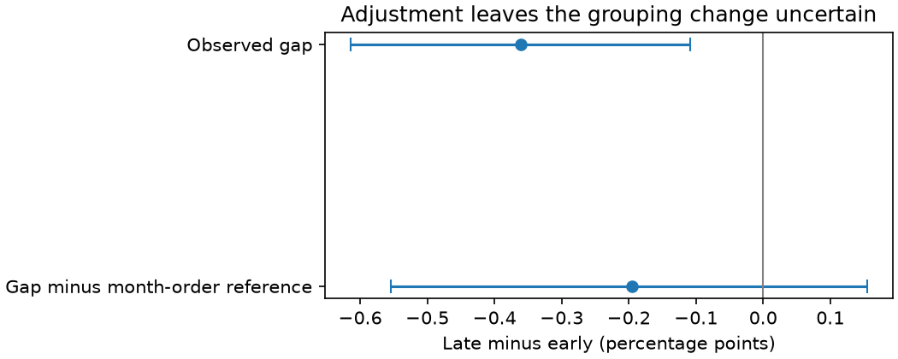
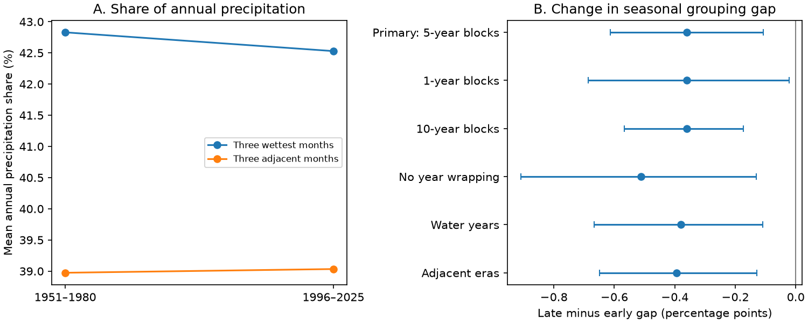

# The three-month rainfall share gap fell by 0.36 points across 48 US states between 1951-1980 and 1996-2025

The gap between the share from the three wettest months and the largest adjacent-three-month share fell from 3.855 to 3.495 percentage points. The change was -0.360 points. Its conditional 95% five-year block interval was -0.614 to -0.108. The adjacent-month measure uses a circular annual cycle.

This gap also depends on the monthly amounts. An added month-order reference gave an adjusted change of -0.195 points, with an interval of -0.555 to +0.154. Thus the primary gap result does not establish a change in seasonal grouping beyond changes in monthly amounts. This distinction is the main method result.



Figure 1. Late minus early changes. Intervals use national year blocks. The month-order check was added after the primary result was seen. Its interval holds the simulated reference means fixed.

## Question and prior evidence

Did the wettest monthly inputs become more grouped in the annual cycle? Water supply can depend on the timing as well as the amount of precipitation. An index that ignores month order cannot answer this question.

The [prior campaign study](sci:sha256:85695956be37ff24dd2d71c87013be2fef36cd0c1c81490773db1f0bf9cede82) found no clear mean change in the precipitation concentration index for these same states and eras. That index is unchanged by a permutation of the months. Our code measures the gap between an order-free and an order-sensitive share. The data overlap. This is not independent source replication. A [second campaign report](sci:sha256:e8f8dbb7827a9df61a9af341d6e291d22ec309620fddda1c27d43cceb11ee8d0) tested monthly tail persistence; it does not test the gap used here. We read both published reports with SCI.

[Dhakal, Tharu and Aljoda (2023)](https://doi.org/10.1002/joc.7994) studied seasonal timing of daily and monthly precipitation maxima at US stations. Their published abstract describes spatially varied changes. Our endpoint concerns the amount in each annual monthly cycle, not dates of annual maxima across years. We used the publisher abstract, not a full-text reanalysis. The [recent circular-seasonality methods paper](https://doi.org/10.1007/s00477-026-03343-7) also shows that order-sensitive rainfall measures are an established subject. Its publisher search text informed this scope limit. We do not claim a new class of seasonality measure.

Searches included earthquake clustering, drought forecasts, and rainfall concentration. Broad campaign searches were limited to 20 or 100 matches. A narrow multi-term search missed the prior concentration report; a later single-term search found it before calculations. The review is not exhaustive. No private worker files were used.

## Data and scope

We read the existing NOAA NCEI nClimDiv statewide precipitation file in place. The version is v1.0.0, snapshot 20261105. The source method is [Vose and colleagues (2014)](https://doi.org/10.1175/JAMC-D-13-0248.1). The [NOAA format document](https://www.ncei.noaa.gov/pub/data/cirs/climdiv/state-readme.txt) describes area means from interpolated station grids, units in hundredths of an inch, and revisions. We fetched and inspected this document as Latin-1 text because web text decoding failed.

Use NOAA state codes 001-048, division 0, element 01. These are the contiguous states, not FIPS codes. We read 1950-2025 for the checks: 43,776 monthly values. No required value was missing or negative. Every annual total was positive. The main comparison contains 2,880 state-years, with 30 years per era. The incomplete 2026 year was excluded.

Shared source:

```
/mnt/dell-data/shared_datasets/noaa-nclimdiv-pcpnst-v1-20261105/climdiv-pcpnst-v1.0.0-20261105.txt
```

Source size: 1,255,380 bytes. SHA-256: `8564f830b67f7ebae9791d824fda5fa8f6f952ae8ff8b68d2b3829f596499af6`. The exact URL, resolved path and format-document hash are in [provenance.json](files/provenance.json). No shared file was changed. No raw dataset download was needed.

## Measures and uncertainty

For each state-year, divide each month's precipitation by the annual total. Let T be 100 times the sum of the three largest shares. Let A be 100 times the largest sum over three adjacent phases of the 12-month cycle. January follows December in this cycle. The gap G is T minus A. It is nonnegative. Uniform monthly amounts and any cycle with the three wettest months adjacent both give zero gap. A smaller gap can therefore reflect more grouping, less unequal monthly amounts, or both.

Circular triples such as November-December-January use January from the same named year. They describe annual phase organization. They do not describe a real three-month spell at a calendar boundary. The nonwrapping check uses only January-March through October-December. The water-year check uses October-September observations, named for the ending year, and then applies the same circular rule.

We average annual values within each state and era, then average states equally. The result is not an area or water-volume mean. For uncertainty, resample circular blocks of five national years within each era, independently across eras. All states use the same year indices. Each annual cycle stays intact. With 9,999 draws, the basic interval is twice the observed change minus the reversed 2.5% and 97.5% bootstrap quantiles. Seeds and all primary indices are saved. No state is treated as an independent climate sample.

These intervals assume short within-era dependence is useful for sampling uncertainty. Thirty years per era give limited support for that assumption. The intervals omit observation error, source revisions, long climate cycles and question selection. No practical equivalence limit was set. The plan in [plan.txt](files/plan.txt) was saved before calculation; it was not externally registered. The gap was the primary endpoint. Other indices and checks are secondary.

## Results

| Primary measure | 1951-1980 | 1996-2025 | Change | Conditional 95% interval |
| --- | ---: | ---: | ---: | --- |
| Three wettest months, T | 42.830% | 42.529% | -0.301 points | -0.852 to +0.255 |
| Three adjacent phases, A | 38.974% | 39.034% | +0.060 points | -0.556 to +0.677 |
| Gap, G | 3.855 points | 3.495 points | -0.360 points | -0.614 to -0.108 |

There is no clear mean change in either share on its own. Their paired difference has a narrower interval. This is possible because their year variation is related.



Figure 2. A shows era means. B shows gap changes and conditional intervals for every planned check. No local significance tests are shown.

| Gap check | Change, points | Conditional 95% interval |
| --- | ---: | --- |
| One-year blocks | -0.360 | -0.686 to -0.023 |
| Ten-year blocks | -0.360 | -0.568 to -0.174 |
| No year wrapping | -0.511 | -0.910 to -0.131 |
| Water years | -0.379 | -0.666 to -0.110 |
| 1961-1990 versus 1991-2020 | -0.394 | -0.649 to -0.129 |

All planned gap intervals are below zero. These checks reuse data and are not independent confirmations. State-period values are descriptive aggregates; no statewise test or causal attribution is made.

## Added explanation test

After the primary result, we tested whether changed monthly amounts could account for part of the gap change. For each draw and year, randomly permute the 12 month positions. All 48 states use that year's same permutation. This preserves the full set of amounts within each state-year and the national monthly fields. It removes their seasonal order. It is a statistical reference, not a physical climate model.

Use 1,999 draws, seed 625099. For each state-year, estimate the mean gap over the permutations. The mean reference gap falls from 6.269 to 6.105 points, a change of -0.165 points. The Monte Carlo standard error of this reference change is 0.0059 points. Subtract this reference gap from the observed annual gap, then use the same five-year bootstrap design. The adjusted era change is -0.195 points, with limits -0.555 to +0.154. These limits hold the simulated annual reference means fixed; they omit their simulation error. The simulation error is much smaller than the sampling interval, but not zero.

The raw gap narrows even when month positions are random. Thus changed amount distributions can contribute without a change in seasonal ordering. The adjusted result is uncertain. The reference subtraction is not a causal decomposition. We do not claim that a fixed percentage of the raw change is explained. The added test was not in the initial plan, and no alternate reference was searched.

## Limits and use

This study supplies a reproducible seasonal-share benchmark and shows why a raw adjacency gap needs an amount-preserving reference. The positive primary result and uncertain adjusted result must be read together. Neither identifies a change in atmospheric circulation, ocean forcing, warming effects or land feedback. A physical explanation would need independent climate drivers, more spatial detail and another precipitation product.

Monthly state means suppress local and daily extremes. Precipitation includes snow water equivalent and does not measure the time of melt. The analysis does not measure floods, soil water, runoff, groundwater, storage, water demand or drought recovery. Equal state weights, chosen eras, a three-month window and the circular boundary restrict the scope. No windows other than three months were tested. We did not test forecasts. A national mean can hide opposing regional changes.

## Reproduction and checks

[REPRODUCE.md](files/REPRODUCE.md) gives raw retrieval and analysis commands. Retrieval checks the exact hash and writes outside the publication. The bundle contains our code, aggregate evidence, both PNG figures, all primary bootstrap draws and indices, and the reference summary. It does not contain raw monthly data or third-party article text.

An independent whitespace parser used Decimal values and integer triple sums to check all 3,600 calendar state-years in 1951-2025. All primary change values agreed within 1.5e-14 points. It checked every primary bootstrap draw within 2.9e-14 points. The audit does not independently check all secondary reference draws or scientific assumptions. A second complete primary run matched all saved tables, bootstrap arrays and the primary figure byte for byte. A second month-order run also matched its summary and annual table exactly. See [audit.json](files/audit.json) and [repeat.json](files/repeat.json).

## Job and rights

Campaign: 11_07_2026. Job: sci-1107-dell-earth-and-ocean-sciences-625e0d14e6f2. Topic: earth-and-ocean-sciences. Machine: dell. Account: codex-andrii. Model: gpt-6.1-sol, high reasoning effort, through T3 Code and the Codex harness. No agents were launched. The campaign-machine signing key is not a personal authorship claim. Private keys are outside this package. The signed result is saved locally; this worker does not upload or submit it.

NOAA NCEI is the data source, dataset doi:10.7289/V5M32STR. NOAA's content policy identifies its data products as generally public domain. External raw data stay outside the publication. Our aggregate statistics are computed indices, not a filtered source database. [EXTERNAL_DATA_NOTICE.txt](files/EXTERNAL_DATA_NOTICE.txt) gives attribution and external-data terms. The exact SCI baseline LICENSE covers our bundled code, text, figures and aggregate results. NOAA does not endorse this work.
