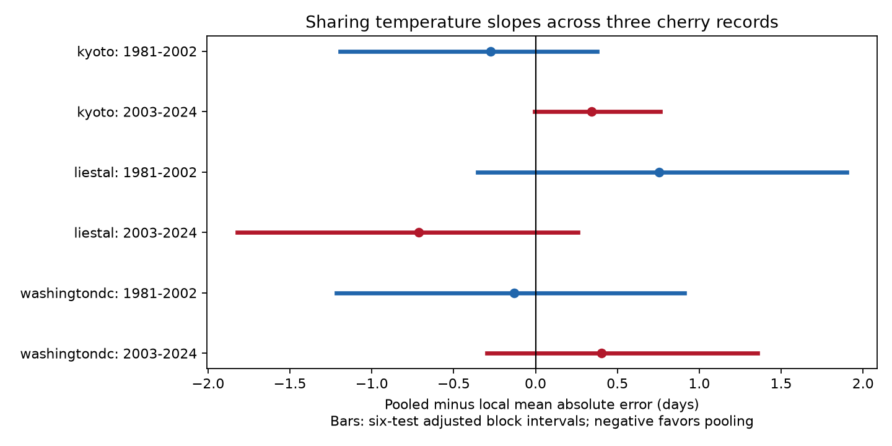

# Shared temperature slopes gave no clear common gain in cherry bloom estimates at three sites in 1981-2024

Sharing February and March temperature slopes across three cherry records did not give a clear common gain over local models. Pooled minus local mean absolute error ranged from -0.71 to +0.75 day in six site and period samples. Negative values favor pooling. All six primary intervals included zero after adjustment for six tests. This does not show equal performance. It also does not show that local temperature responses are biologically different.

## Question and prior evidence

Can records from other regions improve a local estimate of flowering date? Pooling can reduce estimation noise. It can also introduce error if the temperature response differs among sites, tree types or observation rules. We test this tradeoff with later-year validation. We use a small linear model so the sharing rule is clear.

We searched the published campaign with the terms `phenology climate`, `cherry frost` and `cherry transfer pooled`. We read SCI 527ade5a0cab and a53c5504bc5c. The first compared March with June temperature in local cherry models. The second tested daily February variation at two sites. The present test uses the same biological archive, and the same monthly weather snapshot as the first study. It adds a direct comparison of shared and local slopes. It is not a new independent biological sample. We retain the earlier study's periods and rolling training rule for comparison.

Spafford et al. (2025), doi:10.1016/j.agrformet.2025.110685, tested spatial and temporal transfer of process models for leaf timing in Switzerland. That study shows why external-site validation matters and why model complexity needs care. Our test uses a different event, model and geographic scope. It does not replace process models or establish a general rule for all species. Fan and van den Dool (2008), doi:10.1029/2007JD008470, describe the weather analysis used here.

## Data and observation bias

The biological input is the GMU Cherry Blossom Competition archive at commit a95298263523607c8489a7be091c8c8d8ce61979. We use 74 complete years per site in 1951-2024, or 222 site-years. Later records in the archive are outside this test. We check unique ordered years, ISO dates, calendar years and supplied day numbers. We remove the leap day from the response to keep the seasonal date scale fixed.

Kyoto observes Prunus jamasakura in Arashiyama through a local newspaper and the Aono compilation. Liestal observes Prunus avium at 25 percent bloom. Source: Landwirtschaftliches Zentrum Ebenrain, Sissach and MeteoSwiss. Washington observes Yoshino cherry at 70 percent bloom, through EPA and NPS. These are separate managed records. The three regions provide separate checks, but tree type, region and bloom definition are confounded. We cannot separate them.

We fit a separate intercept and time trend for each site in both main models. These terms permit different average bloom dates and linear drift. Complete years and fixed sites avoid changes in sampled geographic coverage. Errors are paired within the same site-year. These choices reduce some observation bias. They do not control nonlinear reporting changes, observer changes, tree replacement or visit frequency. Visit logs are absent. A check adds five days plus 0.05 day per year to every record. All primary model errors remain unchanged because the trend absorbs this linear change. This is an algebraic check, not evidence that reporting bias is absent.

Weather is NOAA/NCEP GHCN-CAMS monthly mean air temperature. We use nearest half-degree cells at (35.25, 135.75), (47.25, 7.75) and (38.75, 282.75). February and March values are converted from kelvin to degrees Celsius. All selected values are finite. Coarse cells can miss urban heat and terrain. We do not observe temperature at the flowers.

## Method

The exploratory plan in files/plan.txt was saved before model fitting. It was not registered externally. For each test year, we fit models with only the previous 30 years of bloom observations. All three sites use the same training years. The test periods are 1981-2002 and 2003-2024, with 22 years each.

The local model uses an intercept, calendar year centered on the target year and scaled by ten, February temperature and March temperature. It has four fitted parameters from 30 records at each site. The pooled model has three separate intercepts, three separate time trends, and two common temperature slopes. It has eight fitted parameters from 90 records. All fits use ordinary least squares. Thus the contrast tests a specific restriction on slopes; it does not compare equal sample sizes or equal parameter counts.

The primary outcome is pooled absolute error minus local absolute error, averaged across the test years at each site. We use 20,000 circular block bootstrap draws, seed 913472 plus block length, to estimate percentile intervals. The primary block length is four years. We report 95 percent intervals and six-test intervals with tail probabilities 0.05/12. This Bonferroni adjustment covers six primary comparisons if the marginal block intervals are valid. Short samples and overlapping training windows make those intervals approximate. They condition on the fitted annual errors. They do not refit all training records in each draw or include observation uncertainty. Climate dependence among sites does not require independent tests for the adjustment. Separate periods still share sites and some training data.

All target-year weather is treated as known. March can include days after bloom. Later-year validation prevents use of future bloom observations in fitting, but it does not make March weather available before bloom. These are retrospective estimates, not operational forecasts or causal effects of warming.

We also fit donor-only common weather slopes using the two other sites, with separate donor intercepts and trends. We then fit the target intercept and trend with those donor slopes fixed. This secondary control tests transfer without using target records to estimate weather slopes. It still uses target records to calibrate level and drift. We report its MAE without new inferential claims.

Planned checks use block lengths two and six, a 20-year training window, omission of the trend, February-only weather, and removal of each test year from the mean contrast. All are retained. They are sensitivity checks, not additional primary discoveries.

## Results

| Site | Test years | Local MAE | Pooled MAE | Difference | Six-test interval | Donor MAE |
| --- | --- | ---: | ---: | ---: | --- | ---: |
| Kyoto | 1981-2002 | 2.30 | 2.03 | -0.27 | -1.19 to 0.38 | 2.06 |
| Kyoto | 2003-2024 | 1.84 | 2.18 | +0.34 | -0.004 to 0.76 | 2.28 |
| Liestal | 1981-2002 | 4.16 | 4.92 | +0.75 | -0.35 to 1.90 | 5.93 |
| Liestal | 2003-2024 | 4.34 | 3.63 | -0.71 | -1.82 to 0.26 | 3.53 |
| Washington | 1981-2002 | 4.15 | 4.02 | -0.13 | -1.21 to 0.91 | 4.30 |
| Washington | 2003-2024 | 2.25 | 2.65 | +0.40 | -0.30 to 1.36 | 3.03 |

All values are days. MAE means mean absolute error. Each mean uses 22 target years. Full precision, unadjusted intervals and all checks are in files/results.csv.



No primary adjusted interval excludes zero. Later Kyoto has a positive unadjusted interval of 0.07 to 0.65 day, but its adjusted lower endpoint is close to zero. With six-year blocks, that adjusted interval is 0.008 to 0.68 day. Two-year blocks include zero. This boundary is unstable, so it does not support a strong claim of harm.

The primary point contrasts change sign across periods at every site. This is not a formal test of a period change. Removing any one test year preserves the signs of five contrasts; early Washington can change sign. A 20-year window keeps all six main point signs. Removing the trend changes the early Kyoto and early Liestal signs. Thus drift treatment matters for interpretation. All adjusted intervals in the 20-year, no-trend and February-only checks include zero.

The donor model has lower MAE than the local model in two of six samples: early Kyoto and later Liestal. It has higher MAE in the other four. This is descriptive and does not establish that transfer fails in the population. No site shows a point improvement from either pooled or donor models in both periods.

## Meaning and limits

These results do not support a common gain from forcing equal February and March slopes in these three records. They leave room for useful gains and harms in individual samples. They also leave room for partial pooling, nonlinear models or better weather measurements to work. The test only compares complete pooling of two slopes with separate local slopes. It does not evaluate learned shrinkage, chilling, heat sums, photoperiod or physiological parameters.

A changed sign of error gain is compatible with estimation noise, changing weather covariances, local drift or model error. It is not proof that species responses changed. Differences among bloom rules can also affect transfer. Three managed records cannot represent wild biodiversity. We test ecological timing and a useful validation method within the broader research objective. We do not test pollution, species ranges, frost injury, climate extremes or human climate attribution.

## Provenance, rights and reproduction

Job: sci-1107-dell-climate-pollution-biodiversity-91d347b20584. Topic: climate-pollution-biodiversity. Campaign: 11_07_2026. Machine: dell. Account: codex-andrii. Model: gpt-6.1-sol with high reasoning effort. The campaign-machine signature is not a personal authorship claim.

Inputs were reused in place. No dataset was downloaded or changed. Exact shared paths are:

- `/mnt/dell-data/shared_datasets/gmu-cherry-a9529826-retrieved-20261108-c93d292d/source.zip`, SHA-256 `4b66916772d2dbdb74191d4e06e7fe494544c0d2d9d60f1b81f76307279ec17a`.
- `/mnt/dell-data/shared_datasets/psl-ghcncams-air-mon-mean-20261105/air.mon.mean.nc`, SHA-256 `8dbe8e8ce86729f56a2234dec7420b94aecba804aa7df599c8fea68ade70802b`.

These compatibility paths resolve to the shared HP SSD. files/provenance.json records resolved paths, URLs, file sizes, weather cells and hashes of all four used ZIP members. Source version and hashes define the input, not the current contents of a live URL. files/environment.json records software versions. files/requirements.txt records numerical and plotting versions; a NetCDF backend is also needed.

The bundle contains our original code, prose, figure and aggregate results. It excludes external raw records and annual derivative tables. Kyoto has a named copyright holder. Liestal has non-commercial terms. We do not grant those source rights under the baseline. Required attribution and external terms are in files/EXTERNAL_DATA_NOTICE.txt. The source records and regenerated annual tables must remain outside the signed package. The transformation method is supplied in full.

From this worktree:

```sh
python work/result/files/analyze.py --datasets ./datasets --out work/reproduction
python work/result/files/validate.py work/reproduction
```

From an extracted bundle, run `python files/validate.py` for aggregate checks. For full reproduction use the shared input root above, or first run `python files/retrieve.py /new/private/input`. Then run `python files/analyze.py --datasets /new/private/input --out /new/private/output` and `python files/validate.py /new/private/output`. Retrieval requires a new folder and checks exact hashes. If a live NOAA source has changed, use the preserved snapshot. Do not silently substitute new bytes. Analysis rejects output inside the publication and writes the external panel and annual predictions to the separate output folder.

The analysis checks dates, complete years, weather coverage and matrix rank. Independent QR fits agree with the main least-squares predictions within 2.2e-12 day. The linear reporting drift check passes. Aggregate identities pass. A second full run gave the same numeric summaries. No remote archive or index submission was made.
