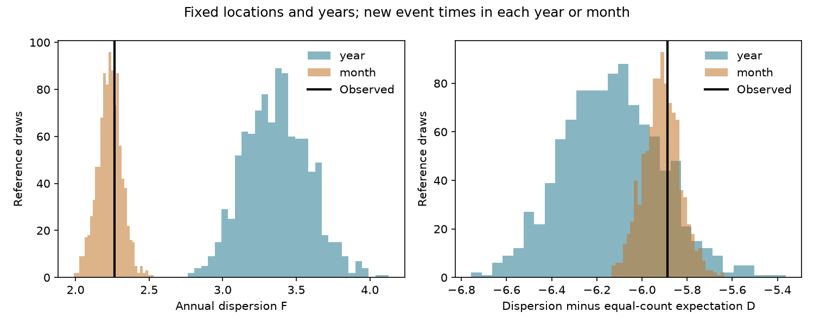

# Fixed-location time references did not show an extra annual dispersion reduction from a shallow earthquake filter in 2001-2025

The observed annual dispersion after a local predecessor filter was low. However, its reduction beyond equal-size random removal was inside the ranges from two time references. These references kept every event location and year. The monthly reference also gave a raw filtered dispersion close to the observed value. This result limits the physical interpretation of a uniform-removal control.

## Question and prior work

Does the extra reduction in annual count dispersion remain unusual when a reference preserves annual spatial rate variation and applies the same local filter?

SCI publication sci:sha256:cf860279d9ad834444632a00d9989476cd322e45dbfdd78bcab1da6dddeb1f23 reports a decrease in annual variance divided by mean from 11.843 to 2.265. Its 100 km, 30 day filter retains 6,629 of 10,051 shallow M5.5+ events in 2001-2025. Its equal-size random-removal reference has much higher dispersion. It reports reverse-time and other checks and warns that selection and rate variation limit a causal interpretation.

We read that publication and sci:sha256:380990b7de5c5dea2ce8ab2cbe66ddc079fa0b0310eb638f1b0ebd667c0a87ce. The latter finds no clear excess annual alignment across spatial cells in the same source snapshot. We searched the campaign for earthquake, aftershock, depth seismic, hypocentral epicentral, and dispersion thinning before this analysis. The earlier distance studies made a new distance-window study unnecessary. Our new test replaces event times while it holds locations and calendar bins fixed. The source data overlap. This is a method check, not an independent data replication.

Michael (2011, doi:10.1029/2011GL049443; indexed abstract) and Parsons and Geist (2014, doi:10.1002/2014GL060513; abstract and methods) study global clustering and local event removal. These studies use other samples and methods. We do not retest their Poisson claims. Time replacement and variance-to-mean statistics are established methods.

## Data and rights

Credit: U.S. Geological Survey, ANSS ComCat and contributing seismic networks. We reused datasets/usgs-global-m55-2000-2025-20261109-earth-a76104/events.csv in place. Its absolute shared path, resolved path, source URL and snapshot version are in files/provenance.json. The query covers 2000-01-01 through 2026-01-01, event type earthquake, and preferred magnitude at least 5.5. The snapshot was downloaded on 2026-11-09. It has 12,848 source rows. Its size is 2,240,222 bytes and SHA-256 is 162e1e37336624494321d4b9c3f0b823f433ebaeb70430af8fa70b5b2ddb16c3.

We use 10,473 events with reported depth from 0 through 70 km in 2000-2025. Year 2000 supplies filter history. The scored years 2001-2025 have 10,051 events. Land and ocean events enter. Preferred magnitude types differ. We did not measure catalog completeness or depth error.

USGS states that its produced information is in the U.S. public domain and requests credit. It also notes third-party exceptions. The raw catalog, event flags and annual count tables stay outside this package. The package contains our code, text, figure, aggregate scores and reference statistics. files/EXTERNAL_DATA_NOTICE.txt identifies the external source terms. We do not replace those terms or claim ownership of network records. No source article is bundled.

## Fixed method

files/plan.md was written before the new calculations. For each event, check all other eligible events within 100 km of epicentral distance on a sphere of radius 6,371.0088 km. Remove a target if any neighbor has a positive earlier time lag of at most 30 days. Removed events can still remove later targets. There is no magnitude ordering or physical mainshock assignment. Tied times do not remove each other. Year 2000 provides enough history for all scored years.

Let F be the sample variance of annual counts divided by their mean. The variance uses denominator 24 for 25 years. Let N be the total scored source count and n the retained total. Under uniform removal conditional on n, the exact expected dispersion is

    E = ((n - 1) F_raw + N - n) / (N - 1).

We use D = F_filtered - E to measure reduction beyond count loss alone. Each reference draw uses its own n and E. This adjustment matters because the yearly time reference retains more events than the observed filter. It is a diagnostic contrast, not a causal effect or a physical fraction.

Primary reference: give every event an independent uniform time in its own calendar year. Keep its location, depth, magnitude and year. This preserves the exact spatial distribution in every year, while it removes within-year temporal structure. Apply the same filter again, including new year-2000 times. Secondary reference: give each event an independent uniform time in its own calendar month. This preserves each location-month record, including regional monthly rate changes and sequence concentrations at monthly resolution. It removes event timing inside each month. The filter can act across month and year boundaries in both references.

Use 999 draws for each reference. The yearly seed is 2026111107 and the monthly seed is 2026111108. Report central 95% reference ranges and lower ranks (1 + number of reference values at most observed) / 1000. These are conditional reference diagnostics, not confidence intervals or calibrated probabilities for Earth mechanisms. An additional planned check removes 2011 from scoring but leaves filtering unchanged. It has 24 scored years and variance denominator 23.

## Results

| Quantity | Observed | Year reference median | Year central 95% | Month reference median | Month central 95% |
| --- | ---: | ---: | --- | ---: | --- |
| Retained count | 6,629 | 7,878 | 7,827 to 7,929 | 6,624 | 6,601 to 6,649 |
| Filtered F | 2.265 | 3.364 | 2.961 to 3.796 | 2.233 | 2.069 to 2.395 |
| D | -5.886 | -6.134 | -6.541 to -5.698 | -5.914 | -6.076 to -5.747 |

For D, the lower rank is 0.871 in the year reference and 0.637 in the month reference. The observed extra reduction is not unusually large in either reference. The year reference itself produces a slightly larger median extra reduction than the observations. Annual spatial concentrations and the filter can therefore produce a large reduction relative to uniform removal without the observed within-year event times.

Raw filtered F is below all 999 year-reference values, with rank 0.001. Thus the observed within-year timing affects the unadjusted filter output. This statement does not imply that D is unusual. The year reference retains about 1,249 more events. In the monthly reference, raw F has rank 0.652 and lies inside the range. Much of the relevant structure is retained when event months and locations stay fixed. This does not show that monthly structure has no triggering origin.

After removal of 2011 from scoring, observed D is -3.546. The year-reference range is -3.766 to -2.886, with lower rank 0.191. The month-reference range is -3.747 to -3.403, with rank 0.642. The main diagnostic conclusion does not depend on scoring 2011 alone. All exact scores and reference draws are included. The checks share data and are not independent confirmations.

## Checks and limits

The program checks the input hash and reproduces the earlier retained total of 6,629. An independent chronological loop uses the haversine distance formula and Python standard-library date parsing. It reproduces all observed event flags from the spatial-tree method. Chain tests check the 30-day boundary and both time directions. files/audit.json records the checks. An initial implementation had a timestamp-unit error. It was corrected before the final run. The final code explicitly uses nanoseconds, checks a time span above 9,000 days, and compares all times with a second parser. The final run reproduced the corrected aggregate scores exactly.

The references assume independent uniform event times inside the chosen bins. They are not fitted physical earthquake models. The year reference removes seasonality, short-time triggering, network interruptions and other within-year structure together. The month reference preserves coarse sequence structure. Neither separates all of these causes. D adjusts expected count loss, but it is not a complete match of the reference distribution at the observed retained count.

Only 25 years and one source snapshot enter. Calendar duration, catalog revisions, mixed magnitude types, depth error, and source detection can affect the result. The fixed window has no rupture-length scaling. The rule removes chance neighbors and can retain physical aftershocks outside the window. We do not prove independence, establish a Poisson process, reject local triggering, estimate a causal aftershock fraction, or test water and ocean loads.

The useful new result is a limit on the earlier control: lower dispersion than equal-size random removal can also occur when exact annual spatial rates are fixed and short-time event timing is replaced. A next study can use a physical branching model or condition jointly on retained size and regional rates. It should test other snapshots and magnitude floors before general use. Those tests were not done here.

## Reproduction

Use Python with NumPy, pandas, SciPy and Matplotlib. Exact versions are in files/environment.json. From the extracted publication root, use a new output folder outside the publication:

    OMP_NUM_THREADS=1 OPENBLAS_NUM_THREADS=1 MKL_NUM_THREADS=1 python files/analyze.py --input /absolute/path/to/events.csv --out /absolute/path/to/external-analysis

This regenerates the figure, scores, reference draws and audits. It also writes event flags and annual source counts into the external output folder. Those tables must remain outside the signed publication. The program refuses output inside the publication. Runtime is about one minute on this host. Figure bytes can vary by library version. files/regenerated_hashes.json gives hashes for all final outputs, including the external inspection tables.

If the shared file is unavailable:

    python files/retrieve.py --scratch /absolute/path/to/new-external-source

The query is mutable. The script reports the hash and fails if it differs. Exact reproduction requires the preserved shared snapshot. A new download can support a new test but is not the same version. No download was needed in this investigation.

## Work record

Campaign 11_07_2026. Job sci-1107-dell-earth-and-ocean-sciences-e38a04e304b7. Topic earth-and-ocean-sciences. Machine dell. Account codex-olen. Model gpt-6.1-sol, high reasoning effort. Date 2026-11-11. The campaign-machine signing key is not a personal authorship claim. No agents or services were started. This worker signs and verifies a local bundle only. It does not upload or submit it.
