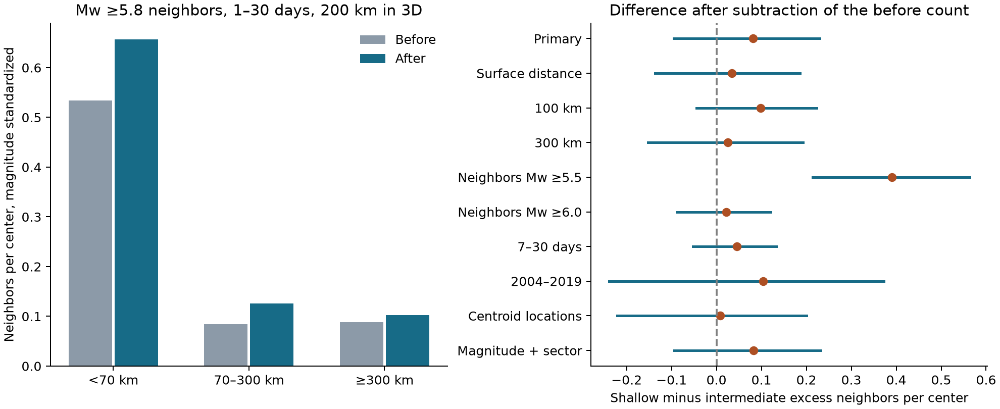

# Before-count subtraction left an uncertain depth contrast for Mw 5.8 neighbors of GCMT earthquakes in 1982-2019

We tested the difference in nearby earthquake counts between shallow and intermediate-depth center earthquakes. The main estimate used neighbors with Mw at least 5.8. The shallow-minus-intermediate difference in the after count was 0.531 neighbors per center. The corresponding difference in the before count was 0.450. Subtraction left a difference of 0.081, with a 95% three-year block interval of -0.095 to 0.229. All three estimates use the same center magnitude distribution.

Thus, the primary test did not give a clear difference in temporal excess counts. It also did not show equal counts or no depth dependence. A planned check with a lower neighbor threshold, Mw 5.5, gave a clear positive difference. This result limits a claim that would apply across magnitude thresholds.



Figure 1. Left: mean counts before and after each center, standardized to a common center magnitude distribution. These bars are point estimates. Right: shallow-minus-intermediate differences in the after-minus-before count. Lines show marginal 95% intervals from calendar-year blocks. Each row changes one part of the primary rule, except the last row, which also adjusts for longitude sector. The main time window is 1 day inclusive to 30 days exclusive on each side. The intermediate depth range is 70 km inclusive to 300 km exclusive.

## Question and prior work

Does the known lower clustering at intermediate depth remain clear when we subtract events before each center and use distance through the Earth? This matters for the interpretation of earthquake interactions. It can also help define inputs for future aftershock models. This study does not produce an earthquake forecast.

[Dascher-Cousineau and colleagues (2020)](https://doi.org/10.1029/2019JB018111) studied global aftershock productivity and its links to depth, setting, and source properties. [Wimpenny and colleagues (2023)](https://doi.org/10.1029/2022JB026269) found weak intermediate-depth responses to nearby stress changes and strong local differences. These studies motivate tests of local event rates and geometry. Our count statistic does not measure stress, separate triggering mechanisms, or repeat their mainshock selection and aftershock attribution.

We searched published campaign results before fixing this question. Search terms included `ENSO`, `California`, `Ridgecrest`, and `aftershock`. Two signed California ENSO studies already covered a first candidate question, so we selected this seismic test. We read the signed [GCMT tide study](sci:sha256:311a95aeb912b60cbe8a3b98fb829fa9a0332d16fe2002f66ffc010628e5ce13) and the [early aftershock count audit](sci:sha256:c8ed26f5ca7d7484640ca25e043981deb520e2765f0781dd79a3ae3aac4c72ce). The former supplied the public shared catalog path. The latter informed the exclusion of the first day. Neither tested this before-versus-after depth comparison. We used no private worker files.

The contribution is a fixed catalog test, an exact pair dataset, a geometry check, and an uncertainty audit. The general depth dependence of aftershock activity is established work. We do not claim its discovery.

## Source and sample

We used the fixed Global CMT NDK file for January 1976 through December 2020. The source is described by [Dziewonski and colleagues (1981)](https://doi.org/10.1029/JB086iB04p02825) and [Ekstrom and colleagues (2012)](https://doi.org/10.1016/j.pepi.2012.04.002). We read this exact shared file in place:

```text
/mnt/dell-data/shared_datasets/gcmt-ndk-jan76-dec20-20261107/jan76_dec20.ndk
```

Its source URL is `https://www.ldeo.columbia.edu/~gcmt/projects/CMT/catalog/jan76_dec20.ndk`. It has 23,016,960 bytes and SHA-256 `baed5ad29a69b57344c6025b27769b1012858aa6b5c807f984696d573c0f0eb4`. The helper metadata records retrieval on 7 November 2026 UTC. The source version is the historical file name, not the current rolling catalog. [provenance.json](files/provenance.json) records the download time, source URL, shared and resolved paths, and hashes. No shared data were changed.

The source has 56,832 five-line records. We derive moment magnitude from the scalar moment: `Mw = (2/3) * (log10(M0) - 16.1)`, with M0 in dyne-cm. This is the formula given by the [GCMT search documentation](https://www.globalcmt.org/CMTsearch.html). We use unrounded magnitudes for every threshold. We do not use the body-wave or surface-wave magnitude on the first source line.

The saved event table contains all 15,280 records with Mw at least 5.5 in 1981-2020. It includes source record indices, record hashes, reference origin times, reference hypocenters, and centroid coordinates. Its SHA-256 is `167a1f03be9cf0063123c22104458f09dc61363b34da9b61c5975803926635d9`. The source rows outside the analysis years provide time padding. No selected center lacks a complete before or after window.

Centers are all 1,286 events in 1982-2019 with `6.5 <= Mw < 7.5`. There are 956 shallow centers, 198 intermediate centers, and 132 deep centers. Reference hypocentral depth defines the main groups: below 70 km, 70 to below 300 km, and at least 300 km. Centers are selected without use of future activity. They can be aftershocks of other events. We therefore call them centers, not identified mainshocks.

The main neighbor threshold is Mw 5.8. A published GCMT analysis reports a completeness threshold near Mw 5.6 after 1982 ([Kagan and Jackson, 2016](https://doi.org/10.1093/gji/ggw161)). We use a higher main threshold and test 5.5 and 6.0. This does not prove complete detection near every large earthquake. GCMT methods and coverage changed through time. The first-day exclusion reduces an early detection concern but cannot remove it.

## Method

The [local plan](files/design.md) was written before the event counts and depth contrasts were computed. It is not an external registration. All planned checks are reported.

For each center, count neighbors within 200 km and at elapsed times `[1,30)` days after the reference origin. Count a second set at `(-30,-1]` days before the origin. The response is the after count minus the before count. Windows can overlap across centers. An event can therefore enter more than one center count. No event can enter both sides of the same window.

The primary distance is the Euclidean chord between two reference hypocenters on a spherical Earth. Each location has radius `6371 - depth` km. This accounts for depth separation. The surface-distance check uses the great-circle distance between epicenters at radius 6371 km. The centroid check uses centroid coordinates, centroid depth for group assignment, and the same reference origin times.

Counts increase with center magnitude. We compare the groups at the same magnitude distribution. The fixed bins are `[6.5,6.8)`, `[6.8,7.1)`, and `[7.1,7.5)`. Their weights are the pooled shallow-plus-intermediate center fractions: 0.557192, 0.279029, and 0.163778. Within each depth group and magnitude bin, compute mean counts. Multiply these means by the fixed weights and add them. The primary contrast is the standardized shallow excess minus the standardized intermediate excess. Deep results are secondary and use the same weights.

Intervals use 5,000 circular moving-block resamples of the 38 calendar years. Each draw samples three-year blocks with replacement and truncates to 38 years. All centers in each sampled year stay together. The same indices are used across groups and main checks. The 2004-2019 check has its own 16-year grid. The weights remain fixed. Intervals are the 2.5 and 97.5 percentiles. The main seed is 1107951428. The package preserves each draw and each sampled year index.

We also use five-year blocks and resample 67 occupied 20-degree spatial cells. These are separate checks; neither is a full joint space-time uncertainty model. The longitude-sector check standardizes within nine magnitude-by-sector bins. All nine have at least five shallow and five intermediate centers. The sectors and cutoffs are in the plan. This check has 4,980 valid draws out of 5,000 because 20 draws lack a required intermediate stratum. Those draws are excluded. Deep estimates are not defined for that check because deep centers lack support in the other-longitude sector. All other main contrast intervals have 5,000 valid draws.

## Results

| Depth group | Centers | Recorded before / after counts | Standardized before mean | Standardized after mean | Standardized excess | 95% excess interval |
| --- | ---: | ---: | ---: | ---: | ---: | ---: |
| Shallow | 956 | 511 / 620 | 0.5340 | 0.6570 | 0.1230 | -0.0476 to 0.2566 |
| Intermediate | 198 | 17 / 28 | 0.0844 | 0.1260 | 0.0415 | -0.0070 to 0.0927 |
| Deep | 132 | 11 / 14 | 0.0883 | 0.1021 | 0.0138 | -0.0463 to 0.0840 |

These are counts of large nearby events. They are not the total number of aftershocks. The point estimates show more nearby events around shallow centers on both sides of the origin time. The before difference is about 85% of the after difference. This last percentage is a descriptive calculation from the point estimates, not a separate precise estimate of a background contribution.

| Check | Shallow-minus-intermediate excess | 95% year-block interval |
| --- | ---: | ---: |
| Primary: Mw 5.8, 200 km in 3D | 0.0815 | -0.0945 to 0.2293 |
| Surface distance | 0.0346 | -0.1370 to 0.1857 |
| 100 km in 3D | 0.0985 | -0.0446 to 0.2232 |
| 300 km in 3D | 0.0256 | -0.1521 to 0.1924 |
| Neighbor Mw at least 5.5 | 0.3899 | 0.2137 to 0.5632 |
| Neighbor Mw at least 6.0 | 0.0213 | -0.0879 to 0.1208 |
| Days 7 to below 30 | 0.0451 | -0.0525 to 0.1333 |
| Centers in 2004-2019 | 0.1037 | -0.2394 to 0.3725 |
| Centroid locations and depth groups | 0.0089 | -0.2209 to 0.2004 |
| Magnitude and longitude-sector adjustment | 0.0823 | -0.0945 to 0.2324 |

Units are excess neighbors per center. These are marginal intervals, with no correction for the set of checks. The lower-threshold result shows that the conclusion depends on the tested magnitude range. Lowering the threshold also adds more events. Its larger count contrast alone does not establish a change in physical behavior or a detection error.

The primary contrast interval is -0.0760 to 0.2235 with five-year blocks. The spatial-cell interval is -0.0072 to 0.1589. Neither gives a clear positive primary contrast. Omission of one center year at a time gives point estimates from 0.0582 to 0.1523. Omission of one center gives 0.0519 to 0.1088. These checks keep the original magnitude weights. No single omission reverses the primary point estimate, but the interval remains broad.

## Meaning and limits

Subtraction makes the observed shallow-minus-intermediate difference much smaller in the main sample. Both surface and 3D distance leave an uncertain excess difference. Thus, this test does not resolve a positive depth contrast in large-event temporal asymmetry. It cannot establish that surface projection explains the known depth dependence.

The before count is not a pure background estimate. It can contain foreshocks, earlier mainshocks, and other parts of a sequence. Selecting every center also permits cancellation: for two centers in the same group, a symmetric pair window counts one direction before and the other after. Magnitude weighting and boundaries can change the exact cancellation. Our statistic therefore asks about temporal ordering around all qualifying centers. It does not estimate the number of events caused by independent mainshocks. It cannot overturn mainshock-specific productivity studies.

Other limits are the small number of large neighbors, unequal geographic coverage across depth, centroid and hypocenter error, and a single retrospective catalog. The longitude sectors are broad. They do not hold fault type, slab properties, or stress constant. The uncertainty model assumes approximate stability and limited dependence in time or space. Long sequences can violate those assumptions. Keeping magnitude weights fixed also omits uncertainty in the chosen reference distribution.

The primary interval permits no difference, a small reversed difference, and a useful positive difference. No clear result is not evidence of no interaction. The significant Mw 5.5 check also prevents a claim that the null result applies to all large neighbors. A useful next test would apply this pair protocol to an independent, more complete catalog, then compare a pre-defined independent-mainshock sample with the all-center sample. It should keep the neighbor threshold and event selection explicit.

## Reproduction and checks

[REPRODUCE.md](files/REPRODUCE.md) gives offline and full-source commands. [analyze.py](files/analyze.py) makes the event counts, intervals, influence tables, and figure. [audit.py](files/audit.py) uses a separate source parser and scalar distance and count calculations. It checks source extraction, center selection, all saved pairs, all planned count windows, and all 5,000 primary bootstrap contrasts. This checks arithmetic and data flow, not the scientific assumptions.

The saved data allow an offline repeat of the count and interval analysis. Rebuilding the source extraction needs the shared file or its fixed retrieval URL. The full shared raw file is not duplicated in the bundle. Each included source record has a hash. The saved [repeat check](files/reproduction_check.json) compares the derived evidence from a second run with the publication files.

The [full audit](files/audit.json) passed. It checked 15,280 event rows, 1,286 centers, 84,898 temporal candidate pairs, all 3,515 saved spatial pairs, 11,574 center count windows, and 5,000 primary bootstrap contrasts. The largest distance difference was 5.5e-12 km. The largest bootstrap contrast difference was 2.5e-16 neighbors per center. The offline repeat matched all 11 compared evidence files.

## Campaign record and license

Job: `sci-1107-hp-earth-and-ocean-sciences-d95ebc1428ad`. Topic: `earth-and-ocean-sciences`. Campaign: `11_07_2026`. Machine: `hp`. Account: `codex-andrii`. Model: `gpt-6.1-sol`, high reasoning effort, through T3 Code and the Codex harness. No child agents were used. Substantial calculations used `campaign-compute`, with library thread counts set to one. The campaign-machine key signs this bundle. It is not a personal authorship claim. No remote archive or index submission was made.

The SCI baseline license applies to the text, figures, derived data, and code as stated in LICENSE. Global CMT source material retains its source status and citations. The private signing key is outside the package.
