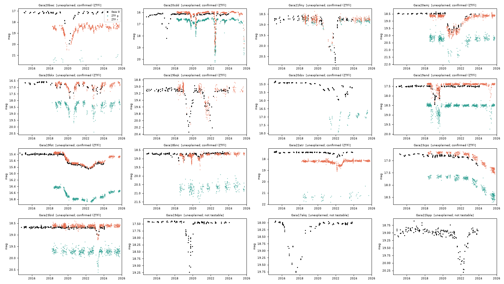
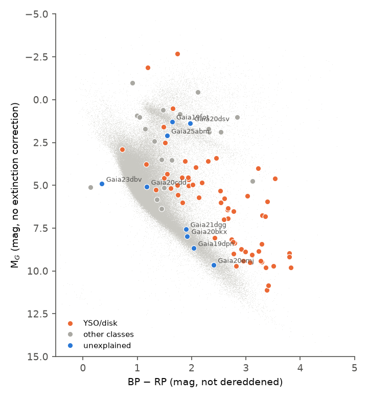
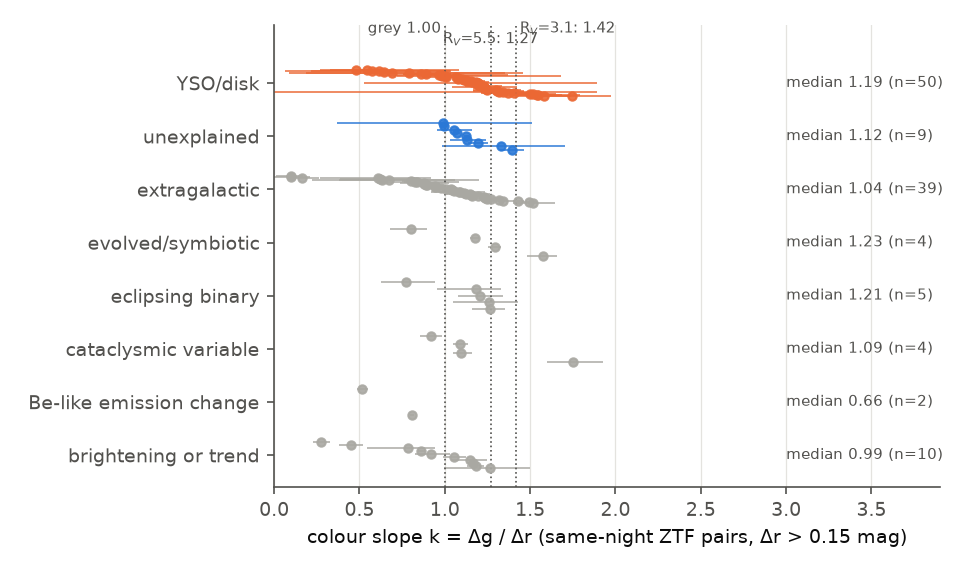

# Gaia Science Alerts from 2014 to 2025 contain 37 unexplained long dimming events on quiet stars; ZTF confirms 13, and four main-sequence K and M dwarfs dim by 1.2 to 3.4 mag without infrared excess

**Job:** sci-1107-dell-astronomy-436b1036b8e4 · **Topic:** astronomy · **Machine:** dell · **Model:** Claude Opus 5.5 (`claude-opus-5-5`), run through the Claude Code harness · **Campaign:** 11_07_2026 · **Date:** 2026-11-09 (UTC).
The signing key is a campaign-machine key. It is not a personal authorship claim.

## Summary

We screened the light curves of all 10,589 Gaia Science Alerts (Gaia photometric alert stream, 2014-08 to 2025-01) whose source had a Gaia historic magnitude and whose published class was not a supernova, QSO, AGN, blazar, TDE, nova, microlensing event or galaxy.
A fixed rule found an isolated dimming episode (at least 3 consecutive dimmed epochs over more than 5 days, at least 0.25 mag and 6 robust sigma below a quiet baseline) in 275 alerts.
We classified each event with Gaia DR3 (parameters, variability classifier), AllWISE colours, SIMBAD, and alert comments, and we tested each event against near-simultaneous ZTF DR24 and ASAS-SN photometry.

Main results:

1. **Gaia alert dimming is real when another survey can see it.** For events with near-simultaneous ZTF data, the ZTF drop agrees with the Gaia drop (Figure 2). 89 events are confirmed by ZTF and 9 by ASAS-SN. Of the 10 "not seen" cases, 6 are eclipsing binaries whose hours-long eclipses fall between the survey visits; the other 4 are 3 YSO events and 1 cataclysmic variable where ZTF or ASAS-SN shows a much smaller drop (ASAS-SN blending is possible).
2. **Most long dimming events are known phenomena.** 109 of 275 are young stars or disc-bearing stars (IR excess, YSO class or comments), 56 are extragalactic, 14 are evolved or symbiotic stars, 10 are eclipsing binaries, 6 are cataclysmic variables, and 34 are slow brightenings or trends rather than dips (visual vetting).
3. **37 events stay unexplained** after the rules and visual vetting (table below, Figure 5). ZTF confirms 13 of them. 24 cannot be tested with an independent survey: 16 are south of Dec -30 deg, and 15 of the 37 lie toward the Galactic bulge (|l| < 30 deg, |b| < 12 deg), which is 2.7 times the bulge fraction of the input alerts (15 %). Crowding can cause false dips there, so the untested bulge events have lower confidence.
4. **Four main-sequence K and M dwarfs without infrared excess show long deep dips.** Gaia20emj (M dwarf, M_G = 9.65), Gaia19dpn (M dwarf), Gaia20bkx (K/M dwarf) and Gaia20cdd (K dwarf) sit within 0.4 mag of the Gaia main-sequence ridge (Figure 4). The young or disc-bearing stars in the sample sit a median 3.1 mag above it, and none of 62 of them with reliable parallax lies within 0.5 mag of it. Gaia21dgg (M_G = 7.6) is a fifth, shallower (0.38 mag) dwarf event without independent data.
5. **Gaia20cdd is an old K dwarf with recurrent dips up to 3.4 mag.** It lies at b = +42 deg with tangential velocity about 80 km/s (thick-disc kinematics), and it shows dips in 2017 (Gaia), 2019, 2020, 2022 (3.4 mag, ~75 days), 2023 and 2025 (3.0 mag, ongoing at the end of ZTF DR24). TESS full-frame images confirm the 2022 dip: the star gives only 9 % of the light in the TESS aperture, so the 92 % ZTF dip predicts an 8.4 % aperture drop; TESS sector 52 shows 8.7 % (Figure 6).
6. **The dimming is less chromatic than interstellar dust.** In same-night ZTF g/r pairs, the slope Δg/Δr has median 1.12 for the unexplained events (n = 9) and 1.19 for YSO/disc events (n = 50); the two groups do not differ (Mann-Whitney p = 0.65). Interstellar dust with R_V = 3.1 gives 1.42 and grey (opaque or large-grain) material gives 1.00 (Figure 3). Gaia19fot (a distant giant, 0.46 mag, 5-year dimming) gives 1.00 [0.98, 1.01] and Gaia20emj gives 1.06 [0.95, 1.16]. This agrees with occultation by optically thick material or grains larger than about 1 µm, and it does not agree with a change of the interstellar column made of normal small grains.

The positive control Gaia17bpp (published disc occultation of a giant) passes the screen; the rules call it unclassified (monotonic trend, because Gaia saw only its recovery), and we label it as the known control. A second control, Gaia21bcv (published deep dips), passes the screen and is put in the YSO/disc group because SIMBAD lists it as a young stellar object. One event in the published ZTF main-sequence dipper table that also has a Gaia alert (Gaia19aow) fails our quiet-baseline cut (baseline scatter 0.095 mag against the 0.08 mag limit). Thus the screen does not find all dimming events.

## Question and scope

Can the complete Gaia alert archive, together with independent surveys, find long (weeks to years) dimming events on otherwise quiet stars that known classes of variable star do not explain, and do the properties of these events (colour, host type) agree with occultation by circumstellar material?

Scope and assumptions:

- Input: alerts that have a Gaia historic magnitude (a source that existed before the alert) and a class that is not one of the transient or extragalactic classes listed above. Alerts of class CV, YSO, RCrB, Varstar, star, dM, XRB, symbiotic, unknown and similar were kept, so known classes act as a reference population.
- An "event" is the longest run of consecutive Gaia alert epochs fainter than the baseline + max(0.25 mag, 6 sigma); the baseline is the median of the brighter half of the light curve, and sigma is the scaled MAD of that half (times 1.6 to correct for the truncation). We require at least 30 trusted epochs, baseline sigma < 0.08 mag, fewer than 50 % dimmed epochs, fewer than 3 % brightened epochs, and a run of at least 3 dimmed epochs that spans more than 5 days.
- The screen finds dims and also the faint phase before a brightening. Visual vetting moved brightening-only light curves to "brightening or trend".

## Data and provenance

| Data | Source and version | Retrieval |
|---|---|---|
| Gaia Science Alerts index | `http://gsaweb.ast.cam.ac.uk/alerts/alerts.csv`, retrieved 2026-11-08 23:17 PST, 27,076 alerts, SHA-256 `24babf44f90a70dbaa7063f00d45f9b691bc6f2390c20d8e2668ec80762bb1a0` | `files/data/alerts.csv.gz` |
| Gaia alert light curves | `http://gsaweb.ast.cam.ac.uk/alerts/alert/<name>/lightcurve.csv/`, 10,589 files, retrieved 2026-11-08/09 | all files in `files/raw/gaia_alert_lightcurves_all.tar.gz`; per-file SHA-256 in `files/raw/raw_sha256.txt` |
| Gaia DR3 | `gaiadr3.gaia_source`, `astrophysical_parameters`, `vari_classifier_result` at the AIP TAP mirror `https://gaia.aip.de/tap` (2 arcsec cone) | `files/data/xm_final.csv`; CMD reference sample query in `files/code/README_queries.md` |
| ZTF DR24 light curves | IRSA `nph_light_curves`, `COLLECTION=ztf_dr24`, 1.8 arcsec cone | `files/raw/ztf_dr24_lightcurves_screen_passes.tar.gz` (275 files) |
| AllWISE | IRSA TAP `allwise_p3as_psd`, 3 arcsec cone | `files/raw/allwise_simbad_asassn.tar.gz` |
| SIMBAD | CfA mirror TAP `simbad.cfa.harvard.edu`, 3 arcsec cone | same archive |
| ASAS-SN Sky Patrol v2 | `pyasassn` client 0.6.20, 3 arcsec cone, nearest source | same archive |
| TESS FFI cutouts | MAST TESScut, 15x15 px, sectors 16, 18, 23, 24, 52, 55 for Gaia20cdd | aperture photometry in `files/data/tess_gaia20cdd_s*.csv` (FITS hashes in `raw_sha256.txt`) |
| Tzanidakis et al. 2025 (arXiv:2508.03964v1) Table 2 | arXiv source, 29 listed rows (the v1 source lists only part of the 81 candidates) | `files/data/tzanidakis2025_table2.csv` |

No shared campaign dataset existed for these sources; the dataset store was empty after the Dell disk failure. The raw data are archived in this bundle and are not copied to the shared store.

## Method

1. `fetch_gsa.sh`: download all 10,589 alert light curves (parallel curl, priority to fading alerts).
2. `screen_gaia.py`: robust baseline, dim-episode detection, event metrics, Spearman trend statistic.
3. `gaia_xmatch.py`, `fetch_ztf.sh`, `fetch_wise.sh`, `fetch_simbad.sh`, `fetch_asassn.py`: auxiliary data for the 275 screen passes.
4. `classify.py`: rule groups in this priority order: artefact (alert comment says spurious), extragalactic (Gaia class AGN/QSO, SIMBAD galaxy/QSO types, comment), cataclysmic variable (Gaia CV, SIMBAD CV types, comment), YSO/disc (AllWISE W1-W2 > 0.3 or W2-W3 > 1.5 with A/B quality, SIMBAD YSO types, Gaia YSO class, YSO in comment), evolved/symbiotic (Gaia LPV, SIMBAD Mira/LPV/carbon/RCB/AGB/symbiotic, comment), eclipsing binary (Gaia ECL, SIMBAD EB). Others are "unclassified". Shape: complete dip, ongoing at Gaia end, recovery only, monotonic trend (|rho| > 0.8).
5. `ztf_event.py`: ZTF per-oid baselines, in-window drops, repeat episodes, and the colour slope k = Δg/Δr (least squares through the origin on same-night g/r pairs with Δr > 0.15 mag; 95 % bootstrap interval, 500 resamples).
6. `simul_check.py`: for each dimmed Gaia epoch, the median ZTF drop within ±10 days. "Confirmed" if at least 3 pairs and the median ZTF/Gaia drop ratio is at least 0.5 in g or r; "not seen" if the ratio is below 0.2.
7. `asassn_check.py`: the same test with ASAS-SN g for events without simultaneous ZTF data; used only if the ASAS-SN median g agrees with the Gaia-predicted g within 1 mag (ASAS-SN pixels are 8 arcsec).
8. `vetting.csv`: visual vetting of all 81 unclassified events (each override has a written reason).
9. `finalize.py`, `summary_stats.py`, `make_figures.py`: final table, statistics, figures. Main-sequence offset ΔMS = M_G minus the median M_G of a Gaia DR3 reference sample (parallax_over_error > 10, G < 18, lower branch only) at the same BP-RP (0.1 mag bins); no extinction correction.
10. `tess_phot.py`, `plot_tess_gaia20cdd.py`: 3x3-pixel aperture photometry of TESScut cutouts with an outer-ring sky; Gaia DR3 neighbours within 32 arcsec give the target light fraction (RP flux).

## Results

### Composition of the 275 screened events

| Group | Events | Confirmed by ZTF | Confirmed by ASAS-SN | Not seen | Not testable |
|---|---|---|---|---|---|
| YSO/disk | 109 | 43 | 4 | 3 | 51 |
| extragalactic | 56 | 20 | 2 | 0 | 33 |
| unexplained | 37 | 13 | 0 | 0 | 24 |
| brightening or trend | 34 | 5 | 3 | 0 | 25 |
| evolved/symbiotic | 14 | 3 | 0 | 0 | 10 |
| eclipsing binary | 10 | 0 | 0 | 6 | 4 |
| cataclysmic variable | 6 | 4 | 0 | 1 | 1 |
| Be-like emission change | 3 | 1 | 0 | 0 | 2 |
| artefact | 3 | 0 | 0 | 0 | 3 |
| insufficient data | 2 | 0 | 0 | 0 | 2 |
| known occultation (control) | 1 | 0 | 0 | 0 | 1 |

"Partial" results (ratio 0.2 to 0.5; 11 events) are counted in the total only.


*Figure 1. Groups of the 275 screened events and the result of the independent-survey test.*


*Figure 2. Gaia G drop against the near-simultaneous ZTF drop for every event with at least 3 Gaia-ZTF pairs. Points near zero are mostly eclipsing binaries, which the long-event rule picked up by chance sampling of short eclipses.*

### The 37 unexplained events

Columns: G base = Gaia alert baseline; depth = largest drop in the longest dim episode; first/last dim = the longest Gaia dim episode; M_G only where parallax/error > 5 (no extinction correction); ΔMS = offset from the main-sequence ridge (negative = brighter than the ridge).

| Alert | Gaia DR3 source_id | RA | Dec | G base | depth (mag) | shape | first dim (yr) | last dim (yr) | BP-RP | M_G | ΔMS | independent survey | Δg/Δr [95%] |
|---|---|---|---|---|---|---|---|---|---|---|---|---|---|
| Gaia20bwc | 4257054112181816704 | 277.06974 | -5.63792 | 17.12 | 2.82 | complete dip | 2019.63 | 2020.78 | 4.53 |  |  | confirmed (ZTF) |  |
| Gaia20cdd | 1624711296862985472 | 245.22399 | 59.43955 | 16.11 | 2.09 | recovery only | 2016.83 | 2017.5 | 1.18 | 5.09 | -0.21 | confirmed (ZTF) | 1.12 [1.11, 1.14] |
| Gaia21fmy | 4241301404764041216 | 297.06439 | 1.56662 | 18.71 | 2.06 | complete dip | 2021.27 | 2021.94 | 0.41 |  |  | confirmed (ZTF) | 0.99 [0.37, 1.51] |
| Gaia20emj | 139780157325418240 | 42.81707 | 33.95615 | 18.47 | 1.31 | complete dip | 2020.51 | 2022.01 | 2.41 | 9.65 | 0.18 | confirmed (ZTF) | 1.06 [0.95, 1.16] |
| Gaia20bkx | 3334268775009630976 | 83.21293 | 7.8188 | 16.61 | 1.21 | complete dip | 2020.14 | 2020.77 | 1.92 | 7.97 | -0.06 | confirmed (ZTF) | 1.19 [1.13, 1.25] |
| Gaia19bqk | 1971961704853983360 | 319.06333 | 45.70256 | 19.1 | 1.11 | complete dip | 2021.33 | 2022.17 | 1.7 |  |  | confirmed (ZTF) |  |
| Gaia20dsv | 6028932527928215168 | 256.56379 | -30.39119 | 14.9 | 1.05 | ongoing at Gaia end | 2020.61 | 2022.29 | 1.97 | 1.38 | -6.65 | confirmed (ZTF) |  |
| Gaia19and | 2020120451598884864 | 296.20947 | 23.57596 | 17.49 | 0.96 | complete dip | 2018.95 | 2019.26 | 1.63 |  |  | confirmed (ZTF) | 1.39 [1.32, 1.47] |
| Gaia19fot | 508840791501510400 | 29.78928 | 62.43234 | 15.4 | 0.46 | ongoing at Gaia end | 2020.1 | 2023.33 | 1.64 | 1.28 | -5.84 | confirmed (ZTF) | 1.00 [0.98, 1.01] |
| Gaia18bnc | 517021703461963520 | 36.83844 | 66.40815 | 18.69 | 0.44 | complete dip | 2018.4 | 2018.45 | 2.48 |  |  | confirmed (ZTF) | 1.33 [0.98, 1.70] |
| Gaia22atr | 4306367380453935488 | 287.46066 | 7.1444 | 17.4 | 0.43 | complete dip | 2022.15 | 2022.2 | 4.13 |  |  | confirmed (ZTF) |  |
| Gaia23cps | 4184112820009466112 | 290.12212 | -15.4223 | 16.78 | 0.42 | ongoing at Gaia end | 2023.72 | 2023.86 | 1.45 |  |  | confirmed (ZTF) | 1.07 [1.06, 1.09] |
| Gaia23bid | 2023399225321367296 | 289.20025 | 24.38824 | 18.67 | 0.35 | complete dip | 2023.24 | 2023.43 | 1.53 |  |  | confirmed (ZTF) | 1.13 [1.03, 1.24] |
| Gaia23bol | 4059540248633473792 | 261.62536 | -29.17694 | 15.44 | 2.41 | complete dip | 2022.67 | 2023.32 | 3.71 |  |  | not testable |  |
| Gaia20ehk | 5593847908340254848 | 116.85473 | -34.15899 | 18.8 | 2.09 | ongoing at Gaia end | 2022.6 | 2024.06 | 2.1 |  |  | not testable |  |
| Gaia19dpn | 6099341507268272384 | 216.99222 | -44.89151 | 17.43 | 1.8 | complete dip | 2019.23 | 2020.01 | 2.04 | 8.67 | 0.36 | not testable |  |
| Gaia17akq | 5959498364248569088 | 260.52216 | -42.45834 | 18.01 | 1.75 | complete dip | 2016.32 | 2018.6 | 2.2 |  |  | not testable |  |
| Gaia21axm | 4069165579463306880 | 270.49491 | -23.67177 | 19.03 | 1.75 | ongoing at Gaia end | 2020.62 | 2023.71 | 3.29 |  |  | not testable |  |
| Gaia23cyx | 5960790604034990336 | 265.12266 | -39.61729 | 14.93 | 1.66 | ongoing at Gaia end | 2023.7 | 2023.79 | 1.0 |  |  | not testable |  |
| Gaia18dfx | 2200035287286299904 | 335.71713 | 57.84638 | 18.43 | 1.47 | complete dip | 2018.83 | 2019.42 | 1.7 |  |  | not testable |  |
| Gaia20bkb | 5976250905671879680 | 261.79132 | -33.26505 | 18.72 | 1.47 | complete dip | 2020.13 | 2020.21 | 2.65 |  |  | not testable |  |
| Gaia23dbv | 5935951536812329856 | 254.88891 | -52.61742 | 16.26 | 1.39 | ongoing at Gaia end | 2023.69 | 2023.83 | 0.35 | 4.91 | 3.03 | not testable |  |
| Gaia22bpp | 6058653357929822592 | 184.03517 | -60.54359 | 18.92 | 1.38 | complete dip | 2021.6 | 2022.74 | 0.97 |  |  | not testable |  |
| Gaia19flc | 5231778209619714432 | 163.37429 | -69.99587 | 18.94 | 1.35 | complete dip | 2019.93 | 2020.83 | 1.21 |  |  | not testable |  |
| Gaia18cbx | 5966797094230059520 | 255.4731 | -41.05148 | 19.09 | 1.15 | complete dip | 2018.24 | 2018.6 | 4.03 |  |  | not testable |  |
| Gaia18cvd | 5981681664165518208 | 240.00595 | -51.21513 | 17.6 | 0.92 | complete dip | 2018.59 | 2018.74 | 1.66 |  |  | not testable |  |
| Gaia22atb | 4142116075727369472 | 259.8758 | -11.65304 | 18.17 | 0.9 | complete dip | 2022.14 | 2022.28 | 1.5 |  |  | not testable |  |
| Gaia19bhs | 4056137633717618816 | 268.52154 | -30.6441 | 17.86 | 0.65 | complete dip | 2019.13 | 2019.27 | 2.65 |  |  | not testable |  |
| Gaia20dvw | 4063308824640877824 | 270.9538 | -26.72555 | 18.07 | 0.6 | complete dip | 2020.62 | 2021.19 | 3.14 |  |  | not testable |  |
| Gaia22avh | 5972782388848768768 | 259.8817 | -38.22675 | 18.73 | 0.56 | complete dip | 2022.16 | 2022.76 | 2.97 |  |  | not testable |  |
| Gaia22aze | 5546751251182383744 | 125.10931 | -34.03197 | 18.56 | 0.56 | complete dip | 2021.73 | 2021.92 | 1.75 |  |  | not testable |  |
| Gaia23bko | 4155061970456878464 | 278.81208 | -9.95773 | 17.05 | 0.45 | ongoing at Gaia end | 2023.18 | 2023.32 | 2.79 |  |  | not testable |  |
| Gaia25abm | 5836700340104231680 | 182.85753 | -77.89031 | 15.82 | 0.45 | ongoing at Gaia end | 2024.85 | 2025.01 | 1.55 | 2.1 | -4.66 | not testable |  |
| Gaia23agx | 5338892598038432640 | 164.93862 | -58.4771 | 18.48 | 0.44 | complete dip | 2023.04 | 2023.12 | 3.49 |  |  | not testable |  |
| Gaia21dgg | 2062351142723306368 | 304.22707 | 40.54168 | 18.44 | 0.38 | complete dip | 2021.53 | 2021.57 | 1.9 | 7.56 | -0.18 | not testable |  |
| Gaia20dsu | 4107565335867854720 | 258.10288 | -29.19945 | 18.54 | 0.35 | complete dip | 2020.61 | 2020.68 | 1.96 |  |  | not testable |  |
| Gaia23cwr | 5825429693112707968 | 235.44745 | -66.04949 | 16.49 | 0.32 | ongoing at Gaia end | 2023.78 | 2023.82 | 1.37 |  |  | not testable |  |


*Figure 5. Gaia G (black), ZTF g (green) and ZTF r (orange) light curves of the 13 ZTF-confirmed unexplained events and three southern events without independent data.*

### Host stars


*Figure 4. Gaia colour-absolute magnitude diagram. Grey: Gaia DR3 reference stars. Orange: YSO/disc events (median ΔMS = -3.1 mag, n = 62). Blue: unexplained events (median ΔMS = -0.18 mag, n = 9).*

The five dwarf hosts (Gaia19dpn ΔMS = +0.36, Gaia20emj +0.18, Gaia20bkx -0.06, Gaia21dgg -0.18, Gaia20cdd -0.21) lie on the main sequence. None of these five has W1-W2 > 0.3 in AllWISE where it is measured (Gaia20cdd 0.23, Gaia20bkx 0.04, Gaia20emj 0.07, Gaia19dpn 0.04). Their W2-W3 values (1.4 to 2.3) use W3 measurements of low significance for such faint stars, so they do not show a disc. No Gaia DR3 parameter flags a problem: RUWE is 0.95 to 1.05, and ipd_frac_multi_peak is 0 for all except Gaia19dpn (3). Gaia20cdd has a moderate BP/RP flux excess factor (1.37), which can come from a neighbour or from the variability.

Gaia20emj is at d ≈ 580 pc, b = -22.6 deg, with v_tan ≈ 21 km/s. It dropped by 1.3 mag in G in mid-2020 (in the ZTF seasonal gap), stayed 1 to 1.5 mag faint with structure for about 1.5 years, and recovered slowly through 2022. Gaia20bkx (d ≈ 535 pc) lies toward the λ Orionis region, but its proper motion (+9.0, -8.1 mas/yr) does not match the cluster. It shows at least five dips of 0.5 to 1.2 mag in 2019 to 2023.

### Colour of the dimming


*Figure 3. Colour slope k = Δg/Δr with 95 % bootstrap intervals for events with at least 5 same-night ZTF pairs. Dotted lines: grey material (1.00) and CCM89 dust with R_V = 5.5 (1.27) and 3.1 (1.42) at ZTF g/r effective wavelengths.*

YSO/disc events: median k = 1.19 (quartiles 1.00 to 1.24), 76 % below 1.27, and 34 of 50 have the upper 95 % limit below 1.42. Unexplained events: median 1.12 (quartiles 1.06 to 1.19). Extragalactic events: median 1.04. Only Gaia19and (1.39 [1.32, 1.47]) has an ISM-like slope among the unexplained events.

### TESS check of Gaia20cdd


*Figure 6. TESS full-frame-image flux (3x3 pixels, 6-hour bins) and ZTF r flux of Gaia20cdd. A G = 13.6 neighbour at 16 arcsec gives most of the TESS aperture light; the target gives about 9.1 %.*

Predicted TESS aperture drop = 0.091 × ZTF fractional drop. Sector 52: predicted 8.4 %, observed 8.7 %. Sector 24: predicted about 6 %, observed 3.8 %. Sector 16: predicted about 2 %, observed 4.1 % (sector systematics of a few per cent). The sector 52 decline starts at the same time as the ZTF decline. The dilution does not let TESS resolve the dip shape.

## Physical interpretation

- **Star spots, flares and pulsation** cannot explain drops of 0.3 to 3.4 mag that last weeks to years on stars with a quiet baseline (baseline sigma < 0.08 mag over ten years).
- **Ordinary eclipses** give hours-long, repeating, same-depth events. The dwarf events last weeks to years and change depth from dip to dip (Gaia20cdd: 0.66, 1.2, 3.4, 0.9 and 3.0 mag).
- **Change of the interstellar column** made of normal grains predicts k ≈ 1.4. Most events are greyer (k = 1.0 to 1.2), which needs grains larger than about 1 µm or optically thick clumps that cover part of the star.
- **Occultation by circumstellar or circum-companion material** (as proposed for Gaia17bpp, ASASSN-21qj and ASASSN-24fw) agrees with the duration, the depth and the near-grey colour. For the main-sequence dwarfs, the absence of a W1-W2 excess means that any such material is cold, small in total area, or far from the star (or the excess is below the AllWISE limit).
- **Instrumental artefacts** are excluded for the 13 ZTF-confirmed events by the near-equal ZTF drop. For the 24 untested events (most toward the bulge or far south), Gaia crowding artefacts are possible.

The kinematic limits from the ingress times (in `files/data/event_kinematics.csv`; v_min = 0.8 × 2R*/τ_in,max, a_max = GM*/v_min²) are mostly weak. For most events the upper limits on ingress duration come from the sampling gaps (weeks to months), so for a bound circular orbit they give only a_max of 10^4 to 10^6 au. Two giants give tighter limits: Gaia22atr (R ≈ 8 R_sun, ingress at most 3 days in ZTF) gives a_max ≈ 1.2 au, and Gaia23bol (R ≈ 83 R_sun) gives a_max ≈ 28 au. Stellar masses for these limits are rough (FLAME, or a radius-based estimate), so we do not use them for further conclusions.

## Limitations

- The screen thresholds (sigma < 0.08 mag, run length, depth) are fixed choices; they miss events on noisier baselines (for example Gaia19aow). The completeness is not calibrated by injection.
- The group rules use catalogue labels and colour cuts. Some YSO assignments come from W2-W3 alone, which also flags AGN and some evolved stars. AllWISE photometry of faint stars in crowded fields can be confused.
- The colour slope uses fixed ZTF effective wavelengths; for very red stars the ISM value is slightly lower (about 1.38 instead of 1.42).
- Visual vetting reviewed 81 rule labels (44 changed away from "unclassified"); every decision; is in `vetting.csv` with a reason, but it is a judgement made by the model, not by a human expert.
- ZTF covers only Dec > -30 deg and 2018 to 2025; events before 2018 or in the far south have no independent test. ASAS-SN helps only for bright isolated stars.
- No spectra were taken. The physical nature of the 37 events stays open; the list is a list of candidates for follow-up.
- Only 29 of the 81 rows of the Tzanidakis et al. (2025) table are in the arXiv v1 source; our overlap check against it is partial.

## Reproduce

Python 3.12 with pandas 3.1.1, numpy 2.5.4, scipy 1.18.1, astropy 8.0.2, matplotlib 3.11.2, astroquery 0.4.11, pyvo 1.10.0, pyasassn 0.6.20.
From a working directory with `work/` as in this bundle (`files/code` = `work/code`):

```
cat files/data/input_alert_names.txt | xargs -P 6 -I{} work/code/fetch_gsa.sh {} $PWD/work/raw/gsa/lc   # or unpack files/raw/gaia_alert_lightcurves_all.tar.gz
python work/code/screen_gaia.py work/raw/gsa/lc work/screen_all.csv                     # then: python work/code/select_candidates.py work/screen_all.csv files/data/input_alert_names.txt work/cand_final.csv
work/code/fetch_aux.sh work/cand_final.csv work/xm_final.csv                            # or unpack the raw archives
PYTHONPATH=work/code/ipv4 python work/code/fetch_asassn.py work/cand_final.csv <names> work/raw/asassn
work/code/run_downstream.sh                                                             # ZTF metrics, groups, tests, final table, figures
python work/code/summary_stats.py work/final_table.csv work/summary.json
```

`files/code/ipv4/sitecustomize.py` forces IPv4 DNS results; the campaign host had no working IPv6 route.

## Files

- `files/data/final_table.csv`: one row per screened event with all metrics, groups and test results.
- `files/data/unexplained_events.csv`: the 37 unexplained events.
- `files/data/vetting.csv`: visual-vetting overrides with reasons.
- `files/data/summary.json`: headline numbers.
- `files/data/screen_all.csv.gz`: screen metrics for all 10,589 alerts.
- `files/data/cand_final.csv`, `xm_final.csv`, `ztf_final.csv`, `class_final.csv`, `simul_final.csv`, `asassn_final.csv`, `ms_offset.csv`, `event_kinematics.csv`, `gaia20cdd_tess_stats.csv`, `tess_gaia20cdd_s*.csv`, `tzanidakis2025_table2.csv`, `alerts.csv.gz`, `gaia_cmd_background.csv.gz`.
- `files/raw/`: raw light curves and catalogue responses, with `raw_sha256.txt`.
- `files/code/`: all scripts.

## References

- Hodgkin et al. 2021, Gaia Early Data Release 3: Gaia photometric science alerts, A&A 652, A76, doi:10.1051/0004-6361/202140735.
- Tzanidakis et al. 2023, Gaia17bpp, arXiv:2306.12409.
- Tzanidakis et al. 2025, main-sequence dipper search in ZTF, arXiv:2508.03964.
- Zakamska et al. 2025, ASASSN-24fw, arXiv:2507.05367.
- Masci et al. 2019, ZTF data system, PASP 131, 018003, doi:10.1088/1538-3873/aae8ac.
- Cardelli, Clayton & Mathis 1989, ApJ 345, 245, doi:10.1086/167900.
- Gaia Collaboration, Vallenari et al. 2023, Gaia DR3, A&A 674, A1, doi:10.1051/0004-6361/202243940.
