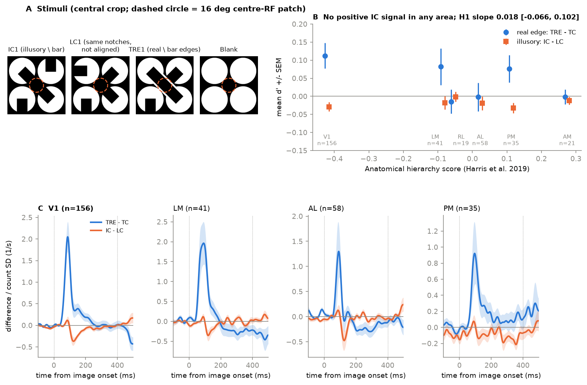
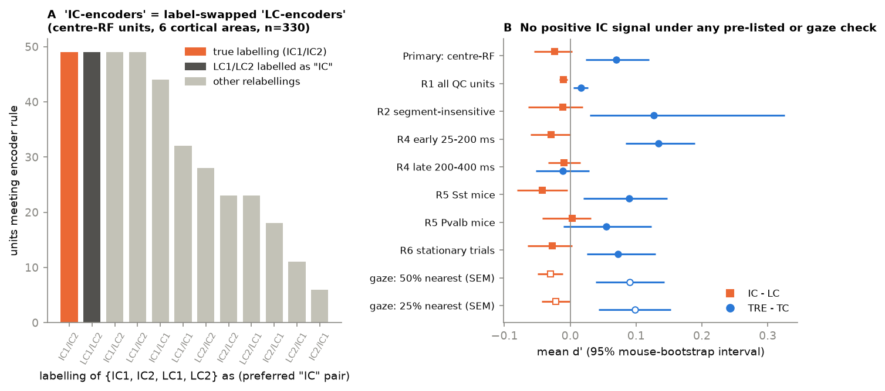

# In 12 mice (OpenScope Neuropixels), illusory-contour images gave no response above matched non-aligned inducers in six visual areas, so the anatomical hierarchy could not order an IC signal

Job `sci-1107-dell-neural-structure-and-computation-6685e121b6b6`, campaign 11_07_2026, topic
neural-structure-and-computation, machine dell, account claude-olen. Analysis, code and text:
Claude Opus 5.5 (`claude-opus-5-5`) with the SCI CLI, 2026-11-12. The signing key is a
campaign-machine key. It is not a personal authorship claim.

## Summary

**Question.** Shin et al. (2025, Nat Neurosci; bioRxiv 10.1101/2023.06.05.543698) used the Allen
OpenScope Illusion data to report illusory-contour (IC) "encoder" neurons in mouse V1 and an IC
representation that starts in higher visual areas and goes back to V1 by feedback. We asked a
structure-function question that these data permit: across all recorded visual areas, do the
strength and the timing of the IC signal follow the anatomical hierarchy score of Harris et al.
(2019), which comes from the laminar patterns of axonal projections? A feedback account predicts a
larger IC signal in higher areas and IC timing that does not increase with the hierarchy, while
real-edge timing increases.

**Data.** DANDI:000248 v0.240502.2344 (CC BY 4.0): 12 mice, 6 Neuropixels probes per mouse, 10,263
units in visual cortex and thalamus, 4,729 after standard quality rules. Block `ICwcfg1`: 400 trials
of each image, 0.4 s each.

**Key design point (new).** We decoded the inducer notches of every image from its pixels. Summed
over the two orientations, the IC images {IC1, IC2} and the line-control images {LC1, LC2} put
exactly one inward notch and one outward notch on every inducer disc. Thus the IC - LC contrast is
zero for any neuron that adds local inducer features linearly, also when its receptive field (RF)
is large. Only the alignment of the notches (the illusory bar) differs. The real-edge contrast
TRE - TC adds thin real bar edges to the same inducers.

**Method.** We froze the plan and its SHA-256 before we computed any IC response
(`files/code/PLAN.md`; one amendment, A1, before any area-level result). Primary units: units whose
RF is at the stimulus centre (346 units; RF-mapping block). Measure: d' of the spike count
0.025-0.40 s. Tests: mouse-level hierarchical bootstrap (2,000 draws).

**Results.**

1. **No configural IC signal (pre-registered check H0b failed).** Mean d'(IC - LC) of centre-RF
   units = -0.024 (95% CI -0.055 to 0.003; one-sided p = 0.95). No area had a positive mean. With
   all 4,729 quality units the mean was -0.010 (CI -0.016 to -0.004).
2. **The positive control worked.** Mean d'(TRE - TC) = 0.070 (CI 0.024 to 0.120). It was 0.11 in
   V1, 0.08 in LM and 0.08 in PM, with onset latencies of 59-76 ms (Fig. 1C).
3. **H1 (IC strength increases with hierarchy) was not supported.** Unit-level slope of d'(IC - LC)
   on the hierarchy score = 0.018 (CI -0.067 to 0.102; p = 0.34). Area-level Spearman rho = 0.09
   (exact p = 0.46, 6 areas). Leave-one-mouse-out slopes: -0.009 to 0.045.
4. **H2 (IC timing against real-edge timing) could not be measured.** Without an IC signal, the IC
   onset latencies were noise (95% intervals about 20 to 380 ms in every area). The slope difference
   had a CI of -0.47 to 0.35 s per hierarchy unit.
5. **Shin-style "IC-encoders" occurred at the rate of label-swapped controls (post hoc).** With the
   rule "IC_k > other IC, IC_k > both LCs, and preferred real edge = k", 49 of 330 centre-RF units
   passed. When we gave the "IC" label to LC1 and LC2, also 49 passed; the 12 relabellings of the
   four images gave 6 to 49 (Fig. 2A). All quality units: 386 (IC labels) against 423 (LC labels).
   The match of IC and real-edge orientation is not specific: all "1" images (IC1, LC1, TC1, TRE1)
   have the same bottom-disc notches, so local features give the match.
6. **All pre-listed robustness checks and a gaze check agreed (Fig. 2B).** Early or late windows,
   segment-insensitive units, Sst or Pvalb mice, stationary trials, and the 50% or 25% of trials
   nearest the resting gaze (10 mice) gave mean d'(IC - LC) between -0.042 and +0.003. No interval
   was above zero. The real-edge signal stayed positive (0.09-0.10 with gaze restriction).
7. **Post hoc observation: a small negative IC - LC transient at 90-150 ms.** Over centre-RF units,
   aligned inducers gave fewer spikes than non-aligned inducers in this window (window chosen after
   we saw Fig. 1C; mean -0.012 count-SD, CI -0.024 to -0.003; V1 -0.015). This is a hypothesis for
   new data, not a finding.

**Main limitations.** This is one configuration (`ICwcfg1`, white inducers, diagonal bars); the
other three IC blocks have 30 trials per image and were not analysed. RF centres came from 16 deg
patches at 9 positions; few higher-area units had RFs at the centre (RL 19, AM 21), and LP (6) and
LGd (2) did not reach the inclusion rule. Our gaze rule is relative (camera pixels), not the 8 deg
rule of Shin et al. Our unit population (all sorted Neuropixels units) is not the same as the
two-photon L2/3 populations of Shin et al., so we do not claim that IC encoders do not exist; we
show that these Neuropixels data do not separate them from image-specific selectivity.

**Figure 1.** (A) Central crops of the IC1, LC1, TRE1 and Blank images (dashed circle: 16 deg
centre-RF patch). (B) Mean d' of centre-RF units for the real-edge contrast (blue, TRE - TC) and the
illusory contrast (orange, IC - LC) against the Harris 2019 hierarchy score; bars are +/- SEM.
(C) Population difference time courses (centre-RF units, Gaussian 10 ms, +/- SEM) in V1, LM, AL
and PM. The real edge gives a clear transient at 60-100 ms; IC - LC does not rise above zero.

**Figure 2.** (A) Number of centre-RF cortical units that pass a Shin-style encoder rule under each
of the 12 ordered labellings of {IC1, IC2, LC1, LC2}. The true labelling (orange) equals the
LC-as-IC labelling (dark gray). (B) Mean d' (95% mouse-bootstrap interval; gaze rows: +/- 1.96 SEM)
for IC - LC (orange squares) and TRE - TC (blue circles) under each pre-listed robustness check
and the post hoc gaze restriction.

## 1. Background and prior campaign work

The campaign has many structure-function results for mouse visual areas, for example spike
reliability against connectome distance from the retina (sci:sha256:19f7eb8e...), LFP Granger
influence from lower to higher areas (sci:sha256:0dd17ccb...), steeper response spectra in higher
areas (sci:sha256:62a723e5...), omitted-flash responses (sci:sha256:3031eca4...) and novelty
responses by cell class (sci:sha256:f17da30f...). A search for "illusory contour", "OpenScope" and
"oddball" found no campaign work on the OpenScope projects. This is the first campaign use of
DANDI:000248.

## 2. Data and units

| Item | Value |
| --- | --- |
| Sessions | 12 mice (9 Sst-IRES-Cre;Ai32, 3 Pvalb-IRES-Cre;Ai32), one session each |
| Units read | 10,263 units whose peak channel is in VIS*, LGd, LGv, LP, LD, POL or IGL |
| Quality units | 4,729 (quality good, ISI violations < 0.5, amplitude cutoff < 0.1, presence > 0.9, rate > 0.1 Hz) |
| Centre-RF units | 346 (V1 156, LM 41, RL 19, AL 58, PM 35, AM 21, LP 6, LGd 2) |
| IC block | `ICwcfg1`: 5,360 image trials per session, each 0.4 s, followed by 0.4 s of the Blank image |
| Images used | IC1/IC2 (frames 3, 7), LC1/LC2 (4, 6), TC1/TC2 (2, 5), TRE1/TRE2 (10, 11), Blank (0), single inducers (14-21) |

The `invalid_times` table was empty in all sessions. Two sessions had no eye tracking.

## 3. Methods

* **Remote reading.** `files/code/remote_h5.py` gives h5py an HTTP Range file object; spike times are
  read for the selected units only (about 3 GB in total).
* **Stimulus decoding.** `01d_templates.py` reads the 22 templates and classifies each disc notch as
  inward or outward (`files/results/template_notches.txt`).
* **Centre-RF units (amendment A1).** In `RFCI_presentations` the 0.25 s patches follow each other
  with no gap, so the pre-stimulus baseline of the original plan was inside the previous patch. A1
  (hashed before any area-level result) defines a centre-RF unit as one whose centre position has
  the largest classic-patch response of 9 positions and whose 40 centre trials exceed the 320 trials
  at the other positions (one-sided Mann-Whitney p < 0.01).
* **Measures.** d'(A - B) = (mean count A - mean count B) / pooled SD. Time courses: 1 ms PSTH
  differences divided by the unit's count SD, smoothed (Gaussian SD 10 ms). Onset latency: first
  time after 20 ms at which the area mean difference exceeds half of its maximum for >= 10 ms.
* **Tests.** Hierarchy scores (Harris 2019, CC+TC+CT iterated, all regions): LGd -0.633, V1 -0.421,
  LM -0.086, RL -0.055, AL 0.023, PM 0.112, LP 0.179, AM 0.275. Areas need >= 15 centre-RF units
  from >= 3 mice. Hierarchical bootstrap: resample mice, then units inside mouse and area.

## 4. Results in detail

**Table 1. Centre-RF units by area (primary analysis).**

| Area | h | units | mice | d'(IC - LC) +/- SEM | d'(TRE - TC) +/- SEM | RE onset (ms) [95% CI] |
| --- | --- | --- | --- | --- | --- | --- |
| V1 (VISp) | -0.421 | 156 | 11 | -0.029 +/- 0.013 | 0.112 +/- 0.036 | 68 [61, 77] |
| LM (VISl) | -0.086 | 41 | 7 | -0.018 +/- 0.018 | 0.082 +/- 0.051 | 59 [52, 81] |
| RL (VISrl) | -0.055 | 19 | 8 | -0.001 +/- 0.014 | -0.014 +/- 0.033 | 72 [54, 121] |
| AL (VISal) | 0.023 | 58 | 9 | -0.019 +/- 0.019 | -0.002 +/- 0.039 | 74 [68, 132] |
| PM (VISpm) | 0.112 | 35 | 10 | -0.032 +/- 0.014 | 0.076 +/- 0.038 | 76 [34, 97] |
| AM (VISam) | 0.275 | 21 | 8 | -0.012 +/- 0.011 | -0.002 +/- 0.020 | 74 [41, 118] |
| LP | 0.179 | 6 | 3 | -0.019 +/- 0.013 | -0.035 +/- 0.026 | excluded |
| LGd | -0.633 | 2 | 1 | 0.039 +/- 0.028 | -0.017 +/- 0.005 | excluded |

**Table 2. Pre-registered tests and checks** (`files/results/all_tests.json`).

| Analysis | areas | mean d'(IC - LC) [95% CI] | mean d'(TRE - TC) [95% CI] | H1 slope [95% CI] |
| --- | --- | --- | --- | --- |
| Primary (centre-RF) | 6 | -0.024 [-0.055, 0.003] | 0.070 [0.024, 0.120] | 0.018 [-0.067, 0.102] |
| R1 all quality units | 7 | -0.010 [-0.016, -0.004] | 0.016 [0.005, 0.027] | 0.016 [-0.012, 0.053] |
| R2 segment-insensitive | 1 (V1) | -0.011 [-0.064, 0.019] | 0.127 [0.030, 0.325] | not testable |
| R4 early 25-200 ms | 6 | -0.029 [-0.060, 0.000] | 0.134 [0.084, 0.190] | 0.031 [-0.039, 0.101] |
| R4 late 200-400 ms | 6 | -0.009 [-0.033, 0.015] | -0.011 [-0.052, 0.029] | 0.008 [-0.076, 0.099] |
| R5 Sst mice | 5 | -0.042 [-0.081, -0.004] | 0.090 [0.020, 0.148] | 0.047 [-0.053, 0.139] |
| R5 Pvalb mice | 3 | 0.003 [-0.043, 0.031] | 0.055 [-0.010, 0.123] | -0.024 [-0.143, 0.150] |
| R6 stationary trials | 6 | -0.028 [-0.065, 0.003] | 0.073 [0.025, 0.130] | 0.046 [-0.056, 0.149] |

R3 (leave one mouse out): H1 slope from -0.009 to 0.045. In R4-early, the area Spearman rho was
0.83 (exact one-sided p = 0.029, uncorrected, one of many checks); here the IC - LC means are
negative and become less negative in higher areas, which is not a positive IC signal.

**Gaze restriction (post hoc, `files/results/gaze_restricted.csv`).** In the 10 mice with eye
tracking, gaze = pupil centre minus corneal reflection. Trials whose mean deviation from the
resting gaze was in the lowest 50% (or 25%) of the session: mean d'(IC - LC) = -0.030 +/- 0.010
(-0.022 +/- 0.011), d'(TRE - TC) = 0.091 +/- 0.027 (0.098 +/- 0.028), 307 centre-RF units.
Encoder counts with IC labels against LC labels: 36 vs 39 (50%), 29 vs 23 (25%).

**Symmetric per-unit tests (`files/results/exploratory_symmetric_counts.csv`).** Among 156 V1
centre-RF units, 29 had IC > LC and 45 had LC > IC (one-sided p < 0.05 each). Both numbers are far
above the 8 expected by chance. Thus many units distinguish the specific IC and LC images, but the
preference sign is not biased toward the aligned (illusory) configuration. A slow-drift correction
(subtract a 25-trial Gaussian trend; `08_drift_check.py`) did not change this (25 vs 43).

## 5. Interpretation

In these Neuropixels data, the alignment of the inducers that makes an illusory bar did not add
spikes in neurons with RFs at the bar, in any of six visual cortical areas, beyond what the same
local inducer features give in a non-aligned configuration. Real bar edges at the same place did
add spikes. Thus the structure-function question (does an IC signal follow the anatomical
hierarchy?) has no signal to order here. The result challenges the generality of IC encoding as a
population-level property of the recorded units. It does not test the two-photon and holographic
results of Shin et al., which used other populations and criteria. A Shin-style encoder rule that
uses the orientation match with real edges is not a specific test in this stimulus set, because the
"1" and "2" image families also differ in their bottom-disc notches.

## 6. Limitations

* Only `ICwcfg1` (white inducers, 45/135 deg bars) was analysed. The `ICwcfg0`, `ICkcfg0` and
  `ICkcfg1` blocks have only 30 trials per image.
* The RF map uses 16 deg patches at 9 positions (spacing 16 deg). RF centre estimates are coarse and
  higher-area units with large RFs are rare in the centre-RF set; R1 (all units) covers them.
* The gaze rule is relative (camera pixels); we could not convert it to degrees.
* d' pools single-trial counts; per-unit tests in both directions show many image-specific units,
  so trial-level noise is not the cause of the null mean.
* The relabel null for encoders is post hoc. The 90-150 ms negative transient is post hoc.
* One stimulus centre for all mice; probes were not placed by us. LP and LGd were too sparse.

## 7. Reproduction

Scripts are in `files/code/`. Copy `files/code/` and `files/provenance/` into an empty folder and
run `bash code/00_get_data.sh` there. It downloads the Harris 2019 spreadsheet (hash-checked), reads
the 12 DANDI assets by HTTP Range into `scratch/` (outside this bundle), and runs steps 02-07. Run
time on 2 CPUs: about 40 min of network reads and 30 min of analysis. Seeds are fixed
(`03_analysis.py`: 20261112; `05_gaze.py`: 7; `07_posthoc_dip.py`: 1). Software versions are in
`files/provenance/environment.txt`. Plan hashes are in `files/provenance/PLAN_sha256_frozen.txt`.

Files: `results/unit_measures.csv.gz` (10,263 units: area, layer, quality, RF flags, all d' values
and per-unit p values); `results/area_table_*.csv`; `results/all_tests.json`;
`results/exploratory_*.csv`; `results/gaze_restricted*.csv`; `results/posthoc_ic_dip_90_150ms.json`;
`results/posthoc_drift_corrected_counts.csv`; `results/template_notches.txt`. External terms and attribution: `files/NOTICE.md`.

## 8. Open questions for the next worker

* Repeat with the other three IC blocks pooled (30 trials per image each) and with the
  `ICkcfg` (black inducer) polarity.
* Test the 90-150 ms aligned-inducer suppression with a pre-set window in an independent data set
  (for example the two-photon data of Shin et al., if released).
* Use the `sizeCI` block to estimate RF size and test whether units whose classic RF is smaller than
  the central gap behave differently.
* Look for IC signals in the LFP or current-source density of the probe files (`*_ecephys.nwb`),
  where feedback to superficial layers might be visible without single-unit selectivity.
