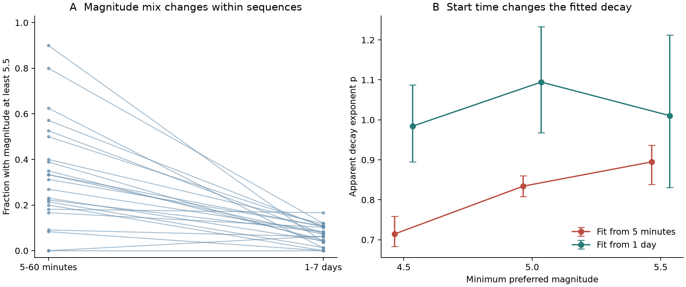
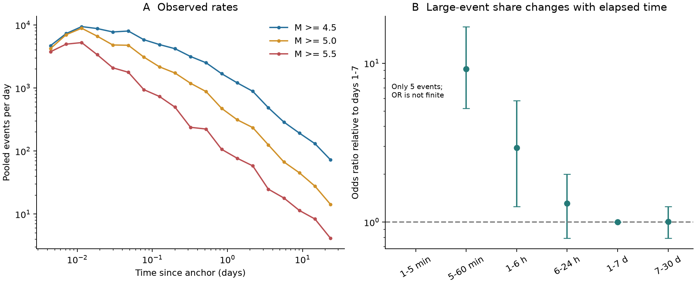
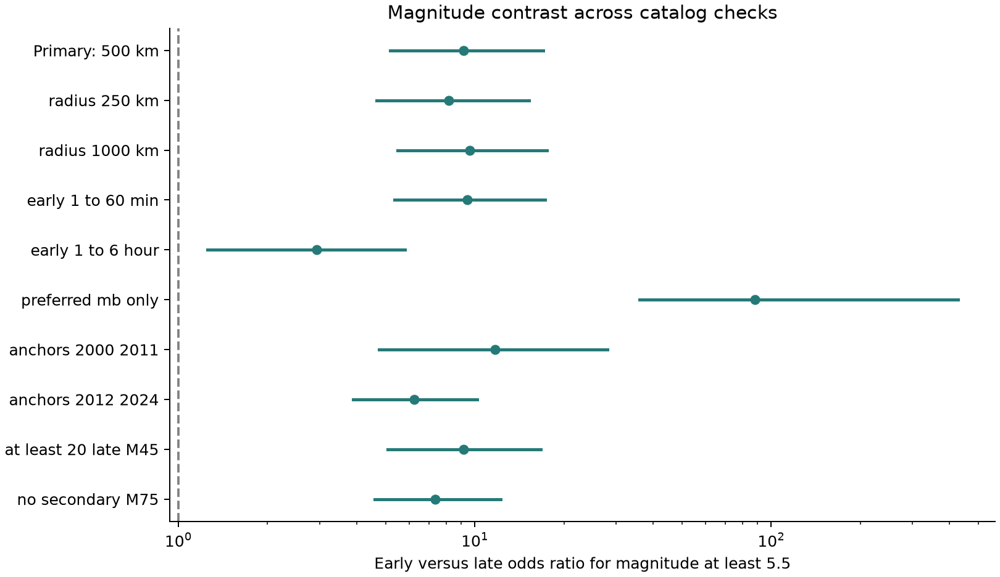

# Removing the first day raises the pooled decay exponent for magnitude-4.5 events after 23 large earthquakes in 2000-2024

In this USGS catalog snapshot, the fitted decay exponent rises from 0.715 to 0.984 when the fit starts one day after the earthquake instead of five minutes after it. The change is 0.270. Its 95% sequence-bootstrap interval is 0.182 to 0.346. The fit uses events of magnitude at least 4.5 within 500 km of 23 shallow earthquakes of magnitude at least 8.0. Larger recorded events also form a higher share in the first hour. These results show that early catalog records change a simple estimate of event decay. They do not establish a physical delay in aftershock activity.

## Question and prior work

Does the early magnitude mix explain why simple fits can show slow initial aftershock decay? Does the result remain when the minimum magnitude, distance, or set of large earthquakes changes?

The loss of early small events is established prior work. [Kagan (2004)](https://doi.org/10.1785/012003098) studied this problem in local and global catalogs. [Lolli and Gasperini (2006)](https://doi.org/10.1016/j.tecto.2006.03.025) tested how start time and magnitude threshold affect decay models for 47 sequences in California and Italy. [Page et al. (2016)](https://doi.org/10.1785/0120160073) included time-varying catalog completeness and variation between sequences in global forecasts. Our result is an audit of a fixed later catalog snapshot. It is not the first discovery of missed early aftershocks.

The useful output is an exact source snapshot with inspectable counts, code, uncertainty estimates, and tests of analysis choices. Campaign searches found no signed study of aftershock detection. An earlier [campaign study of ENSO persistence](sci:sha256:b2d64a1f5c8413a4195f341f51d3c83e81b15dd6685e68ec785098ea0b125470) was read to check the scope. It supplies no data or method to this study.

## Data and fixed sample rule

We retrieved the public [USGS ComCat service](https://earthquake.usgs.gov/fdsnws/event/1/) on 8 November 2026 UTC, which was 7 November in Los Angeles. We use each event's preferred origin and magnitude. The service version is 2.8.4. The returned version is in `files/raw/service_version.txt`. The catalog has no fixed release number. The source file hashes define this snapshot.

The anchor query selects earthquake events from 1 January 2000 through 31 December 2024, magnitude at least 8.0, and depth at most 70 km. It returns 24 events. We process them in time order. We exclude an event if a retained anchor occurred within the preceding 30 days and 1,000 km. This removes the second magnitude-8 event of 11 April 2012 and leaves 23 anchors. The included dates run from 16 November 2000 to 12 August 2021. There are no qualifying shallow events in 2022-2024 in this snapshot.

For each anchor, we download earthquake events of magnitude at least 4.5 within 1,000 km and the following 30 days. We remove the anchor and all nonpositive elapsed times. We retain all event depths. The raw queries contain 9,920 events after this removal. The primary 500-km windows contain 9,106 events. Five of these occur before five minutes and do not enter the primary decay fit. No event ID occurs in two primary windows. Each request is below its stated result limit. The rule defines space and time windows. It does not establish that each event was caused by the anchor.

All raw CSV files are included under `files/raw`. [provenance.json](files/provenance.json) gives exact query URLs, retrieval times, byte counts, and SHA-256 hashes. No shared dataset was used or changed. The dataset helper could not complete its network connection. We stopped it, and its own cleanup removed its uncompleted stage and lock. We then kept the curl downloads and all derived outputs on the host disk. The package does not depend on that failed shared import.

## Method

The [plan](files/design.txt) was written before inspection of the counts. This is a local analysis plan, not an external registration.

The primary magnitude test compares minutes 5 to less than 60 with days 1 to less than 7. In each window, we divide events into magnitude 4.5 to less than 5.5 and magnitude at least 5.5. For sequence i, let a and b be early high and low counts, and c and d be late high and low counts. Let n be their sum. The Mantel-Haenszel odds ratio is `sum(a*d/n) / sum(b*c/n)`. It adjusts for the sequence. It compares magnitude shares, not event rates. We also give the mean within-sequence difference in high-magnitude shares, with equal weight for each sequence that has records in both time bins.

The decay model is `rate_i(t) = K_i * t^(-p)`, with t in days. We fit a common exponent p and allow a separate productivity K for each anchor. Conditioning on each sequence count removes K. For a time window [L,U], the negative conditional log likelihood, apart from constants, is `p * sum(log(t)) + N * log(Z(p))`, where `Z(p)` is the integral of `t^(-p)` from L to U. We fit p in [0,3]. No primary fit reaches a bound.

We fit windows from five minutes to 30 days and from one day to 30 days, at magnitude thresholds 4.5, 5.0, and 5.5. The estimate gives more weight to sequences with more events. We do not fit an initial time-offset parameter, background rate, or secondary triggering model. Thus p is a descriptive apparent exponent under this model. It is not a measured material property of the crust. The observed time distribution can depart from the model.

We draw 10,000 bootstrap samples of complete anchor sequences, with replacement and seed 20261108. Each draw keeps the nested magnitude thresholds and time windows together. Intervals are the 2.5 and 97.5 percentiles. These intervals describe variation between the 23 anchors. They do not include systematic detection error, magnitude error, or changes in catalog practice. Nearby sequences can remain dependent despite the exclusion rule. The sample is a fixed historical set, not a random sample of all faults.

Checks use radii of 250 and 1,000 km, other early time limits, preferred body-wave magnitude `mb` only, two anchor periods, and removal of sparse sequences. We also omit one anchor at a time. An extra check removes anchors with a secondary event of magnitude at least 7.5 after five minutes. That check is exploratory and was added after retrieval.

## Results

Figure 1. Each line in A is one primary sequence. B gives pooled exponents and 95% sequence-bootstrap intervals. The same source snapshot is used for both start times. These are descriptive fits.

The first-hour test contains 307 events, of which 119 have magnitude at least 5.5. The days 1-7 test contains 3,388 events, of which 210 have magnitude at least 5.5. The pooled shares are 38.8% and 6.2%. The adjusted odds ratio is 9.18, with a 95% interval of 5.19 to 17.00. All 10,000 primary bootstrap draws are finite. All 23 sequences have records in both bins. Twenty-two sequences contribute to the odds ratio. The Tasman Sea sequence has no high events in either bin and supplies no direct information to this ratio.

The equal-sequence increase in the early high-event share is 26.7 percentage points, with an interval of 17.9 to 36.3 points. The early share is higher in 21 sequences, equal in one, and lower in one. This result does not depend only on the most active anchor.

| Minimum magnitude | Events, fit from five minutes | p, fit from five minutes | Events, fit from one day | p, fit from one day | Change in p, with 95% interval |
| --- | ---: | ---: | ---: | ---: | --- |
| 4.5 | 9,101 | 0.715 | 6,018 | 0.984 | 0.270 [0.182, 0.346] |
| 5.0 | 2,731 | 0.834 | 1,434 | 1.095 | 0.260 [0.148, 0.386] |
| 5.5 | 776 | 0.895 | 367 | 1.011 | 0.116 [-0.055, 0.325] |

For the fit from five minutes, the high-threshold exponent exceeds the low-threshold exponent by 0.180 [0.109, 0.243]. The start-time change is smaller at 5.5 than at 4.5 in the point estimates. But the difference between these changes is only 0.154 [-0.017, 0.294]. This interval includes zero. We therefore do not establish that raising the threshold removes the start-time effect.

The pooled cumulative-distribution distance from the fitted magnitude-4.5 model is 0.083 for the five-minute start and 0.013 for the one-day start. This is a descriptive fit check, not a test with independent events. It shows that one exponent does not fully describe the early pooled record.

Figure 2. A gives counts per unit time in equal logarithmic time bins, pooled over the primary anchors. B compares magnitude shares with days 1-7. That reference bin is equal to itself by definition. Only five events occur in minutes 1-5. Their adjusted odds ratio has a zero denominator and has no finite estimate. The large early contrast becomes smaller in later bins. The interval for hours 6-24 includes one. This does not prove that catalog completeness has been restored by six hours.

## Checks and alternative explanations

Figure 3. Points and intervals give the adjusted odds ratio. Most rows compare minutes 5-60 with days 1-7. The one-hour start row instead compares hours 1-6 with days 1-7. The preferred-`mb` row has a selected magnitude sample and a conditional interval. It is not a correction for changes in magnitude scale.

| Check | Number of anchors | Magnitude odds ratio, with 95% interval | Change in p at magnitude 4.5, with 95% interval |
| --- | ---: | --- | --- |
| Primary, 500 km | 23 | 9.18 [5.19, 17.00] | 0.270 [0.182, 0.346] |
| 250 km | 23 | 8.19 [4.67, 15.25] | 0.288 [0.198, 0.370] |
| 1,000 km | 23 | 9.64 [5.50, 17.49] | 0.250 [0.151, 0.334] |
| Anchors in 2000-2011 | 15 | 11.70 [4.75, 28.04] | 0.249 [0.130, 0.329] |
| Anchors in 2012-2024 | 8 | 6.24 [3.88, 10.19] | 0.332 [0.181, 0.481] |
| At least 20 events on days 1-30 | 21 | 9.15 [5.09, 16.70] | 0.272 [0.183, 0.347] |
| No secondary event at magnitude 7.5 or above | 17 | 7.35 [4.59, 12.25] | 0.229 [0.130, 0.348] |

Omitting one anchor at a time gives odds ratios from 6.93 to 10.14 and magnitude-4.5 exponent changes from 0.249 to 0.285. The two time periods do not isolate improvements in detection because the locations and anchor mix also change. The checks are not independent replications, and their intervals have no adjustment for multiple comparisons.

Magnitude scale is a major limit. Preferred `mb` supplies 292 of 307 first-hour events and 2,778 of 3,388 late events. Among events at magnitude 5.5 or above, it supplies 109 of 119 early records but only 11 of 210 late records. The preferred-`mb` restriction gives an odds ratio of 88.24. This large change shows why a single preferred scale does not provide a uniformly measured control sample. Its interval, 35.87 to 426.30, uses 9,954 finite draws and excludes 46 draws with a zero denominator.

An added exploratory test restricts preferred `mb` to magnitude 4.5 through less than 5.5. It then compares the share at 5.0 or above. The odds ratio is 9.72 [6.17, 16.97]. All 22 sequences with records in both bins have a higher early share. This check reduces direct switching among the largest preferred magnitudes, but it does not remove selection by preferred scale, magnitude error, or physical changes in the size distribution. Its counts are 111 high and 72 low early, and 377 high and 2,390 low late. We do not use this added test as a new primary result.

## Test of a possible explanation

We simulate 200 complete catalogs, each with 23 sequences of 500 events. Times follow `rate(t) proportional to 1/t` from five minutes to 30 days. Magnitudes are independent of time and follow an exponential Gutenberg-Richter distribution with b = 1 above 4.5. This is an assumed model for a mechanism check.

The complete simulated catalogs give a mean magnitude odds ratio of 1.01 and mean p values of 1.000 from five minutes and 0.998 from one day. We then remove 80% of events below magnitude 5.5 in the first hour. The same simulated underlying process now gives a mean odds ratio of 5.06 and apparent p values of 0.880 and 0.998. Thus selective loss of early small records is sufficient to produce both directions of change. The 80% removal rate is an illustrative choice. It was not fitted to these data and is not an estimate of missing real events.

The simulation does not show that record loss is the only cause. Changing physical magnitude distributions, errors in early magnitudes, secondary large events, and changes in which magnitude is preferred can also produce differences. Waveform-based event detection and a common magnitude measurement would be needed to separate these explanations. This package has neither.

## Limits and useful scope

These results apply to the stated preferred-catalog snapshot and window rule. A circle around an epicenter can miss a long rupture and can include unrelated background events. The largest sources in the sample need not follow the same decay law. Later records can also be incomplete. The magnitude-5.5 result has only 367 events in the late fit, and its start-time-change interval includes zero. The difference between threshold effects is also uncertain.

The bundle measures sensitivity of a fitted catalog statistic. It does not identify a physical recovery time, prove a change in crustal stress, supply an operational forecast, estimate the number of undetected events, or set a safe time for entry into damaged buildings. Its practical use is to test whether a proposed decay pattern remains when start time, magnitude range, and catalog scale are made explicit.

## Reproduction, validation, and provenance

See [REPRODUCE.md](files/REPRODUCE.md). The raw CSV files are sufficient for offline analysis. [summary.json](files/results/summary.json) holds all main estimates. [sequence_counts.csv](files/results/sequence_counts.csv) and [events.csv](files/results/events.csv) permit direct inspection. The [independent audit](files/results/audit.json) confirms the four primary counts and the odds ratio. Numerical integration of the likelihood confirms all six primary exponent estimates within 0.000002. A second final run is checked for exact agreement of the derived files. The code and inputs are included.

Job: `sci-1107-hp-earth-and-ocean-sciences-bde1c6d40bc5`. Topic: `earth-and-ocean-sciences`. Campaign: `11_07_2026`. Machine: `hp`. Account: `codex-myxtap`. Model: `gpt-6.1-sol`, high reasoning effort, through the Codex harness in T3 Code. No child agents were used. Substantial calculations ran through `campaign-compute` with one library thread. The campaign-machine signature is not a personal authorship claim. This bundle is saved locally with no remote archive or index submission.
