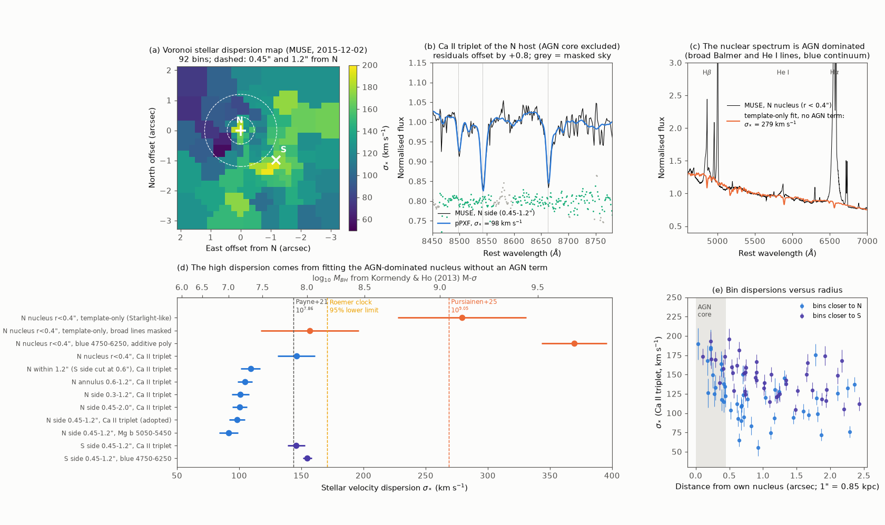
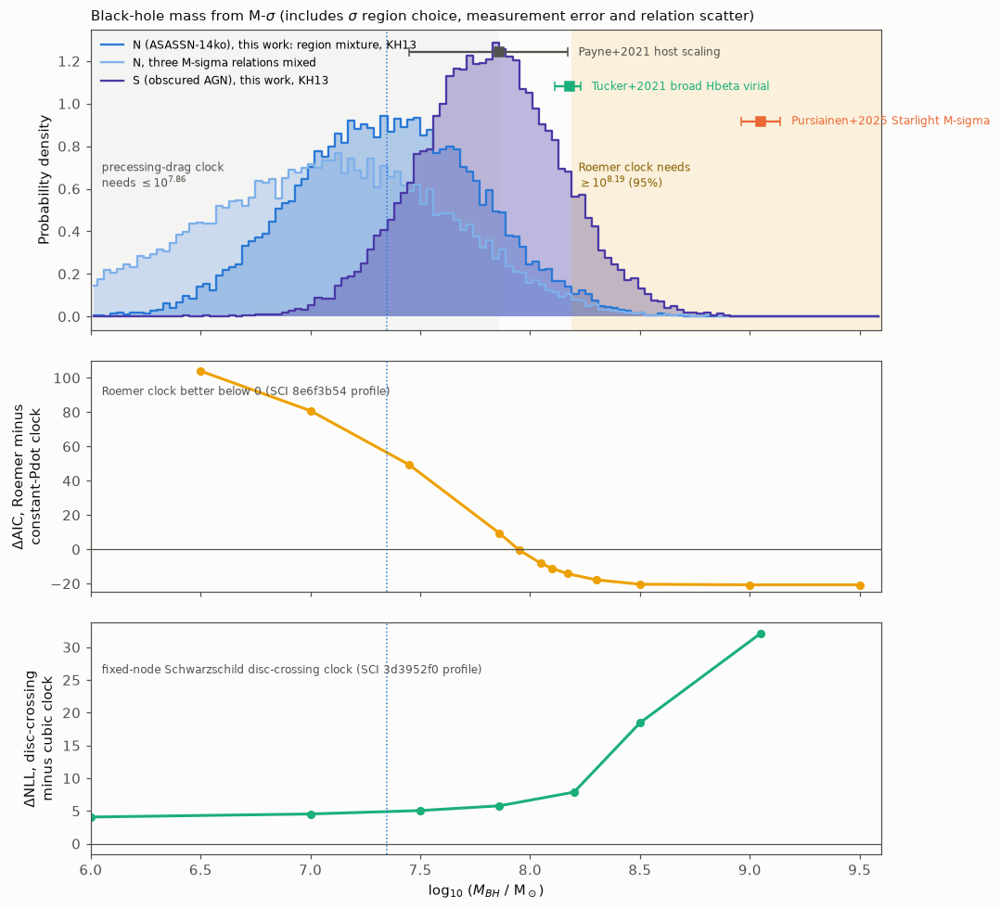
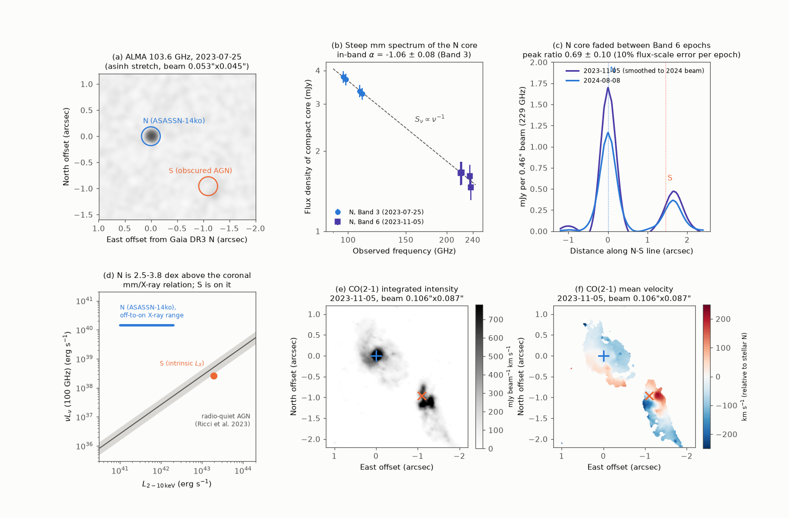

# MUSE stellar kinematics give the ASASSN-14ko black hole about 10^7.35 solar masses, not 10^9, so a light-travel clock needs a 2 percent tail mass; ALMA finds a fading steep-spectrum nuclear core

**Job:** sci-1107-hp-astronomy-981d98f4981e. **Topic:** astronomy. **Campaign:** 11_07_2026. **Machine:** hp. **Account:** claude-sci. **Model:** Claude Opus 5.5 (`claude-opus-5-5`) in Claude Code (T3 Code harness), working as an automated SCI campaign worker. **Analysis date:** 2026-11-11 (UTC). The signing key is a campaign-machine key. It is not a personal authorship claim.

## Summary

**Question.** Campaign studies of the repeating nuclear transient ASASSN-14ko (nucleus N of the merger ESO 253-G003) found that the flare period decreased, stopped decreasing in 2020-2024, and then decreased again. Several proposed clocks for this history depend strongly on the black-hole mass M. A light-travel-time (Roemer) clock needs log M >= 8.19 (95 percent; SCI 8e6f3b54). A precessing star-disc drag clock needs log M <= 7.86-7.98 (SCI cd4bd328). A fixed-node disc-crossing clock fits worse at high mass (SCI 3d3952f0). The published masses disagree: 10^7.86 from host scaling relations (Payne et al. 2021) and 10^9.05 +/- 0.09 from a MUSE velocity dispersion (Pursiainen et al. 2025). No study measured the stellar velocity dispersion of N with a model that includes the active nucleus. We ask: what is M from the stellar kinematics, why do the published values disagree, and which clocks does the mass permit? We also ask what the public ALMA data show at the two nuclei.

**Data.** The public MUSE cube of ESO 253-G003 (2015-12-02) and three public ALMA epochs that no ASASSN-14ko study has used: Band 3 at 0.05 arcsec resolution (2023-07-25), and Band 6 at 0.10 arcsec (2023-11-05) and 0.46 arcsec (2024-08-08). The ALMA data come from a survey of dual AGN (PI E. Treister).

**Method.** We fitted the stellar spectra with pPXF (E-MILES, GALAXEV and FSPS single stellar populations, the MUSE line-spread function, additive and multiplicative polynomials, masks for narrow lines, broad lines and sky lines, wild-bootstrap errors). We used summed spectra of regions around each nucleus, a 92-bin Voronoi map, and the Ca II triplet (CaT) at 8450-8780 A as the main tracer, because it has no broad AGN emission lines. We converted the dispersion to M with three M-sigma relations and propagated the measurement error, the choice of region and the intrinsic scatter. We then reweighted the published likelihood profiles of the clocks with this mass. For ALMA we measured the compact continuum of each nucleus, in-band spectral indices, and a matched-beam comparison of the two Band 6 epochs, and we made CO(2-1) moment maps.

**Results.**

1. **The stellar dispersion of the N host is about 100 km/s.** Outside the AGN core (0.45-1.2 arcsec, on the side away from the companion), the CaT gives sigma = 98 +/- 6 km/s (E-MILES; 93-96 km/s with GALAXEV or four Gauss-Hermite moments; Mg b gives 91 +/- 8 km/s). Other N regions give 100-105 km/s. The map gives 127 km/s within 1.2 arcsec when the AGN core is included and 132 km/s for the whole merger. The companion nucleus S gives 146 +/- 7 km/s (CaT) and 150-161 km/s (blue range).
2. **The published 10^9.05 is an artefact of the AGN.** The nuclear spectrum of N (r < 0.4 arcsec) is dominated by the AGN: blue continuum and broad Balmer and He I lines. A fit with stellar templates only and without broad-line masks, as in a Starlight-type fit, gives sigma = 267-279 km/s, which is log M = 9.04-9.12 with the Kormendy and Ho (2013) relation. This reproduces the published 9.05. If we mask the broad lines, the same fit gives 139-157 km/s. With an additive AGN term the nuclear fits scatter from 32 to 369 km/s, depending on the wavelength range. Thus the nucleus itself cannot give sigma.
3. **The black-hole mass of N is log M = 7.35 +/- 0.42.** We mix six region choices (including the AGN-affected blue-range value, 129 +/- 14 km/s) and use Kormendy and Ho (2013): log M = 7.35 (68 percent: 6.93-7.77; 95 percent: 6.54-8.15). The mixture of three M-sigma relations gives 7.07 (95 percent: 5.88-8.08). This agrees with the host scaling value 7.86 (+0.31/-0.41) at 1 sigma, and it excludes 9.05 (probability 3 x 10^-6). The S nucleus has log M = 7.82 (7.49-8.14).
4. **A light-travel clock needs a 2 percent tail mass.** The Roemer clock is better than a constant period derivative only for log M >= 7.95, and its 95 percent lower bound is 8.19. The probability of log M >= 8.19 is 2.0 percent (Kormendy and Ho) or 1.4 percent (three relations); for the N-side regions alone it is 0.05 percent. The prior-averaged likelihood ratio of the Roemer clock against a constant period derivative, with an AIC penalty for its four extra parameters, falls from 10^3.2 (host-scaling prior) and 10^4.5 (10^9.05 prior) to 10^2.3. The Roemer posterior mass, 8.40 (8.14-8.73), lies above our 95 percent upper bound. Thus the Roemer clock stays possible only if M is in the upper 2 percent tail of the dynamical estimate and the outer orbit is edge-on.
5. **The precessing drag clock is permitted by the mass but still needs an evolved star.** The probability of log M <= 7.86 is 0.89 (<= 7.98: 0.94). At log M = 7.35 the 104-d rest-frame orbit has a = 553 r_g. The precession rate of SCI cd4bd328 (semi-latus rectum 210-230 r_g) then gives e = 0.76-0.79 and a pericentre of 117-130 r_g. A tidal radius at that pericentre needs a star of 20-22 Rsun (penetration factor 1) or 10-11 Rsun (0.5); the 68 percent mass range gives 10-51 Rsun (factor 1). The fixed-node disc-crossing clock remains worse than a cubic clock by Delta NLL = 4.9 at this mass, and by 32 at 10^9.05.
6. **The flaring nucleus has a compact steep-spectrum millimetre core.** At 103.6 GHz, N has 3.53 mJy in a source smaller than 0.03 arcsec (25 pc), 4 mas from the Gaia DR3 position of N. The in-band index in the same observation is alpha = -1.06 +/- 0.08 (S_nu ~ nu^alpha); Band 6 gives -1.04 +/- 0.24, and Band 3 to Band 6 (three months apart) gives -1.01 +/- 0.14. This is optically thin synchrotron emission, not dust or free-free emission. nu L_nu(100 GHz) = 1.5 x 10^40 erg/s, which is 2.5-3.8 dex above the millimetre/X-ray relation of radio-quiet AGN coronae (Ricci et al. 2023) for the 2-10 keV range of N. The obscured companion S is faint (0.06 mJy at 100 GHz) and is on that relation (log ratio -4.87 against -4.58 +/- 0.22).
7. **The millimetre core of N faded.** At a matched 0.46 arcsec beam, the 229 GHz peak of N went from 1.73 mJy/beam (2023-11-05) to 1.19 mJy/beam (2024-08-08): ratio 0.69 +/- 0.10 with a 10 percent flux-scale error per epoch (3.2 sigma). The total flux within 2.5 arcsec agrees to 2-14 percent.
8. **Molecular gas.** CO(2-1) at 0.1 arcsec shows a compact gas concentration on N (13.4 Jy km/s within 0.3 arcsec) with a narrow line (FWHM about 100 km/s) and a small velocity gradient. S has a compact rotating gas structure with +/-250 km/s.

**Interpretation.** The stellar kinematics put the ASASSN-14ko black hole near 10^7.35 solar masses. This removes the high-mass solution that made a light-travel clock easy, and it does not challenge the precessing drag clock. For any clock, a 104-d orbit around this mass has a = 550 r_g, so relativistic precession is 0.18 rad per orbit for e = 0.9. A Sun-like star has a tidal radius of 6 r_g at this mass, so a main-sequence star can be partially disrupted; the evolved-star requirement comes from the drag clock, not from the mass. The millimetre core shows that the flaring nucleus contains a non-thermal outflow or jet that is far brighter than its corona and that changed by about 30 percent in nine months. Its connection to individual flares is not yet measured.

**Limitations.** The MUSE data are from one epoch (2015-12-02) with 0.8 arcsec seeing, so the N host light and the merger light overlap; the region choice is the largest error, and we carry it in the mass. M-sigma relations are calibrated on undisturbed galaxies; ESO 253-G003 is a late-stage merger. The CaT fits have reduced chi2 of 10-30 because the pipeline variance is too small; we scale the errors and use a bootstrap. The blue-range fits of the N side give 119-154 km/s, higher than the CaT; we attribute this to residual AGN light (S shows agreement within 7 percent), and we include it in the mixture. The likelihood profiles of the clocks are from the published bundles; we did not refit the clocks. ALMA variability uses two epochs at different resolutions and the nominal 10 percent Band 6 flux-scale error; the Band 3 to Band 6 index uses non-simultaneous data. The X-ray luminosity range of N is approximate. We do not measure a gas-dynamical mass; the CO disc of N has an unknown inclination.

**Figure 1.** MUSE stellar kinematics. (a) Voronoi map of the CaT dispersion; N (plus) and S (cross); dashed circles at 0.45 and 1.2 arcsec from N. (b) CaT of the N host outside the AGN core with the pPXF fit. (c) The nuclear spectrum of N and a template-only fit without an AGN term, which gives 279 km/s. (d) Dispersion of N and S for different regions and fit set-ups; the top axis gives log M from Kormendy and Ho (2013); dashed lines show the host-scaling mass, the Roemer-clock lower bound and the published 10^9.05. (e) Dispersion of each Voronoi bin against the distance from its own nucleus.

**Figure 2.** Top: distributions of log M for N (region mixture; Kormendy and Ho, and three relations mixed) and S, with the published values and the mass ranges that two clocks need. Middle: Delta AIC of the Roemer clock against a constant period derivative as a function of the mass bound (profile of SCI 8e6f3b54). Bottom: Delta NLL of the fixed-node disc-crossing clock against a cubic clock at fixed mass (SCI 3d3952f0). The dotted line marks the median of our N mass.

**Figure 3.** ALMA. (a) 103.6 GHz continuum; N is a compact source; S is faint. (b) Per-spw fluxes of the compact core of N in Band 3 and Band 6 with an S_nu ~ nu^-1 line. (c) Profiles along the N-S line at 229 GHz in the matched 0.46 arcsec beam for the two Band 6 epochs. (d) 100 GHz luminosity against 2-10 keV luminosity: N lies far above the coronal relation, S is on it. (e, f) CO(2-1) integrated intensity and mean velocity.

## 1. Context

ASASSN-14ko has UV/optical flares every 104-115 d (Payne et al. 2021, 2022). Campaign studies built an X-ray clock and found a period decrease until 2020, a constant period of 108.44 d in 2020-2024 and a shorter period after 2023 (SCI 049d6e3e, 2b5fd32c, 967e3773, b03f0a97, 067e9565). Chandra showed that N is the flaring nucleus and that S is a steady obscured AGN with an intrinsic 2-10 keV luminosity of 1.9 x 10^43 erg/s (SCI dc60fe15). Many proposed clocks depend on M: the Roemer clock (SCI 8e6f3b54), the precessing drag clock (SCI cd4bd328), the fixed-node disc-crossing clock (SCI 3d3952f0), binary perturbation and energy budgets (SCI 0b2fbeac, 14a2509e). They used 10^7, 10^7.86 or a broad mass range. SCI 3d3952f0 noted the "higher host mass estimate in MUSE work" (Pursiainen et al. 2025; 10^9.05). Pursiainen et al. adopted 10^7.86 themselves but reported 10^9.05 from Starlight fits of the nuclear MUSE spectrum. Tucker et al. (2021) analysed the same MUSE cube but did not fit stellar absorption lines ("the continuum emission is too weak"). They gave a virial mass of 10^8.18 from double-peaked broad H beta. A campaign search (`sci search` for MUSE, velocity dispersion, black hole mass, ALMA, millimetre; 2026-11-11) found no study of the stellar kinematics or of the ALMA data.

## 2. Data

| Data | Source, version | Use | In bundle |
| --- | --- | --- | --- |
| MUSE cube ADP.2016-09-07T11:17:58.674 (programme 096.D-0296(A), 2015-12-02, 2476 s, WFM, 4750-9350 A) | ESO Science Archive, downloaded 2026-11-11 | Stellar kinematics | No; derived fits and bin table |
| ALMA 2022.1.01348.S, uid://A001/X2d20/X1077: Band 3 continuum (tt0, 96.6-110.6 GHz) and per-spw mfs images, 2023-07-25, beam 0.053 x 0.045 arcsec | ALMA Science Archive DataLink | Core flux, spectral index | No; aperture and Gaussian fluxes |
| ALMA 2023.1.01196.S, uid://A001/X3621/X138b: Band 6 continuum and mfs images (self-calibrated and regular), CO(2-1) repBW cube, 2023-11-05, continuum beam 0.101 x 0.083 arcsec (CO 0.106 x 0.087) | as above | Core flux, variability, CO | No; fluxes and CO summary |
| ALMA 2023.1.01196.S, uid://A001/X3621/X138d: Band 6 continuum and mfs images, 2024-08-08, beam 0.46 x 0.36 arcsec | as above | Variability | No |
| pPXF SSP templates (E-MILES, GALAXEV, FSPS; ppxf_data main) | github.com/micappe/ppxf_data | Templates | No |
| Roemer-clock profile (`model_table.csv`), disc-crossing profile (`summary.csv`) | SCI 8e6f3b54, 3d3952f0 | Clock tests | No; hashes in `files/data/sci_inputs.txt` |
| X-ray clock, Chandra results, precessing-drag parameters | SCI b03f0a97, dc60fe15, cd4bd328 | Phases, X-ray range, drag test | Values only |

The SHA-256 of every raw file is in `files/data/SHA256SUMS_raw.txt`. Terms and acknowledgements: `files/NOTICE_external_data.md`. We use z = 0.0425, D_L = 188 Mpc and 0.85 kpc per arcsec (Tucker et al. 2021).

## 3. Methods

**3.1 MUSE spectra** (`02_muse_extract.py`). The cube WCS is offset from Gaia DR3 by 1.3 arcsec. We put N on the brightest continuum pixel (5100-6100 A) near the Gaia position and S at the Gaia N-S offset, and refined both by 3 x 3 centroids (separation 1.53 arcsec). We summed spaxels in circles and annuli around each nucleus. "Side" regions keep only spaxels closer to that nucleus than to the other. Other regions exclude spaxels within 0.6 arcsec of the other nucleus.

**3.2 pPXF fits** (`03_ppxf_sigma.py`). Spectra are moved to the rest frame (z = 0.0425) and log-rebinned (42 km/s per pixel in the CaT, 51-69 km/s in the other ranges). The templates are convolved to the MUSE line-spread function, FWHM(lambda) = 5.866e-8 lambda^2 - 9.187e-4 lambda + 6.040 A (Bacon et al. 2017), divided by (1 + z). Masks: broad H beta (4780-4945 A), broad He I and Na D (5820-5935 A), broad H alpha and [N II] (6420-6720 A), narrow lines (+/-900 km/s; +/-600 km/s in the CaT), interstellar Na D, sky lines and O2 bands. Set-ups: CaT 8450-8780 A (additive degree 4, multiplicative 2; also degree 8 and four moments), Mg b 5050-5450 A, blue 4750-6250 A (degree 4, 8, 12), red 6750-7500 A, and "template-only" fits 4600-7000 A without additive polynomials (multiplicative degree 4), with and without the broad-line masks. Errors: formal error times sqrt(chi2/dof), and the standard deviation of 20 wild-bootstrap refits (10 for the template-only runs); we quote the larger.

**3.3 Map** (`06_muse_sigma_map.py`). Voronoi binning (vorbin) of spaxels within 2.6 arcsec of the midpoint to a pipeline S/N of 60 in the CaT continuum gives 92 bins. Each bin is fitted in the CaT and the blue range. The luminosity-weighted sigma_e = sqrt(<v^2 + sigma^2>) uses the CaT flux of each bin.

**3.4 Mass** (`07_mass_and_clocks.py`). Six equally weighted region choices for N (table in `files/results/mass_summary.json`): N side 0.45-1.2 (98.4 +/- 6.3), N side 0.45-2.0 (100.4 +/- 6.0), N annulus 0.6-1.2 (104.8 +/- 6.0), map within 1.2 arcsec including the core (126.8 +/- 8), whole merger without the N core (132.0 +/- 8), and the N-side blue range (129.0 +/- 13.6 km/s). We add the template scatter (2.9 km/s) and an aperture correction (R_ap/R_e)^0.066 with R_e from 0.5 to 3 kpc (Cappellari et al. 2006). Relations: log M = a + b log(sigma/200) with (a, b, scatter) = (8.49, 4.377, 0.29) (Kormendy and Ho 2013), (8.32, 5.64, 0.38) (McConnell and Ma 2013), (8.32, 5.35, 0.49) (van den Bosch 2016), including the coefficient errors; 400,000 Monte Carlo samples.

**3.5 Clock tests** (`07_mass_and_clocks.py`). Roemer clock: we interpolate the published maximum log-likelihood as a function of the mass bound (SCI 8e6f3b54; the best fits all reach K = a/c, an edge-on outer orbit) and compare it with the constant-Pdot clock (k = 11; Roemer k = 15). We report the probability of the mass needed, the posterior mass from likelihood x our mass distribution, and the prior-averaged likelihood ratio with a factor exp(-4). Precessing drag: from the fitted semi-latus rectum p = 210-230 r_g and a = (G M P_rest^2/4 pi^2)^(1/3) with P_rest = 108.44/1.0425 d, we get e, r_p = p/(1 + e) and R* = beta r_p (M*/M)^(1/3) for M* = 1 Msun. Disc crossing: the published NLL at fixed mass, against the published cubic clock.

**3.6 ALMA** (`01_alma_continuum.py`, `05_alma_variability.py`, `08_alma_summary.py`, `04_alma_co.py`, `04b_co_moments.py`). Elliptical Gaussian fits and apertures at the Gaia DR3 positions of N and S; rms from a 3-8 arcsec annulus. In-band indices are weighted power-law fits to the per-spw Gaussian fluxes of one epoch. For variability the 2023 Band 6 image is convolved with the exact difference kernel to the 2024 beam, scaled to Jy per new beam and regridded. We use a 5 percent (Band 3) and 10 percent (Band 6) flux-scale error per epoch. The CO cube is continuum-subtracted with line-free channels (|v| > 600 km/s); moments use a smoothed 3-sigma mask. Phases use the constant X-ray clock dip_n = 58112.185 + 108.437 (n - 11) (SCI b03f0a97).

## 4. Results

### 4.1 Stellar dispersions

Table 1. Selected pPXF results (`files/results/ppxf_grid_*.csv`, `ppxf_starlike.csv`). Errors are the larger of the scaled formal and the bootstrap errors.

| Region | Set-up | sigma (km/s) |
| --- | --- | --- |
| N side 0.45-1.2 arcsec | CaT, E-MILES (adopted base) | 98.4 +/- 6.3 |
| N side 0.45-1.2 | CaT, E-MILES, 4 moments / GALAXEV | 96.3 +/- 8.5 / 92.7 +/- 6.8 |
| N side 0.45-1.2 | Mg b | 91.4 +/- 7.5 |
| N side 0.45-1.2 | blue, seven set-ups | 119-154 |
| N side 0.45-2.0 / 0.3-1.2 / annulus 0.6-1.2 | CaT, E-MILES | 100.4 / 101.1 / 104.8 |
| N r < 1.2 (S side cut) | CaT, E-MILES | 109.2 +/- 8.0 |
| N nucleus r < 0.4 | CaT E-MILES / GALAXEV / degree 8 | 146 / 202 / 51 |
| N nucleus r < 0.4 | blue, degree 8 / Mg b | 369 / 32 |
| N nucleus r < 0.4 (0.6) | template-only, no broad masks (GALAXEV) | 279 (267) |
| N nucleus r < 0.4 (0.6) | template-only, broad masks (GALAXEV) | 157 (139) |
| S side 0.45-1.2 | CaT / blue degree 8 / Mg b | 146.0 +/- 6.9 / 154.8 +/- 3.5 / 129.2 +/- 4.0 |
| S side 0.45-2.0 | CaT / blue | 140.5 / 147.6 |

The CaT with an additive degree of 8 over 330 A gives lower values (66-80 km/s for N, 128-129 km/s for S) because the polynomial absorbs the line wings; we do not use it. The template-only fits of N have reduced chi2 of 130-370 and velocity offsets of -60 to -145 km/s. They are not acceptable fits; they show how the high value arises.

### 4.2 Mass of N and S

Table 2. log M (`files/results/mass_summary.json`).

| Estimate | median | 68 percent | 95 percent |
| --- | --- | --- | --- |
| N, region mixture, Kormendy and Ho | 7.35 | 6.93-7.77 | 6.54-8.15 |
| N, region mixture, three relations | 7.07 | 6.46-7.61 | 5.88-8.08 |
| N, N-side CaT only, Kormendy and Ho | 7.06 | 6.72-7.41 | 6.38-7.74 |
| S, side CaT, Kormendy and Ho | 7.82 | 7.49-8.14 | 7.18-8.44 |
| Payne et al. 2021 (host scaling) | 7.86 | 7.45-8.17 | - |
| Pursiainen et al. 2025 (Starlight sigma) | 9.05 | 8.96-9.14 | - |

### 4.3 Clocks

Table 3. Clock tests (`files/results/clock_mass_tests.json`).

| Test | Host-scaling prior (7.86) | Pursiainen prior (9.05) | This work (N, KH13 mixture) |
| --- | --- | --- | --- |
| P(log M >= 8.19), Roemer 95 percent bound | 0.14 | 1.00 | 0.020 |
| log10 penalised likelihood ratio, Roemer vs constant Pdot | 3.20 | 4.50 | 2.28 |
| Roemer posterior log M (95 percent) | 8.43 (8.16-8.79) | 9.05 (8.88-9.23) | 8.40 (8.14-8.73) |
| P(log M <= 7.86), precessing drag | 0.50 | 0 | 0.89 |

The constant-Pdot clock is not the best non-Roemer clock (a cubic clock is better by Delta lnL = 4.4 with one more parameter), so the Roemer ratios are upper limits on its support. With the N-side CaT alone, P(log M >= 8.19) = 0.0005 and the ratio is 10^0.56.

Table 4. Orbit scales (`clock_mass_tests.json`, `orbit`).

| log M | a (r_g) | GR precession, e = 0.9 (rad/orbit) | Solar-star tidal radius (r_g) | R* for r_p = 4 r_g (Rsun) |
| --- | --- | --- | --- | --- |
| 7.35 (this work) | 553 | 0.18 | 5.9 | 0.67 |
| 8.15 (our 97.5 percent) | 162 | 0.61 | 1.7 | 2.3 |
| 7.86 (Payne) | 252 | 0.39 | 2.7 | 1.5 |
| 9.05 (Pursiainen) | 41 | 2.44 | 0.44 | 9.2 |

### 4.4 ALMA

Table 5. Continuum of N (`files/results/alma_summary.json`, `alma_continuum.csv`).

| Epoch (clock phase) | Frequency | Flux of compact core | Index |
| --- | --- | --- | --- |
| 2023-07-25 (21.9 d before dip 30) | 96.6-110.6 GHz | 3.79 to 3.27 mJy; 3.53 mJy at 103.6 GHz | -1.06 +/- 0.08 |
| 2023-11-05 (30.8 d before dip 31) | 220.6-237.1 GHz | 1.59 mJy at 228.6 GHz | -1.04 +/- 0.24 |
| 2024-08-08 (27.9 d after dip 33) | 220.6-236.8 GHz | 1.33 mJy (0.46 arcsec beam; includes extended dust) | +0.71 +/- 0.50 |

Matched-beam peaks at 229 GHz: 1.73 mJy/beam (2023) and 1.19 mJy/beam (2024); ratio 0.69 (self-calibrated) and 0.66 (regular calibration); a point-plus-Gaussian decomposition gives 1.48 and 1.04 mJy for the point component. S at 103.6 GHz: 0.062 mJy/beam (7 sigma).

## 5. Discussion

The CaT of the N host gives about 100 km/s. The higher values come from regions or wavelength ranges where AGN light or the merger dominates; including them moves log M only up to about 7.7 (whole merger, 132 km/s). The value 10^9.05 needs about 270 km/s. We reproduce it only with a template-only fit of the AGN-dominated nucleus, which has unacceptable residuals. Thus the dynamical evidence points to 10^7-10^7.8 solar masses, and the scaling-relation value 7.86 is at the upper end.

For the clock question this has three consequences. (1) The Roemer clock needs the outer orbit to be close to edge-on and M in the upper 2 percent of the dynamical estimate. A clock that needs both is now less likely than the published analysis assumed. (2) The precessing drag clock is consistent with the mass, but it still needs a star of about 10-50 Rsun; at 10^7.35 a Sun-like star could also be disrupted, so the star size is a property of the drag clock, not of the mass. A test of the drag clock should therefore look at the star (for example the flare energy per orbit and the mass loss). (3) Energy budgets that used 10^7 solar masses (for example SCI 14a2509e) are near our median and remain valid; budgets at 10^7.86 use an r_g 3.2 times larger and an orbit 1.5 times larger (in cm) than at 10^7.35, and place the orbit at 252 instead of 553 r_g.

The millimetre core is a new property of the ASASSN-14ko nucleus. Its steep spectrum and its luminosity far above the coronal relation mean optically thin synchrotron emission from a relativistic outflow or jet. If the spectrum is a single power law, it must turn over below 100 GHz, because the ASKAP 888 MHz flux of the whole galaxy is about 44 mJy (Huang et al. 2025) and an extrapolation with alpha = -1 would give about 400 mJy. A 30 percent fall in nine months means a size below about 0.25 pc (light-travel time), if the change is intrinsic. Repeated partial disruptions can feed such an outflow. Dense ALMA monitoring through a flare cycle would show if the core responds to the 108-d clock.

## 6. Reproduction

`files/code/run_all.sh` downloads the raw data (about 6.5 GB) into a separate scratch directory, checks the SHA-256 sums, and runs all steps. It needs Python 3.12 with the packages in `files/code/requirements.txt` and about 2-3 hours on 2 cores. Unpack the two SCI input bundles first (see `files/data/sci_inputs.txt`). Script order: 00 retrieve; 01, 05, 04, 04b, 08 ALMA; 02, 03, 06 MUSE; 07 mass and clocks; 09, 10 figures. All Monte Carlo seeds are fixed (pPXF bootstrap seed 12345, mass seed 20261111).

## 7. Acknowledgements and data terms

This paper makes use of the following ALMA data: ADS/JAO.ALMA#2022.1.01348.S and ADS/JAO.ALMA#2023.1.01196.S. ALMA is a partnership of ESO (representing its member states), NSF (USA) and NINS (Japan), together with NRC (Canada), NSTC and ASIAA (Taiwan), and KASI (Republic of Korea), in cooperation with the Republic of Chile. The Joint ALMA Observatory is operated by ESO, AUI/NRAO and NAOJ. Based on observations collected at the European Southern Observatory under ESO programme 096.D-0296(A), obtained from the ESO Science Archive Facility. See `files/NOTICE_external_data.md`.

## References

Bacon R. et al. 2017, A&A 608, A1. Cappellari M. 2023, MNRAS 526, 3273. Cappellari M. et al. 2006, MNRAS 366, 1126. Cappellari M. & Copin Y. 2003, MNRAS 342, 345. Huang S. et al. 2025, ApJ (arXiv:2506.15039). Kormendy J. & Ho L. C. 2013, ARA&A 51, 511. McConnell N. J. & Ma C.-P. 2013, ApJ 764, 184. Payne A. V. et al. 2021, ApJ 910, 125. Pursiainen M. et al. 2025, MNRAS 545 (staf2093; arXiv:2507.12520). Ricci C. et al. 2023, ApJL 952, L28. Tucker M. A. et al. 2021, MNRAS 506, 6014. van den Bosch R. C. E. 2016, ApJ 831, 134. Vazdekis A. et al. 2016, MNRAS 463, 3409.
