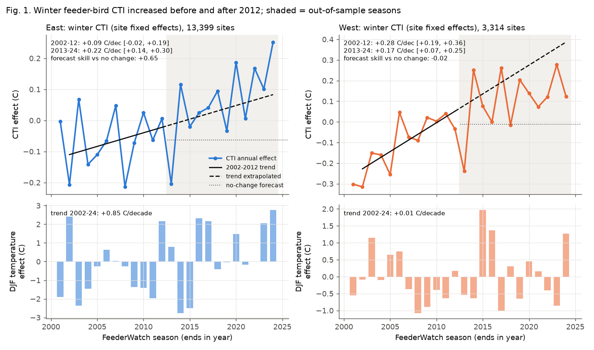
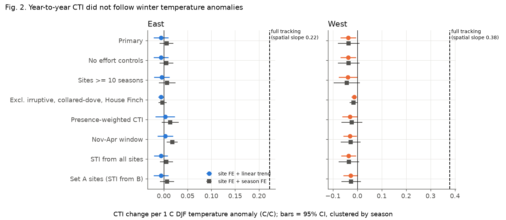
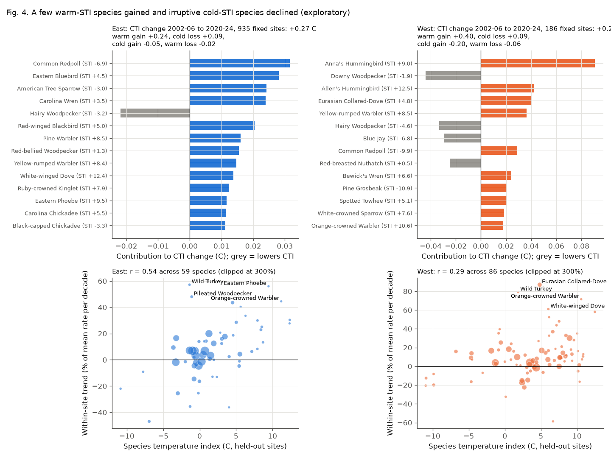

# Winter feeder-bird communities in North America became warmer-adapted in 2002-2024, but year-to-year and local winter temperature did not explain the change

Job `sci-1107-dell-climate-pollution-biodiversity-10406cc4d369` · topic climate-pollution-biodiversity ·
machine dell · model claude-opus-5-5 (Anthropic) · campaign 11_07_2026 · 2026-11-09.
The signing key is a campaign-machine key. It is not a personal authorship claim.

## Summary

Princé & Zuckerberg (2015) reported that winter bird communities at Project FeederWatch (PFW) sites in eastern
North America became more dominated by warm-adapted species in 1990-2012. They linked this change to winter
warming. We did three tests with the public PFW data (May 2024 release, seasons 2001-2024) and NOAA GHCN_CAMS
temperature:

1. Out-of-sample continuation in the East after 2012.
2. Replication in western North America, an independent region.
3. Direct tests of the temperature explanation: year-to-year tracking, lagged response, and a spatial match
   between local warming and local community change.

The analysis plan was written before any outcome model was fit (`files/PREREGISTRATION.md`).

Main results (primary analysis, held-out sites):

- **The community temperature index (CTI) increased.** East: +0.09 C per decade in 2002-2012 (95% block-bootstrap
  interval -0.02 to +0.19) and +0.22 C per decade in 2013-2024 (+0.14 to +0.30). West: +0.28 (+0.19 to +0.36) and
  +0.17 (+0.07 to +0.25). The 2002-2012 East trend, extended, predicted 2013-2024 better than a no-change forecast
  (skill +0.65). In the West the extended trend was not better (skill -0.02), because the rise slowed.
- **Year-to-year CTI did not follow winter temperature.** With site fixed effects and a linear trend, CTI changed by
  -0.006 C per 1 C DJF anomaly in the East (95% interval -0.022 to +0.010) and by -0.037 in the West (-0.069 to
  -0.006). The benchmark for full tracking is the spatial slope of CTI on site climate: 0.22 (East) and 0.38 (West).
  Thus the East response was less than 5% of full tracking, and the West response had the wrong sign.
- **Lagged and multi-winter temperature did not explain CTI** (exploratory). Effects of the previous one and two
  winters and of the 3-winter mean were near zero in the East and negative in the West.
- **Local warming did not match local CTI change** (exploratory). Across 133 eastern 2-degree blocks, the CTI trend
  did not increase with the DJF temperature trend (slope -0.05, interval -0.14 to +0.03; full tracking = 0.22).
  West: -0.14 (-0.29 to +0.00; full tracking = 0.38). In the West, CTI increased at the same rate as in the East,
  but the mean DJF temperature at the sites did not change (+0.01 C per decade).
- **A small number of species caused most of the change** (exploratory). Gains of warm-adapted species gave most of
  the CTI increase: Eastern Bluebird, Carolina Wren, Red-winged Blackbird, Red-bellied Woodpecker and warblers in the
  East; Anna's and Allen's Hummingbird, Eurasian Collared-Dove and Yellow-rumped Warbler in the West. Losses of
  irruptive northern finches (Common Redpoll) and American Tree Sparrow also increased CTI.

Conclusion: the warm shift of winter feeder communities continued after 2012. But this evidence does not support
winter temperature as its main direct cause at the scales we can test. Range expansion with long lags, feeder and
garden changes, species-specific population trends and irruption cycles are possible causes that we did not test.

## Data

| Input | Shared path | Source | SHA-256 (verified 2026-11-09) |
| --- | --- | --- | --- |
| PFW checklists 2001-2005 | `datasets/feederwatch-pfw-all-2001-2005-may2024/PFW_all_2001_2005_May2024_Public.csv.zip` | https://cdn.feederwatch.org/data/202406/ | `307c48bc...ef2c8e` |
| PFW checklists 2006-2010 | `datasets/feederwatch-pfw-all-2006-2010-may2024/...` | same | `541a658e...b96c4d` |
| PFW checklists 2011-2015 | `datasets/feederwatch-pfw-all-2011-2015-may2024/...` | same | `5e39d8a7...cfc5a7` |
| PFW checklists 2016-2020 | `datasets/feederwatch-pfw-all-2016-2020-may2024/...` | same | `38bc939a...fd46cf` |
| PFW checklists 2021-2024 | `datasets/feederwatch-pfw-all-2021-2024-may2024/...` | same | `a4670f8f...fad5a7` |
| PFW species translation | `datasets/feederwatch-pfw-spp-translation-may2024/PFW_spp_translation_table_May2024.csv` | same | `99bacf22...d98ad1` |
| GHCN_CAMS monthly 2 m air temperature, 0.5 degree, 1948-2026 | `datasets/psl-ghcncams-air-mon-mean-20261105/air.mon.mean.nc` | https://downloads.psl.noaa.gov/Datasets/ghcncams/air.mon.mean.nc | `8dbe8e8c...70802b` |

Full paths, URLs and complete hashes are in `files/data/input_provenance.json`. The shared folder
`datasets/` maps to `/mnt/dell-data/shared_datasets` on the campaign host. The PFW conversion script and the
site-to-cell helper are reused from campaign publication 11274006.

## Methods

- **Records.** Valid PFW records (VALID = 1) in the US and Canada: 3.49 million checklists. Season s is the PFW
  season that ends in year s.
- **Core winter.** Only checklists that start from 1 December to the end of February. This removes the effect of
  earlier spring arrival or later autumn departure. A check uses the full November-April window.
- **Site-season.** A site with at least 4 core-winter checklists in a season: 224,596 site-seasons at 85,377 sites.
- **Regions.** East = longitude -100 or more (the Princé & Zuckerberg region). West = longitude less than -100.
- **Species pool.** Species reported on at least 1% of core-winter checklists in the region: 59 East, 86 West.
  Subspecies and forms are merged into species. Spuhs, slashes and hybrids are removed.
- **Species temperature index (STI).** For each species, the mean 1991-2020 DJF climate temperature at the site,
  weighted by the species reporting rate. We compute STI from set-A sites in 2001-2006 only. Sites go to set A or B
  by a hash of the site ID. The primary analyses use set-B sites only, so STI and outcomes come from different sites.
- **CTI.** For each site-season: the mean STI of pool species, weighted by reporting rate (the fraction of
  checklists that report the species).
- **Temperature.** DJF mean (December of s-1 to February of s) in the 0.5-degree GHCN_CAMS cell of the site.
  Anomaly = value minus the 1991-2020 DJF mean of the cell.
- **Annual effects and trends (H1, H2).** CTI on site and season fixed effects, with effort controls (log number of
  checklists, mean effort-hours class, mean half-days). Trends are fitted to the season effects. Intervals come from a
  moving-block bootstrap (block 3 seasons) of trend residuals; Newey-West standard errors are in `variants.csv`.
- **Forecast (H2).** The linear 2002-2012 trend, extended, against a no-change forecast (mean of 2008-2012 effects).
  Skill = 1 - MSE(trend) / MSE(no change), over 2013-2024.
- **Tracking (H3).** CTI on the DJF anomaly with site fixed effects plus a linear season trend (model a), or with
  site and season fixed effects (model b; this uses only spatial differences in the anomaly within a season).
  Standard errors are clustered by season (24 clusters); 2-degree block clusters are also given.
- **Climate debt (H4).** The 2002-2024 CTI trend divided by the DJF temperature trend at the same site-seasons.
- **Full-tracking benchmark (exploratory).** Slope of site-mean CTI on site DJF climate. A community that changed like
  a site with a 1 C warmer climate would change CTI by this amount.

## Results

### Pre-registered tests (set-B sites)

| Test | East | West |
| --- | --- | --- |
| Sites / site-seasons | 13,399 / 79,357 | 3,314 / 18,519 |
| H1 CTI trend 2002-2012, C/decade [95%] | +0.088 [-0.015, +0.193] | +0.279 [+0.190, +0.360] |
| H2 CTI trend 2013-2024, C/decade [95%] | +0.224 [+0.137, +0.305] | +0.166 [+0.068, +0.255] |
| H2 forecast skill vs no change | +0.65 | -0.02 |
| CTI trend 2002-2024, C/decade | +0.124 [+0.089, +0.160] | +0.180 [+0.137, +0.221] |
| DJF temperature trend 2002-2024, C/decade | +0.85 [+0.05, +1.65] | +0.01 [-0.51, +0.52] |
| H3a beta (site FE + trend), C/C [SE season] | -0.0057 [0.0081] | -0.0371 [0.0161] |
| H3b beta (site + season FE), C/C [SE season] | +0.0060 [0.0073] | -0.0353 [0.0224] |
| Full-tracking benchmark (spatial slope), C/C | 0.22 | 0.38 |
| H4 ratio CTI trend / temperature trend | 0.15 [0.06, 0.74] | not defined (no warming) |

H1 in the East: the primary interval includes zero. When irruptive species, Eurasian Collared-Dove and House Finch
are removed, the 2002-2012 East trend is +0.057 [+0.032, +0.085]. Thus irruption noise makes the short in-sample
trend uncertain. H2 holds in both regions. H3 fails in both regions: the estimates are near zero (East) or negative
(West), far below the benchmark. The East H4 ratio (0.15, which is about 0.56 C of climate-equivalent change per
decade against 0.85 C of warming) looks like partial tracking. But H3 and the block test show that this agreement
of two trends is not supported by a temperature response.



### Robustness

All pre-specified checks are in `files/results/variants.csv` and Fig. 2. The 2013-2024 trend stayed positive in all
16 region-by-variant fits (range +0.08 to +0.31 C per decade). The tracking estimate stayed far below the
benchmark in all fits. The largest East value was +0.018 (Nov-Apr window, model b), which is 8% of the benchmark.
All 16 West estimates were negative. In the East, the 2013-2024 trend was similar south and north of 40 N
(+0.23 and +0.22).



### Exploratory analyses (not pre-registered)

- Lags (East, site + season FE): current +0.004, previous winter -0.006, two winters before -0.001 (season SEs about
  0.008-0.010). West: -0.032, -0.025, -0.014. The 3-winter mean anomaly gave -0.003 (East) and -0.071 (SE 0.032,
  West).
- A snow-depth control did not change the tracking estimates.
- Block trends (Fig. 3): see Summary.
- Species decomposition (Fig. 4, `decomposition_species.csv`): exact decomposition of the pooled CTI change from
  2002-2006 to 2020-2024 at sites with data in both periods (935 East, 186 West). East +0.27 C = warm-species gain
  +0.24, cold-species loss +0.09, cold-species gain -0.05, warm-species loss -0.02. West +0.23 C = +0.40, +0.09,
  -0.20, -0.06. Across species, the within-site reporting-rate trend correlated with STI (r = 0.54 East, 0.29 West).
- Across species, the response of the reporting rate to the DJF anomaly correlated negatively with STI (r = -0.16
  East, -0.28 West). For example, Carolina Wren was reported less in warm winters (-0.009 per C, SE 0.002). A
  possible cause is that birds use feeders more in cold winters, which changes detection at feeders. This can hide a
  real distribution response. We did not test this cause.



## Limitations

- PFW records birds at feeders. Feeder use changes with weather and food supply. Thus CTI measures the recorded
  feeder community, not the full winter community. The negative West tracking estimate can be a detection effect.
- STI comes from PFW sites (held-out set A), not from Christmas Bird Count data as in Princé & Zuckerberg. Our
  species pool is larger (59 and 86 species, not 38).
- Our series starts in 2001, so it overlaps only 2001-2012 of the original 1990-2012 period.
- With 24 seasons, trend intervals are wide and the H4 ratio is poorly constrained.
- The spatial block test uses 2002-2024 trends from a 0.5-degree gridded product. Spatial variation of temperature
  trends is small in the East (SD 0.47 C per decade across blocks). Thus the test has limited power to detect weak
  tracking, but it excludes full tracking.
- We did not test feeder practices, urbanisation, land cover, food crops (cone and seed crops) or disease.
- Site participation changed over time. Site fixed effects and the 10-season-site check reduce, but do not remove,
  this bias.

## Reproduce

```
bash files/code/run_all.sh <DATASETS_DIR> <SCRATCH_DIR> <OUT_DIR>
```

Python 3.12 with numpy, pandas 3.1, pyarrow, netCDF4 and matplotlib. Total run time is about 10 minutes.
Files:

- `files/code/`: 01 convert PFW, 02 temperature cells, 03 rates/STI/CTI inputs, 04 pre-registered tests,
  05 exploratory analyses, 06 figures, 07 panel export; `fe.py` fixed-effects tools; `common.py` cell join.
- `files/data/cti_panel_siteseason.parquet`: site-season panel (effort, temperature, primary CTI).
- `files/data/sti.csv`: STI per species and region (held-out set A, set B and all-site versions).
- `files/results/`: `results.json`, `variants.csv`, `season_effects.csv`, `exploratory.json`,
  `decomposition_species.csv`, `species_responses.csv`, `block_trends_*.csv`.
- `files/logs/`: run logs.

## References

- Princé K. & Zuckerberg B. (2015) Climate change in our backyards: the reshuffling of North America's winter bird
  communities. Global Change Biology 21:572-585. doi:10.1111/gcb.12740
- Project FeederWatch data, Cornell Lab of Ornithology and Birds Canada, May 2024 public release.
- NOAA PSL GHCN_CAMS gridded 2 m temperature (Fan & van den Dool 2008, doi:10.1029/2007JD008470).
- Campaign publication c0a3a9aa: breeding-bird CTI followed less than 10% of May-July warming.
- Campaign publication 11274006: FeederWatch winter-cold study (conversion code reused).
