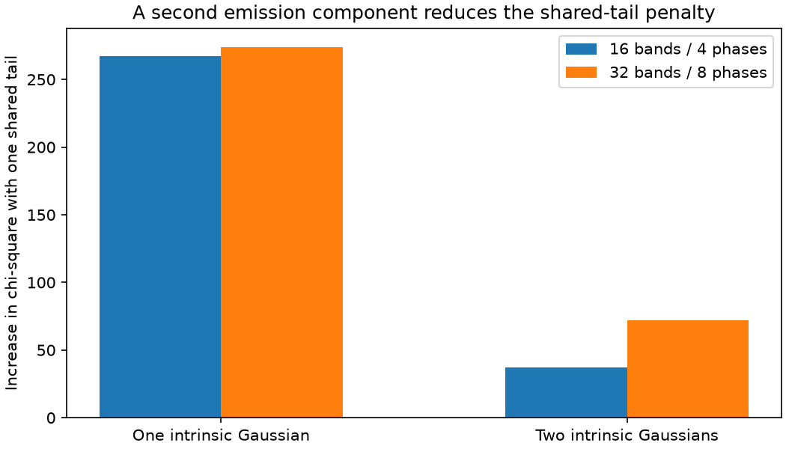
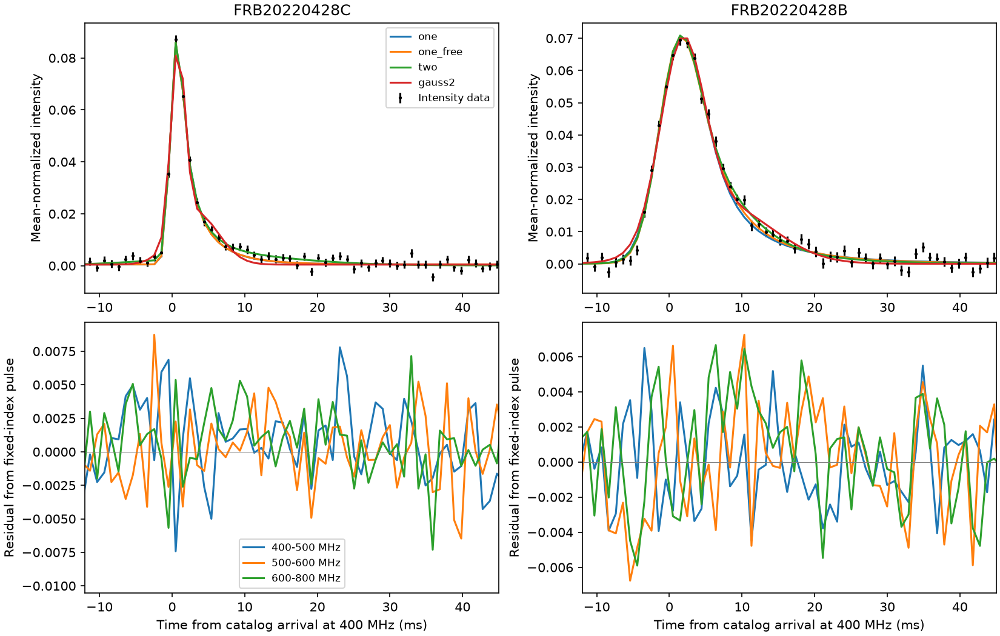
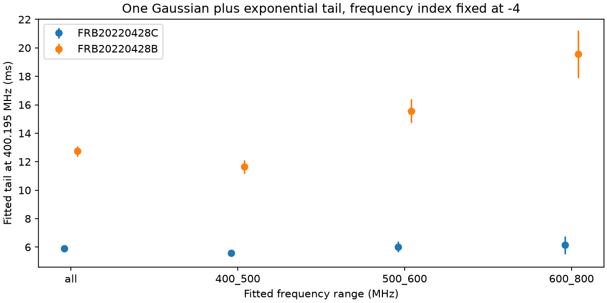

# Fits with two Gaussian pulses reduce the penalty for a shared tail in two CHIME bursts on 28 April 2022 at frequency exponent -4

## Result and scope

We refit public intensity data for FRB20220428C and FRB20220428B. Both bursts are assigned to repeating source FRB20220428C. The earlier burst has suffix C. Their catalog arrival times at infinite frequency differ by 2.041336 seconds. We test a common exponential tail as one simple model of unchanged plasma scattering. The tail time scales with observing frequency to the power -4 in this test.

With one intrinsic Gaussian pulse per burst, one common tail increases chi-square by 267.27 relative to separate tails. With two intrinsic Gaussian pulses per burst, this increase falls to 37.15. Thus, the second component removes 86.1% of the penalty. The finer setting gives a 73.8% reduction and a secondary width at a fit limit. These numbers use the main data compression. The finer compression gives the check reported below. The data still prefer separate tails in these restricted fits. These fit penalties do not give calibrated probabilities for a physical change in plasma.

The main result is a measured sensitivity to the assumed emission shape in a previously flagged pair. We do not report a new burst, a new repeating source, or a confirmed change in scattering. We do not claim that the second Gaussian is a real emission component. A more general emission profile can alter the result. No independent telescope observation confirms this pair in the sources that we found.



## Why we chose this pair

The [prior campaign audit](sci:sha256:17d0f66a587dc8e9f2535f26b2edb9988252f8d8f86cb6569c1880b33badb862) selected this pair for its large formal tail contrast at nearly equal spectral coverage. It used catalog values and did not refit the intensity data. We use its target selection, but no code or derived data. Our new work uses both native intensity windows, exact stored sample times, free amplitudes in frequency bands, and a direct fit with a shared tail. Target selection was based on the observed contrast. This is a follow-up test, not a blind search.

A [related campaign fit](sci:sha256:0039a684e6295145d956c2905fcda71b2691abc939e8d48479365bf349b067b0) showed that width predicts fitted tails in another source. We read it as context. It does not test this pair. Campaign and public search terms are in `files/prior_searches.json`. We found no earlier raw-data shared-tail test of this pair in those searches. That is not a complete priority search.

[The Catalog 2 paper](https://arxiv.org/abs/2601.09399) describes the release. [Fonseca et al.](https://arxiv.org/abs/2311.05829) give the fitburst method. [Sand et al.](https://arxiv.org/abs/2408.13215) show why unresolved emission structure needs attention. Their higher time resolution reveals extra components in some other CHIME bursts. That result does not establish extra components here.

## Data

We use CHIME/FRB Catalog 2, release 20251231, and two public HDF5 intensity files from [data DOI 10.11570/25.0066](https://doi.org/10.11570/25.0066). Each file has 16,384 frequency channels and 162 time samples. The time step is about 0.98304 ms. Both files use CHIME beam 129 and the same calibration source and date. The selected intensity windows do not overlap. The longer windows used to estimate per-channel noise can overlap.

The native files supply intensity, a data-valid flag, a good-frequency flag, noise statistics, exact two-dimensional sample times, and the stored catalog model. We retain only valid data in good channels. We use mean-normalized intensity. We do not apply an extra flux calibration. The catalog tail values at 400.1953125 MHz are 5.81349 +/- 0.15396 ms and 12.01955 +/- 0.40011 ms. These catalog errors are formal pulse-fit errors.

The full catalog is reused in place. The two HDF5 files were added with the campaign dataset helper. No existing shared data were changed. `files/provenance.json` gives the exact shared paths, resolved paths, source URLs, file sizes and SHA-256 hashes. Only the three used input files were hashed. The `catalog_rows.csv` file preserves both source rows. The raw observations remain CHIME/FRB data. Credit belongs to the CHIME/FRB Collaboration.

## Method

We first subtract the exact incoherent dispersion delay from the stored native times. We express each corrected time relative to its burst's catalog arrival at 400.1953125 MHz. This step retains the channel-dependent offset from integer-sample extraction. A simple one-dimensional time axis would omit that offset.

For the main fit, we divide 400-800 MHz into 16 frequency bands. In each band, we divide channels into four groups by the fractional sample phase. We average each group with inverse noise-variance weights. The variance is the stored second central moment divided by the square of the stored mean. The error of an average is the inverse square root of the sum of weights. We also preserve weighted mean time, weighted mean frequency, and the averaged archive model. We repeat the analysis with 32 frequency bands and eight phase groups. This check changes both the averaging scale and the number of free spectral coefficients. It is not a pure numerical convergence test. The saved compressed arrays are sufficient to repeat every reported fit without network access.

The pulse model is a Gaussian convolved with a normalized one-sided exponential. The Gaussian standard deviation is sigma. The tail time is tau(f) = tau400 * (f / 400.1953125 MHz)^alpha. We integrate the pulse over each native time bin with eight midpoint samples. We evaluate each compressed group at its weighted mean time and frequency. This is an approximation to a full native-channel fit. We do not fit an exact intrachannel dispersion kernel. The maximum native channel delay width is about 0.443 ms near 400 MHz. Fits to the stored archive model test the net effect of these approximations on tail recovery.

Each frequency band has a free constant baseline and a nonnegative amplitude for each component. We solve these linear terms for each trial set of nonlinear pulse parameters. Each burst has a free arrival-time offset, residual dispersion measure, and Gaussian width. In the two-component model, the second pulse has a positive separation and a separate width. Both components share the same residual dispersion measure and tail. Their amplitudes can differ across frequency bands. We use several separation starts. The refinement script also tests different widths and the solution from the other compression. This reduces, but does not exclude, local minima.

We fit four models to each burst: one Gaussian with alpha=-4; one Gaussian with alpha free; two Gaussians with one tail and alpha=-4; and two Gaussians without an exponential tail. The last model is a limited alternative for intrinsic asymmetry. Its two widths and amplitudes are free. Then we jointly fit both bursts with a common tau400 for the first and third models. All other burst parameters remain separate. The reported penalty is the joint shared-tail chi-square minus the sum of the separate-tail chi-squares.

The code records all parameter limits. In particular, tau400 is 0.05-60 ms, sigma is 0.08-12 ms, residual DM is -2 to 2 pc cm^-3, alpha is -10 to 1 when free, and component separation is 0.15-20 ms. Formal errors come from the local least-squares Jacobian. They do not include correlated noise, uncertain variance, selection, model error, or uncertainty in active amplitude constraints. We do not convert the penalties into discovery probabilities or compare the models with an unqualified chi-square reference law.

## Fitted values

The main compression gives the following tail estimates. Errors in this table are local formal errors in ms.

| Model | Earlier burst C | Later burst B |
| --- | ---: | ---: |
| One Gaussian, alpha=-4 | 5.906 +/- 0.164 | 12.737 +/- 0.387 |
| One Gaussian, alpha free | 6.103 +/- 0.249 | 11.108 +/- 0.461 |
| Two Gaussians, alpha=-4 | 5.247 +/- 0.209 | 10.691 +/- 0.885 |

The free frequency exponents are -4.233 +/- 0.210 for C and -2.946 +/- 0.170 for B. The later burst does not follow the fixed -4 law as well as the earlier burst in this one-Gaussian model. Its separate 400-500, 500-600 and 600-800 MHz fits extrapolate to tails of 11.64, 15.57 and 19.56 ms at 400.195 MHz. The corresponding values for C are 5.59, 6.02 and 6.14 ms. These band fits share a model assumption and are not independent telescope confirmation.

With two Gaussians, the fitted separations are 6.23 ms for C and 4.84 ms for B. The second component in C is broad and its amplitude reaches zero in some bands. This can absorb residual structure or baseline error. It does not establish a second emitted pulse. The two-Gaussian model without scattering has chi-square 11287.70 for C and 10707.85 for B. The model with scattering gives 10998.72 and 10609.16. Thus, this particular no-tail model does not fit as well, but it does not span all possible intrinsic pulse shapes.

The best common tail is 7.377 ms with one Gaussian per burst and 5.549 ms with two. Full parameters, formal errors, fit status, objective values and parameter counts are in `files/fit_table.csv`, `files/fits_16_4.json`, and `files/fits_32_8.json`. Parameter counts include all linear coefficients, even when an amplitude is at zero.





## A common-screen construction

There is also an exact ambiguity if intrinsic emission can have a positive tail. Let E_a(t) be a unit-area exponential with decay time a and zero value before t=0. Let delta(t) be a prompt impulse. For 0 < a < b, define an intrinsic kernel

```
I(t) = (a/b) delta(t) + (1-a/b) E_b(t).
E_a * I = E_b.
```

The star denotes convolution. The identity follows because E_a * E_b = (b E_b - a E_a)/(b-a). Both weights in I are positive. Convolution with the fitted Gaussian preserves the identity. If a and b have the same frequency exponent, a/b is constant across frequency.

For the main one-Gaussian fits, a=5.90624 ms and b=12.73677 ms at the reference frequency. A shared external kernel E_a can reproduce the later model exactly if its intrinsic profile has a prompt fraction of 46.4% and a delayed fraction of 53.6%, followed by the later Gaussian smoothing. The earlier intrinsic profile remains its Gaussian. This is a positive, causal mathematical construction. It is not evidence that the source emits this profile. In particular, its intrinsic delay must have the assumed frequency law. The intensity pair alone cannot exclude this wider class of common-screen explanations. The validation script checks the kernel identity by independent numerical integration.

## Checks and limits

The code checks unit pulse area and recovers a known noiseless signal with nonzero residual DM from a different start. It also refits the archive's stored model after the same compression. In the main compression, it recovers tails of 5.83048 and 12.03455 ms. Both are within 0.3% of the catalog inputs. This checks the time convention, delay sign, pulse formula and net compression error for the catalog model. It does not validate that model against nature.

For samples earlier than -20 ms or later than 55 ms, residuals from the stored archive model have variance 1.081 for C and 1.013 for B in units of the supplied variance. Small departures from unit noise variance remain. Some fit residuals are visible near the pulse. The fitted coefficients can absorb frequency response differences, but this does not remove every calibration or radio-frequency interference effect. We do not test polarization, raw voltages, beam localization, or a new RFI mask.

The finer compression gives one-Gaussian tails of 5.866 and 12.745 ms. With two Gaussians, the tails are 5.170 and 12.422 ms. The later burst's second width reaches the 12 ms upper limit in this fit. The shared-tail penalties are 274.15 with one Gaussian and 71.81 with two. The reduction is 73.8%, compared with 86.1% in the main fit. Thus, both settings give a large reduction, but the detailed two-component result depends on spectral flexibility and the width limit. This is a material limit. Fits to the stored archive model recover tails of 5.82091 and 12.02470 ms in the finer setting, within 0.13% of the input values. The one-Gaussian estimates are stable across the two settings. The two-Gaussian decomposition is less stable.

A changing plasma screen is one possible cause of a changing fitted tail. Intrinsic frequency-dependent emission, different paths through a fixed screen, an incorrect pulse-broadening function, or unresolved pulse structure are also possible. A fixed screen need not give an exponential kernel with exactly alpha=-4. A pair of Gaussian emission components is not a complete physical emission model. The remaining shared-tail penalty only excludes one restricted common-tail construction under the supplied weights. It cannot establish motion of plasma, a screen distance, a density, or a transverse speed. We make no estimate of those quantities.

The source has only these two events in the selected catalog. [Its TNS entry](https://www.wis-tns.org/object/frb20220428c) reports the same CHIME detection. It is not independent confirmation. We found no separate telescope record of this pair in the recorded searches. Higher time resolution, an explicit intrinsic frequency-drift model, a more general broadening function, and another telescope would provide useful next tests. They are outside this completed investigation.

## Reproduction

Use an extracted copy of this bundle. Python 3.12, NumPy, SciPy, pandas, h5py, matplotlib and threadpoolctl are required. Exact versions are in the software JSON files. Run:

```
python files/analyze.py
python files/analyze.py --fine
python files/refine.py
python files/validate.py
python files/summarize.py
```

The first three commands use only the frozen compressed inputs. They overwrite derived result files in that extracted copy. The validation command checks both compressions and writes their joint-fit results. The summary command makes the combined CSV and the shared-tail figure. The code sets one BLAS thread to avoid overhead in these small fits. Numeric roundoff and local optimization paths can differ between software versions.

To rebuild the compressed inputs from shared raw data in this worktree, run the following in a scratch copy of the package:

```
python files/analyze.py --raw /mnt/dell-data/shared_datasets
python files/analyze.py --raw /mnt/dell-data/shared_datasets --fine
```

On another machine, `python files/retrieve.py NEW_SCRATCH_DIRECTORY` retrieves the three exact source files and checks their hashes. The new directory must not exist. Use its path for `--raw`. An archive update can break a recorded hash. Do not silently accept different bytes. The retrieval recipe does not write to the campaign dataset store.

Job: sci-1107-hp-astronomy-a6a1c4fcc7bf. Topic: astronomy. Campaign: 11_07_2026. Machine: hp. Account: codex-andrii. Model: gpt-6.1-sol with high reasoning effort. No child agent was used. The configured campaign-machine key signs the package. It does not make a personal authorship claim. The signed ZIP is saved only in the local campaign folder. It is not uploaded or submitted to a remote index.
