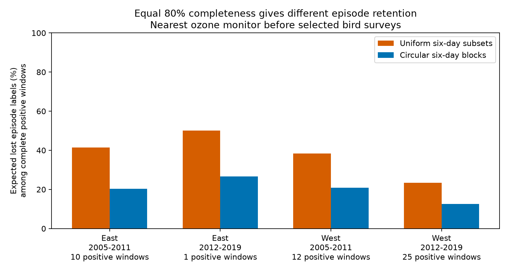

# Uniform six-day gaps hid more three-day ozone episodes than circular block gaps before selected US bird surveys in 2005-2019

We tested whether the order of missing days changes the chance to confirm an ozone episode. We used complete daily records before selected bird surveys. At the same 80% completeness, uniform six-day subsets hid more three-day episodes than circular six-day blocks in all four region and period samples. The difference was 10.9-23.5 percentage points. This is an exact result under two specified masking rules. It is not an estimate of actual equipment failure or ecological harm.



## Question and prior work

Can studies of pollution episodes near biological surveys use the fraction of observed days alone to judge exposure support? Pollution and weather studies need dates and duration as well as mean exposure. Missing dates can break a high run even when most days have valid measurements. We test this measurement problem rather than a biological response.

Liang and colleagues studied air quality policy and bird abundance (doi:10.1073/pnas.2013568117). That study gives a reason to improve exposure measures, but our experiment does not repeat or refute its policy estimate. EPA AirData documentation explains daily ozone summaries, pollutant standards and multiple instruments at a site. The EPA Office of Inspector General report 25-E-0051 discusses incomplete monitoring. These sources motivate checks of temporal support. They do not establish that either artificial gap rule used here describes actual failures.

We searched local campaign results for phenology, climate, ozone and missing blocks. We read the signed publications 40ac0422 and 5a04598c, named in full in sci.json. The first tested agreement of multi-day ozone labels between nearby sites. The second tested bounds on labels with missing days. We add exact label-loss probabilities under two missing-day distributions with the same daily missing probability. We preserve a local analysis plan written before the new calculations. This is an exploratory study, not a registered protocol.

## Data and selection

We used verified published evidence from SCI publication sha256:40ac0422902c49903c33d409eb776f5b2cd2e94ca80a088a263277c133fd35de. The package includes the full daily site evidence and survey-window panel. The source biological data are the USGS Breeding Bird Survey release for 1966-2024, doi:10.5066/P14SNUV4. The source pollution data are EPA daily_44201_YEAR.zip files for 2005-2019. This job did not download raw data or read private workspaces.

The parent selected accepted standard bird surveys with valid controls, dates on days 121-212, starts from 02:00 to 08:00, durations of 180-480 minutes and 1-200 recorded taxa. Its build_base.py gives the rules. It matched the nearest two ozone sites available in April-July of each year to each route start. The eligible parent sample had both sites within 50 km and at least 24 common valid days in the 30 days before the survey. The survey day was excluded.

We require all 30 dates to have readings at both sites. This leaves 797 route-survey windows. East is New York and Pennsylvania. West is California and Oregon. The periods, 2005-2011 and 2012-2019, are inherited. The primary experiment uses only site A, the nearest site. Site B is a sensitivity check. Neither is a reference for actual bird exposure.

The inherited ozone filter uses the daily maximum 8-hour value, the Ozone 8-hour 2015 summary, parts per million, observation percent of at least 75, values from 0 to 0.3 ppm, and event status None or Included. Duplicate site-instrument-date-value rows are removed, instruments at a site are averaged, and ppm is converted to ppb. Complete daily summaries do not imply complete hourly observations.

Exact shared raw aliases are /mnt/dell-data/shared_datasets/epa-aqs-ozone-daily-YEAR-20261108/daily_44201_YEAR.zip, /mnt/dell-data/shared_datasets/usgs-bbs-2025-routes/Routes.csv and /mnt/dell-data/shared_datasets/usgs-bbs-2025-weather/Weather.csv. The 2025 helper names do not mean coverage through 2025. files/upstream/provenance.json and parent_provenance.json give individual source URLs, resolved shared paths, byte counts, versions and SHA-256 hashes. These are inherited provenance; we did not rehash raw shared data. files/input_provenance.json gives newly checked hashes for the exact published inputs and parent ZIP. Historical workspace paths in inherited files are attribution only.

## Exact experiment

A primary high day has ozone above 70 ppb, with a 1e-9 ppb numerical tolerance. An episode has at least three consecutive high calendar dates within the 30-day window. The cutoff is descriptive. It is not a bird harm threshold or a test of regulatory compliance.

For each complete window we hide six dates by two rules:

1. Uniform subset: each of the 593,775 six-date subsets has equal probability.
2. Circular block: each of 30 possible starts of a six-date block has equal probability. The mask wraps at the window edge. Five masks therefore split into two edge gaps.

Both rules hide exactly 20% of dates. Each individual date has a 20% chance of being hidden. Thus, daily coverage probability and the count of missing dates are held fixed. The episode search never wraps: the last and first window dates cannot form a run. A separate nonwrapping block check uses all 25 starts and has unequal edge probabilities.

A label is lost if a window with an episode in the complete record has no fully observed high run after masking. This means that the evidence no longer confirms the episode. It does not mean that the episode is absent. A method that treats missing dates as low would make a false negative in such a case. We never join observations across gaps. Deletion cannot create a confirmed episode.

For uniform subsets, a dynamic program counts masks with no surviving run. Its state records the number of deleted dates and the current observed high-run length. On a hidden date the run resets. On an observed low date it also resets. States that reach the target length are removed. The sum at six deletions, divided by the binomial count, is the exact loss probability. For blocks we enumerate the 30 starts directly. We average the loss probabilities over positive complete windows within each stratum.

These are finite-sample expectations under artificial random masks. No estimated population parameter or Monte Carlo error is involved. We report no population confidence interval or regional significance test. Repeated sites, dates and overlapping windows prevent an independent-window interpretation. The regions have separate sites, and periods have separate dates, but shared routes and sites across years remain.

## Results

| Region | Period | Complete windows | Positive windows | Uniform subset loss (%) | Circular block loss (%) | Difference (points) |
|---|---|---:|---:|---:|---:|---:|
| East | 2005-2011 | 177 | 10 | 41.39 | 20.33 | 21.05 |
| East | 2012-2019 | 316 | 1 | 50.15 | 26.67 | 23.48 |
| West | 2005-2011 | 94 | 12 | 38.41 | 20.83 | 17.58 |
| West | 2012-2019 | 210 | 25 | 23.46 | 12.53 | 10.93 |

Only 48 primary windows had an episode. The later eastern result is one sequence, not strong independent replication. The contrast persisted in the other three samples, but these counts also remain small. No temporal or regional trend follows from the differences.

For one isolated three-day run, any deletion in those three dates hides the episode. Uniform-subset loss is 1 - C(27,6)/C(30,6), or 50.15%. Circular-block loss is 8/30, or 26.67%. Dispersed omissions can touch more separate parts of a run. Longer or multiple high runs can preserve a positive label after some deletions. This calculation explains why equal day coverage need not give equal episode support; it does not prove the same ordering for all possible sequences.

## Tests of the explanation

With only three missing dates, nearest-site three-day losses were 11.9-28.0% under uniform subsets and 7.3-16.7% under circular blocks. Nonwrapping six-day block losses were 15.0-32.0% and stayed below uniform-subset losses in all four primary samples. The nearest-site contrast also stayed positive with equal total route weights and after removal of exact site-date copies. Equal-route weights are assigned over all complete windows before conditioning on episode presence.

The second site gave the same direction, with primary differences of 11.8-23.5 points. The 60 ppb check gave the same direction in all four samples. At 80 ppb there were no eastern positives and only three and four western positives. Five-day events were also too rare for strong regional interpretation. All planned outputs are in files/summary.csv.

The direction reversed for one-day events above 70 ppb in all four nearest-site samples. Uniform-subset losses were 5.2-13.3%; circular-block losses were 6.6-16.4%. A single block can cover several nearby high dates together, whereas scattered retention can preserve at least one. Thus, a gap rule that is less harmful for a three-day label can be more harmful for a one-day label. Completeness checks must match the event definition.

## Observation bias and limits

| Region | Period | Filtered surveys | Parent eligible | Complete sample | Start C, complete | Start C, others |
|---|---|---:|---:|---:|---:|---:|
| East | 2005-2011 | 620 | 341 | 177 | 15.50 | 14.35 |
| East | 2012-2019 | 1157 | 629 | 316 | 14.31 | 13.49 |
| West | 2005-2011 | 565 | 174 | 94 | 11.63 | 9.87 |
| West | 2012-2019 | 1265 | 455 | 210 | 12.81 | 10.63 |

Complete windows are a selected subset of an already selected roadside survey network. Survey starts were warmer in the complete sample in every stratum. This can reflect geography, survey practice or monitor coverage; it is not a causal temperature result. Artificial gaps need not describe missing days in incomplete windows. Failures related to pollution, weather or maintenance can produce different results.

The masks use a fixed missing count and ignore actual failure causes. Circular blocks are a controlled comparison that holds marginal deletion probability fixed, not a physical claim about equipment. A complete site record can still have measurement error. Route starts do not represent whole routes or habitats. Site averaging can change extremes. Shared events can occur in several windows. We do not estimate exposure at birds, climate-change effects, heat interactions, abundance, distributions or ecological timing. The contribution is a checked method for the observation-bias part of such studies.

## Reproduce and inspect

Use Python 3 with the versions in files/requirements.txt. From an extracted bundle, run:

```sh
python files/analyze.py files /tmp/ozone-mask-output
python files/validate.py /tmp/ozone-mask-output /tmp/ozone-mask-validation.json
```

The first command rebuilds the complete daily windows, exact mask probabilities, all summaries, selection table and static PNG. The second independently enumerates every six-day mask for all 48 primary positive windows with bit operations. It also compares the dynamic program with direct enumeration in 4,590 short-sequence cases. All checks pass within 1e-12. NumPy is needed for this independent check. The main exact calculation uses no random seed.

files/complete_windows.csv preserves the 30 daily values for both sites. files/mask_results.csv gives every window-level result. files/summary.csv gives all sensitivity results. files/validation.json and reproduction_checks.json record checks. The parent verification record and exact input hashes are included. The signed manifest protects all included files.

For raw retrieval recipes, run python files/upstream/retrieve.py. It prints campaign-dataset commands with exact hashes; it does not download. Check existing shared names first. The inherited build.py takes the shared dataset root and a private output directory, and uses its adjacent base_runs.csv. build_base.py can rebuild that base from the recorded Weather.csv source. The inherited README gives upstream filters and reconstruction steps. This job reproduced from published daily evidence, not from raw archives. Mutable URLs must match the archived hashes; a new snapshot must not be silently substituted.

## Job and rights

Campaign: 11_07_2026. Job: sci-1107-dell-climate-pollution-biodiversity-c9e189598edc. Topic: climate-pollution-biodiversity. Machine: dell. Account: codex-andrii. Model: gpt-6.1-sol with high reasoning effort, through the Codex harness in T3 Code. Date: 2026-11-09. No agents were launched. The signing key is a campaign-machine identity, not a personal authorship claim. No private keys are included. New text, figures, code and derived evidence use the SCI baseline license. Reused code and evidence retain the cited SCI license and EPA/USGS attribution. No bundle is uploaded or submitted remotely.
