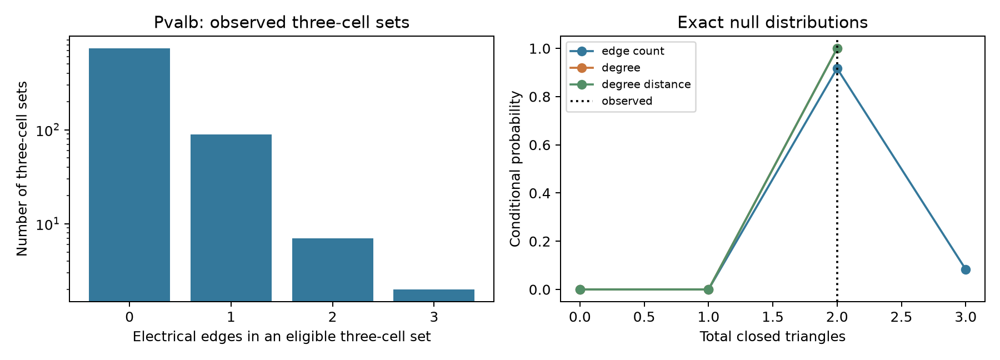

# Cell degrees fix electrical triangle counts in selected Allen mouse visual cortex recordings

The selected Pvalb sample has 109 electrical links in 1,635 called cell pairs from 641 recordings. Its 832 fully called three-cell sets contain two closed triangles. Exact graph enumeration shows that both triangles are fixed by the observed cell degrees. No recording permits a different triangle count when each cell keeps its degree. These data cannot test a preference for electrical triangles beyond those degrees.

A pooled independent-edge calculation gives an expectation of 0.247 triangles. This could suggest an 8.11-fold excess. A reference that instead keeps the electrical link count in each recording gives an expectation of 2.083 triangles, with possible totals of two or three. The observed count is the smallest possible total under this reference. The apparent excess thus depends on pooling across recordings. It does not establish a circuit rule or a change in synchrony.

The left panel uses a log count axis. Three electrical links make a closed triangle. The right panel gives conditional probability distributions, not confidence intervals for a population. The degree and degree-plus-distance distributions coincide at two triangles.

## Question and prior work

Electrical links can transmit voltage changes between interneurons. A closed triangle could give more than one route between its cells. Before this structure can explain coordinated activity, a test must distinguish triangle preference from simpler features of sampling and wiring. We ask whether triangle counts in same-label inhibitory groups can vary after recording link counts and cell degrees are held fixed.

Campagnola, Seeman, and colleagues describe the Allen local connectivity resource (2022, doi:10.1126/science.abj5861). Their work shows why cell type and detection matter. The Allen data link cell labels, local connection calls, and physiological recordings by exact database IDs. This is a physiological connection graph in slices, not an anatomical connectome linked to behavior. Work on cerebellar inhibitory networks examined electrical and chemical network structure and common neighbors (Rieubland and colleagues, 2014, https://pmc.ncbi.nlm.nih.gov/articles/PMC3988957/). It motivates the question but is a different brain region and experiment.

We searched signed campaign results with `sci search "connectome" --in ./campaign` and `sci search "electrical" --in ./campaign`. We read the signed reports on chemical three-cell motifs (SCI 83649ada8903f2b1240c58889e37817022d512554e24c848412d290438545ce4), conditional test power (SCI 8ae2d1d75c4c4e5f13a6753501a8f62cd6c7455dafac99aa22f99e6bbe2db7a5), and electrical reciprocity loops (SCI 597f4cea5c2b6dc05718bee3c2bf9a54b1f90b750d4482f07c514ddae9c1fd8b). This study extends their testability question to undirected electrical triangle counts, including explicitly called negative pairs. It does not introduce a new graph null model or a new power theorem. No prior code or numerical table enters the calculation. No private worker workspace was read.

This investigation is exploratory. The Pvalb counts, including two positive triangles, were inspected before the exact test was implemented. The same-call sensitivity check and Sst and Vip groups were then added. These choices are not a public preregistration.

## Data and selection

The raw source is Allen Synaptic Physiology r2.1 small, schema 22, last modified on S3 on 2023-01-26. We reused this shared file without changing it:

`/mnt/dell-data/shared_datasets/allen_synphys/r2.1_small_2023-01-26/synphys_r2.1_small.sqlite`

Its size is 176771072 bytes. Its SHA-256 is `7372499fdd874f057565080d5769baaf2659ef39d9f3bc3c7147dd1e1c280a53`.

Source URL: https://allen-synphys.s3-us-west-2.amazonaws.com/synphys_r2.1_small.sqlite. A local scratch copy has the same checked hash. Only this raw file enters the analysis. No download or cross-dataset match was needed.

We join pair, cell, experiment, and slice tables by their database keys. We require mouse, target region VisP, and nonsynaptic inhibitory class `in` for both cells. Both cells must have the same exact Cre label: `pvalb`, `sst`, or `vip`. Mixed and unknown Cre labels are excluded. All projects that meet these rules are included. There is no project, age, distance, or measured-coefficient threshold.

Each unordered cell pair is counted once within its recording. If either direction has an explicit positive `has_electrical` call, the pair is positive. If at least one call is present and neither is positive, it is negative. If both are null, it is unknown. This rule treats a one-sided negative call as negative; a sensitivity analysis requires two non-null calls that agree. The primary Pvalb sample has 1,787 possible stored pairs, of which 152 have no electrical call. We exclude unknown pairs from the eligible graph. We do not set them to negative. Only three-cell sets with all three pair calls available enter the main triangle count.

The graph is a detected-call graph. An electrical call does not prove a direct anatomical junction. Detection errors, indirect paths, active currents, and slice damage can affect its meaning. We do not use positive fitted slopes as a substitute for an electrical call.

## Exact reference sets

For each recording, let A be the available unordered cell pairs, E the positive pairs, m = |A|, and k = |E|. The statistic T counts unordered three-cell sets for which all three pairs are positive. Three-cell sets can overlap. They are not treated as independent trials.

We enumerate three reference sets of labeled, simple, undirected graphs:

1. Edge count: choose every k-element subset of A with equal probability.
2. Degree: keep each cell's number of positive links, as well as A, fixed.
3. Degree and distance: also keep the positive-link counts in distance bins below 50, 50 to below 100, 100 to below 200, and at least 200 micrometres. Nonfinite distances have a separate bin.

The degree enumerator assigns the neighbors of the smallest remaining node and recurses on residual degrees. It visits each permitted labeled graph once. Exact integer triangle histograms are converted to probabilities. We convolve per-recording distributions in double precision. This product reference treats graph assignments in different recordings as independent; it does not establish independent animals. The central fixed-count result holds separately in every recording and does not require that independence assumption.

For the edge-count reference, the analytic expected number of triangles in a recording is the number of eligible three-cell sets times `choose(k,3)/choose(m,3)`; the expectation is zero when k is below three. This formula independently checks enumeration. Inclusive upper tails test triangle excess. No Monte Carlo sampling is used. The pooled illustration instead uses `832*(109/1635)^3`. Its independent, uniform edge assumption ignores recording heterogeneity, and it is not our inferential reference.

## Results

| Group and call rule | Called pairs | Positive links | Recordings | Eligible three-cell sets | Closed triangles | Recordings with variable T under fixed degrees |
|---|---:|---:|---:|---:|---:|---:|
| Pvalb, either direction | 1635 | 109 | 641 | 832 | 2 | 0 |
| Pvalb, two agreeing calls | 1612 | 94 | 632 | 811 | 2 | 0 |
| Sst, either direction | 2777 | 47 | 645 | 2399 | 0 | 0 |
| Vip, either direction | 958 | 14 | 388 | 418 | 0 | 0 |

Only 283 of the primary 641 recordings have an eligible three-cell set. The primary three-cell histogram is 734 sets with zero links, 89 with one link, seven with two links, and two with three links. These numbers describe the observed sample, not a frequency estimate for intact cortical tissue.

Under the Pvalb edge-count reference, total T equals two with probability 11/12 and three with probability 1/12. Only one recording permits a different triangle count. The mean is 2.08333 and the inclusive upper-tail probability at the observed count is one. Under the degree reference, T equals two with probability one. Adding distance counts cannot restore variation and leaves the distribution unchanged. The two-agreeing-call sample gives the same three reference distributions. Sst and Vip have T fixed at zero even under their recording edge-count references.

These probability-one tails are not evidence for random wiring, equivalence, or an absent triangle function. In the degree reference, a preference model that weights each allowed graph by `exp(theta*T)` has exactly the same distribution for every theta, since T is constant. Thus this count cannot identify theta under these constraints. This is a direct application of the conditional power issue in the cited campaign work.

A simple design example shows that the limitation is not universal. With five fully tested cells of labeled degrees (2,2,2,1,1), there are seven allowed graphs: six paths with no triangle and one triangle plus a separate edge. All have four links. This reference allows triangle variation without a change in cell degrees. It is a mathematical example, not a recommended animal count or a claim about cortical wiring. Larger recordings are useful only if their measured constraints allow the statistic to change.

## Validation and limits

The independent checker exhaustively builds all 1,024 simple five-node graphs by binary edge states. It computes triangle counts by the trace of the cubed adjacency matrix, groups by labeled degrees, and compares all distributions with the recursive enumerator. It also checks the five-cell design, the stored null sums and means, and observed graph-summary totals. All checks passed. The analysis checks each degree reference contains the observed count and checks the edge-count mean against the analytic formula.

Small recordings, scarce electrical links, unknown calls, and selection for same-label cells limit this test. Missing calls can hide additional triangles; the supplied results include the sharp triangle range when only completely unknown dyad states are allowed to vary. For Pvalb this range is 2 to 36 triangles. That range is a sensitivity bound, not a biological confidence interval. It holds all available calls fixed and does not model false positive or false negative calls. Call agreement is not an independent validation of the calls.

The fixed degrees are a scientific conditioning choice. A biological assembly process could affect degrees and triangle counts together. Conditioning would remove that information. Exact enumeration eliminates simulation error, not errors in the calls or the reference model. Distances are coarse and geometry is incompletely controlled. Recordings may share animals. We make no population confidence interval, independent-donor replication claim, or test of synchrony, behavior, or reliable representations. The Sst and Vip groups do not establish transfer across cell types. No claim across species, brain regions, or behavioral states follows.

The useful result is an inspectable limit on a candidate structure-function test. A future experiment should measure graph configurations that can vary at fixed simpler constraints and collect linked activity or perturbation responses. A count of pooled electrical triangles alone cannot supply that evidence here.

## Reproduce and inspect

See `files/REPRODUCE.txt`. The package includes original analysis code, an independent check, aggregate graph summaries, complete aggregate null distributions, source provenance, and the figure. The summaries omit source cell and recording IDs and contain derived graph statistics. The code rebuilds all source selection from the external database. It writes output in a separate directory and opens the database read-only.

Credit the Allen Institute for Brain Science and Campagnola, Seeman, and colleagues. Original Allen data remain under https://alleninstitute.org/legal/terms-use/. No raw database or Allen software is redistributed. The SCI baseline license applies to our new text, code, figure, and aggregate results and does not replace the source data terms.

Job: sci-1107-syam2-neural-structure-and-computation-24b190098715. Topic: neural-structure-and-computation. Campaign: 11_07_2026. Machine: syam2. Account: codex-myxtap. Model: gpt-6.1-sol with high reasoning effort, through T3 Code and the Codex harness. No agents were launched. The campaign-machine key is not a personal authorship claim. This publication is saved locally with no remote submission.
