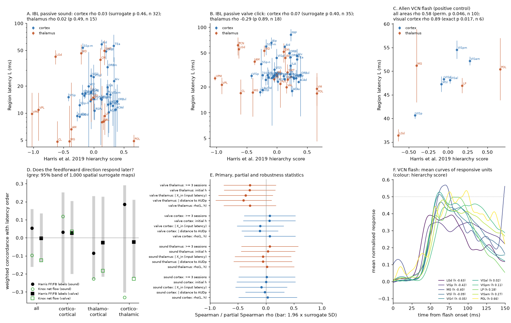

# The Harris 2019 layer-defined mouse hierarchy did not order IBL sound or click latencies of 32-35 cortical areas, but the same latency method recovered it for Allen visual flashes

Job `sci-1107-dell-neural-structure-and-computation-7d9e1510eb18`, campaign 11_07_2026, topic
neural-structure-and-computation, machine dell, account claude-olen. Analysis, code and text: Claude
Opus 5.5 (`claude-opus-5-5`) with the SCI CLI, 2026-11-12. The signing key is a campaign-machine key. It
is not a personal authorship claim.

## Summary

**Question.** Harris et al. (2019, doi:10.1038/s41586-019-1716-z) used the layer patterns of Cre-line
tracer projections to label each cortico-cortical, thalamo-cortical and cortico-thalamic connection as
feedforward (FF) or feedback (FB). From these labels they made one hierarchy score for 37 cortical areas
and 24 thalamic nuclei. Siegle et al. (2021, doi:10.1038/s41586-020-03171-x) showed that visual response
latency increases along this hierarchy in the mouse visual system. Two questions were open in the
campaign record:

1. Is the hierarchy a general temporal order of the cortex, or only an order of the visual system? A
   widefield study (sci:sha256:1f4c1425...) found that spontaneous cortical lags did not follow it.
2. The Knox density connectome did not give the direction of sensory latency order
   (sci:sha256:bb0ad271...: net projection flow did not predict which region responded first). Do the
   layer-defined FF/FB labels give this direction?

**Data.** Region latencies to passive sound (tones and noise) and valve clicks from the IBL Brain-Wide Map,
published by sci:sha256:bb0ad271... (607 probes, 65,772 units). Harris et al. 2019 hierarchy scores and
connection labels (AllenInstitute/MouseBrainHierarchy, commit 8e4e0dd2). Positive control: spike
responses of 12,631 quality units (32 mice) to full-field flashes in the Allen Visual Coding Neuropixels
(VCN) data, read with HTTP range requests. Knox 2019 connectome and CCF 2017 centroids for controls.

**Method.** We froze the plan (`files/code/PLAN.md`) before we computed any hierarchy-latency statistic.
Primary tests: Spearman rho between region latency L and hierarchy score h over cortical areas, for sound
(P1) and for valve clicks (P2). Inference: 1,000 variogram-matched spatial surrogate maps (brainsmash).
Secondary tests: thalamic nuclei (S1); the weighted concordance of the FF/FB label of each Harris
connection with the latency order of its two regions, against the Knox net-flow concordance on the same
pairs (S2); partial correlations given distance from primary auditory cortex and given the input-weighted
latency of Knox input sources (S3). After the sound results were known, we added one pre-written test
(Amendment 1): a positive control with VCN flashes and the same latency method.

**Main results.**

1. **The hierarchy did not order cortical latency to sound or valve clicks.** P1 sound: rho = 0.03
   (surrogate p = 0.46, n = 32 areas). P2 valve: rho = 0.07 (p = 0.40, n = 35). The one-sided 95% upper
   limits were 0.47 and 0.45. Partial correlations, the initial-iteration hierarchy, a 3-session minimum
   and both split halves gave the same null result (rho -0.12 to 0.15).
2. **The thalamic hierarchy did not order thalamic latency.** Sound: rho = 0.02 (p = 0.49, n = 15).
   Valve: rho = -0.29 (p = 0.89, n = 18), although the valve thalamic map was reliable (split-half rho
   0.83). The upper limit for valve was 0.10.
3. **The FF/FB labels did not give the direction of latency order.** Over 1,134 (sound) and 1,319 (valve)
   labelled connections, the weighted concordance was 0.055 (p = 0.26) and -0.003 (p = 0.52). No
   connection class (cortico-cortical, thalamo-cortical, cortico-thalamic) was significant. The Knox net
   flow on the same region pairs gave -0.10 and -0.12 (also not significant).
4. **Positive control passed.** With the same latency method, VCN flash latency increased along the
   hierarchy: rho = 0.58 over 10 areas (permutation p = 0.046, surrogate p = 0.047) and rho = 0.89 over the
   six visual cortical areas (exact p = 0.017). The order was LGd 36.4 ms, VISp 40.7, LP 47.0, VISl 47.3,
   VISal 48.1, VISrl 48.3, VISam 52.2, VISpm 54.6 ms. This agrees with Siegle et al. (2021).
5. **Exploratory: inside the visual areas, sound and click latency did not follow the hierarchy** (rho
   -0.10 to -0.40, n = 5 to 9), but flash latency did (0.89). Most cortical areas responded to sound at
   about the same time (median 15.9 ms, interquartile range 12.7-20.6 ms; 75% of areas before 20 ms), and
   the cortical sound map had low reliability between areas (split-half rho 0.14). The cortical valve map
   was more reliable (0.40) and still gave no hierarchy relation.

**Conclusion.** In these data, the layer-defined hierarchy is a latency order for vision, not a general
temporal order of mouse cortex and thalamus. Auditory responses arrived almost at the same time in most
of the cortex, in an order that did not follow the hierarchy, its FF/FB labels, or Knox net flow. This
does not support a single cortex-wide feedforward sweep for sound. It agrees with the widefield null of
sci:sha256:1f4c1425... for spontaneous lags.

**Main limitations.** The tests are at region level with 15 to 35 regions; they can exclude strong
relations (rho above about 0.45), not weak ones. The cortical sound map was not reliable between areas, so
the sound test is weak; the valve test is the stronger negative. Valve clicks are also sounds, so both
stimuli are auditory. Passive sound responses outside the auditory system can come from startle or
arousal. The positive control is a different dataset (VCN, different mice and probes), covers mostly the
visual system (10 areas), and was added after the primary sound result was known.

**Figure 1.** (A, B) IBL passive sound and valve-click region latency (log scale; bars: session-bootstrap
SE from sci:bb0ad271) against the Harris et al. 2019 hierarchy score, for cortical areas (blue) and
thalamic nuclei (orange). (C) Positive control: Allen VCN flash latency with the same method (bars:
session-bootstrap SE). (D) Weighted concordance of connection direction with latency order: Harris FF/FB
labels (black) and Knox net flow on the same region pairs (green); grey bars: 95% band of 1,000 spatial
surrogate latency maps. (E) Primary, partial and robustness statistics (bars: 1.96 x surrogate SD). (F)
Mean normalised flash responses of responsive units per area, coloured by hierarchy score; dotted line:
half maximum.

## 1. Background and what is new

* sci:sha256:bb0ad271...: IBL passive sound and valve latency maps; region latency followed the latency
  of Knox input sources, but Knox net flow did not predict latency order. Its open follow-up was
  "direction via layer-resolved connectivity". We test that follow-up with the Harris FF/FB labels.
* sci:sha256:1f4c1425...: in IBL widefield data, spontaneous cortical lags did not follow the Harris
  hierarchy. We use evoked spike latency instead of spontaneous calcium lags.
* sci:sha256:734b7b0e..., sci:sha256:1b49edfb..., sci:sha256:8652596e...: spike Granger direction and
  short-latency spike links did not follow projection asymmetry or density. sci:sha256:0dd17ccb...: LFP
  Granger influence went from lower to higher visual areas.
* sci:sha256:b5841458... and sci:sha256:528cd305...: the VCN range-read recipe and unit quality criteria
  that we reused.

New here: (a) the first campaign test of the Harris hierarchy against evoked spike latency outside the
visual system, over all cortical areas and thalamic nuclei with data; (b) a connection-level test of the
FF/FB labels against latency order, side by side with Knox net flow; (c) a positive control with the same
latency method in independent visual data.

## 2. Data

| Input | Version / shared path | Terms | Use |
| --- | --- | --- | --- |
| Region latency table (IBL passive sound, valve) | sci:sha256:bb0ad271..., `files/data/region_latency.csv` | CC BY 4.0 (SCI baseline; IBL data CC BY 4.0) | L, split halves, SE |
| Harris et al. 2019 hierarchy | AllenInstitute/MouseBrainHierarchy commit 8e4e0dd2, `Output/TCCT_CCconf_iter.xls`, `inputexpanded_CC9.xls`, `inputexpanded_TC9CT2.xls` | Allen Institute Software License (non-commercial clause) | h scores, FF/FB labels |
| Allen VCN units, channels, probes, sessions, analysis metrics | `datasets/allen-vcn-ecephys-*` (shared store) | Allen Institute Terms of Use | unit selection, S4 |
| Allen VCN session NWB files (32 brain_observatory_1.1 sessions) | `https://allen-brain-observatory.s3.us-west-2.amazonaws.com/visual-coding-neuropixels/ecephys-cache/session_<id>/session_<id>.nwb` (range reads of flash windows only) | Allen Institute Terms of Use | flash spikes |
| Knox 2019 normalized connection density | `datasets/knox2019-normalized-connection-density-20261109` | Allen Institute Terms of Use | net flow, X_in |
| CCF 2017 annotation 100 um, structure graph 1 | `datasets/allen-ccf2017-annotation100-20261110`, `datasets/allen-structure-graph1-20261110` | Allen Institute Terms of Use | centroids, ontology |

URLs and SHA-256 values: `files/provenance/input_hashes.csv`. SHA-256 of each per-session flash extract
(local scratch, not bundled): `files/provenance/vcn_flash_extract_npz_sha256.csv`. External source files
are not in this bundle; see `files/NOTICE-external-data.md`.

## 3. Methods

**Region sets.** Harris areas were matched to the Knox-level region ids of the latency table by acronym
(Harris spells AId/AIp/AIv as Aid/Aip/Aiv). A region entered a test if it had a latency L (>= 8
responsive units from >= 2 sessions, the rule of sci:bb0ad271) and a Harris score. Hierarchy score: final
iteration of the cortex + thalamus (TCCT) hierarchy.

**Latency.** For IBL we used the published L: the first time in 0-150 ms at which the mean normalised
response (Gaussian sigma 4 ms, baseline-subtracted, max-normalised per unit) of the responsive units of a
region reaches half of its maximum. For the VCN positive control we applied the same code to full-field
flashes (white and black pooled, 150 per session): responsive unit if the count in (0, 150] ms exceeds the
count in (-150, 0] ms (one-sided Wilcoxon over trials, p < 0.01). Units: VCN quality criteria (ISI
violations < 0.5, amplitude cutoff < 0.1, presence ratio > 0.9) in structures that map to Harris areas
(MGv, MGd, MGm to MG). Spike times were read per unit from the NWB files with HTTP range requests that
cover only the flash block (a rate-based index guess, widened until the block is covered).

**Tests.** P1/P2/S1: Spearman rho(L, h), one-sided. Null: 1,000 brainsmash surrogate maps of L on the CCF
centroid distances of the regions in the test (variogram matched, resampled values); label-permutation p
also reported. S2: for each Harris connection i -> j, s_ij = mean over Cre lines of (confidence x FF/FB
sign) (CC) or mean FF/FB sign (TC, CT); concordance C = sum |s_ij| sign(s_ij) sign(L_j - L_i) / sum |s_ij|
over connections with both latencies; prediction C > 0 (FF targets later). The Knox comparison uses
a_ij = (W_ij - W_ji)/(W_ij + W_ji) on the same unordered pairs. Null: 1,000 surrogate maps over all
cortical and thalamic regions of the test. S3: partial Spearman (rank residuals) given the centroid distance
from AUDp, or given X_in = input-weighted mean latency of the Knox input sources (all regions with L).
PC (Amendment 1): Spearman rho over the VCN areas with L, permutation (10,000) and surrogate p; PC_cortex:
exact permutation over the visual cortical areas.

**Deviations and changes.** (1) The plan file was amended once (Amendment 1, positive control) after the
sound results of P1, S1 and S2 were seen. The SHA-256 of the plan before the amendment was
`1bbc839ce861de3e1eea84248054456f695c41afe811204c64a206b8b38370f4`; `PLAN.sha256.txt` holds the hash
of the amended file. (2) S4 (VCN `time_to_peak_fl` summary) failed a sanity check before its result was
seen: CA1 (44.5 ms) came before LGd (56.8 ms), so it is not a latency measure. We report it but do not use
it. (3) The first run of `02_tests.py` stopped at the last test (brainsmash cannot make surrogates for 6
areas). We added an exact-permutation branch for n < 8 and re-ran the whole script; all earlier values
were identical. (4) The flash extractor first used a 48-point grid per unit (as in sci:b5841458); this
was too slow (tens of thousands of small requests per session), and we replaced it with the guess-and-widen
read before any session finished. (5) The analyses in result 5 and the split-half and upper-limit values
(`06_explore.py`) are exploratory and were not in the plan.

## 4. Results

### 4.1 Primary and secondary tests (`files/results/tests.csv`)

| Test | Stimulus | Regions | rho | Surrogate p | Permutation p |
| --- | --- | --- | --- | --- | --- |
| P1 cortex | sound | 32 | 0.031 | 0.46 | 0.41 |
| P2 cortex | valve | 35 | 0.068 | 0.40 | 0.34 |
| S1 thalamus | sound | 15 | 0.018 | 0.49 | 0.48 |
| S1 thalamus | valve | 18 | -0.288 | 0.89 | 0.88 |
| S3a cortex, given distance to AUDp | sound / valve | 32 / 35 | -0.021 / -0.109 | 0.55 / 0.75 | |
| S3b cortex, given X_in | sound / valve | 32 / 35 | -0.084 / -0.102 | 0.63 / 0.66 | |
| Initial-iteration h, cortex | sound / valve | 32 / 35 | 0.001 / 0.060 | 0.49 / 0.41 | |
| Split halves, cortex | sound | 27 | -0.078, -0.119 | 0.58, 0.63 | |
| Split halves, cortex | valve | 34 | 0.055, 0.146 | 0.43, 0.29 | |

### 4.2 Direction (S2)

| Stimulus | Connections | Harris FF/FB concordance (p) | Knox net-flow concordance on same pairs (p) |
| --- | --- | --- | --- |
| sound, all | 1,134 | 0.055 (0.26) | -0.097 (0.72) |
| sound, CC / TC / CT | 708 / 183 / 243 | 0.032 (0.41) / -0.084 (0.76) / 0.185 (0.12) | 0.120 / -0.227 / -0.330 |
| valve, all | 1,319 | -0.003 (0.52) | -0.125 (0.82) |
| valve, CC / TC / CT | 799 / 227 / 293 | 0.027 (0.43) / -0.026 (0.62) / -0.024 (0.59) | 0.036 / -0.183 / -0.228 |

### 4.3 Positive control (`files/results/tests_pc.csv`, `vcn_flash_region_latency.csv`)

2,967 of 12,631 quality units responded to flashes. Ten Harris areas had a latency (VCN probes reach few
thalamic nuclei; PO, VPM, PIL and VISli had too few responsive units or sessions).

| Test | Areas | rho | Permutation p | Surrogate p | rho split halves |
| --- | --- | --- | --- | --- | --- |
| PC (all areas) | 10 | 0.58 | 0.046 | 0.047 | 0.72, 0.92 |
| PC_cortex (visual cortex) | 6 | 0.89 | 0.017 (exact) | n/a | 0.89, 0.94 |
| S4 (time_to_peak_fl summary; invalid measure) | 11 | 0.17 | 0.31 | 0.27 | |

MG (9 responsive units) and POL (13) had late, uncertain flash latencies (SE 6.6-7.8 ms); without them the
order is that of the visual cortex and LGd/LP.

### 4.4 Exploratory (`files/results/explore.csv`)

| Quantity | Sound | Valve | Flash |
| --- | --- | --- | --- |
| Split-half rho of cortical L between areas (alternate sessions) | 0.14 (27 areas) | 0.40 (34) | 0.94 (6) |
| Split-half rho of thalamic L | 0.29 (12) | 0.83 (16) | |
| rho(L, h) in the six VCN visual cortical areas | -0.10 (n 5, p 0.61) | -0.30 (n 5, p 0.74) | 0.89 (n 6, p 0.017) |
| rho(L, h) in all visual areas with L | -0.40 (n 9, p 0.86) | -0.35 (n 9, p 0.83) | 0.89 (n 6) |
| One-sided 95% upper limit of rho, cortex (rho + 1.645 x surrogate SD) | 0.47 | 0.45 | |
| Upper limit, thalamus | 0.43 | 0.10 | |

Cortical sound latencies were short and close together: median 15.9 ms (IQR 12.7-20.6). Examples: AUDp
9.3, AUDd 9.2, ACAv 10.2, RSPv 10.6, ACAd 11.0, MOs 12.1, VISa 12.8, VISp 15.1, MOp 17.4 ms; late: ORBm
32.6, ORBl 48.8, SSp-m 53.4, TEa 56.1, AId 58.4 ms.

## 5. Interpretation

The same half-maximum latency method and the same statistics found the expected visual hierarchy order
(LGd before VISp before higher visual areas) and no order for auditory stimuli. Thus the null results for
sound and valve clicks are not only a failure of the method. For valve clicks, the cortical and thalamic
latency maps were reliable enough to show a relation of moderate size, and none was present; for the
thalamus the relation was in the wrong direction. Auditory signals reached anterior cingulate,
retrosplenial and secondary motor cortex as early as auditory cortex (10-12 ms). A cortex-wide FF sweep
along the layer-defined hierarchy does not explain this. A parallel route, for example through non-lemniscal
or matrix thalamic nuclei with wide cortical targets, or startle- and arousal-related input, fits better;
these data do not identify the route.

## 6. Open questions and next steps

* A visual test outside the visual system: the IBL task visual stimulus (large, high contrast) would give
  visual latencies in frontal and motor areas. The go-cue tone plays at stimulus onset, so a
  contralateral-minus-ipsilateral response is needed.
* Somatosensory stimuli (whisker or touch) to test a third modality.
* Module-level hierarchies (Harris modules) instead of the global score: sound latency inside the
  auditory module has too few areas here.
* The route of the fast, cortex-wide auditory response (matrix thalamus versus brainstem arousal): use
  thalamic nucleus latency and Knox thalamo-cortical weights.

## 7. Reproduction

`files/code/run_all.sh SCRATCH` runs everything into a scratch folder: `00_get_external.sh` (downloads,
hashes), `01_prep.py` (centroids, Harris tables, IBL and VCN tables), `02_tests.py` (P1, P2, S1-S4, about
35 min on one CPU), `03_extract_flash.py` (VCN flash range reads, about 1 min per session, 1.3 GB in
total), `04_flash_latency.py` (positive control), `06_explore.py`, `05_figures.py`. Seeds are fixed
(20261112). Python package versions: `files/provenance/environment.txt`. Logs of the runs:
`files/results/logs/`.

Bundled tables: `tests.csv`, `tests_pc.csv`, `explore.csv` (statistics); `test_regions_A.csv`,
`test_regions_valve.csv` (the regions of each test with L, split halves, X_in and distance to AUDp; L comes
from sci:bb0ad271); `test_regions_vcn_flash.csv` and `vcn_flash_region_latency.csv` (our region-level
flash latencies from Allen VCN data). The Harris hierarchy scores are not bundled; `00_get_external.sh`
downloads them.
