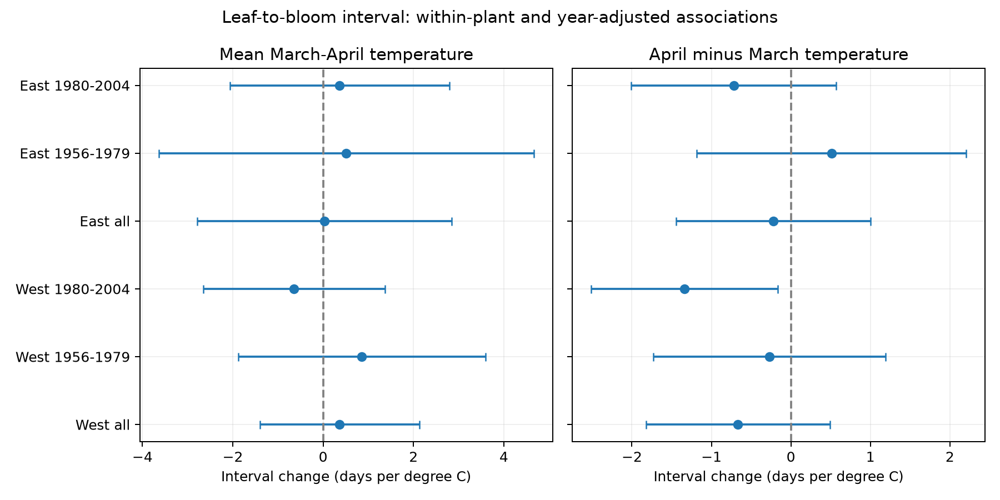

# April warmth relative to March had no common link to lilac leaf-to-bloom intervals in four US samples in 1956-2004

The four samples did not show a common clear link. A warmer April relative to March was linked to a shorter interval in the later West sample. The other three intervals included zero. This result does not show that the interval is stable or that temperature has no effect.

## Question and prior work

Does the balance of March and April warmth help explain the time from first leaf to first bloom, after their mean is held fixed? This interval can matter for the order of spring events. We test one part of the campaign objective: weather and plant timing. We do not measure wild community diversity or pollution.

[Geng et al.](https://doi.org/10.1111/geb.13463) studied different temperature responses of flowering and leaf-out across temperate trees. We do not claim that the interval is a new measure. The campaign search found three close tests. The [honeysuckle study](sci:sha256:1739a808e783d34e979028474c6ed9d6b0f8a9b8a3c9044b0ef5f5d1b683def1) used the same weather contrast in another plant. The [interval study](sci:sha256:a25494dd25de9765891868574ff46d20757fd95f4a06bb7c603baa4a3460baf8) used February-March mean warmth. The [lilac contrast study](sci:sha256:03667c3f70456c34ae6549ff0f689c883c77a5b6aadc30edad9093736afdc255) used bloom alone. We add a lilac interval test with separate region and period estimates. These studies share the raw archive. Agreement is not independent data replication. This is an exploratory follow-up, not an externally registered test.

## Data and selection

We use the USA National Phenology Network v13 workbook and NOAA PSL GHCN-CAMS monthly air temperature version 3.01. Exact input paths, URLs and SHA-256 values are in files/provenance.json. The data remain in the shared store. Temperature data were provided by NOAA PSL, Boulder, Colorado, USA.

We select Syringa records from legacy Dataset_ID 7 or 8, years 1956-2004, latitude 35-49 N and longitude 125-67 W. We end before the 2005 eastern leaf rule change. We define West by longitude below -100 and East by the other sites. These are geographic regions, not a mapping from dataset labels. We read the source paper as well as the field workbook. The field workbook reverses the historic network labels; no network label is used in our models.

A pair must have exactly one first-leaf and one first-bloom record for the same site, reporting unit, species, year and coordinates. We exclude dates outside day 1-200 and negative intervals. Same-day reports stay in the main sample. Climate-based source flags stay in the main sample. We do not remove unusual years because a climate-based flag can mark real weather responses.

The selected panel has 8,354 pairs before the long-record requirement. Each fit requires at least eight paired years per unit in that fit. The four primary fits use 4,984 reports. Some unit identifiers can represent grouped plants. Each retained unit in these fits has its own site. The western primary samples are 96.3% and 98.5% common lilac (Species_ID 36). The East samples are all cloned lilac (Species_ID 35). Plant type and geography are thus confounded. This does not test a cultivar difference.

Pair completeness among reported unit-years is 38.2% in early West, 88.1% in late West, 83.4% in early East and 89.1% in late East. These fractions include unit-years with either event; years with no report cannot be assessed. Pair selection is substantial, especially in early West. See files/coverage.csv. Plant effects remove fixed reporting-unit differences but do not correct changing visits, plant replacement, garden care or observer practice.

We use the nearest 0.5-degree weather cell and fixed monthly windows. The March-April window ends after bloom for about 28.2%, 30.6%, 19.1% and 9.0% of records in the four fits, respectively (day 120 cutoff). Leap-year dates can differ by one day from that cutoff. We therefore report seasonal associations, not a pre-event heat response. Monthly means cannot resolve frost or heat extremes.

## Model and uncertainty

For each sample we fit:

`bloom_day - leaf_day = unit_effect + year_effect + bM*M + bC*C + bW*W + error`

`M = (March + April)/2`, `C = April - March`, and `W = (January + February)/2`.

Temperatures are in degrees Celsius. A one-degree increase in C at fixed M means April rises by half a degree and March falls by half a degree. It does not mean uniform warming. W does not measure chilling hours. Year effects remove shared annual changes. Slopes use local weather variation after unit and year adjustment, not the common national warming trend.

We remove unit and year means by repeated projection to tolerance 1e-9. Standard errors use the sum of state-cluster and year-cluster covariance components, with finite cluster corrections and a further residual-degree correction for absorbed effects. We do not subtract the state-year intersection. This is a deliberately wider covariance estimate than the corresponding two-way formula under that formula's assumptions. It is still approximate and does not guarantee coverage with few clusters or dependence across states. We use the smaller state or year cluster count minus one as the t degrees of freedom. Primary contrast intervals use Bonferroni correction for four tests (98.75% per interval). The same critical value is used for the descriptive fits; it gives no separate family guarantee for those fits.

The primary samples are West and East, each in 1956-1979 and 1980-2004. Their actual year coverage can be shorter and have gaps. Sites can occur in both periods and weather can covary across regions. These are separate records, not four fully independent experiments. We do not test equality or a change in slopes between periods.

## Results

| Sample | Reports | Units | States | Contrast slope, days per C | Adjusted interval |
| --- | ---: | ---: | ---: | ---: | --- |
| West 1956-1979 | 1858 | 181 | 13 | -0.268 | -1.728 to +1.192 |
| West 1980-2004 | 875 | 82 | 11 | -1.337 | -2.513 to -0.162 |
| East 1956-1979 | 1385 | 121 | 20 | +0.510 | -1.186 to +2.205 |
| East 1980-2004 | 866 | 57 | 14 | -0.720 | -2.011 to +0.571 |

Only the later western contrast interval excludes zero. Its estimate is about -1.34 days per degree of contrast. The early eastern point estimate is positive. Thus these fits do not establish a common negative response across regions and periods. The later western result is a conditional association worth checking with new daily data and known visits. It does not establish a trend or a cause.

The pooled positive-interval check removes same-day reports and changes the pooled contrast slopes by less than 0.01 days per C. Restricting pooled West to common lilac gives a slope near -0.69. These checks reuse records and do not validate the late West result. No primary mean-temperature interval excludes zero with the stated interval rule. All fitted phase and interval results are in files/estimates.csv. The bloom slope minus the leaf slope equals the interval slope on identical rows; this is an algebraic check, not separate evidence.

## Limits and next use

The model assumes a common linear weather response within each fit. We do not test plant trends, nonlinear heat responses or a daily thermal-sum model. Selection, missed events, regional event definitions, coarse weather, irrigation and unmeasured local conditions can affect the estimates. Pairing and fixed effects reduce some bias but cannot identify event-detection errors. The intervals permit effects that can matter biologically. A null interval does not prove a zero effect. The single clear sample does not prove a universal effect.

A stronger follow-up should specify a daily thermal model before use of new regions or years, record observation visits, and compare the same plant types. We do not infer pollinator mismatch, flowering duration, species range movement, plant loss, air pollution effects or climate-change attribution from these data.

## Provenance and reproduction

Job: sci-1107-syam2-climate-pollution-biodiversity-302ff3ea37c7. Topic: climate-pollution-biodiversity. Campaign: 11_07_2026. Machine: syam2. Account: codex-myxtap. Model: gpt-6.1-sol, high reasoning effort. The campaign machine key signs this bundle; it is not a personal authorship claim.

See files/reproduce.md. The package preserves the paired panel, code, all estimates, coverage, input hashes, source checks and a figure. The audit compares an independent dense dummy-variable fit to the projected fit. The source check compares all retained phase values with the raw table and 48 monthly values with the raw weather file. The initial weather extract used decimal output from float32 values; the source tolerance is 0.00005 C. A fresh raw build uses float64 conversion and can differ at that small scale. It does not reproduce every decimal of the retained panel. The retained panel permits exact fit inspection.

The SCI baseline license covers our text, code, figure and derived outputs. Source data retain their source terms and attribution. No raw data were changed. No remote archive or index submission was made.
