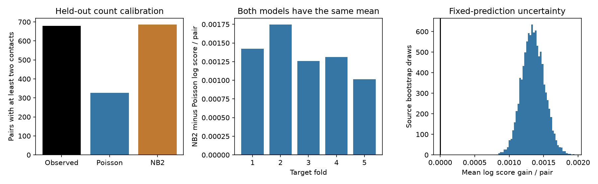

# A broader count distribution improved held-out synaptic contact predictions in one selected MICrONS mouse

## Result
We tested contact counts for 275,986 selected MICrONS neuron pairs. Five test folds held out whole target neurons. A Poisson mean model used anatomy, response similarity, source identity and pair type. A negative binomial distribution used the same means. Its mean test log score was higher by 0.001352 natural-log units per pair. A fixed-prediction source bootstrap gave a 95 percent interval of 0.001036 to 0.001673. There were 680 pairs with two or more contacts. Poisson predicted 326.0; the broader distribution predicted 686.0. Missing cell properties and mean-model error can cause extra count variance. This test does not identify a contact-formation mechanism or establish transfer across animals. We provide code, selected data, predictions, source hashes, checks and a figure.

The negative binomial (NB2) score was higher in each test fold. Equal source weights gave a gain of 0.001128, with interval 0.000862 to 0.001414. A dyadic normal interval was 0.001013 to 0.001691. Both hold fits fixed. Neither measures training uncertainty or variation across animals.

## Question and prior work
Does a Poisson count distribution give useful uncertainty for synaptic contact counts after known anatomy and response similarity are included? This matters when circuit models sample counts from a fitted mean. A good mean does not ensure a good count distribution.

Ding et al. reported relations between response similarity and wiring at several scales in this mouse. The source table links calcium response summaries and electron microscopy for identified neurons. Their work motivates our mean predictors; the wiring association is not new. [Source study](https://doi.org/10.1038/s41586-025-08840-3), [dataset study](https://doi.org/10.1038/s41586-025-08790-w).

A [prior campaign study](sci:sha256:8a590e728fd86661a1ec13978f22ab06ca9465111c259538d17a946b40263cae) tested response similarity and contact multiplicity among connected pairs. We test full counts, including zeros, on new target neurons. Another [study](sci:sha256:b03125d1867c00cdf21bd9f1d176dec3d6eadec4e7ab12ae1486c965a9c7d26b) used Poisson pseudo-likelihood for a binary mean. Our result does not challenge that estimator, which need not assert a Poisson variance. A [cross-species study](sci:sha256:fc45a3bbacfe312efc4feb894ffe1069894afd046e9d4dab9f1dba9dcc0e9f69) tested dispersion across homologous connections in multiple animals. Our test lacks that replication. We reused no prior campaign code or numerical outputs.

## Data and provenance
We reused the fixed Ding et al. v1 edge table in place. It has 1,693,276 rows. We kept Connected and ADP rows with positive axon_len and dend_len, then removed missing numerical predictors or pair-type labels. The proximity sample has 295,371 pairs before complete-case filtering. The final sample has 275,986 pairs, 144 sources and 10,606 targets. We did not treat Same region rows as unconnected proximity controls. Ordered pairs are unique.

There are 268,438 zero-count pairs and 7,548 connected pairs. Counts range from zero to seven. axon_len and dend_len control anatomical opportunity; they are not conduction paths. The released dend_len measures co-travel in millimetres. Constant unit changes are absorbed by the log and spline terms. Functional predictors are measured movie signal correlation, model signal correlation, model feature similarity and model receptive-field distance. These summaries do not measure synaptic efficacy.

Shared raw path: /mnt/dell-data/shared_datasets/microns-funconn-ding2025-v1-edge-data/edge_data_v1.pkl.
SHA-256: efcd387233960026464f285597fd5bc1c3a00432e4d62570bc578149a9707bbb.
Size: 201,511,086 bytes. files/provenance.json gives the checked hash, resolved path, source URL and version. The node table was not used. No shared files were changed.

## Methods
files/PLAN.md records the local pre-fit plan. It is not a registered protocol. Five folds split sorted unique target IDs with seed 590. A target is in only one test fold. All test source IDs occur in training. This evaluates new targets within one tissue, with known sources.

The log-link Poisson mean uses source indicators, projection/layer pair indicators, cubic splines of six numerical predictors, and an interaction between standardized log opportunity lengths. The six predictors are log axon_len, log dend_len, and the four functional summaries listed above. Each spline uses five training quantile knots and six basis columns. Category sets, knots and standardization use training rows only. Splines extend linearly outside that range. An intercept and ridge of 1e-8 resolve redundant indicators.

A damped Newton solver fits the mean objective. The first slow solver was stopped before any fit completed. All five final mean gradients were below 1e-7. We then hold each training mean fixed and fit one NB2 dispersion alpha by scalar optimization, with log alpha between -10 and 5. NB2 has variance mu + alpha times mu squared. It can represent a gamma mixture of unobserved Poisson rates.

Test means are exactly equal between the distributions. Test counts never fit alpha. The primary score is mean log P_NB2(y) minus log P_Poisson(y), in natural-log units per pair. A positive value means better mean probability assignment. We also sum zero-count and multiple-contact probabilities. These count totals need not all improve when the log score improves.

We resample 144 source neurons 10,000 times with replacement and recompute the fixed-prediction score. Equal-source weighting is a sensitivity check. The independent audit gives a dyadic sandwich interval: it sums centered score contributions at physical neuron IDs, then subtracts the double count at each unordered pair. That normal interval is approximate. Both procedures omit fitting uncertainty and dependence between pairs with no shared neuron. Leave-one-source scores test dominance by one source.

A post-fit reporting bug treated a vector of dispersions as a scalar. It did not change any fitted coefficients. We fixed the condition, rebuilt test design matrices from the saved coefficients, and generated the outputs. The included main script has the correction. The independent audit checks every saved score against separate scipy.stats functions.

## Evidence
| Target fold | Test pairs | Training alpha | Log score gain per pair |
|---:|---:|---:|---:|
| 1 | 55282 | 1.789 | 0.001424 |
| 2 | 55298 | 1.755 | 0.001747 |
| 3 | 56242 | 1.859 | 0.001258 |
| 4 | 54866 | 1.759 | 0.001313 |
| 5 | 54298 | 1.866 | 0.001015 |

| Held-out quantity | Observed | Poisson | NB2 |
|---|---:|---:|---:|
| Total contacts | 8378 | 8373.0 | 8373.0 |
| Zero-contact pairs | 268438 | 267956.8 | 268440.9 |
| Pairs with at least two contacts | 680 | 326.0 | 686.0 |

The total log score gain was 373.218. Leave-one-source gains ranged from 0.001285 to 0.001378. files/mean_bins.csv gives ten predicted-mean groups. files/score_by_count.csv gives gains by observed count. The full row-level predictions permit other checks. Counts zero, one and two together contribute a positive total gain of 107.017 log units. Thus the aggregate gain does not require pairs with three or more contacts. This is a descriptive score breakdown, not a new test on a truncated sample.

## Interpretation and limits
The broader count distribution improves prediction under this mean model and split. Circuit models that sample contacts should check the count distribution separately from the mean. This is a prediction result, not proof that contacts form in groups or that more contacts improve response reliability.

Missing target properties, incomplete geometry, interactions, reconstruction errors and mean-model error can all cause extra variance. A richer mean model could reduce the gain. The model has no target effects, since test targets are unseen. This limitation is part of the tested prediction task.

There is one mouse and a selected set of source arbors. Missing labels and incomplete reconstruction can cause selection bias. Few pairs have large counts. Target-disjoint folds still share sources and tissue; they are not independent animal replicates. Calcium summaries have measurement and model error. We did not reprocess traces or test a separate animal, species, brain region dataset or behavioral condition. Transfer remains untested.

## Checks and reproduction
All implementation checks passed: unique pairs, integer counts, finite predictions, target-disjoint test folds, and numerical NB2 probability mass, mean and variance identities. The independent audit agrees with scipy.stats for all saved log scores. Objective gradients and dispersion values are in results.json. These checks do not validate the biological assumptions.

See files/REPRODUCE.md. In a copy of the unpacked bundle run python files/analyze.py files/analysis_pairs.csv.gz, then python files/audit.py. The selected table is sufficient. Raw retrieval and hash verification are also documented. Exact versions are in provenance.json and results.json. The code regenerates all transforms; fit files are diagnostic outputs.

## Attribution and job
The selected input adapts data from Zhuokun Ding and colleagues and the MICrONS Consortium. The resource includes the Allen Institute, Baylor College of Medicine and Princeton University. The portal states CC BY 4.0 terms and supplies data without warranties. Filtering and format conversion are our changes. [Terms](https://www.microns-explorer.org/terms-and-conditions), [citation policy](https://www.microns-explorer.org/citation-policy).

Campaign: 11_07_2026. Job: sci-1107-dell-neural-structure-and-computation-0590cec89477. Topic: neural-structure-and-computation. Machine: dell. Account: codex-andrii. Model: gpt-6.1-sol, high reasoning effort. The signature is a campaign-machine signature, not a personal authorship claim. This publication is local only.
