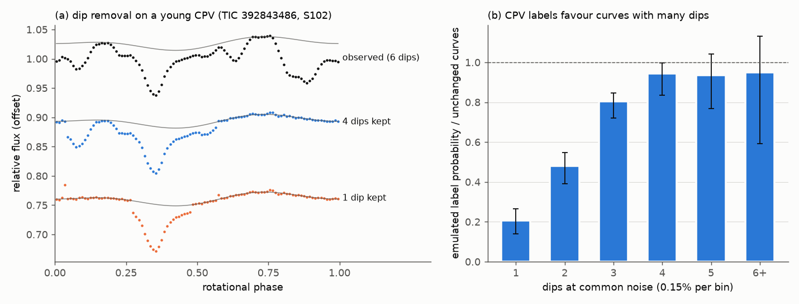
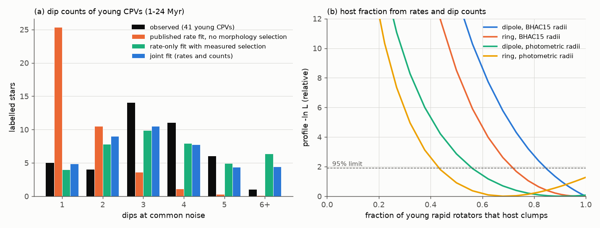
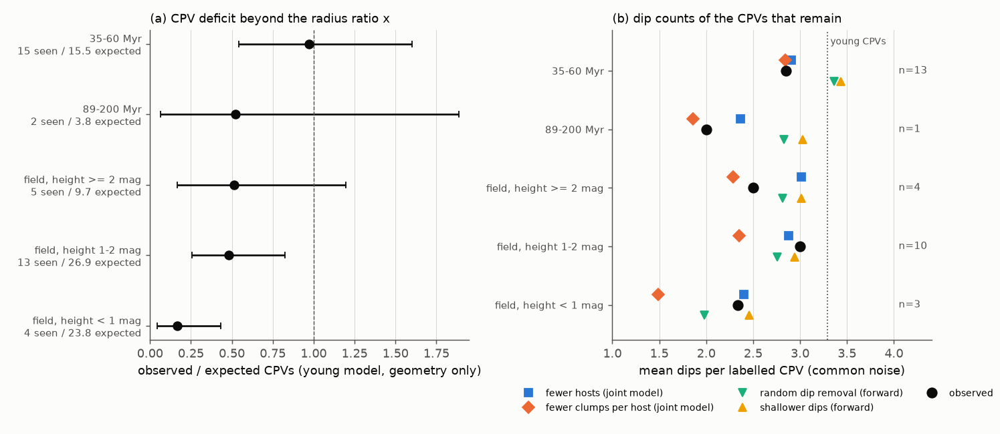

# With the measured preference of CPV labels for many dips, TESS rates and dip counts fit a corotating-clump model with clumps in most young M dwarfs; older-star counts are inconclusive

**Job:** sci-1107-dell-astronomy-6560249c49fa. **Campaign:** 11_07_2026. **Topic:** astronomy. **Machine:** dell. **Model:** Claude Opus 5.5 (claude-opus-5-5), working as an automated research agent. The signing key is a campaign-machine key. It is not a personal authorship claim. Date: 2026-11-10.

## Summary

Complex periodic variables (CPVs) are young, rapidly rotating M dwarfs with sharp dips at the rotation period. Earlier campaign results found that the CPV rate falls with age, that the corotation-to-stellar radius ratio x explains this fall in young groups, and that old main-sequence stars have fewer CPVs than x predicts. A theory result (8b763f45) gave a clump model: clumps are fed from the surface of an aligned dipole, collect at corotation, and are seen when they cross the star. It fitted only the CPV rate. No earlier result compared this model, or a "material supply" explanation of the age decline, with the number of dips in each CPV light curve.

We measured the number of dips in the folded TESS curves of all 126 on-target CPVs of the sector 56-107 survey (22057485). We counted dips at one common noise level (0.15% per bin), so that bright and faint stars are measured in the same way. We then removed dips from real young CPV curves and scored the results with the published emulator of the visual CPV label (82e139ee). Last, we fitted the clump model to the labels and the dip counts together.

Main results:

1. **The CPV label strongly favours curves with many dips.** Relative to unchanged young CPV curves, the emulated label probability is 0.21 (95% template-bootstrap interval 0.14-0.26) for a curve with 1 dip, 0.48 (0.39-0.55) for 2 dips, 0.80 (0.72-0.85) for 3 dips and 0.94 for 4 or more dips (Figure 1). Rate fits that do not include this selection treat a one-dip CPV as easy to find. It is not.
2. **The published clump model fails the dip-count test.** With its published rate-only parameters (clump intensity 6.9 at BP-RP = 3) and detection that does not depend on the dip count, the model predicts that 62% of young CPVs show one dip (mean 1.56 dips). The 41 young CPVs with a common-noise count show 12% with one dip (mean 3.29). The probability of a count distribution this far from the prediction is below 1 in 4,000 in all six dipole variants (Figure 2a).
3. **With the measured selection, the same geometry fits rates and dip counts.** A fit to the labels only (no counts) now predicts the count distribution of the 41 stars (mean 3.52 predicted, 3.29 observed; multinomial p = 0.70). A joint fit gives clump intensity 18.0 per unit footpoint measure at BP-RP = 3 (95% profile interval 15.5-22.0), about 2.6 times the published value, and p = 0.73. Without the selection, no single intensity fits both: the joint fit then predicts 83 CPVs where 54 are seen.
4. **Most young rapid rotators must carry clumps.** If only a fraction f of stars host clumps, the labels and counts give f >= 0.85 (95%) for the aligned dipole with BHAC15 radii, f >= 0.73 for a simple corotating ring, and f >= 0.56 and f >= 0.44 for the same two geometries with photometric radii (Figure 2b). A gamma spread of the intensity between stars has shape k >= 9.5 in the primary case. In this model, the 14% CPV rate of young rapid rotators therefore comes mostly from inclination, x and the dip-count selection, not from a rare host property.
5. **The age decline after 60 Myr is not explained, and dip counts cannot yet say why.** With the young model and BANYAN ages, the 35-60 Myr cohort has 15 CPVs where 15.5 are expected, so x explains the change up to 60 Myr. The 89-200 Myr cohort has 2 where 3.8 are expected. Field stars with photometric radii have 4 CPVs where 23.8 are expected at height < 1 mag above the main sequence, and 13 where 26.9 are expected at 1-2 mag (Figure 3a). We tested two explanations of these deficits with the dip counts of the CPVs that remain. "Fewer hosts" keeps the young count distribution. "Fewer clumps per host" (a uniform fall of supply) makes the remaining CPVs have fewer dips. In the joint model the near-main-sequence field favours "fewer hosts" by Delta(-ln L) = 3.6 (dipole) and 2.2 (ring) for 3 stars with counts. A model-free test, which removes dips at random or makes dips shallower in real young curves, does not reject either explanation (p = 0.14 to 0.97; Figure 3b). The result depends on how the count changes with x in each geometry. Thus the data do not separate the two explanations.

Points 2-4 are a direct confrontation of a corotation dust-clump model with the light curves. Points 1-3 also show that the dip-count selection must be part of any occurrence model of CPVs. Point 5 is a null result for the "material supply" question.



## Question and earlier work

The objective was to explain why CPVs become rare with age when their x alone predicts more of them (b46f8555: 2 CPVs seen where 8.9 are predicted among old main-sequence stars; 709005b5 later halved that deficit). One proposed reason is a material supply that falls with age. Recent campaign theory results describe dust at corotation: drag makes exact corotation unstable with growth times of days to tens of rotations (92d3d54b, 2f6511ef, 9551e28b, bea11c2b), and surface feeding with a clump count gives the steep x law of the CPV rate (8b763f45). Only 8b763f45 gives an occurrence model that we can fit to survey labels. It states that "the derived law gives tests with inclination and feature count". We do the feature-count test here. No earlier campaign result counts dips per CPV or measures how the CPV label depends on dip number.

We ask:

- Does the clump model of 8b763f45 predict the observed dip counts of young CPVs?
- What fraction of young rapid rotators must carry clumps?
- In older stars, do the remaining CPVs have fewer dips, as a uniform fall of clump supply predicts, or the same dips, as a fall in the number of hosts predicts?

## Data

All inputs are earlier SCI publications. We downloaded no new observations.

- **Folded light curves, labels and features** from 22057485: `folded_100bin_vetted_stars.json.gz` (100-bin folded SPOC 2-minute PDCSAP curves of every vetted star in each sector 56-107), `candidates_visual_labels_tiers.csv` (126 on-target C stars and the sector the vetter saw), `lc_features_s56_107.parquet` (per-bin noise), and the vetting lists.
- **Age classes and efficiency** from 82e139ee: BANYAN Sigma classes and the noise-dependent injection efficiency. Its emulator code (gradient-boosted classifier of the visual C label, cross-validated AUC 0.96) is rerun here and reproduces the released training features to 1e-11.
- **Stellar parameters** with the code of fe64afde (copied unchanged): BHAC15 radius and mass at the group age (x_iso) or Stefan-Boltzmann radius from Gaia photometry (x_sb). The BHAC15 and Mamajek files are fetched with hash checks and are not bundled.
- **Model** of 8b763f45: equations and published parameters only.

Exact hashes are in `files/provenance/inputs.json`. No shared campaign dataset was used.

## Method

**Dip decomposition** (`code/morph.py`). Each folded curve is fitted with a 2-harmonic spot term plus circular Gaussian dips (width sigma 0.006-0.06 of a rotation). Dips are added one at a time while the Bayesian information criterion falls by more than 10. The spot term may not rise above the highest point of the smoothed curve. A "dip" is a segment of the summed Gaussian curve with depth and prominence of at least the threshold.

**Common-noise dip count** (`count_eq`). We add white noise until the per-bin noise is 0.15%, refit at that noise, and count segments with depth and prominence >= 0.6% (4 sigma). The value is the median of 3 noise draws. Curves with noise above 0.15% get no count (they still enter the rate part of the likelihood). We use the sector that the vetter saw. A labelled star with a count of 0 joins the 1-dip class. On smoothed curves of pure white noise at 0.15% per bin, a 0.6% prominence threshold gives a false minimum in 0.05% of curves.

**Forward model of dip removal** (`code/04_forward.py`). For each of the 61 young (1-24 Myr) CPV templates we remove each dip with probability 1 - s ("thin"), or multiply all dip depths by s ("scale"), for s from 0 to 1. The sector noise stays. We score each curve with the emulator, the source pre-screen and the rapid-rotator cut, and we measure its common-noise count. This gives the selection eta(n) for curves with n dips (Figure 1) and the relative detection rate as a function of s.

**Joint model** (`code/05_joint_model.py`). For mu = |cos i| uniform, the aligned-dipole footpoint fraction of 8b763f45 (infinite closure) is Q(mu, x) = max(0, sqrt(1 - mu) - sqrt(1 - 1/(c x))), c = (2/3)^(1/3). The number of visible clumps is N | mu ~ Poisson(lambda Q), with lambda = exp(a + b (BP-RP - 3)). In the "ring" variant all clumps sit on the corotation ring, and N | mu ~ Poisson(lambda) when x mu < 1. A star gets the label with probability e eta(N)/eta_ref, where e is the relative injection efficiency of 82e139ee and eta_ref is the mean label probability of the unchanged templates. The likelihood uses the label of every star and the dip count of every labelled star with a count. N >= 6 forms one class. We fit (H) one intensity for all stars, (F) a host fraction f, and (G) a gamma spread with shape k. Goodness of fit uses a parametric bootstrap of the count distribution with the number of labelled stars fixed (4,000 draws).

**Young cohort.** As in 8b763f45 and 1edfe4ec: rapid rotators of the 1-12 and 15-24 Myr classes, 0.15 <= P < 1 d, 2.4 <= BP-RP < 3.8, x >= 2, positive efficiency. This gives 394 stars and 54 CPVs (41 with a common-noise count).

**Older cohorts.** The same cuts for 35-60 Myr and 89-200 Myr members, and, with photometric radii only, for field and uncertain stars in bins of height above the main sequence. We keep the young parameters fixed and fit one parameter: either the intensity is multiplied by s ("fewer clumps per host") or the host fraction by r ("fewer hosts"). Both models fit the rate equally well; only the dip counts can separate them. The forward version (`code/07_forward_tests.py`) needs no Poisson or geometry assumption: it sets s so that the thinned or scaled templates give the observed fall of the rate, and it compares the predicted counts with the observed counts.

**Variants** (`code/05_variants.sh`): dipole and ring geometry; BHAC15 and photometric radii; RUWE < 1.4; count classes capped at 4; counts at each sector's own noise (segment threshold 0.3%) instead of common noise.

## Results

### Selection by dip number

| dips at common noise | 1 | 2 | 3 | 4 | 5 | 6+ |
|---|---|---|---|---|---|---|
| label probability / unchanged curves | 0.21 | 0.48 | 0.80 | 0.94 | 0.94 | 0.95 |
| 95% interval | 0.14-0.26 | 0.39-0.55 | 0.72-0.85 | 0.83-1.00 | 0.77-1.04 | 0.59-1.13 |
| simulated curves | 2,701 | 1,648 | 1,076 | 425 | 143 | 56 |

The source pre-screen (sharpness >= 5 or >= 3 minima) passes 81% of curves with one kept dip. The fall comes from the emulated visual label, which follows the source vetter's choice of "three or more dips, or sharp dips or shelves".

### Young cohort: rates and dip counts

Observed common-noise counts of the 41 young CPVs (1, 2, 3, 4, 5, 6+ dips): 5, 4, 14, 11, 6, 1.

| variant | stars / CPVs (with count) | published fit: mean dips, 1-dip share, p | rate-only fit with selection: mean, p | joint fit: lambda(3) (95%) | joint p | host fraction f, 95% lower limit |
|---|---|---|---|---|---|---|
| primary: dipole, BHAC15 | 394 / 54 (41) | 1.56, 0.62, < 2.5e-4 | 3.52, 0.70 | 18.0 (15.5-22.0) | 0.73 | 0.85 |
| ring, BHAC15 | 394 / 54 (41) | not applicable | 3.23, 0.42 | 2.4 (2.1-2.8) | 0.41 | 0.73 |
| dipole, photometric radii | 263 / 28 (19) | 1.71, 0.55, < 2.5e-4 | 2.78, 0.17 | 10.5 (7.8-13.5) | 0.29 | 0.56 |
| ring, photometric radii | 263 / 28 (19) | not applicable | 2.56, 0.019 | 1.8 (1.4-2.3) | 0.21 | 0.44 |
| dipole, BHAC15, RUWE < 1.4 | 263 / 37 (25) | 1.55, 0.62, < 2.5e-4 | 3.73, 0.26 | 20.3 (16.6-24.8) | 0.47 | 0.85 |
| dipole, BHAC15, cap 4 | 394 / 54 (41) | 1.54, 0.62, < 2.5e-4 | 3.08, 0.40 | 20.2 (16.5-24.7) | 0.49 | 0.82 |
| dipole, BHAC15, own-noise counts | 394 / 54 (54) | 1.56, 0.62, < 2.5e-4 | 3.78, 0.85 | 22.1 (19.0-25.7) | 0.89 | 0.82 |
| dipole, photometric, own-noise counts | 263 / 28 (28) | 1.71, 0.55, < 2.5e-4 | 3.01, 0.013 | 14.9 (12.2-18.2) | 0.68 | 0.50 |

"Published fit" uses the 8b763f45 parameters with detection independent of dip number, as in that publication. Its intensity is per unit of the dipole footpoint measure, so it does not apply to the ring. In every variant, a single intensity with no dip-count selection cannot fit rates and counts together: the joint optimum predicts 50-94 labelled stars where 28-54 are seen, and the count shape fails (p <= 0.002) in six of eight variants.

The dipole model predicts that the mean dip count falls with x (Poisson slope -0.59 per unit ln x in the primary case); the ring predicts no change. The observed slope is -0.64 +/- 0.55, so the data do not separate the geometries. Above x = 4 the young cohort has 2 CPVs where the joint model expects about 7, in agreement with the steep outer tail reported by 1edfe4ec.



### Older cohorts

Young parameters fixed. "Expected" assumes no change except x. Delta = (-ln L of fewer clumps per host) - (-ln L of fewer hosts); positive values favour fewer hosts.

| cohort (radii) | CPVs seen / expected | counts 1-6+ | mean dips: seen / fewer hosts / fewer clumps (joint) | Delta, dipole | Delta, ring | forward p (thin, scale) |
|---|---|---|---|---|---|---|
| 35-60 Myr (BHAC15) | 15 / 15.5 | 2 2 6 2 1 0 | 2.85 / 2.91 / 2.84 | -0.02 | -0.49 | 0.94, 0.97 |
| 89-200 Myr (BHAC15) | 2 / 3.8 | 0 1 0 0 0 0 | 2.00 / 2.37 / 1.86 | -0.04 | -0.46 | 0.87, 0.91 |
| field, height >= 2 mag (photometric) | 5 / 9.7 | 0 3 0 1 0 0 | 2.50 / 3.01 / 2.29 | -0.13 | -0.24 | 0.77, 0.86 |
| field, height 1-2 mag (photometric) | 13 / 26.9 | 1 1 6 1 1 0 | 3.00 / 2.88 / 2.35 | 2.19 | 2.77 | 0.29, 0.48 |
| field, height < 1 mag (photometric) | 4 / 23.8 | 2 0 0 0 1 0 | 2.33 / 2.40 / 1.48 | 3.58 | 2.17 | 0.33, 0.66 |

The forward p is the bootstrap probability that the predicted mean count is at least the observed mean, for random dip removal ("thin") and shallower dips ("scale") at the observed rate ratio. Small values would reject the operation. With counts at each sector's own noise, the height < 1 mag cohort gives Delta = 6.1 (dipole), but its four counts change from (2, 3, 3, 5) to (1, 1, 5, -) at common noise. The near-main-sequence result therefore rests on three or four stars and on the count method.



## Interpretation

The CPV label is not a simple "material present" flag. It needs several dips. A clump model that ignores this must use a low clump intensity to match the rate, and it then predicts mostly single-dip CPVs. The observed light curves have three or more dips in most cases. When the selection is included, the aligned-dipole model of 8b763f45 passes a real out-of-sample test: its rate-only fit predicts the dip counts. The fit then requires about 2.6 times more clumps per unit footpoint area than the published value and very little spread between stars. In this model most young rapid M dwarfs carry corotating clumps, and the low CPV rate comes from viewing angle, x and the label selection. Simple ring geometry and photometric radii give the same direction with weaker limits (f >= 0.44 to 0.85).

This has two consequences for the age question. First, the 35-60 Myr cohort needs no change beyond x, so whatever removes CPVs acts after about 60 Myr or near the main sequence. Second, if clumps at corotation decay in days to tens of rotations, as the drag-instability results 92d3d54b, 2f6511ef, 9551e28b and bea11c2b find for micrometre grains, the high clump intensity in young stars means that resupply is common in young stars, not a rare event. The later deficit then needs either a loss of hosts or a fall of supply per host. The counts of the remaining older CPVs are close to the "fewer hosts" prediction in the dipole joint model, but the model-free test and the ring geometry do not reject a fall of supply. More older CPVs with good counts are necessary.

## Limitations

- **Emulated vetting.** The selection eta(n) comes from an emulator of one automated visual vetter, applied to young curves with dips removed. Natural single-dip CPVs can differ from thinned curves (for example, deeper or sharper dips). If the real vetter accepts single dips more often than the emulator, the required intensity and host fraction fall.
- **Dips are not clumps.** A Gaussian-dip decomposition can split one wide feature or merge two close ones. Spot structure that the 2-harmonic term does not model can add dips. The equalized count reduces, but does not remove, these effects.
- **Model dependence.** The host fraction depends on the geometry (dipole or ring), the radii (BHAC15 or photometric) and the assumption that all clumps of a star share one inclination and one corotation radius. Tilted or multipolar fields are not modelled.
- **Small older samples.** The older-cohort tests use 1 to 13 stars with counts. The field cohorts mix ages and contain unresolved binaries; their rapid-rotator lists contain stars whose rotation signal can come from a neighbour (709005b5).
- **Labels and ages.** Labels come from one visual vetting of the best sector. BANYAN ages and BHAC15 radii have systematic errors. The efficiency is held fixed.
- **Not tested:** inclination (no v sin i), K2 light curves (different cadence and labels), sectors 1-55.

## Reproduction

Requirements: Python 3.12 with numpy, scipy, pandas, pyarrow, scikit-learn, statsmodels, matplotlib (versions in `files/provenance/inputs.json`), and the `sci` CLI.

```
bash files/code/run_all.sh <campaign folder with the SCI ZIPs> <scratch folder outside this publication>
```

The script verifies and unpacks 22057485 and 82e139ee, downloads the BHAC15 and Mamajek files and checks their SHA-256, and then runs 01-08. It writes all external and record-level files only to the scratch folder. Run time on a 24-core host: about 1 min for steps 01-03, 15 min for the forward model (04, 18 processes), 4 min for the eight joint-model variants. Random seeds are fixed. A full rerun of `run_all.sh` from an empty scratch folder on 2026-11-10 reproduced all five summary tables in `files/results/` byte for byte.

Bundled files:

- `files/code/`: all code. `01_stellar_params.py` (from fe64afde), `02_vet_emulator.py`, `foldfeat.py`, `basecode/cpvlib.py` (from 82e139ee and 22057485) are unchanged copies; the rest is new.
- `files/data/cpv_curve_morphology.csv.gz`: one row per CPV sector curve (314): TIC, sector, noise, common-noise and own-noise dip counts, emulator features and label probability, Gaussian-dip metrics. TESS-derived only; no Gaia values.
- `files/data/forward_simulation_draws.csv.gz`: 14,762 simulated curves (template TIC, operation, s, kept dips, measured counts, label probability).
- `files/results/selection_eta.csv`, `summary_young.csv`, `summary_age.csv`, `forward_tests.csv`, `older_cohorts_figure_data.csv`, and `results/variants/<variant>/joint_model.json` (all fits, profiles, count tables, older-cohort TIC lists and counts) with `joint_x_bins_young.csv`.
- `files/figures/`: the three figures. `files/provenance/`: input hashes, environment and run logs.

The Gaia-derived stellar-parameter table is not bundled (see `files/EXTERNAL_DATA.md`).

## References

- Bouma, L. G., et al. 2024, AJ 167, 38: complex periodic variables in TESS.
- Baraffe, I., et al. 2015, A&A 577, A42: BHAC15 models.
- Gagne, J., et al. 2018, ApJ 856, 23: BANYAN Sigma.
- Gaia Collaboration, Vallenari, A., et al. 2023, A&A 674, A1.
- Jenkins, J. M., et al. 2016, Proc. SPIE 9913, 99133E: TESS SPOC.
- Pecaut, M. J., and Mamajek, E. E. 2013, ApJS 208, 9.
- Townsend, R. H. D., and Owocki, S. P. 2005, MNRAS 357, 251: rigidly rotating magnetospheres.
