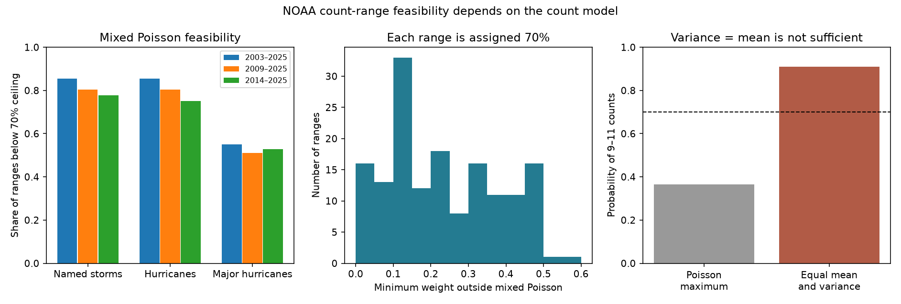

# Mixed Poisson models cannot give 70% probability to 108 of 153 NOAA hurricane count ranges from 2009 to 2025

Job: sci-1107-dell-earth-and-ocean-sciences-cb117b9f8cd1. Topic: earth-and-ocean-sciences. Campaign: 11_07_2026. Machine: dell. Account: codex-olen. Model: gpt-6.1-sol, high reasoning effort. Date: 11 November 2026. The key identifies a campaign machine. It is not a personal authorship claim.

## Result

For 108 of 153 archived NOAA seasonal hurricane count ranges from 2009 to 2025, no mixed Poisson distribution can put 70% probability inside the range. This is a property of the range endpoints, under the model assumption. It is not a new estimate of observed calibration. A random storm rate, more rate predictors, or a negative binomial distribution cannot remove this limit.

However, this limit is not a general law for count noise. We give an equal-mean, equal-variance counterexample. We also show how a finite-trial binomial model can reach the target without wider ranges. Thus the prior width attribution is valid within a broad Poisson family, but it does not establish an unavoidable physical error. A count model must be checked before it is used to prescribe wider outlook ranges.

The new contributions are a sharp bound on the weight outside the mixed Poisson family needed to reach the stated target, its application to the archived ranges, and an exact finite-trial sensitivity test. The fixed-Poisson maximum itself was used in the parent study and is not new here.



## Sources and scope

We use the frozen verification table in SCI publication 04cd0a5fbb07c95dbf3061f86168d57de298854bcbdaa90cdf3a47081719f7db. We read its paper and code, and a later temporal-transfer study, before writing files/PLAN.md. This is a retrospective mathematical audit, not an independent pre-registration.

The table has NOAA outlook endpoints, storm counts already present at the issue date, and HURDAT2 outcomes. The count types are named storms, hurricanes, and major hurricanes. There are three outlook sets per year: Atlantic May, Atlantic August, and eastern Pacific May. We exclude ACE, 2002, and incomplete 2026. For August we inherit the parent's subtraction of the count already present: a = lower endpoint - count to date; b = upper endpoint - count to date. We do not independently check that subtraction or transcribe new pages.

The main scope is 2009-2025, which the parent identifies as having explicit 70% wording. We also report 2003-2025 to match its main sample and 2014-2025 to test the more recent width regime. Early outlooks do not all promise exactly 70%; their values are a reference calculation at a common target. We checked the official 2025 May page: it states 70% for each range and does not require equal tail probabilities. Our test requires no equal-tail assumption.

No shared raw dataset was used. The exact input is an entry in the published parent ZIP at campaign/04cd0a5fbb07c95dbf3061f86168d57de298854bcbdaa90cdf3a47081719f7db.zip. The resolved shared path, ZIP hash, entry hash, and software versions are in files/results/provenance.json. The entry SHA-256 is 04cd62810cfa726116d23263e0e0e3655b13668aab6e8bb2742d92b9f4ae600e. This published source is sufficient to reproduce this audit. There is no need to download a live NOAA archive.

## Proof and method

For integer bounds 1 <= a <= b, let

C(a,b) = sup over lambda >= 0 of P(a <= Poisson(lambda) <= b).

The derivative of this probability is P(Poisson(lambda)=a-1) minus P(Poisson(lambda)=b). The ratio of these two masses decreases strictly with lambda. Thus the unique maximum is at

lambda* = exp((log(b!) - log((a-1)!))/(b-a+1)).

If a <= 0 <= b, the supremum is 1 at lambda = 0. A range entirely below zero has probability zero.

For any mixing measure G on nonnegative rates,

P(a <= Y <= b) = integral P(a <= Poisson(lambda) <= b) dG(lambda) <= C(a,b).

The bound is sharp: G can be a point mass at lambda*. This includes arbitrary rate mixtures, not only gamma mixtures. A negative binomial count is one such mixture. Known, fixed accrued counts are handled by shifting the endpoints first.

Now suppose a forecast law has the decomposition F = (1-epsilon) M + epsilon Q, where M is any mixed Poisson law and Q is any count law. Then its interval probability is at most (1-epsilon) C + epsilon. To reach target t > C, it needs

epsilon >= (t-C)/(1-C).

This is sharp for this one interval: take the optimal Poisson law for M and any point inside the interval for Q. This is a feasibility bound, not an estimate of the true mixture weight. It does not say that a proportion of observed seasons has a special physical cause. Arbitrary Q can have a larger variance than its mean.

For a finite-trial alternative Y ~ Binomial(n,p), with a > 0 and n > b, the maximum interval probability is at

logit(p*) = [log(b!) + log((n-b-1)!) - log((a-1)!) - log((n-a)!)]/(b-a+1).

For n=b it can reach 1 at p=1. We find the first integer n at which the optimized coverage falls below 0.7 as n increases from b. We record the preceding n and the variance-to-mean ratio 1-p* there. We check every integer from b through that preceding n. We do not use these trial counts as estimates of real storm opportunities. We make no global monotonicity theorem for all larger n.

## Quantitative evidence

| Years | Count ranges | Mixed Poisson maximum below 70% | Mean maximum | Mean minimum outside weight |
| --- | ---: | ---: | ---: | ---: |
| 2003-2025, reference | 207 | 156 (75.4%) | 63.58% | 17.68% |
| 2009-2025, explicit wording | 153 | 108 (70.6%) | 67.79% | 11.42% |
| 2014-2025, recent regime | 108 | 74 (68.5%) | 69.12% | 9.97% |

The final column averages the per-range lower bounds, including zero for feasible ranges. It is not the minimum weight needed to reach 70% only after pooling all ranges.

In 2009-2025, the impossible counts are 75 of 102 Atlantic ranges and 33 of 51 eastern Pacific ranges. By count type they are 41 of 51 named-storm ranges, 41 of 51 hurricane ranges, and 26 of 51 major-hurricane ranges.

Among the 108 impossible ranges in that period, the median minimum outside weight is 13.82%. The median binomial variance-to-mean ratio at the last feasible integer before the first crossing is 0.817. For the full reference sample the corresponding values are 21.63% and 0.707. These are sensitivity summaries under the chosen family, not measured dispersion parameters.

For comparison only, inherited observed coverage is 66.67% in 2009-2025 and 68.52% in 2014-2025. Individual observations can exceed a model probability ceiling in a finite sample. These empirical rates neither prove nor refute the mixed Poisson assumption here. In particular, the count-only explicit-period results should not be confused with the parent's 58% result, which pools ACE and earlier years.

## Why variance is not enough

Let Y take values 0, 9, 11, and 20 with probabilities 1/22, 5/11, 5/11, and 1/22. Its mean is 10 and its variance is 10. But P(9 <= Y <= 11) = 10/11 = 90.91%. The largest probability that any Poisson mean can put in that same interval is 36.40%.

This exact example disproves the claim that a mean-equals-variance condition alone imposes the Poisson interval ceiling. It is not proposed as a hurricane model. Together with the binomial test, it separates a valid family-specific bound from a universal count-noise claim.

## Prior work, interpretation, and limits

The parent already maximized fixed-Poisson interval probabilities and reported measured-dispersion alternatives. We extend its maximum to all mixed Poisson laws and give a sharp departure bound. Its temporal-transfer follow-up found no clear interval-score gain from early fitted width extensions. Our result does not repeat that correction exercise.

Prior seasonal tropical cyclone work used the Conway-Maxwell-Poisson distribution for underdispersed counts (WAF-D-20-0160.1). A recent large-ensemble study reports underdispersion in seasonal Atlantic counts (MWR-D-26-0085.1). These sources motivate a model-scope check; their abstracts and search records were available, but full journal pages returned HTTP 403. We do not use their numerical results as data or claim to verify their physical explanations. The method here is derived directly.

This audit shows a logical constraint and its limits. It does not identify the process that caused NOAA misses, choose a better operational distribution, or show that wider ranges improve a proper score. Underdispersion can result from finite opportunities or dependence, but these data do not distinguish causes. The binomial examples optimize a separate probability for every range; they are feasibility witnesses, not forecasts.

All results depend on inherited endpoint transcription and accrued-count handling. The table is fixed and has only 23 years. No new independent outcomes are added. No confidence interval is assigned to a deterministic fraction of this fixed archive; sampling uncertainty would concern extrapolation to other outlooks, which we do not attempt. The sharp departure bounds concern one marginal range at a time. The separate sharp constructions need not form a coherent joint law for all three nested storm counts. Near-target values can be sensitive to numerical precision.

## Reproduction and checks

First verify the parent bundle with sci verify. Then, from this publication directory, run:

```
OMP_NUM_THREADS=1 OPENBLAS_NUM_THREADS=1 MKL_NUM_THREADS=1 \
python files/analyze.py /path/to/04cd0a5fbb07c95dbf3061f86168d57de298854bcbdaa90cdf3a47081719f7db.zip /tmp/hurricane_feasibility/results
```

Use a new scratch output directory, outside this signed publication. The script reads the parent entry in memory and writes aggregate results, a numerical audit, provenance, and a PNG. It does not write external record tables. It uses Python, numpy, pandas, scipy, and matplotlib. A run takes about 15 seconds on one CPU.

Checks cover all 62 distinct remaining-count intervals. Independent scalar optimization agrees with the exact Poisson maximum to within 1.1e-11. A separate numerical optimization checks the binomial maximum, and exhaustive integer checks verify the first-crossing search. The equal-mean, equal-variance example is checked numerically. No random seed or fitted parameter is required.

The source data and authorship terms are explained in files/NOTICE_EXTERNAL_DATA.md. Only our code, text, mathematical evidence, original figures, and aggregate results are included. There are no running services or long computations.
