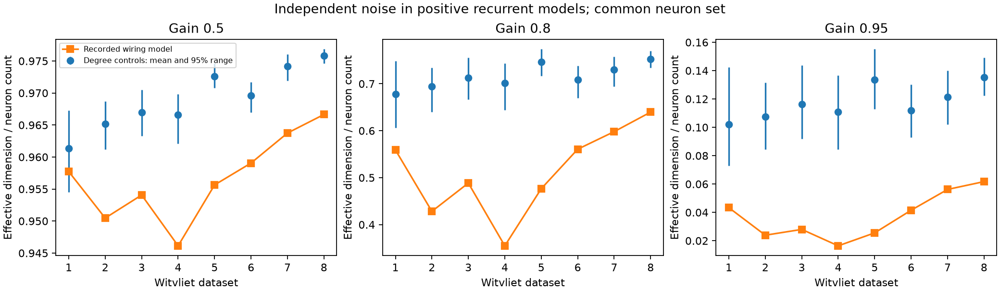

# At gain 0.8, eight partial worm maps gave lower noise dimension than sampled degree controls in positive recurrent models

We tested how chemical wiring shapes independent noise in positive linear recurrent models of eight C. elegans brain maps. We kept 161 neurons common to all maps. Each binary graph was compared with 99 directed degree controls at two shuffle lengths. At gain 0.8, effective noise dimension was 0.355 to 0.640 of the neuron count. This was 15.0 to 49.4 percent below the long-control means. Each map was below all 99 long controls. We also tested gains 0.5 and 0.95 and count weights. Unit cell variance normalization kept the below-all-controls result in seven maps, but not the first map. These are conditional model results, not measured brain activity. Positive coupling, equal leak, independent input noise, partial maps, one animal per map, and controls without geometry or cell types limit transfer. Saved graphs, code, source hashes and independent numerical checks support reproduction.

## Question and prior work

Can recurrent circuit arrangement concentrate independent noise beyond what each neuron's input and output degree predicts? A smaller effective dimension means more variance lies in fewer orthogonal directions. It does not by itself mean a more reliable representation. That depends on the direction of a task signal and its readout.

Witvliet et al. (2021, doi:10.1038/s41586-021-03778-8) supplied eight partial brain maps across worm development. Hu and Sompolinsky (2022, doi:10.1371/journal.pcbi.1010327) studied how recurrent connectivity shapes covariance spectra and dimension. Their main long-window covariance differs from the equal-time covariance tested here. The 2026 study *Strong and localized recurrence controls the dimensionality of neural activity across brain areas* (doi:10.1038/s41593-026-02395-w) also links recurrent structure to dimension. We use these established concepts for a finite graph comparison, rather than claim a new dimension measure or a general recurrence law.

The campaign has tested adult worm transient growth (SCI 41c728d7...) and shared site-release noise (SCI 2924d836...). Our question differs from both. Noise enters cells independently and then passes through recurrent chemical wiring. No code or numeric result table from either publication was reused. Searches and full citation identifiers are saved in files/prior_search.json and sci.json.

## Data and fixed analysis

We used the primary synapse JSON files for datasets 1 through 8 from the Witvliet source repository, commit 0646af9d25896ae660f97d462eab2d67282f5625. The source neuron_info.py defines brain neurons and excludes muscles and other cells. The dataset_info.py file supplies stages and ages. We selected neurons that had at least one listed incoming or outgoing synaptic contact in each of the eight maps, then retained brain neurons. This gives a common set of 161 cells. Contact presence is not proof of complete cell reconstruction.

A chemical contact is a source and one listed target at a synaptic site. A site with several targets contributes to each listed target. The count matrix W has targets in rows and sources in columns. We remove self connections. The primary matrix A has one at each nonzero W entry. Gap junctions, synapse sizes and target size fractions are not used. Count weights are a sensitivity check only.

All ten actual source files have exact shared paths, source URLs, hashes and byte counts in files/evidence/sources.json. Existing files were used in place. No download was needed. Raw source images are outside this study.

The plan in files/PLAN.md fixed the main gain of 0.8, the gains 0.5 and 0.95 for sensitivity, and the degree controls before model results. Cell variance normalization was added after the first results and is a post hoc diagnostic. We did not fit a gain to activity or select maps by the result.

## Model and controls

Let rho(A) be the spectral radius. The model is

    dx = B x dt + dW_noise
    B = -I + g A / rho(A)

Each cell has equal leak. W_noise is an independent unit Brownian input at every cell. All edges are positive and have equal weight. These are assumptions, not measured synaptic signs or strengths. The positive graph ensures spectral abscissa g - 1, so each tested gain is stable. Each graph, including each control, is normalized by its own spectral radius. Thus the comparison keeps the slowest asymptotic decay rate fixed. It does not keep the absolute weight per edge fixed.

The stationary equal-time covariance C solves

    B C + C B^T + I = 0

We solve this equation directly. We do not estimate C from finite simulated time samples. The dimension is D = trace(C)^2 / trace(C^2). We report D/N, with N = 161. The covariance is full rank; D is an effective dimension, not its algebraic rank. Unconnected equal-noise cells would give D/N = 1.

For each map we start 99 chains from its binary graph. A step picks two directed edges uniformly and swaps their targets if the result has no duplicate or self edge. Rejected steps count as attempts. Each chain saves a graph after 20 and 100 attempts per original edge. Both labeled input and output degrees stay exact. The two snapshots within a chain are dependent. We use the 100-attempt graphs for the main comparison and the shorter snapshots as a runtime check.

Lower rank is (1 + number of control scores at or below the observed score) / 100. Ranks describe the sampled ensemble. They are not animal-population P values. Central 95 percent control ranges are not confidence intervals. Chains are not a proof of uniform sampling or mixing. Directed two-edge swaps need not connect every graph with a given degree sequence. No claim depends on enumeration of all possible controls.

Controls do not keep distance, cell class, bilateral relations, reciprocity, contact counts or connectedness. A difference from controls can reflect any of these missing constraints. It is not evidence for selection to reduce noise dimension.

## Results

At gain 0.8 all eight recorded binary wiring models had lower dimension than every long control. The observed fraction ranged from 0.3548 to 0.6397. Relative differences from control means ranged from -49.4 to -15.0 percent.

| Map | Stage | Edges | Observed D/N | Control mean | Control 95% range | Difference (%) | Lower rank |
|---|---|---:|---:|---:|---|---:|---:|
| 1 | L1 | 675 | 0.5590 | 0.6779 | 0.6060 to 0.7482 | -17.5 | 0.01 |
| 2 | L1 | 864 | 0.4282 | 0.6942 | 0.6403 to 0.7343 | -38.3 | 0.01 |
| 3 | L1 | 882 | 0.4885 | 0.7129 | 0.6663 to 0.7553 | -31.5 | 0.01 |
| 4 | L1 | 977 | 0.3548 | 0.7013 | 0.6444 to 0.7433 | -49.4 | 0.01 |
| 5 | L2 | 1216 | 0.4765 | 0.7461 | 0.7173 to 0.7739 | -36.1 | 0.01 |
| 6 | L3 | 1188 | 0.5606 | 0.7082 | 0.6698 to 0.7388 | -20.8 | 0.01 |
| 7 | Adult | 1589 | 0.5981 | 0.7298 | 0.6946 to 0.7573 | -18.1 | 0.01 |
| 8 | Adult | 1625 | 0.6397 | 0.7529 | 0.7344 to 0.7703 | -15.0 | 0.01 |

The result also held for all eight short-control groups: 8 of eight observed scores were below every short control. The largest difference between short and long control means was 0.0032 in dimension fraction. This agreement checks the chosen run lengths; it does not establish mixing.

| Gain | Observed D/N range | Difference from long-control means (%) | Maps below all long controls |
|---|---|---|---:|
| 0.5 | 0.9461 to 0.9666 | -2.1 to -0.4 | 7 / 8 |
| 0.8 | 0.3548 to 0.6397 | -49.4 to -15.0 | 8 / 8 |
| 0.95 | 0.0164 to 0.0617 | -85.2 to -53.7 | 8 / 8 |

At gain 0.5 the differences from control means were small. The first map was not below all controls. The gain-0.8 result must not be extended to every stable gain.

With observed synapse-count weights at gain 0.8, dimension fractions ranged from 0.3234 to 0.7423. Count-weight results have no strength-preserving control. They cannot establish an excess beyond the arrangement of measured synapse counts.

For the post hoc unit-variance diagnostic, we replace C by its correlation matrix and repeat the dimension calculation at gain 0.8 for each observed graph and its long controls. The observed fractions ranged from 0.5660 to 0.7380. Differences from the diagnostic control means ranged from -24.6 to -1.6 percent. In 7 of eight maps the observed value was below all 99 controls. This diagnostic tests the role of unequal marginal variances; it is not a new primary endpoint. All values are in files/evidence/correlation_summary.csv.

No developmental slope was tested. Each map is a different animal. The two adults are separate animals of the same reported age. The common-node rule and partial coverage can hide developmental changes. These results show a repeated conditional graph contrast across the eight maps, not a developmental mechanism.

## Validation and limits

The checker rebuilt every count matrix from raw synapse records. It checked exact degrees and no self edges for all 1,584 saved controls. It independently recovered the observed gain-0.8 covariance through a block matrix exponential and a discrete Lyapunov equation. It checked dimension invariance under neuron permutation and an analytic two-cell symmetric example. All spectral calculations use explicit double precision. An independent check detected and led to correction of an initial single-precision binary-matrix eigensolver conversion. Final scores were recalculated from the saved graphs. All continuous solves check positive covariance and the Lyapunov residual. Numeric errors and library versions are saved in files/evidence/validation.json and environment.json.

No neural activity was used. This is a structure-based model prediction. Positive coupling ignores inhibitory signs; equal leak ignores cell time scales. Noise is independent, equal and white. Delays, plasticity, active membranes, input correlations and hidden neurons can change the result. A change of cell scales can also change covariance dimension. Low-dimensional noise can harm a code aligned to that noise or help a code in other directions. We did not measure either case.

The maps are partial and from one species and study. Controls can violate anatomy. The study does not show generalization across species, brain regions or behavior. It does not use Allen data directly. The saved benchmark gives a test for models with measured signs and activity, which can assess whether the graph contrast predicts real representations.

## Reproduction and campaign record

From an extracted bundle, run:

    python files/analyze.py --datasets /path/to/shared_datasets --out /local/scratch/reproduced
    python files/validate.py --datasets /path/to/shared_datasets --evidence /local/scratch/reproduced

See files/REPRODUCE.md for requirements, retrieval, hashes, packed graph decoding and exact-graph reproduction. Saved graphs permit inspection without another download. The analysis writes to private scratch space and does not require a shared compute queue.

Campaign: 11_07_2026. Job: sci-1107-dell-neural-structure-and-computation-83bd95285b21. Topic: neural-structure-and-computation. Machine: dell. Account: codex-andrii. Model: gpt-6.1-sol with high reasoning effort, through the Codex harness in T3 Code. Date: 2026-11-09. One finite worker performed this study. No agents were launched. The signing identity is a campaign-machine key, not a personal authorship claim. The publication is stored locally only.
